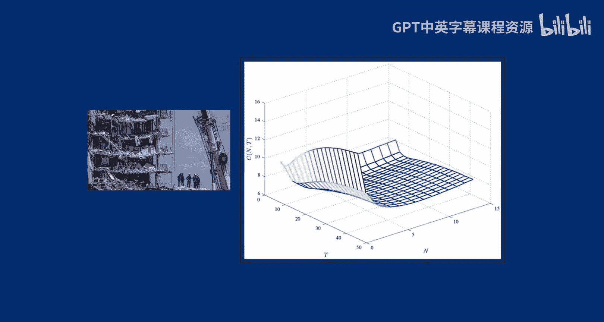

#  012：几何模型构建方法 🏗️

在本节课中，我们将学习一种用于描述系统随时间缓慢失效行为的数学模型——几何过程。我们将重点探讨一种特殊的更新几何过程模型，它如何帮助我们制定预防性维护计划，以延长工程结构（如建筑物）的使用寿命和安全性。

上一节我们讨论了决策中的不确定性，本节中我们来看看如何为潜在的故障风险建立数学模型。

## 几何过程模型

一种描述事物随时间缓慢恶化行为的模型是几何过程。接下来我们将讨论一种特殊的模型——更新几何过程，它专门用于模拟故障。

## 预防性维护的类型

在更新几何过程的框架下，存在两种可以执行的预防性维护。

以下是两种主要的预防性维护类型：

*   **恢复性维护**：一种可以将系统状态恢复到接近全新的维护。
*   **衰减性维护**：一种作为衰减过程一部分的维护，其效果不如前者彻底。

第一种维护成本较低，可以在一个运行周期内进行。第二种维护则更为昂贵。

## 模型的实用性与局限性

这只是一个特定的模型。需要立即补充的是，和任何模型一样，它几乎肯定是“错误”的，即无法完全精确地反映现实。但它能让你感受到，特定的预防性维护计划如何能够延长使用寿命，从而提高特定工程环境（如瑟夫赛德公寓楼那样的环境）的安全性。

显然，建立这样的模型是困难的。你并不总是知道故障率，也不知道最佳的维护计划。但在某些类别的模型中，我们可以论证出一个最优的维护计划。我们即将探讨的正是这样一个例子。

在接下来的部分，在特定类别的模型中，我们至少可以为维护计划论证出一个最优方案，从而延长建筑物的总使用寿命成本。因此，这对人们来说是一个真正的优势。


现在，我强调过几乎所有模型都是“错误”的，但有些确实非常有用。这是一句来自统计学家乔治·博克斯的重要论断。

## 模型的应用：从工厂到建筑

对于像公寓楼倒塌这样的事件，我们如何预防？我们如何防止一个结构恶化？这与沃尔德序贯抽样中的思想再次非常相似，它也适用于工厂生产：如何防止特定工厂生产出有缺陷的部件？如何防止运输问题？如何防止坏事发生？

解决这个问题的一个模型是几何更新过程。我认为这是一个非常好的模型，因为它在概念上非常简单。

## 几何更新过程详解

你可以看到，我们有从第一到第n个更新阶段。这里的随机变量 **Y** 代表了随时间推移的恶化过程。当我们从阶段(1)到阶段(2)，再到阶段(n)时，我们正在经历不同的更新阶段。

在每个阶段内，你都有一个 **M₁, M₂, ..., Mₙ**。如下列公式所示，这些 **M** 值设定了每个“小周期”的长度。我们不知道小 **mₙ** 具体有多大，但我们知道它存在。

```
M₁, M₂, ..., Mₙ  # 每个更新阶段内的小周期长度
```

这些 **M** 值设定了我们的预防性维护周期。然后我们还有由 **N** 设定的外部模型，它设定了总时间。所以我们有 **N** 个更新阶段。在这个模型中，小 **m** 再次表示我们在两次维护之间进行的时间长度。

我们可以稍微改变一下符号，现在用 **X** 代替 **Y**，我们可以考虑从第一个维修周期到第 **n** 个维修周期。在第一个维修周期中，我们在每个小时间窗口的末尾进行预防性维护。你可以看到图中有一个空心圆点，你可以认为这些维护点是以某种方式设定或定义的。无论如何，我们有一系列能将系统恢复到正常状态的维修，然后我们重复这个过程 **N** 次。

我们想要考虑建筑物、桥梁或任何物品的使用寿命。因此，我们现在可以做的是优化成本。我们可以考虑预防性维护的成本，也可以考虑在每个主要维修周期结束时的成本。这里我们有 **N** 个这样的大周期。

因此，你可以得到总维修次数，可以将其视为 **N-1** 次维修，最后一次是更换。但无论如何，我们都有成本。这里的大变量是这些小 **mᵢ**。

## 成本优化

我们可以考虑一个期望值，小 **mᵢ** 由某个概率分布函数设定。这就是为什么它被称为几何模型，因为我们试图定义的期望值将被定义为 **m × p**，其中 **p** 是一个关于 **mᵢ**（称为 **m**）在所有可能取值上的分布函数。

因此，每个周期都定义了一个成本，这也体现在最后这张图中。这是一个等高线类型的图，Y轴是成本。我们考虑的是这些主要维修周期的总数 **N**，以及 **T**，即这些预防性维护之间的时间长度。



所以，如果我们再次考虑瑟夫赛德公寓的例子，并试图防止类似我们想避免的场景中的倒塌，我们可以代入不同的函数。例如，这是小 **mᵢ**（即某物失效所需时间）的 **E** 分布函数，我们将得到 **N** 和 **T** 的不同估计值。但显然，如果我们选择 **N** 和 **T** 的值，我们可以调整成本，而这正是我们想要做的——进行优化。

## 总结与联系

我希望我已经让你对如何制定最优维护计划，以及这如何对桥梁或建筑物等事物的使用寿命产生重大影响有了一些体会。显然，再次强调，制定这些计划是困难的，为这些情况找到正确的模型也是困难的。

但事实是，应该设定某种维护计划，并且它能够对总使用寿命以及结构的安全性产生影响，我认为这真的非常有趣。这再次与沃尔德序贯抽样和假设检验紧密相连，这些都是我们在“时间中的决策”和“最佳利用数据”中探讨的所有理念。

本节课中，我们一起学习了如何利用几何更新过程模型来为系统故障建模，并基于此制定预防性维护策略。我们了解了模型的构成、成本优化的思路，以及该模型在延长工程结构寿命和保障安全方面的实际意义。