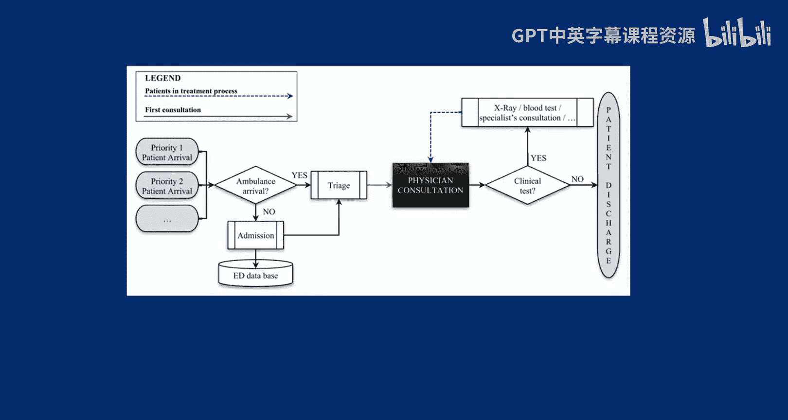
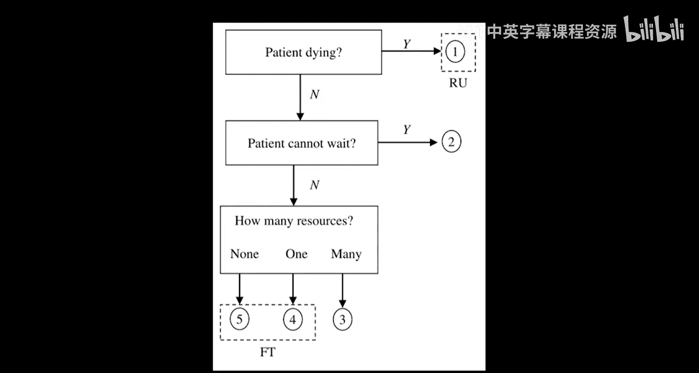

#  014：马尔可夫决策过程与急诊科资源分配优化 🏥

在本节课中，我们将要学习**马尔可夫决策过程**。这是一种非常有趣的模型，可以看作是我们在本课程中学习内容的一个顶点。与之前无法改变的连续事件序列不同，在马尔可夫决策过程中，你可以在事件序列中进行调整和改变。这些调整使你能够优化整个过程，从而在原则上控制过程，以获得特定的结果。这意味着，即使在存在不确定性和意外事件的情况下，你也可以确保你的过程或事件序列按照你期望的方式进行。在马尔可夫模型的框架下，这最容易实现。在这种模型中，你只需要根据当前所处的特定状态来做出调整，以进入下一个状态。在极限情况下，这就进入了所谓的**强化学习**领域。你可以将其简单地理解为一系列我们正在改变的状态，在每个节点上，我们都有奖励或惩罚。我们需要思考如何根据这些奖励来调整我们的连续决策，最终目标是优化我们的总奖励。

本周我们将从讨论急诊室开始，思考如何优化其人员配置。这有望成为一个有趣的例子，展示马尔可夫决策过程如何帮助某一类事务流程运行得更顺畅。

## 急诊科资源分配的挑战

想象一下你正在管理一个急诊科，这绝非易事。患者带着各种不同的病情、在不同的时间前来就诊，其紧急程度也各不相同。患者是否濒临死亡？患者能否等待？你拥有多少资源？你能用这些资源做什么？因此，你必须进行分诊，必须在患者到来时处理他们，并思考如何帮助他们。

在上图中，我们有“快速通道”，可以评估我们拥有的快速通道资源；还有“复苏单元”，用于处理濒危患者。这些是我们能做的事情。但对于我们当前的课程而言，真正需要思考的是这些决策块以及从中做出的决策。我们根据眼前的数据做出决策：患者的状况如何？我们有多少资源？

## 优化分诊系统：一个研究案例

本周我们将讨论的一篇论文试图建立一个更好的分诊系统。他们的做法是，也许我们可以将患者分为四类：紧急且简单、紧急且复杂、非紧急但复杂、非紧急且简单。他们称之为“复杂性增强分诊”，并将其作为提升患者安全和运营效率的工具。这篇论文发表于2014年的一份知名期刊。

本质上，患者在一天中的不同时间前来就诊，你必须考虑人员配置。当他们到来时，他们会在候诊室等待，会进行某种互动，你会进行检查，并决定下一步做什么。同样，你是在**时间中做出决策**。因此，你有到达、分诊、候诊（第一阶段和第二阶段）、治疗、检查以及处置。这些就是**马尔可夫决策过程**：你有一个环境、一个智能体、一系列动作、状态和奖励。我们试图做的，同样是优化这个过程。这不是一个没有状态和奖励行为的简单箭头。动作与最终的奖励紧密相连。

## 决策过程的核心要素

在所有这些情况下，我们都可以这样思考：我们面对一个情境，根据我们的环境（例如，在本例中是根据我们的资源）做出决策，然后我们尝试优化，努力使情况尽可能有利。

以下是另一篇探讨此问题的论文，同样是关于分诊。患者到来，经过初次和二次咨询，在候诊室等待，最终在右侧出院，期间可能进行临床检查。本质上，这同样是我们在分诊中讨论的那种**连续设计决策**。在这个具体案例中，我们有高优先级患者、中优先级患者等。我们也可以将其视为一种队列，这本质上是一种马尔可夫连续设计流程。

## 将问题建模为队列系统

患者以一定的速率 **λ**（可能是一个泊松过程）到达，被放入一个队列。这个队列以另一个速率进入医生处理环节，我们称之为服务速率 **μ**。然后我们还有反馈，例如诊断测试的反馈，这非常重要。这是第二篇论文《急诊科患者管理中的累积优先级队列与纯优先级队列》的核心论点。其论点本质上也是一个马尔可夫决策过程：定义了特定状态，决策基于我们在这些状态中所处的位置。这一点再次显得重要，因为我们正试图优化我们的决策。

回到我们的第一张图：我们能帮助濒死的患者吗？我们能帮助无法等待的患者吗？我们如何在时间中最好地做出一系列连续的决策？

## 总结与应用意义

希望你现在对如何改善急诊科的患者流程，或者如何优化任何需要做出连续决策的队列系统，有了更好的理解。这是将20世纪40年代沃尔的核心理念应用于现代现实生活和实践的一个例子。

所有这些事件都有一个共同的思想脉络：我们拥有某种数据（可能由模型或概率分布提供信息），我们试图基于这些数据做出决策。这又回到了我们本课程的标题——**在时间中做出决策，并充分利用你的数据**。这些思想对我们日常世界的许多方面都至关重要。

我们刚刚讨论的例子，可能对部分同学有趣，未必对所有同学都有趣，但我认为它仍然非常有趣：我们如何着手处理一些本质上复杂、棘手的事情，并试图使其顺畅，并尽可能减少棘手程度？这再次体现在急诊科以及患者如何被分诊或引导通过这些系统中。因此，作为马尔可夫决策过程的一个模型，患者到来（事件），做出决策，我们试图优化某些目标。我认为这是进入我们本周主题——**马尔可夫决策过程**——的一个很好的切入点。

本节课中，我们一起学习了马尔可夫决策过程的基本概念，并通过急诊科资源分配和分诊优化的具体案例，理解了如何将连续的决策问题建模为状态、动作和奖励的序列，并以此进行优化。这为我们利用数据在动态环境中做出更好的序列决策提供了强大的框架。