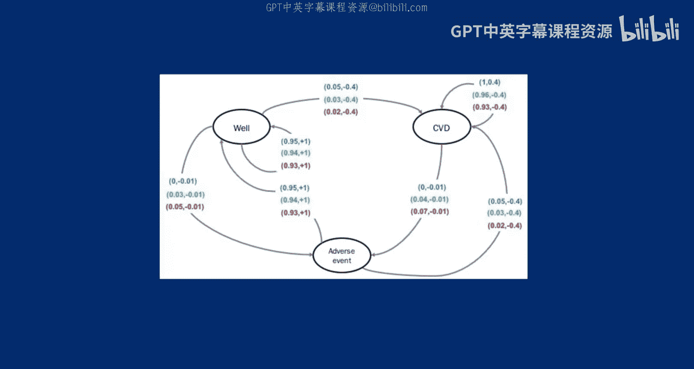

#  015：药物治疗方案优化策略 💊

在本节课中，我们将学习如何将马尔可夫决策过程应用于一个重要的现实问题：高血压的药物治疗方案优化。这是一个在国家层面虽有指导原则，但通过建模可以更理性地进行个性化决策的典型案例。

## 概述：从指南到个性化决策

高血压治疗是一个重要且复杂的问题。虽然存在国家级的治疗指南，但将其构建为一个马尔可夫决策过程问题，可以更合理地定义状态转移概率，并最终实现血压控制的个性化优化目标。

## 马尔可夫决策过程在医疗中的应用

上一节我们介绍了马尔可夫决策过程的基本概念，本节中我们来看看它在临床决策中的具体应用。

本质上，我们可以将高血压治疗视为一个序贯决策问题。患者控制血压的能力是**状态**，医生开具的药物是**动作**，而血压是否得到控制则是**奖励**。这个过程是许多马尔可夫决策过程思想的原型：我们有一系列被访问的、带有不同奖励的状态，我们的目标是优化最终结果——帮助患者控制血压。

想象你是一名医生，试图降低患者心脏病发作的风险，核心任务之一就是控制其收缩压。这本身极具挑战性，但一种思考方式就是将其视为一个马尔可夫决策过程。患者可能处于不同状态（如伴有不良反应、患有心血管疾病等），根据状态和预期奖励，医生可以采取不同的**动作**：停止用药、不干预、更换药物、增加剂量等。在这些不同马尔可夫状态之间转移所获得的奖励，最终决定了药物治疗控制血压的效果。

## 与传统指南的对比

以下是当前两种主要的决策方法（JNC8指南及其强化版本）与基于马尔可夫决策过程的动态模型之间的对比思路：

*   **JNC8 / 强化JNC8**：这是当前基于流程图的静态决策方法。
*   **动态马尔可夫决策过程模型**：这种基于模型的方法，原则上能够推广并应用于个体层面。

基于马尔可夫决策过程的模型可以推荐具体的药物（如半剂量或全剂量）及其组合。高血压治疗通常需要联合用药，具体使用一种、两种、三种还是四种药物，取决于患者的个体反应。医生的长期目标就是通过优化这些选择，帮助患者控制血压。

## 模型效果验证

《英国医学杂志》上的一篇论文对此进行了测试，评估了这种个性化方法相较于JNC8标准方案的效果。他们的结论是，马尔可夫决策过程模型表现得相当出色。

下图展示了基于马尔可夫决策过程的模型（红色）与两种JNC8方案在不同年龄和性别患者中的血压控制效果对比。横轴从左到右为从18岁到60岁以上的不同年龄段。

尽管细节复杂，但总体来看，在许多情况下，马尔可夫决策过程模型的表现与现有方案相当甚至更好。这表明，此类临床决策确实可以通过我们讨论的序贯决策模型来制定。

## 个性化决策实例

例如，一位具有特定人口统计学特征的患者就诊。JNC8指南可能建议“不治疗”，但马尔可夫决策过程模型根据其特征空间，可能会个性化地推荐“使用β受体阻滞剂”。这强调了模型对个体特征的直接依赖性。

## 核心优化公式

此方法的核心思想基于优化马尔可夫决策过程的标准方程，其目标是找到最优策略 **π**：

**目标：最大化 E[ Σ (λ^t * R(S_t, A_t)) ]**

其中：
*   **S_t** 代表时间t时的状态（如血压控制水平）。
*   **A_t** 代表在状态S_t下采取的动作（如使用何种药物及剂量）。
*   **R(S_t, A_t)** 代表在状态S_t下采取动作A_t获得的即时奖励（如血压是否达标）。
*   **λ** 是折扣因子，用于权衡近期与远期奖励。
*   **π** 是从状态到动作的映射策略。

我们的目标是通过选择随时间施加的适当动作（即药物），来优化像收缩压这样的长期结果。这回到了最初的概念：我们应该能够优化个体的治疗方案，控制和优化状态转移，最终目标是尽可能让患者长期保持在“健康”状态。对于心血管疾病而言，这通常意味着控制好血压。

## 总结与展望

本节课中，我们一起学习了马尔可夫决策过程在临床场景（特别是高血压药物治疗优化）中的应用。这只是众多应用之一。

随着课程进入第五周，也是本学期的最后阶段，希望大家能够发挥想象力，思考如何利用序贯形式的数据并据此采取行动。考虑如何通过将数据置于**多臂老虎机**、**马尔可夫模型**或**汤普森采样**的框架中，来改进决策、实现优化。过去几周我们所讨论的许多经验教训，其应用范围远不止于已提及的用例。正在听课的各位，未来很可能为这类方法的进一步发展做出贡献。

