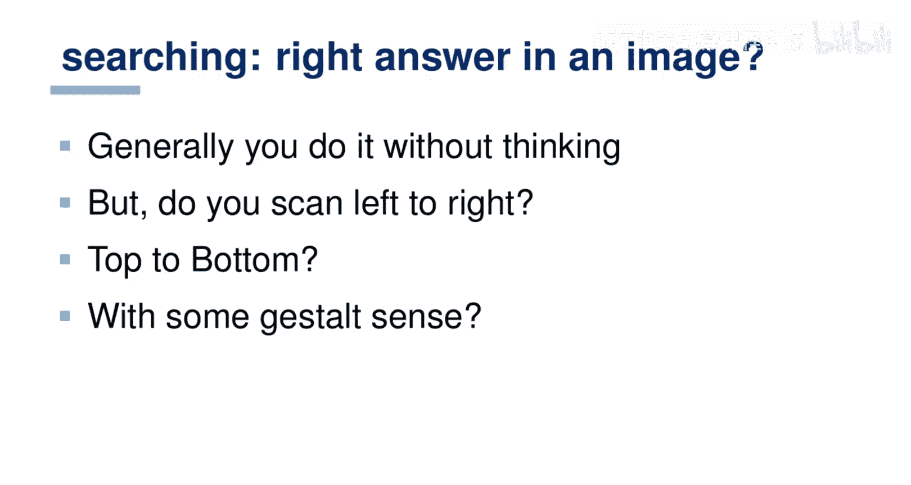
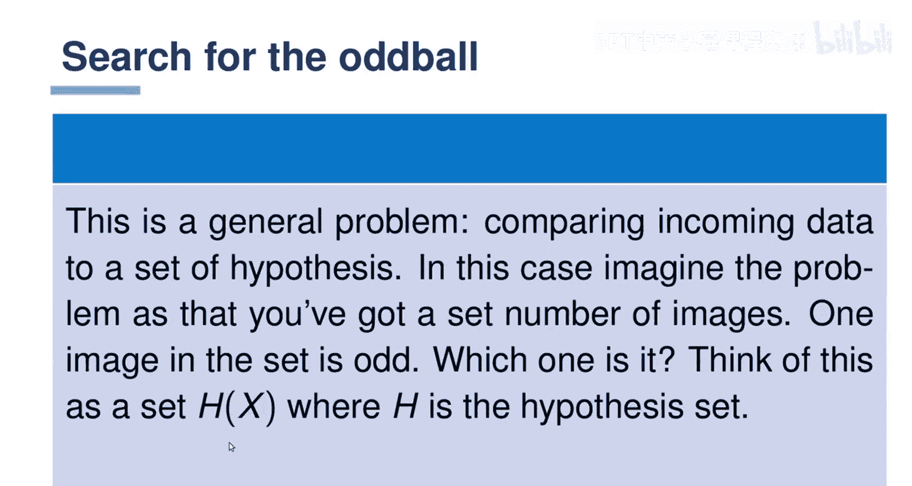
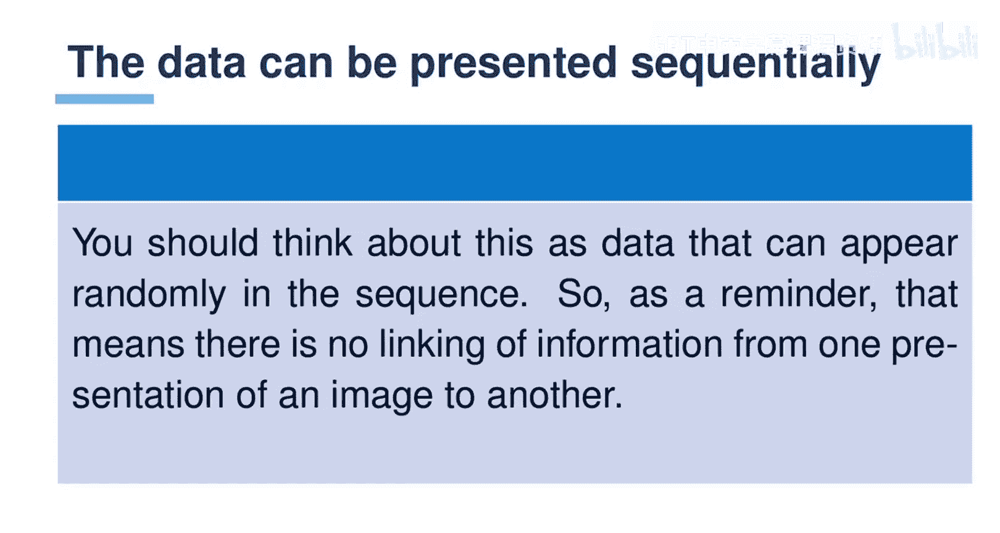
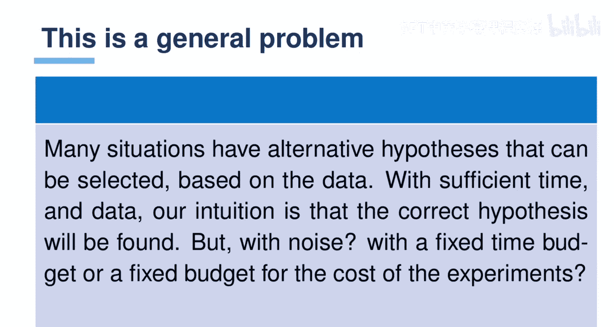
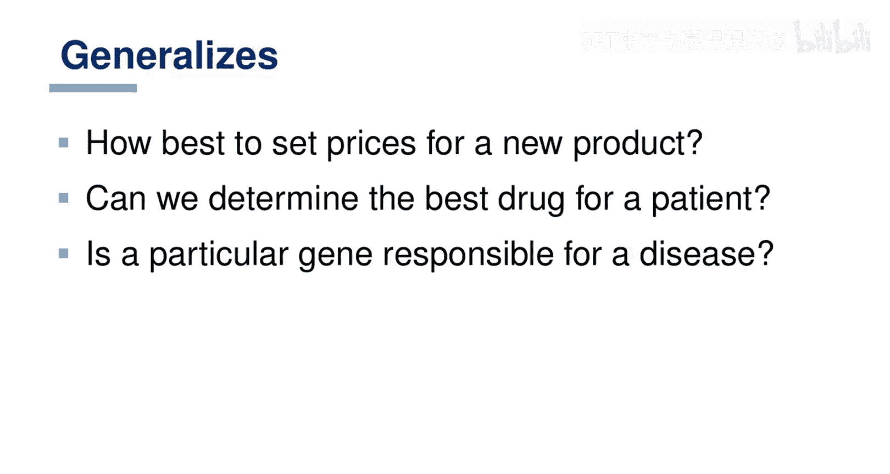

#  016：视觉网格图像中的异常识别方法 👁️

在本节课中，我们将学习如何在一个图像集合中快速识别出与众不同的那一个。这是一个关于**序列假设检验**的生动例子，也是数据科学中处理时序或序列数据决策问题的核心。

## 概述：从视觉搜索到序列假设检验

我们从一个简单的问题开始：你能在一组图像中找出“异类”吗？这看似是一个视觉游戏，但它能迅速推广到更广泛的数据科学问题中。本质上，你在进行一种**假设检验**：在多个可能的假设（“哪张图是异常的？”）中，根据依次观察到的数据，找出最可能正确的那个。

上一节我们介绍了决策的背景，本节中我们来看看这个具体的视觉搜索案例，并理解其背后的算法思想。

## 视觉搜索：一个引导性示例

想象你面前有一张由许多小图像组成的网格图。你知道其中有一张图与其他图不同。你的任务是找出它。你会怎么做？是左右扫描，还是上下查看？或许你的视觉系统会不假思索地“弹出”那个目标。

这个过程就是**序列搜索**。数据（图像）一个接一个（或以某种顺序）呈现在你面前，你需要基于这些陆续到来的信息做出判断：哪一个是“异类”？这里的核心挑战是：如何在最短的时间内，或使用最少的观察次数，以最高的准确性找到目标？

## 问题形式化：假设与数据

我们可以将这个问题形式化。假设我们有一个包含 *N* 张图像的集合：

`X = {image_1, image_2, ..., image_N}`

其中，有且仅有一张图像是“异常”的。那么，我们就有了 *N* 个可能的假设：

*   **H₁**: 异常是 image_1
*   **H₂**: 异常是 image_2
*   ...
*   **H_N**: 异常是 image_N

数据以序列方式到来。每次观察，我们可能获得关于某张图像的部分信息（例如，它的颜色、形状）。关键点在于：**每次观察被认为是独立地从某个概率分布中抽取的**。观察之间没有必然的联系，就像你依次独立地看每一张小图一样。

我们的目标是：设计一个策略，通过分析这些**序列到达的、独立的数据**，来接受其中一个假设（即找出异常图像）。

## 研究实例：猴子与人类的视觉处理

为了深入理解这个问题，我们参考一项2010年卡内基梅隆大学和匹兹堡大学的联合研究。该研究比较了猴子和人类在完成此类视觉搜索任务时的神经机制和行为表现。

研究人员设计了多组图像对，要求受试者找出“异类”。以下是他们使用的部分图像集示例：

*   **集合1（颜色/方向）**：大多数图案是深色在上、浅色在下，但有一个是反的。你能多快找到它？
*   **集合2（距离）**：图案元素间的距离不同（近、中、远）。
*   **集合3（大小）**：图案本身的尺寸不同（小、中、大）。
*   **集合5（长宽比）**：相同“S”形图案，但形状被拉高、压扁或保持方形。

对于人类受试者，任务很简单：图像网格出现在屏幕上，他们需要用左手或右手食指按键，指出异常图像在左侧还是右侧。研究人员记录他们的**反应时间**。

对于猴子，研究人员通过电极记录其大脑视觉皮层神经元的**放电频率**。他们观察当呈现不同图像（例如，正常vs异常图案）时，特定神经元的反应强度。

## 核心发现与关联

研究的关键在于比较神经活动与行为反应。他们提出了一个问题：猴子神经元对两种图案的**放电频率差异**，是否能预测人类区分这两种图案所需的**反应时间**？

以下是研究发现的部分关联：

上图展示了不同图像特征对（对应之前提到的集合）下，猴子神经反应差异（横轴）与人类行为反应时间（纵轴）的关系。趋势表明，某些特征（如颜色、明显朝向差异）能引起强烈的神经反应差异，人类也能极快地识别（反应时间短）。而另一些特征（如细微的距离或长宽比变化）引发的神经差异较小，人类识别起来也更慢。

这揭示了视觉搜索效率的底层机制：**某些特征在神经处理层面更“突出”，使得假设检验的过程更快，几乎是不假思索的**。

## 从视觉到通用数据科学问题

这个视觉搜索的例子完美地诠释了**序列假设检验**的通用性。一旦掌握了这个框架，我们可以将其应用到无数领域：

1.  **产品定价**：我为新产品设定一系列可能的价格（假设）。每次以一个价格上市（序列测试），观察市场需求（数据）。目标是找到能最大化利润的最佳价格（接受正确假设）。
2.  **医疗诊断**：面对一位患者，我有几种可能的疾病假设（如A病、B病）。我依次进行不同的检查（序列收集数据），根据结果逐步排除或确认，以找到最可能的病因并给出最佳治疗方案。
3.  **基因研究**：怀疑多个基因中有一个与某种疾病相关。我通过实验依次研究这些基因（序列实验），寻找与疾病表型关联最强的证据。

在所有这些情形中，我们都面临共同挑战：数据依次到来、观察可能有成本或时间限制、需要平衡搜索速度与准确性。

## 总结

本节课中，我们一起学习了如何通过一个生动的视觉搜索游戏来理解**序列假设检验**的核心思想。我们了解到：

*   问题可以形式化为从一组假设中，根据序列到达的独立数据，找出最可能的一个。
*   视觉搜索的效率与底层神经处理对特征差异的敏感度有关。
*   这一框架具有极强的通用性，可广泛应用于定价、医疗、科研等需要**在时间序列中做出最优决策**的领域。

这个例子为我们打开了理解动态数据环境中决策问题的大门。在接下来的章节中，我们将深入探讨实现这种序列搜索的具体算法和统计工具。