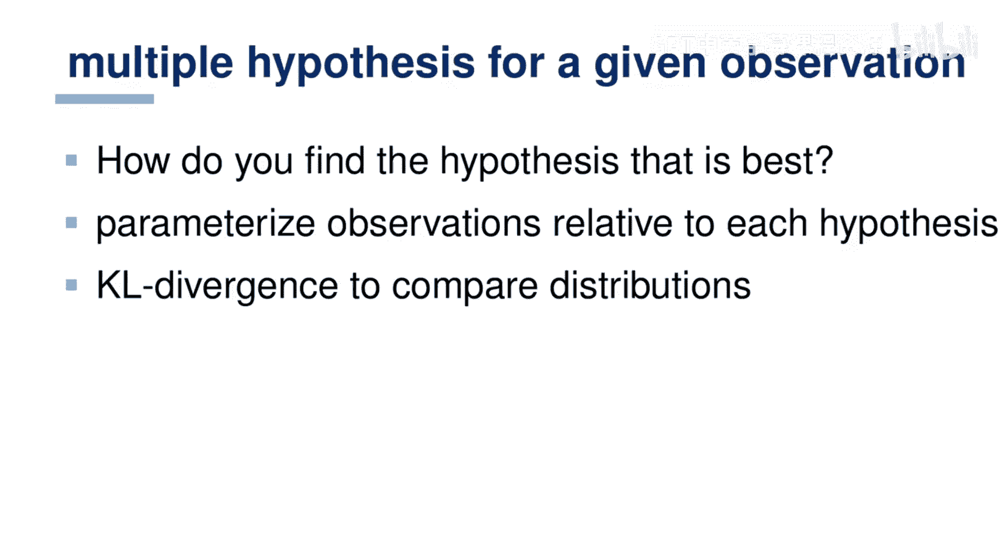
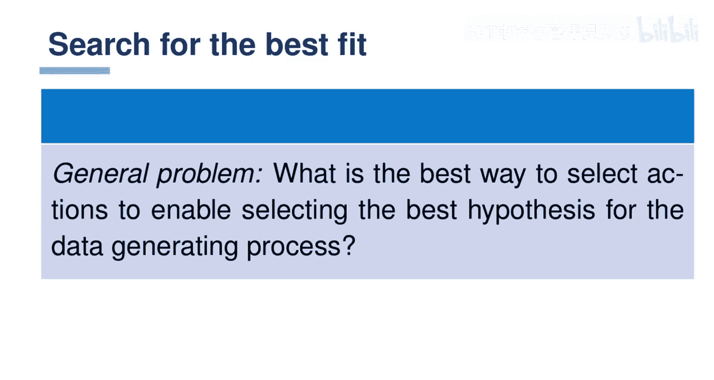
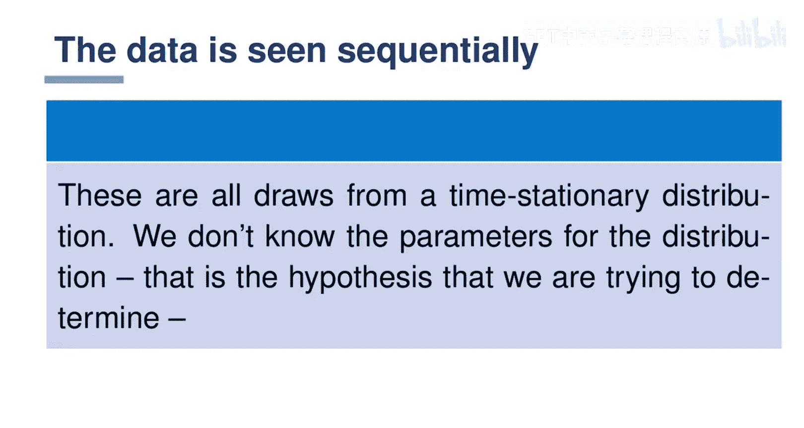
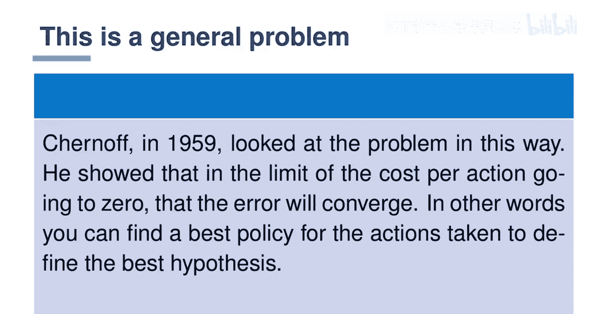
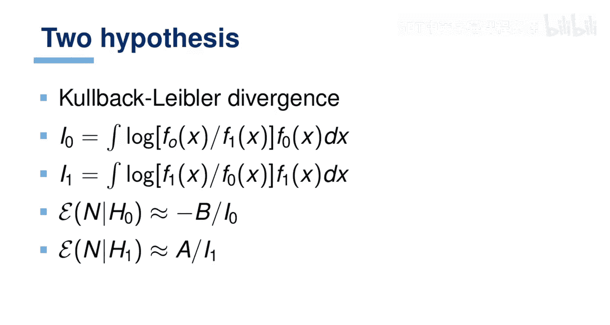
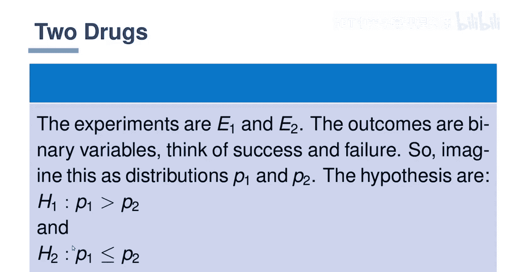
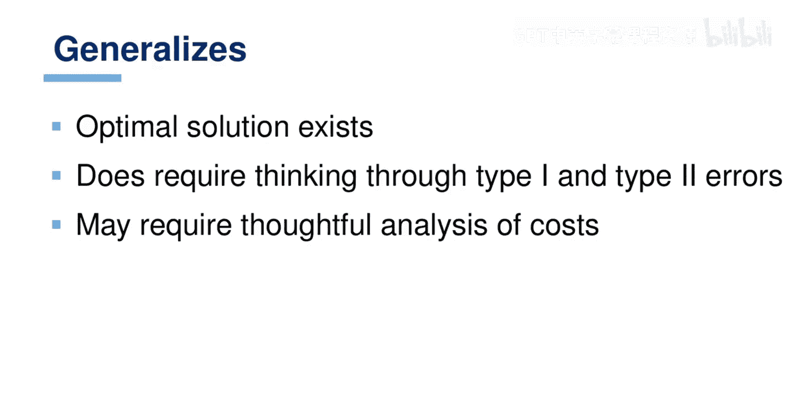

#  018：切尔诺夫1959年论文精要解析 📊

在本节课中，我们将要学习切尔诺夫于1959年发表的另一篇杰出论文。这篇论文与1945年的贡献相似，是我们“有效利用数据进行时间决策”系列课程的核心基础。我们将解析其核心思想、数学框架及其对当代研究的影响。

上一节我们介绍了序列决策的基本概念，本节中我们来看看切尔诺夫如何将这一思想形式化，并解决从多个假设中寻找最佳拟合的问题。

## 论文概述与核心问题

这篇论文题为《实验的序列设计》，是另一篇奠基性文献。其核心思想是：对于一个给定的观测数据，我们拥有多个假设，如何从中找到最能概括数据特征的最佳假设？

想象我们再次拥有来自某个分布的平稳数据。为便于理解，你可以将数据生成过程视为从一个定义良好、参数化的概率密度函数中抽取样本。问题在于：描述该概率密度函数的参数是什么？数据生成过程背后的参数是什么？这些观测值相对于每个假设都是参数化的。

另一个关键点是，我们使用Kullback-Leibler散度来比较不同的分布。我们通过这个散度度量来思考这些分布彼此之间的差异。

因此，我们的核心问题是寻找最佳拟合。这最终驱动着我们如何选择最佳行动。我们将其视为一种主动搜索，旨在为数据生成过程选择最佳假设。我们如何优化这个过程？如何思考它？

## 问题设定与基本假设

再次提醒，我们的数据是序列出现的，它们都是从平稳分布中抽取的。我们目前不考虑分布随时间变化的更复杂问题，也不考虑时间上相关的数据。我们考虑的是从平稳分布中独立抽取的数据。

我们不知道这个分布的参数，但知道它们所属的集合，因此我们可以定义我们的假设集。但我们并不直接知道数据生成过程是什么。这正是我们试图定义的假设。我们试图确定最能描述我们所生成数据的最佳假设。

切尔诺夫在1959年以一种巧妙的方式研究了这个问题，其思路超越了许多当代研究问题。他展示了一个在特定极限下成立的数学结果。像许多纯数学结果一样，它很吸引人，但并未直接告诉我们如何设计算法或如何应用于特定问题。

本质上，他证明了在每次行动成本趋于零的极限下，误差将会收敛。换句话说，你可以找到这些行动的最佳策略，从而找到定义数据最佳拟合的最佳假设。因此，你应该思考的是：在我们每次实验的成本趋于零的极限情况下，存在一个最优解，可以证明我们能够在合理时间内收敛到期望的误差容忍度。

## 核心数学要素

从数学上讲，这篇1959年的论文《实验的序列设计》需要你思考以下几个要素：
*   你对**第一类错误**和**第二类错误**的容忍度。这些是传统假设检验的概念。第一类错误是当原假设为真时错误地拒绝它；第二类错误是当原假设为假时错误地接受它。
*   **似然比检验**。我们在沃尔德的工作中遇到过，在本课程中会再次使用它。
*   **K-L散度**。

切尔诺夫方法的核心要素，本质上与沃尔德在1945年提出的问题相同：我们面对的是序列数据（用当代语言说是流数据），我们可以选择继续采样，或者停止。如果我们停止，是因为我们要么接受要么拒绝假设（可以认为是H0对H1，备择假设可能是H1）。我们接受或拒绝H0（通常称为原假设）。H1通常称为备择假设。我们经常希望拒绝H0，因为这通常意味着你发现了新东西，即H1能更好地解释数据。

## 二元假设检验框架

在这篇论文中，切尔诺夫从两个假设开始阐述，这在数学中很常见：先从两个开始，然后可能扩展到三个，最后推广到一般情况。我们从两个开始，并想象它可以推广到更多。

我们想象分布的参数。将它们视为单参数分布：θ = θ0 或 θ = θ1。为了简化数学，你可以将它们视为具有单个参数θ0和θ1的二项分布。

然后我们可以定义这些假设的概率密度函数：f(x)。我们称之为f1(x)或f2(x)。这里的f1和f2对应两个不同的假设H0和H1。注意符号略有变化，我们从0和1变成了1和2，但我们仍然只考虑两个假设及其定义它们的分布。

接着，我们可以定义Sn。这里的Sn是我们似然比检验log(f1/f0)的和。现在我们回到了正确的表述：F0和F1代表我们的原假设和备择假设，我们取它们比值的对数。随着数据到来，我们对其求和。你可以将其视为最终是关于Sn收敛性的问题。

对于那些学过概率论的人，我们基本上是在处理随机变量之和，但这里是一个似然比检验，即取log(f1/f0)的和。我们询问关于Sn可以定义什么样的收敛性质。换句话说，它是否收敛到某个我们可以确信F1正确或F0正确的状态？我们如何定义向某个特定假设的收敛？这最终是切尔诺夫提出的问题。

## 决策规则与风险函数

回到沃尔德的方法，我们定义了A和B，它们取决于我们的第一类和第二类错误，但基本上旨在决定我们是否停止，以及是接受H0还是拒绝H0。

以下是决策规则：
*   如果我们的Sn ≥ A，我们将拒绝H0。
*   如果我们的Sn ≤ B，我们将接受H0。

因此，A和B（最终将是n的函数）是我们用来决定是继续采样还是停止采样的边界。

切尔诺夫提出的另一个很好的问题（尤其是在当今时代非常值得考虑）是：这些观测可能伴随着成本。如果你想象每次实验都非易事，那么每次收集数据都可能产生成本。因此，无论数据xi如何到来，都需要考虑收集它的成本，并将其与第一类和第二类错误一起纳入考量。

在切尔诺夫的公式中，我们定义：
*   R0：错误拒绝H0的风险。
*   R1：错误接受H1（当其为假时）的风险。

我们可以用误差来考虑相关风险：
*   大写R0 = r0 × α + C × E[N | H0]
*   大写R1 = r1 × β + C × E[N | H1]

其中，α和β是错误类型的概率，这实际上正是沃尔德提出的。我们有一个先验概率W，与备择假设H1相关联。因此，我们实际上是在尝试最小化与R0和R1相关的加权风险。

## 成本趋于零的极限与信息度量

在切尔诺夫的思考方式中，如果我们的成本趋近于0，那么我们可以用A和B来表示α和β，从而得到清晰的表达式，让我们可以根据第一类和第二类错误求解A和B。

但我们可以更进一步，用K-L散度来思考。我们可以写出I0和I1。这两个信息度量是不对称的，取决于我是在f0密度下积分还是在f1密度下积分，取的是似然比检验的对数（log(f0/f1)）。对于I0，我相对于f0来考虑；对于I1，我相对于f1来考虑。这样我就有了两个不同的信息度量来描述这些密度的比较。

然后，我可以将我的成本与I0和I1联系起来考虑。我可以写出成本与误差的平衡关系，大致形式为：成本与 (N给定H0下的期望 - B)/I0 和 A/I1 相关。这样，我们就有了边界A、B以及我们的信息度量。这是一个非常好的理解方式。

## 推广到多臂实验（如药物试验）

我们可以快速将其推广到类似两种药物比较的场景。假设我们有实验E1和E2。现在场景更临床化，可能不仅仅是视觉测试。我们试图理解哪种药物更好。现在我们有了不同的结果，不再是0和1，而是1和2。请注意符号变化。

结果通常是二元变量（成功或失败），这简化了数学。现实显然可能复杂得多。现在我们有两个分布P1和P2。假设H1：P1 > P2；假设H2：P1 ≤ P2。这些是我们试图通过实验来定义的假设，以理解药物是否有效。

在切尔诺夫的思考方式中（我认为这是一种非常好的表述方式），我们可以为θ值定义一个最大似然估计。这是一个非常常见的统计框架。

最大似然估计公式为：
`\hat{p}_1 = m_1 / n_1`
`\hat{p}_2 = m_2 / n_2`

其中，m1是药物1的成功次数，n1是总试验次数；m2和n2同理。符号“^”表示我们对每种药物的最大似然估计向量。

我们可以思考我们的原假设类型：我们的最大似然估计是否正确？切尔诺夫最终论证的是，在足够多事件的极限下，我们可以在序列采样框架中信任最大似然估计量。

## 广义框架与收敛性证明

在切尔诺夫的框架中，我们接下来考虑备择假设的类型：在备择假设框架内的次优假设是什么？他认为，我们可以对备择假设中的药物进行加权平均。这与最大似然估计量不同，但非常相似。我们称这个为θ̃。

现在，我们在最大似然估计量中有了信息内容。我们可以将θ̂_n视为原假设，将θ̃_n视为备择假设。我们有一组实验。然后我们可以定义信息熵，即log( g(θ̂_n) / g(θ̃_n) )的比值，然后相对于θ̂_n进行积分（应该有一个共同的层），并在原则上进行求和（离散情况下是求和）。

无论如何，其核心思想是：我们正在计算信息内容，并且在此实例中相对于我们的最大似然估计量θ̂_n进行计算。

现在我们可以定义H1（来自集合Ω1）和H2（来自集合Ω2）。这些是不相交的集合。我们将其视为几乎像原假设对备择假设，但考虑的是两个不同的集合。实际上，H1可能包含一整组不同的假设。在每种情况下，我们都用K-L散度来度量所有观测值彼此之间的差异。

最终，我们想知道是否停止。但在这篇论文中真正想强调的是：在极限情况下，如果我们忽略停止规则，只考虑无限进行下去而不考虑成本，那么他论证的基本点是：θ̂_n估计量以概率1收敛于真实参数θ。换句话说，存在收敛性质。这是经典的数学思维方式。

存在某个B > 0和常数K，使得定义某个大于n的停止时间的概率有界，即 `P(τ > n) ≤ K * e^{-B * n}`。我们本质上是在说，存在某个概率，我们将定义一个停止时间，即我们的序列检验将会收敛，并且实际上它将收敛到我们的最大似然估计量。这是独立于成本的，但非常好的一点是我们可以定义这个极限，并且切尔诺夫证明了它的存在。

## 总结与应用启示

本节课中我们一起学习了切尔诺夫1959年论文的核心内容。它为我们序列假设检验问题提出了一个最优解的构想。它确实要求我们仔细思考第一类和第二类错误，决定我们对这些错误边界的容忍度。

成本因素在论文中被“粗略考虑”了。在1959年的论文以及许多更当代的论文中，尤其是在任何实际应用中，思考收集这些数据相关的成本至关重要。定义你的最佳估计量并定义你的行动，以最优地收敛。存在解决方案这一事实很棒，但你仍然希望看看是否能更快地找到它。

再次强调，1959年的这篇论文的伟大之处在于，它确实收敛，并为这些序列假设检验问题提供了一个非常令人满意的答案。希望我现在已经让你对序列假设检验如何工作有了一定的了解。在整个第二门专项课程中，我希望花更多时间，让你真正了解这类问题如何得以解决。