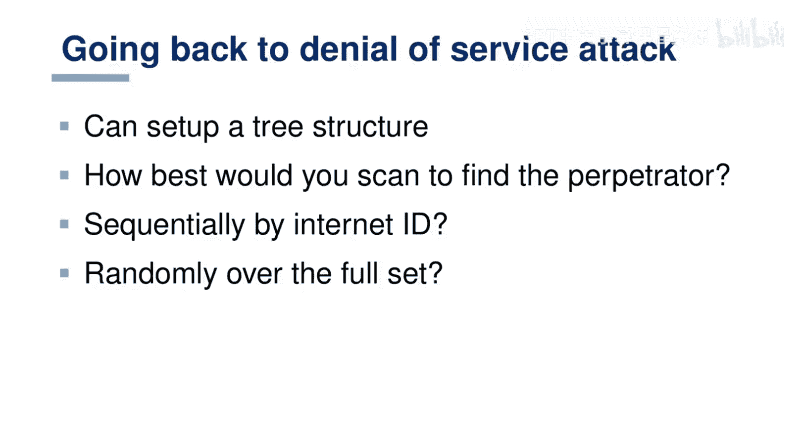
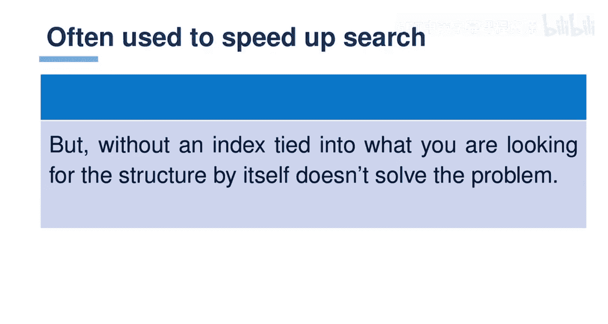
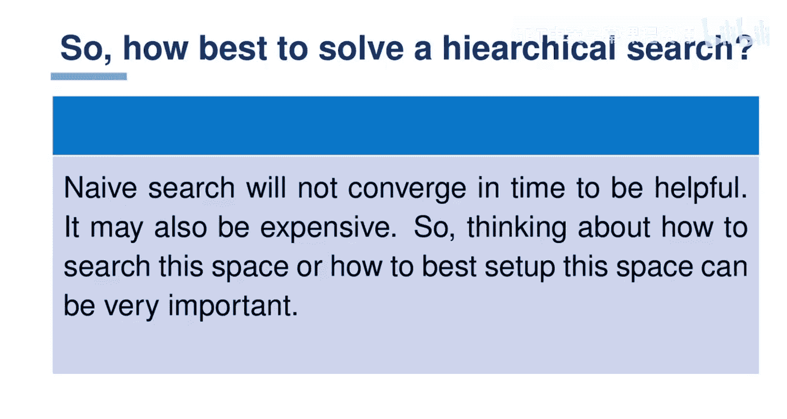
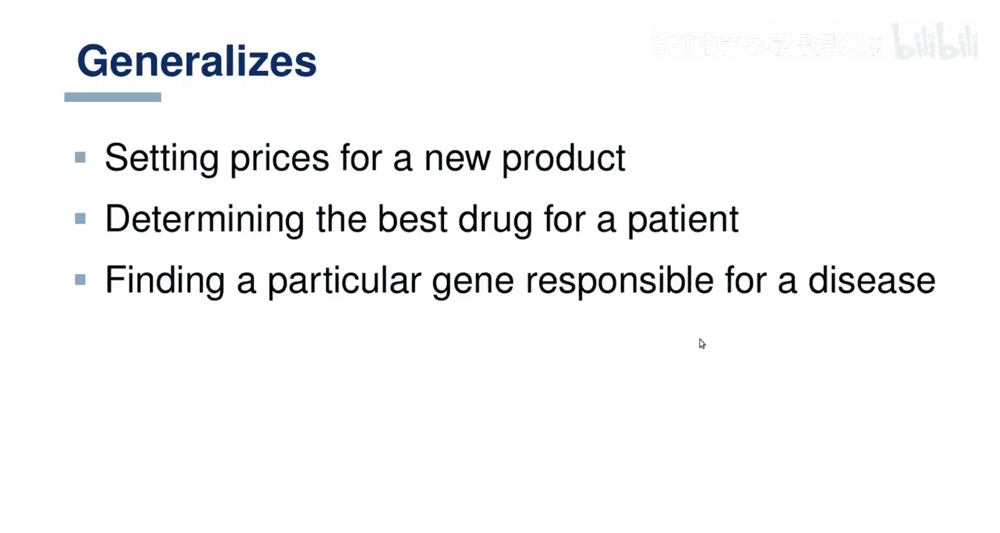

#  020：构建二叉树的随机游走高效探索算法 🧭

在本节课中，我们将学习如何在一个二叉树结构中，高效地搜索一个罕见的“目标节点”。我们将探讨一种名为“信息导向随机游走”的算法，它特别适用于解决诸如分布式拒绝服务攻击溯源等实际问题。这种方法的核心思想是利用树结构中每个节点上的信息，来引导我们的搜索方向，从而比顺序搜索或完全随机搜索更快地找到目标。

---

上一节我们讨论了在层次结构中搜索罕见假设的一般性问题。本节中，我们来看看如何将这一思想应用于一个具体的二叉树结构。

想象你有一个二叉树结构。这种结构本身很容易建立。例如，你可以根据IP地址等数值标准定义分割点来构建它。然而，仅仅拥有树结构并不能直接解决搜索问题，除非你恰好按照建立索引的字段进行搜索。在许多实际场景中，比如追踪一次分布式拒绝服务攻击的源头，攻击者的IP可能是动态的，或者只在特定时间表现出异常，因此无法预先建立完美的索引。这时，我们就需要一种能在树结构内进行高效搜索的方法。

## 问题设定与朴素方法 🎯

假设在二叉树的众多叶子节点中，只有一个节点是“危险节点”（例如，正在发起攻击的服务器），而其他节点都处于“正常”状态。我们的目标就是尽快找到这个危险节点。

以下是两种简单的搜索方法：
*   **顺序搜索**：按某种顺序（如IP地址）逐个检查所有节点。
*   **完全随机搜索**：在所有节点中随机跳跃进行检查。

这两种方法虽然最终都能找到目标，但效率可能非常低下，尤其是在节点数量庞大时。因此，我们需要一种更智能的探索策略。

## 信息导向随机游走算法 🚶‍♂️

信息导向随机游走算法的灵感来源于特诺夫在1959年论文中的思想，即在每个决策点都利用可用信息。在这个树搜索场景中，我们假设**每个父节点都能汇总其所有子节点的信息**。

算法的核心过程如下：
1.  从树的根节点开始。
2.  在**当前节点**，我们面临一个“三元选择”：是返回父节点，走向左子节点，还是走向右子节点？
3.  这个选择不是随机的，而是基于当前节点观测到的、来自其子树的信息。如果左子树中包含异常信号（危险节点）的可能性更高，那么算法“走向左边”的概率就会被调高。
4.  重复步骤2和3，直到到达叶子节点或满足停止条件。

这个过程就像在每一步都进行了一次假设检验，引导我们朝着更可能包含目标的子树方向前进。

## 算法原理：似然比与决策 🧮

为什么走向某个子节点的概率会更高？这基于**似然比检验**的思想。

*   设正常节点的流量数据服从分布 **F0**。
*   设危险节点的异常流量数据服从分布 **G0**。

在每个父节点，我们观测到的数据是其所有子节点数据的聚合。如果一个子树中包含危险节点，那么该子树根节点观测到的数据分布就会更接近 **G0**，而不是纯粹的 **F0**。通过比较走向左子树或右子树后可能观测到的数据似然，我们可以计算出一个偏向性的概率。

更形式化地，算法试图优化一个目标函数，该函数权衡了**搜索成本**和**错误概率**：
`R(π) = P(π) + C * Q(π)`
其中：
*   `π` 代表我们的游走策略。
*   `P(π)` 代表策略下出错的概率。
*   `Q(π)` 代表策略的期望搜索成本（如访问的节点数）。
*   `C` 是一个权衡参数。

最优策略 `π*` 就是最小化 `R(π)` 的策略。信息导向的随机游走正是在每一步都试图逼近这个最优决策。

## 算法优势与泛化能力 🌳

这种方法的强大之处在于其**泛化能力**：
*   **处理多个罕见事件**：算法可以轻松扩展到树中存在多个危险节点的情况。
*   **广泛的适用场景**：任何可以建模为层次结构搜索的问题都可以应用此思想。例如：
    *   在产品层次结构中为新产品定价。
    *   在药物分子层次结构中为患者寻找最佳药物。
    *   在基因层次结构中定位导致疾病的特定基因。

所有这些场景的本质，都是在信息不完全的层级系统中，高效地找到目标。

---

本节课中，我们一起学习了**信息导向随机游走算法**。我们从在二叉树中搜索罕见节点的实际问题出发，分析了朴素方法的不足，进而详细阐述了如何利用每个节点的聚合信息来引导搜索方向。该算法的核心是基于**似然比检验**做出偏向性决策，以优化搜索成本与准确性的权衡。最后，我们看到了这一强大思想如何从特诺夫的基础理论发展而来，并能广泛应用于产品定价、药物研发和基因分析等多个领域。通过将层次结构与动态信息相结合，我们能够实现远比随机或顺序搜索更高效的探索。