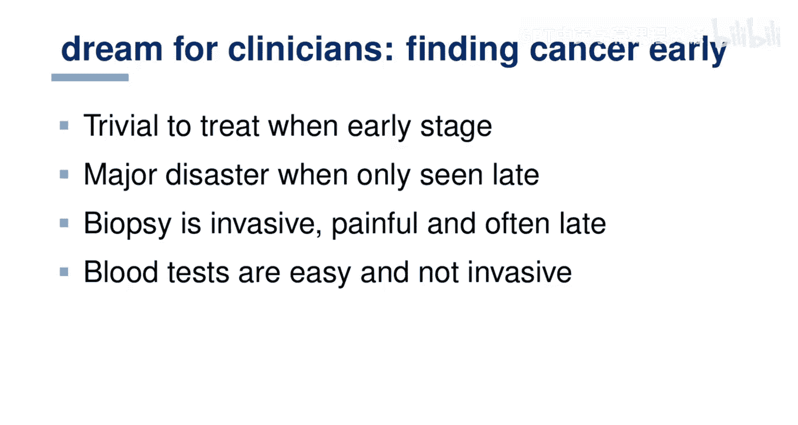
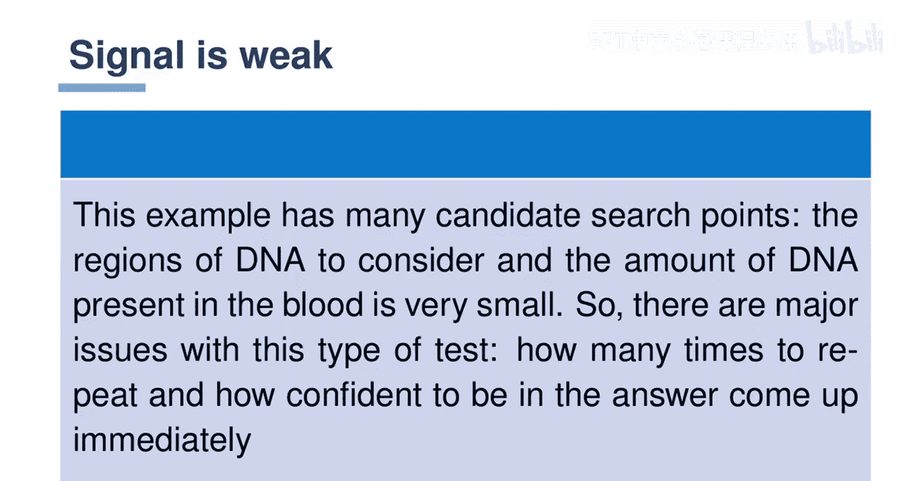
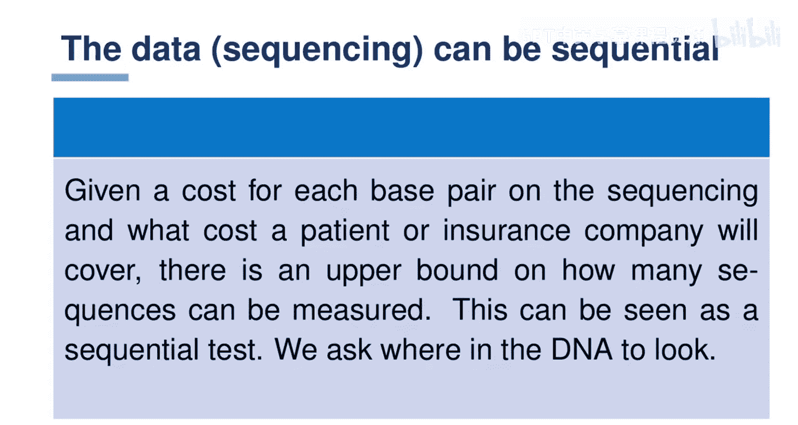
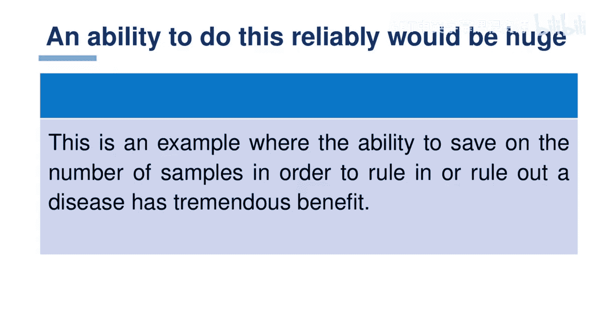
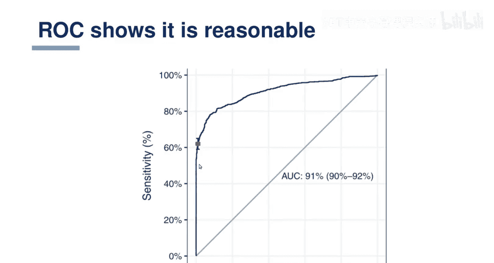
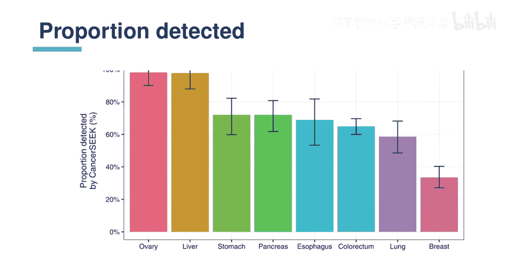
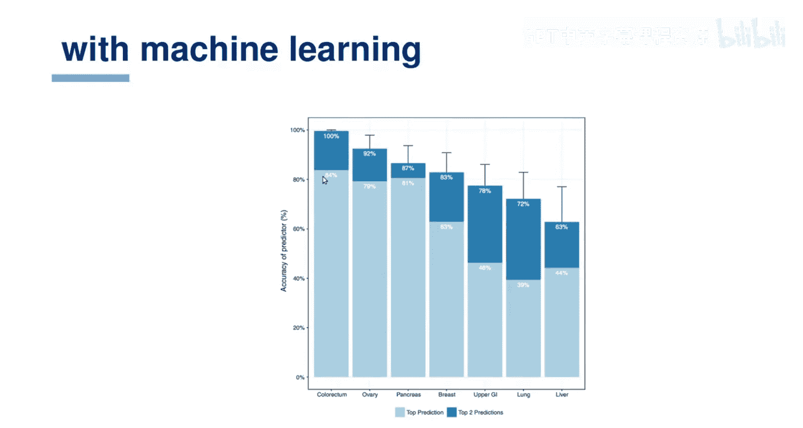
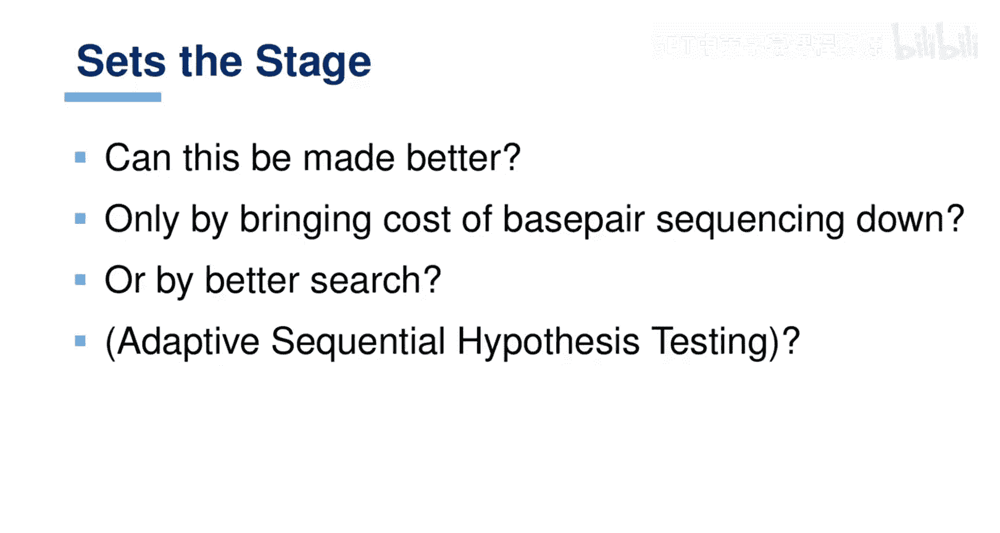

#  022：癌症液体活检的临床预检技术 🩸

在本节课中，我们将探讨癌症的基因组检测。这是一个非常有趣的问题，也是序贯假设检验的一个典型应用。

我们将要解决的问题是：能否可靠且快速地发现早期癌症？如果可行，这将是改变游戏规则的巨大进步。对于许多临床医生而言，早期发现癌症是梦寐以求的目标。癌症在早期阶段治疗起来非常简单，只需切除感染区域，治愈率会大幅提高。然而，如果发现得太晚，癌症已经转移，那将是一场巨大的灾难。

因此，我们的目标是尽可能避免活检。活检可能带来痛苦，并且通常是在问题已经很严重时才进行的指标。从临床治疗的角度出发，理想的方案是拥有一种能够早期检测癌症的血液检测方法。这种方法易于实施且无创。当然，这其中也存在重大挑战：必须确保检测能力是合理的，并且能够相对精确地定位问题所在。血液检测本身可能提示存在系统性问题，但未必能指明具体哪个区域有潜在问题。

因此，这既是一个梦想，也是直到最近才似乎变得可能的事情。2018年发表的一篇论文表明，这完全是可能的。我们稍后会详细讨论这篇论文。但首先，我想强调几个关键点。

首先，信号非常微弱。血液中存在DNA，但数量不多且分布广泛，是全身性收集的。这意味着我们有很多不同的搜索点。

除了DNA，血液中显然还有蛋白质和其他生物标志物。因此，最终我们寻找的不仅是发现问题，还要能定位问题。所以搜索空间非常大。

我们必须积极考虑要检测DNA的哪些区域，思考是否需要多次重复检测。在临床上，还必须充分考虑我们对答案的信心程度，因为这关系到后续沟通以及对患者的影响，例如假阳性问题。

我们这里主要进行的DNA测序可能相当昂贵。尽管成本在不断下降，但无法对血液检测中数量很少的整个基因组进行测序。因此，我们可以从一开始就将其视为一种序贯检验形式，这也是它出现在我们课程中的原因。

如果我们对每个碱基对的测序都有成本，那么患者和搜索公司能够承担的成本是有限的。

我们能够获取的信息量存在一个成本上限，即可测量的序列数量存在成本上限。因此，我们可以将其视为序贯假设检验：我们可以采取行动，提出假设，并询问现在应该在DNA或血液检测中的哪个位置进行最优搜索。

显然，如果我们能做到这一点——稍后我会展示至少在概念层面我们正接近这种现实——如果真的能做到，其益处将是巨大的，真正巨大的。因为我们可以节省诊断特定疾病所需的样本，并且通过早期检测，有可能挽救大量患者的生命。因此，实现这一目标具有巨大、巨大的益处。

## 2018年的突破性研究

这篇2018年的论文发现，主要贡献者来自约翰霍普金斯大学。例如，伯特·沃格斯坦在癌症治疗和疗法等多个领域都是杰出的领导者。这是一个主要由约翰霍普金斯大学医学院团队组成的庞大团队，他们一直致力于更好地理解此类问题。

这同样是一种血液检测，其核心理念是最终可以证明——尽管2018年的论文在某种程度上仍是概念性的，但现在已有公司积极致力于此，试图了解是否真的能为患者提供这种检测——起点是观察不同数量的被测序碱基。这是针对所有癌症的，基本论点是信号确实会增强，并在某个点达到平台期。因此，有理由相信，可以获取有限数量的碱基对序列，如果它们是正确类型的序列，尤其能够检测到系统中是否存在早期癌症。

他们研究了处于不同阶段的一系列患者，这些患者已被诊断，并且已知其中一些患者的癌症位置。论点与上述针对所有癌症的情况非常相似：对于某些类型的癌症，信号都趋于达到平台期。因此，能够选取一个序列子集，并通过查看这些子集来检测癌症。

许多人可能见过这些接收者操作特征曲线。本质上，你看的是灵敏度与特异性的关系。论点是，如果你的结果沿着这条线（表现不佳），但如果它像这样上升——在这里左侧的高灵敏度对应高特异性——那么你就拥有一个可能相当不错的检测方法。

任何类似噪声、看起来像这样的ROC类型曲线，都表明你拥有一个相当合理的检测器。因此，仅从ROC类型曲线的角度来看，这也表明这一研究方向非常正确。

接着，观察他们研究的不同癌症类型，通过这些检测发现的癌症比例，他们能够证明对于某些类型的癌症，效果相当好。例如，肺癌可能效果不佳，乳腺癌效果也不佳，但对于肝癌，检测比例确实相当高。这再次表明，进行这些血液检测，并了解一些信息——可以将其视为类似机器学习的事情，我们知道一些标记集，可以证明我们能够检测，这很棒。

## 按阶段与机器学习分析

你也可以按阶段进行分析：第一阶段、第二阶段、第三阶段。显然，你再次希望早期检测。论点是，有合理的机会可以真正做到早期检测。

在他们论文的最后部分，他们使用了机器学习。这不是我们的序贯假设检验方法，但他们在这里想要说明的是，通过增强——考虑传入的信号类型并进行一些训练——论点是他们可以进一步改进这一点。

同样，针对不同类型的癌症，例如肺癌最具挑战性，而结直肠癌在此类检测中最容易。这样做的另一个原因是，你可以设想后续跟进。你可以设想先进行血液检测，然后设想可以跟进的其他类型检测，以尝试更准确地定位问题所在。例如，对于结直肠类型，你可以考虑相对容易的结肠镜检查程序来跟进初步结果。

这同样是2018年的一篇论文，主要来自约翰霍普金斯团队。患者数量适中，在验证其有效性方面是合理的，也扩展到尝试探索不同的癌症类型，并将其视为有标记的数据。

将其作为血液检测推广到更广泛的人群存在扩展性问题。但我认为，作为一篇概念性论文，它非常、非常、非常令人兴奋，并提出了许多可能的前进道路。同样，已有公司正在致力于此。

但对我们课程而言，真正的问题是信号上的假设检验。我们能否对碱基对进行主动搜索？我们能否为答案设置误差范围？在算法方面，甚至更好。根据癌症类型的不同，其可变性如何？换句话说，我们能否根据癌症类型，通过主动搜索进行调整？也就是说，我们能否使其变得更好？在现有基础上，我们能否改进？我们是否只能通过想象某种技术改进（碱基对测序成本下降）来实现，还是可以将其视为一个更好的搜索类型问题？换句话说，通过自适应的序贯假设检验。

从我介绍的方式你可以看出，我认为确实有方法可以在此领域应用自适应序贯假设检验类型的框架，并且实际上可以使其变得更好。本周晚些时候我们将讨论一篇论文，该论文也提出了这一点。因此，我认为这不再是一个空想，而是真正可能为患者带来重大益处的事情。

希望本节课能帮助你进一步了解我们在这个方向上的进展，以及自适应序贯假设检验在临床环境中的有用性。

## 总结

本节课我们一起学习了癌症液体活检的临床预检技术。我们探讨了通过血液检测早期发现癌症的梦想与挑战，回顾了2018年一项表明该技术可行性的关键研究。我们了解到，通过分析血液中的循环DNA等生物标志物，并结合序贯假设检验与机器学习方法，有望在癌症早期实现无创、可靠的检测。尽管在信号强度、定位精度和成本方面仍存在挑战，但自适应序贯假设检验等优化方法为提高检测效率和准确性提供了 promising 的方向。这项技术已不再是空想，而是具有为患者带来巨大益处的现实潜力。