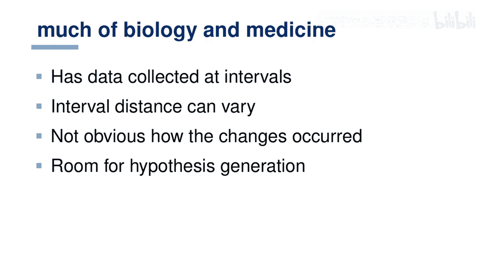
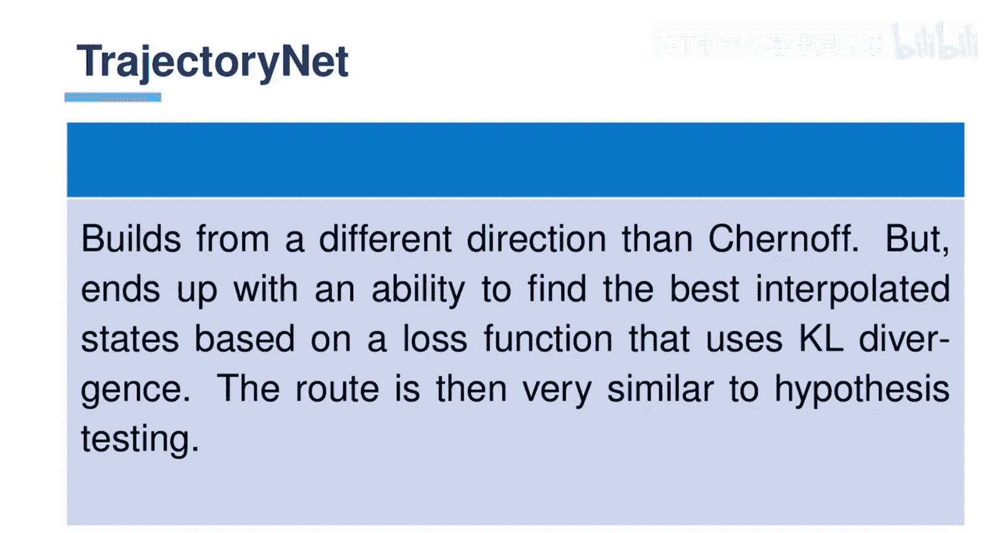
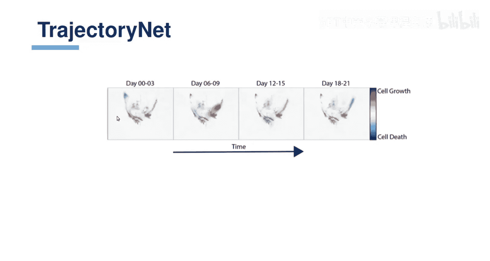
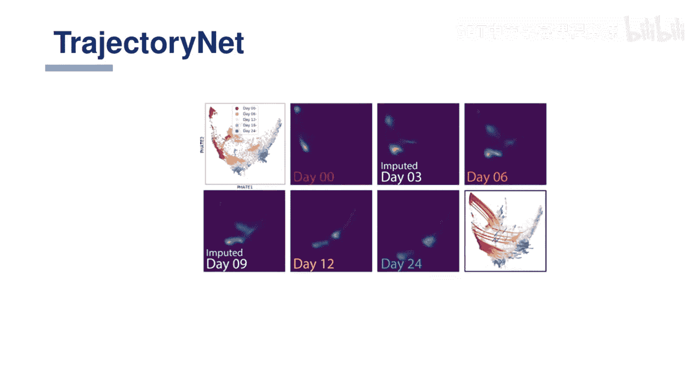

#  025：动态系统与轨迹推断 🧬

在本节课中，我们将探讨动态系统。与静态假设集相比，动态系统在某些方面更具挑战性。核心问题是：我们能否推断出缺失的信息？例如，当疾病进展时，我们可能了解某个时间点的情况，或许也了解稍后时间点的一些情况，但大量信息仍然缺失。我们能否通过生成假设来理解这些缺失的数据？这在生物学和医学领域非常普遍。

## 动态系统的挑战

我们通常在间隔时间点收集数据，这些间隔可能并不规律，有时甚至间隔很大。由于间隔距离可能变化，预测疾病或发展的时间进程有时非常困难。因此，变化如何发生或是什么驱动了变化，往往并不明显。如果我们考虑干预措施，例如引入新疗法或调整环境因素，这一点就变得尤为重要。我们如何预测这些改变将如何影响系统？这为假设生成留下了很大空间。

本课程的主要议题是，如何对数据流上的不同假设进行调整、改变或解释。另一种表述方式是：在这个动态系统中，如果我输入某些东西（例如疗法）或调整某些边界条件，它将如何影响系统动态？这本身就是一种假设生成的形式。

## 轨迹推断工具：TrajectoryNet 🛤️

现在我们来讨论一个名为 **TrajectoryNet** 的程序。对于希望在课程中完成项目的人来说，这是一个很好的工具。它是开源的 PyTorch 代码，非常稳健。

TrajectoryNet 的构建方向与我们之前讨论的起点不同，但在某些方面达到了非常相似的终点。它赋予我们一种能力，即使用基于 **KL散度** 的损失函数来寻找最佳的中间状态插值。这种 KL 散度与我们之前用于假设生成的损失函数非常相似。

换句话说，我们使用 KL 散度来观察两个不同的分布，并理解它们的相似程度。在这里，它被用于插值，以尝试推断这些中间状态。因此，它与假设生成非常相似，也与之前构建的“故事”非常相似。

## 核心思想与应用示例

其核心思想如下：假设我们有时间点 **T0** 和 **Tn** 的数据，但我们想了解这些中间点的情况。数据像蜂群一样移动，问题是：如果给定了这个起点和终点，我能否理解这些中间点，甚至是沿途其他中间点的情况？我该如何插值？如何找出这些缺失的部分？可能我们只有零星的数据，或者在某些时间点有确切数据但中间没有。如何插值推断正在发生的过程？这就是 TrajectoryNet 的本质。

以下是一个细胞生长的例子，涉及不同天数。问题同样是：你能否解释正在发生什么？他们用不同蛋白质的表达作为标记物。问题是，在这个动态系统中，作为时间的函数，我们能否理解细胞内部的变化？许多系统都是如此。我虽然强调生物学和医学，但这确实适用于许多复杂系统。它们实际上是动态的，你拥有时间上的横截面，并希望理解这些不同时间横截面是如何连接的。这种轨迹推断方法，可能是进行一种假设检验以理解状态之间变化的一种方式。

另一个例子是关于发育的测试。他们试图理解一个缺失的日期（例如第3天或第9天），他们拥有其他日期的数据并进行比较。结果表明，该方法可以推断出非常相似的状态。这再次表明，你拥有一种可以动态地在这些状态之间进行插值的方法。

还有一个例子关注基因表达投影。这非常接近我们之前讨论的血液检测。问题再次是：如果你有表达的端点，你能了解中间的时间进程吗？你能预测正在发生什么吗？

## 数学基础与距离度量

这里的起点是距离度量。这部分可能有点数学化，如果你觉得比其他部分难懂，请尝试吸收其核心思想。想象我有分布 **μ** 和 **ν**，两个不同的分布函数，我考虑它们之间的距离。我可以定义它。

公式涉及一个积分，在状态 **μ** 和 **ν**（即 x 和 y）上进行。我考虑这对分布函数中的所有点，从 **μ** 和 **ν** 的度量中提取 **π**。这就是我正在做的积分，我有一个距离的 P 次方，然后我对 x 和 y 进行度量 **D_π**。这是一种可用于比较不同分布的定义距离，与 KL 散度非常相似。

由此可以提出这样的问题：我能否找到一个相似的分布？我能否计算它？在什么时间范围内可以计算？这引出了**最优传输**等概念。这意味着我可以对时间求偏导，然后设置空间导数 **∇·(Pf)** 等于 0。然后我有 **t0** 和 **t1**，即这里的 **μ** 和 **ν**，以及由表达式设定的边界条件。

这种动态方法的本质是，我们有一个类似 P 的表达式，我们有边界点 **μ** 和 **ν**，我们可以再次考虑它们之间的距离。现在我们可以定义一种新型的距离度量，一个下确界，但现在我们有了时间 **t1** 和 **t0**。我在空间上积分，并在时间上增长。我有一个平方函数，对于思考机器学习的人来说，这几乎像一个 **L²** 度量或正则化项。本质上，我有我的概率和距离，我在时间和空间中观察。因此，我可以有效地论证，我有某种最小化器需要尝试理解。

另一种思考方式是通过这种变换。这就像概率意义上的最优传输。我有 x 中的东西，y 中的东西，然后我有一个可以在 x 和 y 之间控制的函数。我可以对 y 取 F 的偏导，确定其对数，然后这两个函数现在相差这个对数行列式及其分数。这给了我一种将一种密度一致地转换为另一种密度的方法。

我们现在可以将其与动力学联系起来，因为我们可以将 **x(t1)** 相对于 **x(t0)** 视为由 **f_θ** 给出。现在这是一个连接，**x(t)** 和 **t**。**x(t0)** 已定义，然后我们可以定义 **P(t1)**。同样，这些就像是端点。可以将其视为我们描述的、在这两个不同状态之间移动的**路径积分**。

## 损失函数与假设生成

然后，他们有一个非常简洁的定理，本质上说明我们可以用 KL 散度乘以 **λ** 来定义这个距离。我们考虑 **t1** 时刻的概率相对于 **ν**，再次比较 **μ** 和 **ν**。你可以看到这与我们刚刚讨论的内容密切相关。它涉及一个时间相关场 **F(x, t)**，其中 **x** 在 **R^d** 维度，**t** 在 **R** 空间。我们有一个密度 **P(x, t)**，同样是从 **R^d × R** 到 **R^+**。积分被定义并归一化为 1。**t** 在 **t0** 和 **t1** 之间，因此我们在 **t0** 和 **t1** 之间进行插值。

我们有一个连续性方程，以及一个 **λ**，它实质上是我们的 **t1** 时刻分布与目标分布 **ν** 之间 KL 散度的乘子。这样，我们有效地用 **μ** 约束 **P**，然后计算这个距离。下确界作用于一个包含 **f** 平方积分的期望上。你可以再次将其视为一个带有 KL 散度的正则化项。

因此，我们有效地定义了一个非常清晰的**损失函数**。你最终可以将其视为类似假设生成的过程。我们生成一系列中间状态，可以论证它们是对可能发生情况的潜在有趣假设。

## 总结与应用前景

本质上，TrajectoryNet 使我们能够构建中间状态的路径，这可能有助于我们理解诸如疾病变化等事物。例如，你可以考虑不同时间点的血液检查数据。原则上，这将允许你在这些时间点之间进行插值，从而真正思考疾病进展。这确实有可能用于一种比较性治疗的可视化。

这是一个非常有趣的方法，因为它为未来可能实现的事情开辟了一些有趣的想法。因此，我建议，对于你们中的许多人来说，这可能是一个项目点。这里的 GitHub 仓库是开源的，使用 PyTorch，因此很容易进行修改。问题是：你能否思考如何使其适用于假设检验？我认为这是一个非常好的项目候选。

---

本节课中，我们一起学习了动态系统的概念及其在数据推断中的挑战。我们重点介绍了 **TrajectoryNet** 这一工具，它利用 **KL散度** 和 **最优传输** 理论，通过定义损失函数来插值和推断动态过程中的中间状态。这种方法与假设生成紧密相连，能够帮助我们在仅有稀疏或端点数据的情况下，理解如疾病进展、细胞发育等动态过程，并为评估干预措施效果提供了新的视角。希望这能让你对轨迹推断及其与我们讨论内容的联系有所了解。其有趣之处在于能够讨论动态系统、假设中间状态，以及关于不同中间状态下不同治疗结果的潜在假设。