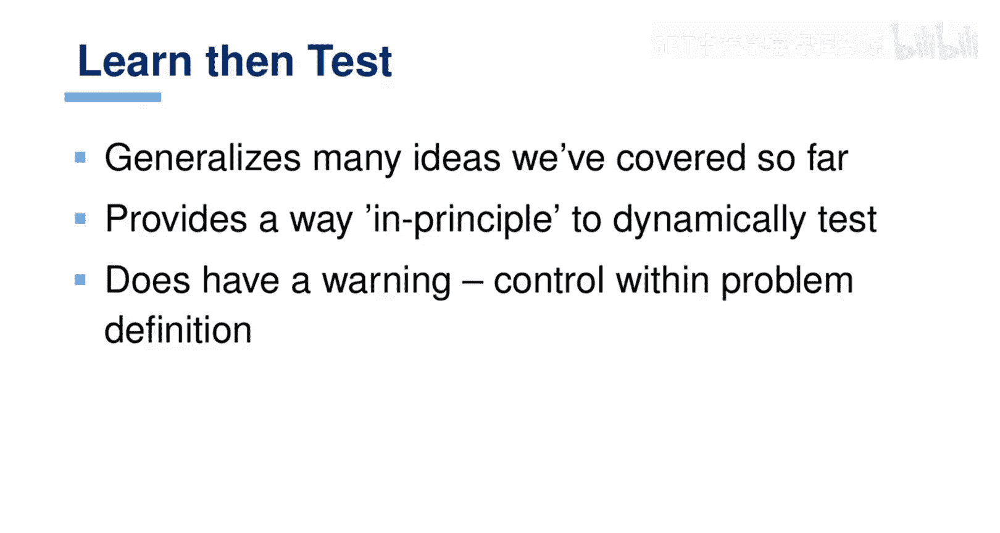

#  032：学习后测试（下）🧪

在本节课中，我们将深入探讨一种名为“学习后测试”的现代方法，它用于在复杂的假设检验场景（如图像识别）中控制错误率。我们将了解其核心算法、控制参数，并理解它如何将经典的统计思想（如Tukey的1959年方法）推广到现代机器学习环境中。

---

上一节我们介绍了假设检验和错误率控制的基本概念。本节中，我们来看看如何将这些概念应用于动态、复杂的图像解析任务。

## 核心算法与控制命题 🧠

为了构建一个可控的测试框架，我们需要三个核心命题来设置控制参数。

以下是三个必要的命题：
1.  我们有一个控制参数集合 **P1 到 PN**。
2.  我们有一个函数，能从该集合中返回一个控制参数 **Λ**。
3.  算法 **A** 是一个控制算法，它基于这些参数和计算出的P值进行决策。

这些命题确保我们能够为后续的算法建立一个清晰的错误控制基础。基于这些控制参数，我们可以通过多种方式计算P值。虽然算法不依赖于特定的P值计算方法，但这三个命题保证了我们能够有效地设置控制，并最终控制错误。

## 固定序列测试算法 🔄

现在，让我们看看第一个具体的控制算法。该算法的精神与1959年Tukey的方法非常相似，但被置于更现代的背景下，用于针对输入的图像进行假设检验。

该算法的核心步骤如下：
*   **输入**：错误水平 **δ**（可视为控制参数网格）、针对不同假设计算出的 **P值**、以及一个基于核心参数 **λ** 的初始化网格。
*   **过程**：从 **J=1** 开始迭代，当 **P(J) < δ / |J|** 时（避免重复计算），更新估计的 **λ_hat** 和 **J**。
*   **输出**：最终目标是得到**拒绝集**。在假设检验中，拒绝原假设通常意味着我们找到了优于现状（原假设）的替代方案。因此，这个算法通过拒绝参数网格空间中的某些部分（某些 **λ** 值），来“筛选”出系统中有意义的信息。

## 序贯图检验算法 🕸️

接下来，我们进入序贯图检验算法。这是对上一讲中介绍算法的改进和详细阐述，它使用了图论的核心概念。

该算法的流程如下：
*   **输入**：错误水平 **δ**、参数网格、**P值** 以及一个表示假设间关系的**图**。
*   **初始化**：将每个节点的初始错误预算 **δ_i** 设为0（类似于之前讨论的 **α** 消耗）。
*   **过程**：当存在某个 **i** 使得 **P_i ≤ δ_i** 时，循环执行以下步骤：
    1.  选择满足条件的假设 **i**。
    2.  更新对应的 **λ_hat**。
    3.  根据图中的边（关系）更新图中其他节点的错误水平（即进行 **α** 消耗的再分配）。
*   **输出**：最终同样得到一个**拒绝集**。

希望这些讲解能让你感受到，这些算法与我们一直讨论的统计思想一脉相承。

## “学习后测试”的应用实例 🖼️

他们的代码是公开的，非常适合在我们的框架内进行项目实践。这里他们研究的是**多层级预测集**。任务是为复杂图像中的多个物体分配正确的标签和置信度。

例如，在一张包含人脸、花盆、餐桌的图片中，你需要为每个元素分配概率。或者在一张手里拿着胡萝卜的图片中，判断那是否是“马”还是其他动物。这比“找出不同”的游戏要复杂得多，但核心相似。

这项研究最有趣的地方在于，能够为这些判断附上**置信区间**或**误差条**，在假设检验的层面上理解哪些判断是正确的。

## 算法性能比较 ⚖️

他们将三种算法（即我们讨论的这类算法的细化版本）与一个**均匀分布**基准进行了比较。

以下是性能对比的关键发现：
*   **均匀分布法**：作为一种对照基准，其表现 consistently 不如其他方法。
*   **固定序列法**：在这组方法中表现最佳，尤其是在控制**错误发现率**方面。
*   **其他算法**：如基于汉明距离的Fallback方法等，它们通过不同的方式在假设间进行选择和判断。

主要结论是，你可以进行**错误预算分配**，并以不同的方式（如图中的链条或网络）连接这些检验。通过图中的箭头和 **α** 预算，系统能够动态调整。无论是使用Fallback、2D固定序列还是Bonferroni校正，你都可以比较它们的**覆盖率**、**过密程度**和**覆盖不足**等指标。能够为结果添加误差条，并从覆盖率和过密度的角度思考，这非常强大。

## 参数化与控制维度 🎛️

这是从参数角度理解该框架的另一种方式。在我们的算法中，不同的控制参数对应着不同的任务维度：

以下是算法中控制的几个方面及其对应参数：
*   **定位远处物体** -> 由参数 **λ1** 控制
*   **为每个物体找到精确的像素集** -> 由参数 **λ2** 控制
*   **为每个物体分配正确的类别** -> 由参数 **λ3** 控制

这些任务关联着**召回率**、**交并比**、**覆盖率**等指标。**λ1, λ2, λ3** 就是算法中用于这些不同检验的**控制参数**。

回到之前滑板的图片，这套方法最终要实现的就是对这种复杂图像进行“学习后测试”。我们得到不同的预测集和分数，从而论证我们真正理解或解析了这张图像。对于包含地形、等待人群的复杂图像，我们能否贴上正确的标签？能否理解图像中发生的事情？

通过比较不同算法在**召回率**、**平均交并比**和**平均覆盖率**上的表现，他们提出了一个既有细节说服力又有宏观视野的论点：这种结合图论和离散集合的方法，能够为这些系统附加真正有意义的置信条和错误控制。

## 总结与展望 📝

本节课中我们一起学习了“学习后测试”框架，它以一种非常优美的方式概括了我们目前学到的许多思想。

总结来说，该方法原则上提供了一种动态测试的途径，能够将**I类错误**和**II类错误**的控制融入用于解析图像的机器学习算法中。但文中也提出了一个重要的警告：这里讨论的错误控制是在**问题定义范围内**的。就像任何其他学习算法一样，如果图像或数据集中的某些内容超出了这些设定的范围，那么警告标签或错误控制可能就不再有效。因此，使用者必须小心地在定义好的边界内工作。这是一个恰当的警告。

然而，真正令人兴奋的是，我们可以设想一系列假设检验被动态调整和控制，最终为结果贴上清晰的标签。这很好地回到了我们起点——1959年的那篇论文。在那个背景下，我们用它来检测图像中的罕见事件。虽然你能看到它的实际应用，但作为本部分课程的结尾，我想指出它的影响远不止于此。

换句话说，你可以看到这类思想如何应用于许多机器学习算法，并进一步推广到更多类型的算法中， potentially 为它们提供一种深入测试并控制其设置中I类和II类错误的方法，这是1959年Tukey的原始论文中并未勾勒的。尽管我说这些方法源于Tukey，但如果没有众多研究者迄今所做的扎实工作，我们不可能看到今天的成果。

我希望这节课能帮助你窥见这一领域的魅力，我认为这是一个非常迷人的方向，而且显然还有更多内容即将出现。请继续跟随我，一起探索更多与“在时间中做出决策”相关的内容。谢谢。