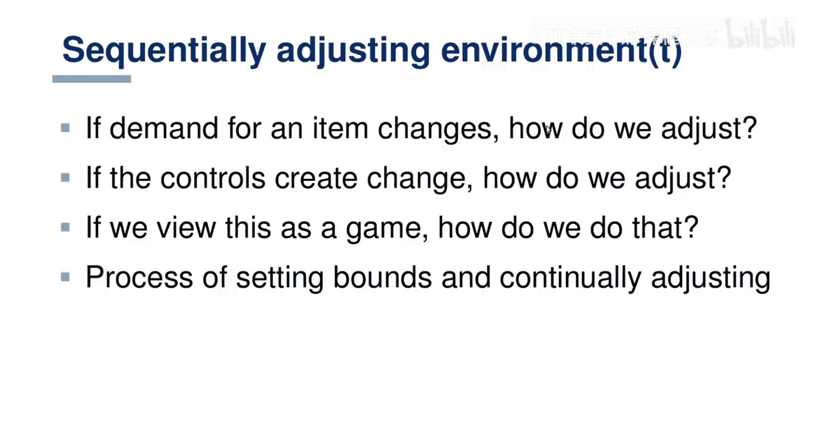
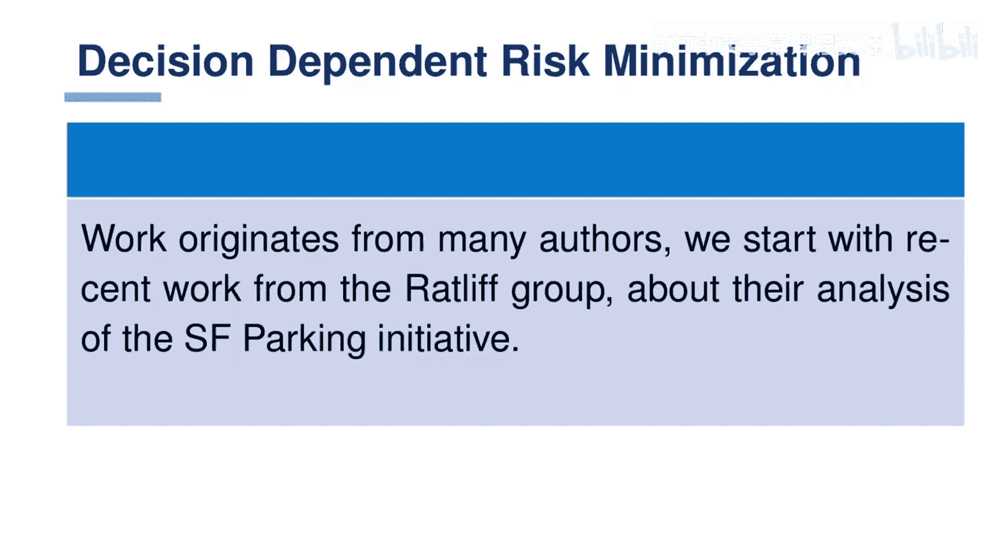
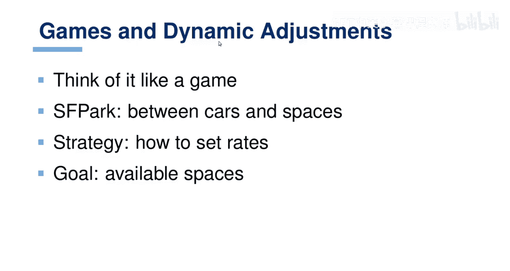

#  033：SFPark智能停车系统 🚗💡

在本节课中，我们将学习一个动态博弈的实际案例：旧金山的SFPark智能停车系统。我们将探讨如何通过动态调整价格来管理停车需求，并理解其背后的核心概念——价格弹性。

---

## 从静态到动态的决策环境

上一节我们介绍了在静态环境下的序贯决策。本节中，我们来看看当环境本身随时间变化时，我们应如何调整决策。

我们再次回到序贯决策的场景。但这次，环境是时间的函数。这意味着，如果对某个物品的需求发生了变化，我们应如何调整策略？回想我们最初讨论的沃尔德序贯概率比检验，在那个场景中，我们虽然也是序贯观察，但环境本身是静态的。现在，我们面临的是在序贯观察的同时，环境本身也在随时间变化。SFPark就是这样一个例子。

具体来说，如果我们的控制行为本身就能引发环境的变化，我们该如何调整？这就是我所说的“环境是时间的函数”。我们可以将其视为一场博弈，这正是本课程这一部分的核心。调整的过程本质上是设定边界并持续调整，这与序贯检验有相似之处，但更为复杂，因为环境不再是静态稳定的分布，而更像一场动态的“对话”。

---

## SFPark：一个真实的动态博弈案例

SFPark并非虚构，它是旧金山实施的一个真实动态算法，旨在控制城市停车。他们面临的问题是：如果停车费率定得太低，将永远没有空余车位。该项目始于2011年4月，其目标是确保在任何给定街区，始终有约15%的停车位是空置的。

这个目标很重要。试想，如果没有一定数量的空位，作为开车出行的消费者，你将总是在街区绕圈寻找车位；对于商户而言，顾客会因为找不到车位而无法光顾。因此，问题转化为：能否通过优化费率来实现这一目标？这里的费率是动态调整的。

这本质上是一场博弈，是消费者与城市管理者之间的博弈。博弈的核心是：如何通过策略（设定价格）来尽可能保证每个街区都有一定比例的空置车位。找到最佳策略并非显而易见，而这正是我们本节要探讨的内容。

---

## 动态定价机制

费率会根据时间段动态调整。例如，工作日上午和周末的费率可能不同，上午11点前和中午12点到下午3点的费率也可能不同。

以下是调整的示例：
*   一个街区可能将费率从每小时0.25美元调整到2美元。
*   另一个街区可能从每小时1.25美元调整到4.25美元。

费率由城市设定。最终的问题是：他们选择的费率以及调整费率的时间段，是否足以引导出正确的需求，从而实现15%空置率的目标？

从另一个角度看，系统会调整上午费率或中午费率，并观察相应的车位占用率，将占用率与费率进行对比。因此，我们有了“上午费率”与“中午费率”这样的区分。市面上也有相应的应用程序来帮助用户应对这种动态定价。如果你是旧金山居民，可能已经用过这类应用。这种算法和思路可能会变得越来越普遍，因为确保一定的空置率以避免车辆无效巡游，是一个普遍需求。

---

## 问题的核心：巡游交通与价格弹性

历史上，有很大一部分交通流量纯粹是在寻找停车位，这被称为“巡游交通”。数据显示，在不同城市和年份，巡游交通占整体交通流量的比例很高，例如洛杉矶达到68%，纽约达到45%。这意味着大量交通仅仅是车辆在寻找车位。

这会导致双输局面：商户因失去顾客而损失收入，消费者因花费大量时间寻找车位而感到沮丧。我们的目标是实现双赢：消费者能找到车位，同时通过设计合理的每小时价格，让人们在经济上决定不会停留过久，从而腾出车位。但关键问题是：这个“合理”的价格是多少？应该设定怎样的价格来解决这类巡游问题？

这就引出了**价格弹性**的概念。**价格弹性**衡量的是价格变化如何影响占用率（即需求量）。这是理解如何通过调整价格来调整停车位需求的关键概念。

我们可以这样定义**价格弹性**，它是一个比率：
`价格弹性 = 占用率变化的百分比 / 价格变化的百分比`

例如，如果价格上调10%导致占用率下降5%，那么价格弹性就是 `(-5%) / (10%) = -0.5`。这个数值告诉我们，价格每变动1%，占用率会反向变动多少。理解弹性后，你就能理解如何玩转这场博弈：城市管理者可以通过驱动价格来获得特定的结果，从而影响消费者的行为和停车需求。

---

## 应用与目标

理想情况下，实施SFPark后，即使在市中心商业区，也至少能有一个空余车位，而不是完全被占满。目标始终是保持一定数量的空置车位。社会层面可以讨论这个具体数字应该是多少。

相关的手机应用（如SFPark App）增加了系统的透明度和开放性，帮助消费者快速了解费率变化，并根据自己的支付意愿优化停车选择，从而影响了消费者对价格变化的反应速度。

---

## 学术研究：决策依赖的风险最小化

我们将花一些时间讨论来自Ratcliff团队及其合作者的一篇论文。这篇论文题为《几何衰减动态环境中决策依赖的风险最小化》。虽然标题听起来复杂，但其核心正是研究如何在变化、动态的环境中，基于价格弹性曲线做出最佳决策，为SFPark找到设定价格的最佳策略。

再次强调，这里的核心概念是**价格弹性**——那个关于占用率变化与价格变化比率的指标。这个弹性值揭示了需求的关键信息，对于城市管理者（控制方）与消费者（寻求廉价、便捷车位的需求方）之间的博弈至关重要。我们探究的是：需要改变多少价格，才能改变占用率？这显然是问题的核心。

其基本思路是：城市拥有不同街区（如旧金山的Long Beach Street, Garraelli Square）。如果我们能了解不同区域（以及不同时间段）的**价格弹性**，就能比当前城市采用的方法更好地调整费率。研究展示了不同区域的颜色编码价格弹性值，这正是动态调整策略的中心思想。

---

## 总结：作为动态博弈的SFPark

在本节课中，我们一起学习了SFPark智能停车系统这个动态博弈案例。

我希望通过这个介绍，让大家感受到，这可以看作是一场博弈（停车或其他类似场景），具有广泛的应用价值。这是一场在消费者（车辆）与资源提供方（城市空间）之间的博弈。策略在于如何设定费率，如何定义最优费率以改变行为。目标很简单：实现双赢。有空余车位，消费者不再为寻找车位而巡游；城市通过优化定价获得更多收入，同时商户因客流量增加而受益。如果费率设定得当，总能找到车位，这就是一个可行的双赢策略。

可以看到，这个思路延续了我们课程开始的脉络：从思考工厂生产中序贯控制产品质量，到第二门课程中讨论的序贯分析，再到本课程中关于动态环境下的博弈与调整。我们可以将其视为一个我们正在其中进行调整的博弈。

希望这个案例能帮助大家理解我们在这第三门课程中将要去往的方向。