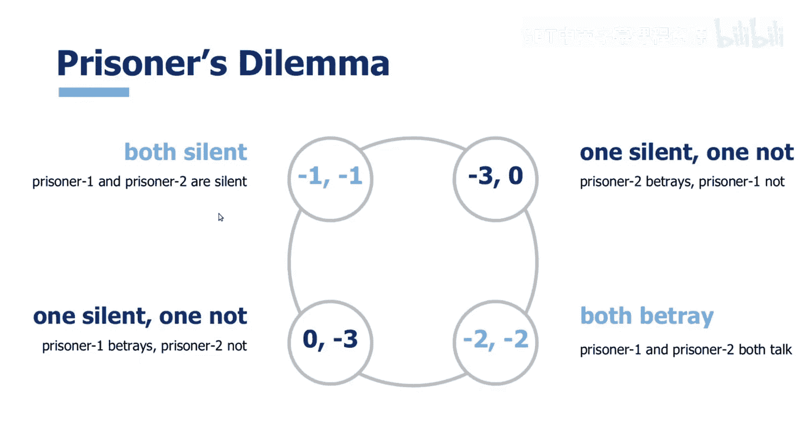
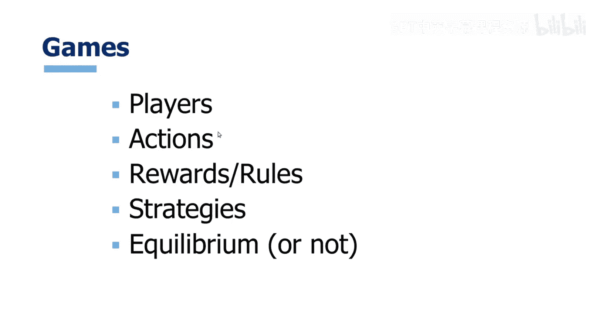
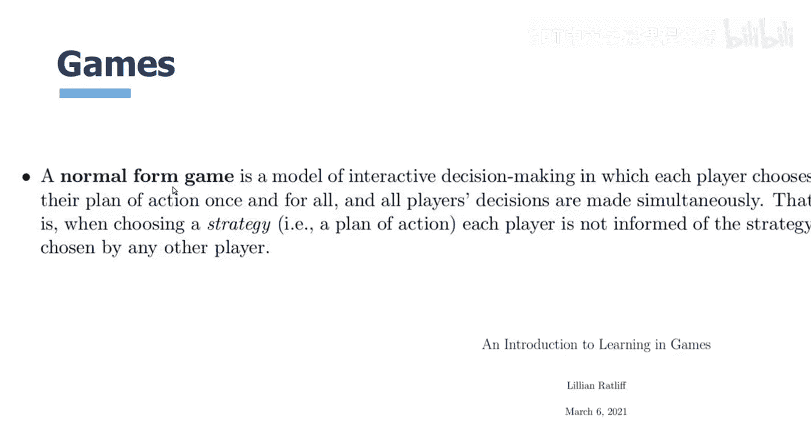
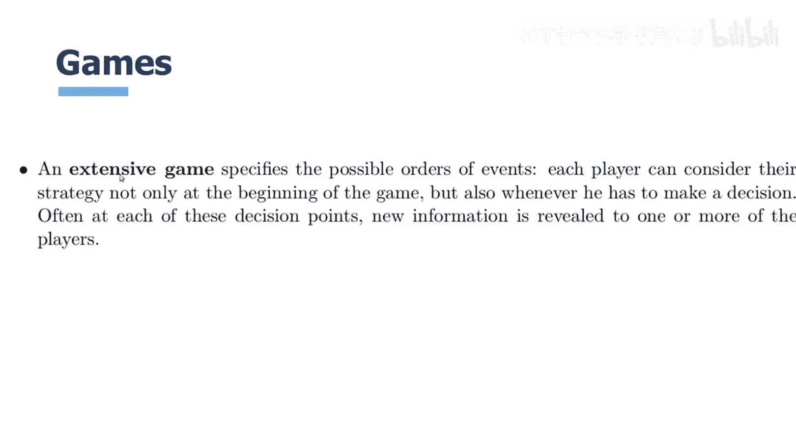
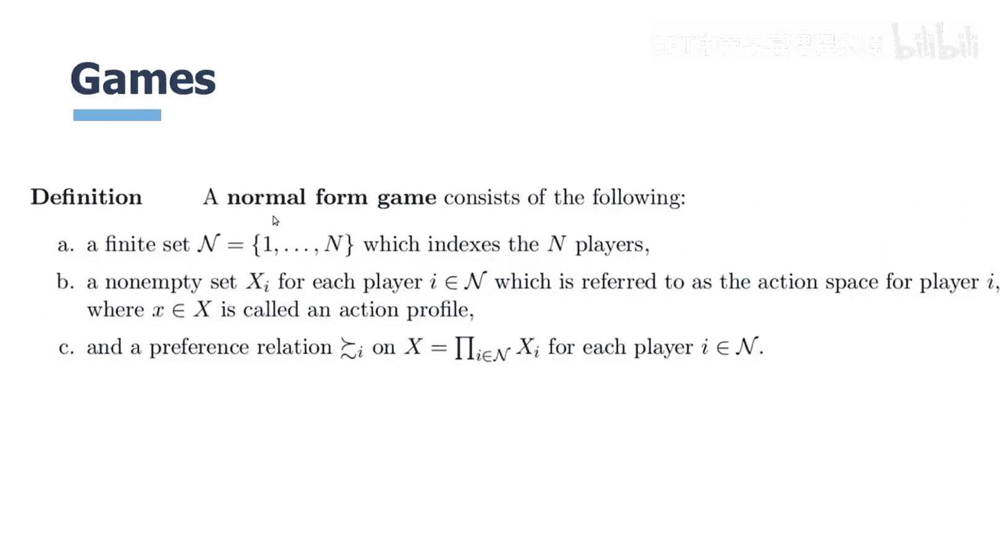
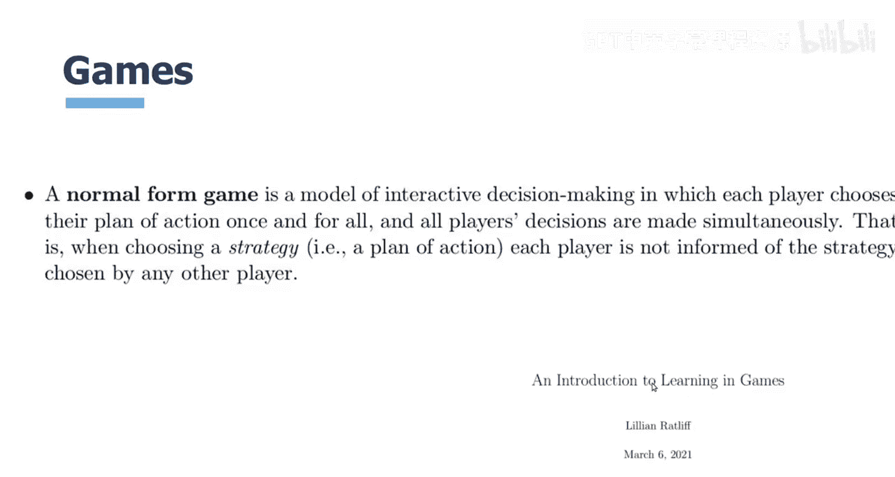
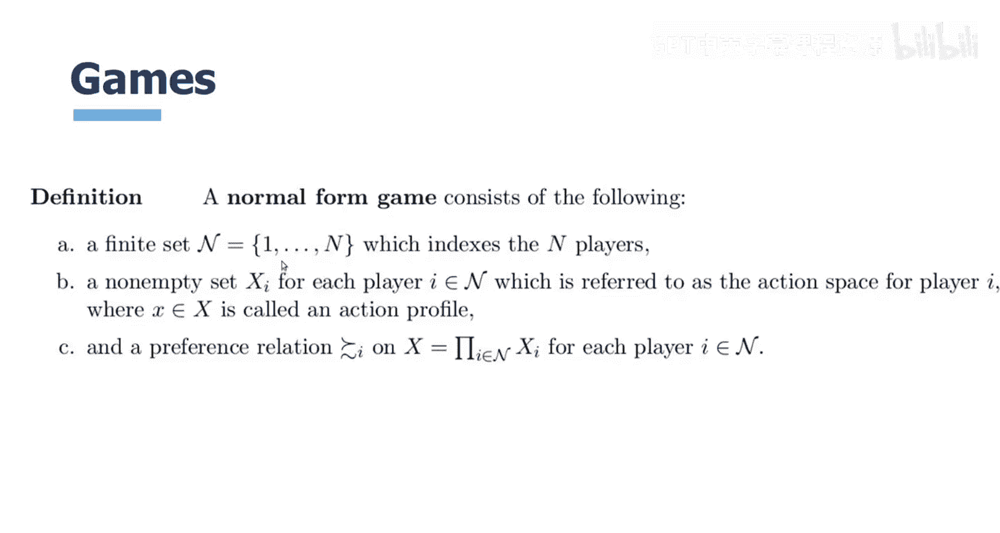
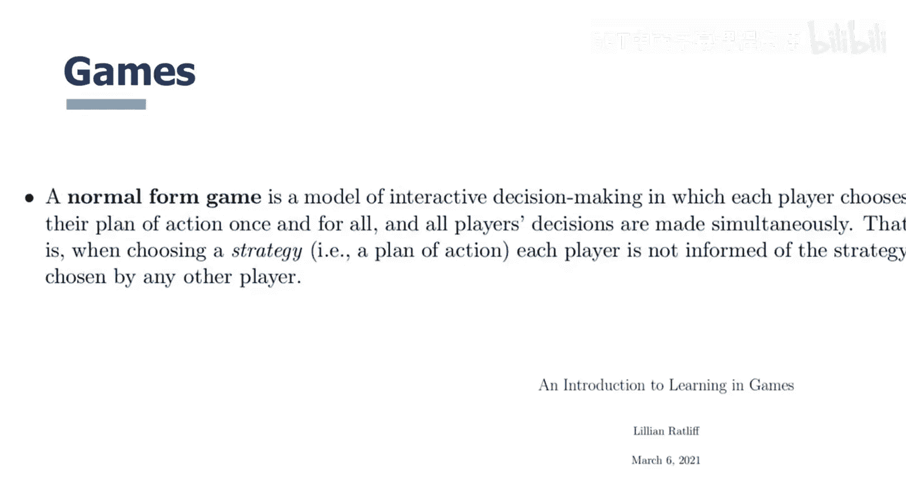
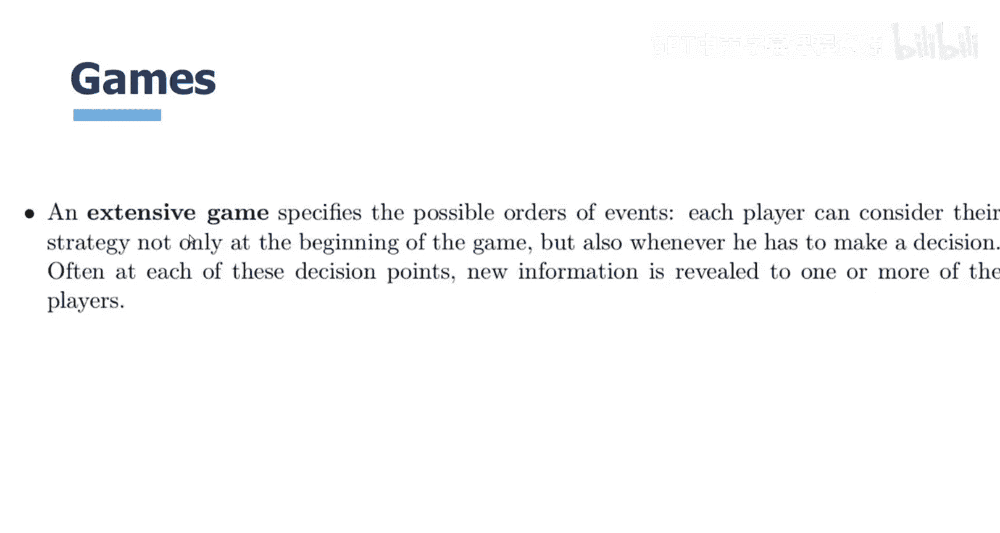

#  034：非合作博弈论入门 🎲

在本节课中，我们将深入学习博弈和博弈论的基础知识。我们将从非合作博弈开始，这是理解博弈论概念最直观的切入点。课程将介绍核心术语、经典案例以及博弈的数学描述方式，为后续学习信息论和更复杂的博弈模型打下基础。

## 从经典案例入手：囚徒困境

上一节我们介绍了博弈论的基本概念，本节中我们来看看一个最著名的例子：囚徒困境。

想象两名囚犯，他们共同犯罪后被分别关押，无法沟通。检方分别向他们提供选择：保持沉默（合作）或背叛对方（告发）。判决结果取决于两人的共同选择。

以下是不同选择组合下的收益矩阵（刑期，负值表示惩罚）：

| 囚徒1 \ 囚徒2 | 沉默（合作） | 背叛（告发） |
| :--- | :--- | :--- |
| **沉默（合作）** | (-1, -1) | (-10, 0) |
| **背叛（告发）** | (0, -10) | (-5, -5) |

*   **收益解读**：括号内第一个数字是囚徒1的刑期，第二个数字是囚徒2的刑期。`0`代表立即释放，`-10`代表重判。
*   **个人理性分析**：对于每个囚徒而言，无论对方选择什么，选择“背叛”总能让自己获得更好的（或至少不更差的）结果。这被称为**优势策略**。
*   **集体理性结果**：如果两人都选择合作（沉默），总刑期仅为-2，优于都背叛的总刑期-10。但由于无法沟通且同时决策，基于个人理性，最终往往会走向（背叛，背叛）的结局。

这个结果体现了**纳什均衡**的概念：在给定其他参与者策略的情况下，没有参与者愿意单独改变自己的策略。在囚徒困境中，（背叛，背叛）就是一个纳什均衡点。

## 博弈的基本构成要素

理解了囚徒困境后，我们可以系统地定义一个博弈。以下是构成一个博弈的核心要素：

1.  **玩家**：参与决策的个体或实体。在囚徒困境中，玩家就是两名囚犯。我们用集合 `N = {1, 2, ..., n}` 表示所有玩家。
2.  **行动**：每个玩家可以选择的选项。囚徒的行动集是 {沉默， 背叛}。我们用 `X_i` 表示玩家 `i` 的行动空间。
3.  **收益**：在玩家们选择了一组特定的行动（称为**行动组合**）后，每个玩家所获得的结果（效用或成本）。在囚徒困境中，收益表现为刑期长短。

## 博弈的两种主要形式

根据决策的顺序和信息结构，博弈主要分为两种形式。

### 标准型博弈

我们目前讨论的囚徒困境和“石头剪刀布”都属于标准型博弈。其特点是所有玩家同时做出决策，且决策时不知道其他玩家的选择。这对应着**非合作**与**同时行动**的场景。

在数学上，一个标准型博弈可以定义为三元组：
`Γ = (N, {X_i}_{i∈N}, {f_i}_{i∈N})`
其中：
*   `N` 是玩家集合。
*   `X_i` 是玩家 `i` 的行动空间。
*   `f_i: X → R` 是玩家 `i` 的收益函数（或成本函数），它将所有玩家的行动组合 `x = (x_1, ..., x_n)` 映射为一个实数，表示玩家 `i` 在该结果下的收益。

**收益与偏好**：收益函数量化了玩家的偏好。如果对于玩家 `i`，行动组合 `x` 带来的收益高于另一个组合 `x'`，即 `u_i(x) ≥ u_i(x')`，那么我们就说玩家 `i` 更偏好 `x`。

### 扩展型博弈

上一节我们介绍了同时决策的博弈，本节中我们来看看更贴近现实动态的扩展型博弈。

扩展型博弈用于描述**序贯行动**的博弈，玩家轮流行动，并且后行动的玩家可能能够观察到先行动玩家的部分选择，从而获得新的信息。我们课程后续将重点讨论这类博弈。

*   **特点**：行动有先后顺序，信息可能不对称，决策树结构。
*   **例子**：象棋、拍卖、SFpark智能停车系统（城市管理者根据停车数据动态调整价格和规则，驾驶员随后做出停车决策）。
*   **与标准型的关系**：理解标准型博弈是分析更复杂的扩展型博弈的基础。

## 零和博弈与常和博弈

根据所有玩家收益之间的关系，博弈有一个重要的分类。

在标准型博弈 `Γ` 中，如果对于所有可能的行动组合 `x`，所有玩家的收益之和为一个常数 `C`，即：
`∑_{i∈N} u_i(x) = C` （对所有 `x ∈ X` 成立）
那么这是一个**常和博弈**。

如果这个常数 `C = 0`，即一方的收益完全等于另一方的损失，那么这就是一个**零和博弈**。例如，赌博、棋类比赛通常被建模为零和博弈。

本节课中我们一起学习了非合作博弈论的基础知识。我们从经典的囚徒困境入手，理解了玩家、行动和收益等核心概念，并认识了优势策略和纳什均衡。我们学习了用数学三元组 `(N, {X_i}, {f_i})` 来定义标准型博弈，并区分了同时行动的标准型博弈与序贯行动的扩展型博弈。最后，我们了解了基于收益总和的零和博弈与常和博弈分类。这些基础概念为我们后续深入探讨信息不对称下的序贯博弈奠定了坚实的基石。