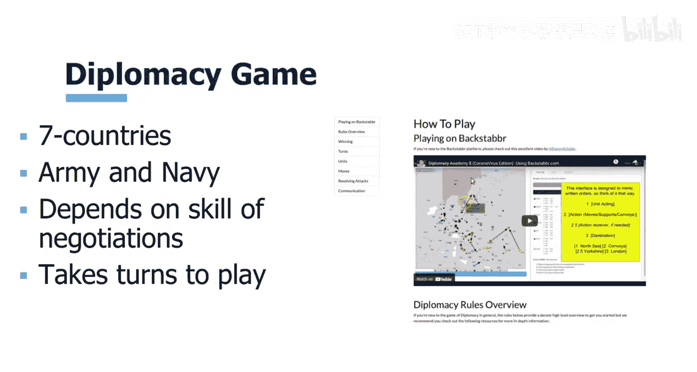
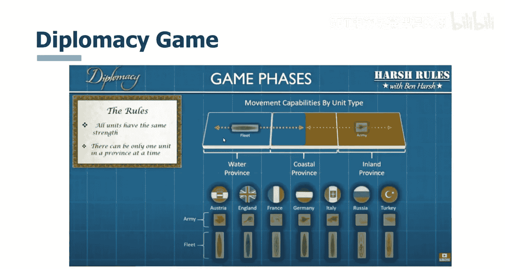
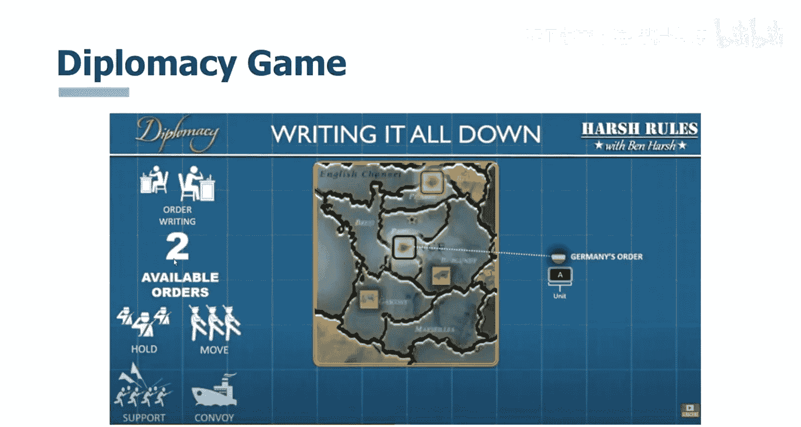
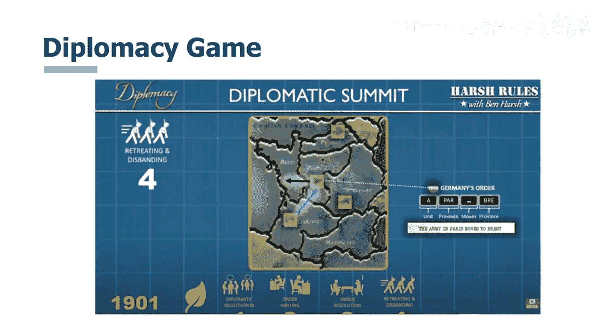
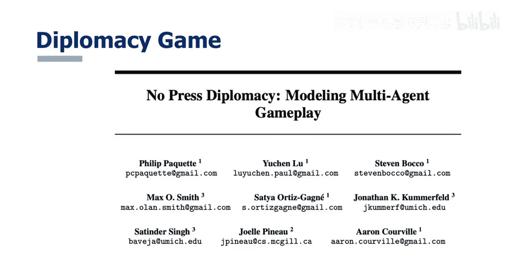

#  035：非对称信息的序贯模型 🎲

在本节课中，我们将学习一个名为“外交博弈”的复杂游戏。这个游戏是理解信息不对称和序贯决策的绝佳模型。我们将探讨其基本规则、游戏机制，以及玩家可以采取的不同策略类型。

---

## 概述

外交博弈是一个模拟第一次世界大战前欧洲外交与军事冲突的策略游戏。它于1959年首次发布，以其复杂的谈判机制和序贯决策过程而闻名。游戏的核心在于七国之间的互动，玩家需要通过结盟、谈判和战略部署来争取胜利，这完美地体现了信息不对称和决策随时间展开的特点。

## 游戏基本设定

上一节我们介绍了游戏作为序贯决策模型的概念，本节中我们来看看游戏的具体设定。

游戏设定在1901年，模拟第一次世界大战前的欧洲局势。共有七个参与国家：**奥地利、英国、法国、德国、意大利、俄罗斯、土耳其**。每个国家都拥有陆军和海军（舰队）单位，在游戏版图上的特定地理区域开始游戏。

游戏的核心资源是**控制中心**。玩家通过占领省份来获得控制中心，从而建造新的单位。游戏的目标是占领超过半数的控制中心。

## 游戏流程与机制

了解了基本设定后，我们来看看游戏是如何进行的。这是一个按回合进行的序贯游戏。

每个游戏年份分为两个主要阶段：春季和秋季。每个阶段都遵循相同的流程：

1.  **外交谈判阶段**：玩家可以进行公开或私下的谈判，讨论结盟、互不侵犯条约或协同军事行动。这是游戏的核心，决策深受此阶段交流的影响。
2.  **命令书写阶段**：玩家秘密下达军事命令。每个单位可以执行以下行动之一：
    *   **占领**：保持当前位置。
    *   **移动**：移动到相邻的省份。
    *   **支援**：增强相邻省份友军单位移动或防御的力量。
    *   **运输**：舰队可以运输陆军跨越海域。
3.  **命令裁决阶段**：所有命令同时公开并结算。系统根据所有命令的交互决定冲突结果。力量更强的行动成功。

以下是每个阶段的关键规则：
*   所有命令同时结算，没有先后顺序。
*   一个省份同时只能有一个单位。
*   陆军只能在陆地上移动，舰队只能在海上或沿海省份移动。
*   支援命令可以叠加，但支援单位自身受到攻击时，支援无效。

## 玩家策略类型

由于游戏高度依赖谈判和人际互动，玩家发展出了不同的策略风格。理解这些策略有助于分析游戏中的决策行为。

以下是游戏中常见的八种玩家策略类型：

*   **建筑师**：知识渊博，有宏观战略，善于策划。**优点**：专注、观察力强、能引导游戏进程。**缺点**：可能多疑、易受挫、沟通过多。
*   **外交家**：沟通能力强，受人喜爱，善于建立联盟。**优点**：不易被背叛。**缺点**：可能成为老好人，依赖他人。
*   **战术家**：沉默寡言，沟通简洁，专注于版图局势。**优点**：避免冲突，不说谎。**缺点**：可能被欺骗，忽视人际因素，令人怀疑。
*   **新手**：可能是真新手，或假装经验不足。**优点**：容易被低估，不构成威胁。**缺点**：犯战术错误，做出奇怪决策。
*   **算计者**：冷酷无情，善于操纵，战术清晰。**优点**：有耐心，是诚实的盟友。**缺点**：不擅长人际元素，可能误判，招致报复。
*   **忠诚者**：快速结盟，重视牢固关系和声誉。**优点**：是受欢迎的盟友，成功时受尊重。**缺点**：易受欺骗，可能盲目，难以独自取胜。
*   **骑墙者**：犹豫不决，误导对手，立场不明确。**优点**：保持低调，不主动挑起争端，难以预测。**缺点**：令盟友沮丧。
*   **变形者**：善于观察并模仿他人策略，出牌难以预料。**优点**：灵活、有创造力、演技好。**缺点**：难以取得信任。

## 游戏的计算模型与课程关联

这些人类策略的复杂性引出了一个有趣的问题：计算机能否模拟这个游戏？这也将我们带回到本课程的核心。

正如我们在四门课程序列开始时试图界定结果范围一样，在外交博弈中，你也在试图影响可能发生的事。这类似于试图影响停车政策，本质上都是通过策略互动来影响结果。

研究人员已经开始尝试为“无谈判外交”版本游戏建立**多智能体博弈模型**。这直接关联到我们对序贯博弈的思考：在规则下，七个玩家（国家）试图通过外交、关注他国并组建联盟来获胜。这与我们之前讨论的非合作、同时行动博弈不同，这是一个高度依赖玩家间互动的序贯博弈。

## 总结

本节课中，我们一起深入探讨了“外交博弈”这个复杂的序贯决策模型。我们学习了它的历史背景、七国设定以及以春季和秋季为阶段的游戏流程。我们重点分析了其核心——结合了秘密命令书写与开放式谈判的机制，这创造了典型的信息不对称环境。此外，我们还探讨了玩家在游戏中可能采用的多种策略类型，从宏观规划的“建筑师”到模仿他人的“变形者”。最后，我们将游戏与课程主旨联系起来，指出它对理解现实世界中随时间展开的、依赖人际互动的策略决策具有重要借鉴意义。如果你对策略和谈判感兴趣，这是一个非常值得尝试的游戏。