#  036：水资源分配的博弈谈判 💧

在本节课中，我们将学习如何运用博弈论的思想来解决现实世界中的水资源分配问题。我们将通过两个具体的研究案例，探讨在多方利益相关者（如不同国家或地区）之间，如何通过合作或非合作的策略来优化水资源的分配。

上一节我们介绍了经典的囚徒困境等非合作博弈模型，本节中我们来看看如何将这些模型应用于更复杂的现实问题，例如跨国河流的水资源管理。

## 博弈论基础回顾

首先，我们简要回顾博弈论的核心概念。一个博弈通常包含以下要素：
*   **玩家**：参与决策的个体或团体。
*   **行动**：每个玩家可以选择的策略。
*   **收益**：玩家根据所有玩家的行动组合所获得的结果（通常用数字表示）。
*   **均衡**：一种策略组合状态，在此状态下，任何玩家单方面改变自己的策略都无法获得更好的收益。

在非合作博弈中，玩家独立决策，追求自身利益最大化，有时会导致对整体不利的结果，囚徒困境就是一个典型例子。其收益矩阵可以简化为：

```python
# 囚徒困境收益矩阵示例 (囚徒A, 囚徒B)
# 策略：0=沉默，1=背叛
payoffs = {
    (0, 0): (-1, -1),   # 都沉默，均获轻刑
    (0, 1): (-5, 0),    # A沉默，B背叛，A重刑，B释放
    (1, 0): (0, -5),    # A背叛，B沉默，A释放，B重刑
    (1, 1): (-3, -3),   # 都背叛，均获中刑
}
```
纳什均衡是博弈论中一个关键的解概念，它描述了在给定其他玩家策略的情况下，没有玩家愿意单独改变自己策略的状态。

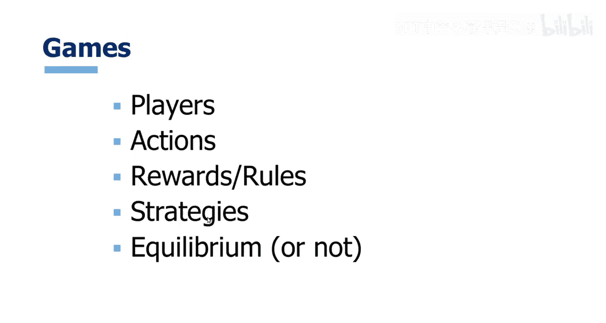

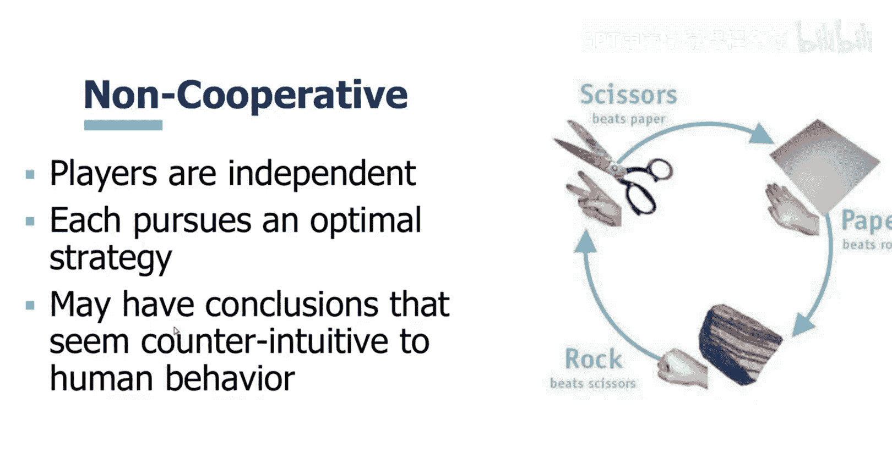

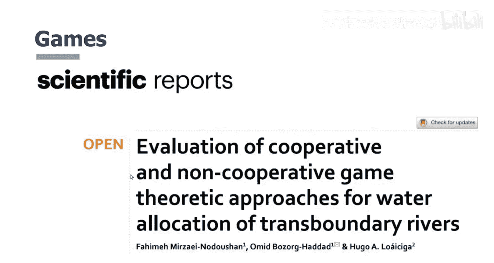

## 案例一：跨国河流的非合作分配

现在，我们将博弈论应用于第一个现实案例：流经三个国家（阿富汗、伊朗、土库曼斯坦）的阿姆河盆地水资源分配问题。这与我们上周讨论的“外交博弈”类似，各国需要协商如何取水。

这是一个典型的非合作博弈场景。每个国家都可以选择“合作”（妥协）或“对抗”（争夺）的策略。研究者构建了一个**收益矩阵**来分析不同策略组合下各国的得失。

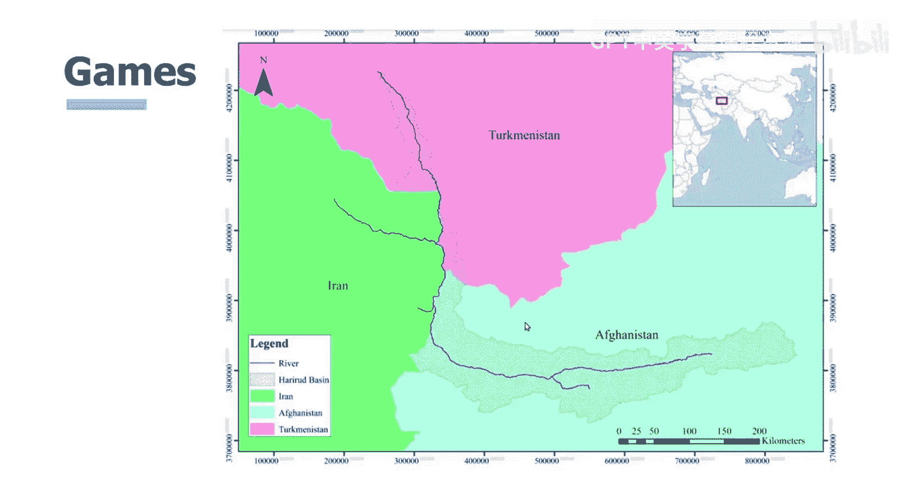

以下是可能出现的策略组合及其对应的收益结构示意：
*   **全部合作**：三国共同协商，达成妥协方案。
*   **两国合作，一国对抗**：例如伊朗和土库曼斯坦合作，阿富汗对抗。
*   **一国合作，两国对抗**：例如阿富汗合作，伊朗和土库曼斯坦对抗。
*   **全部对抗**：三国互不妥协，激烈争夺。

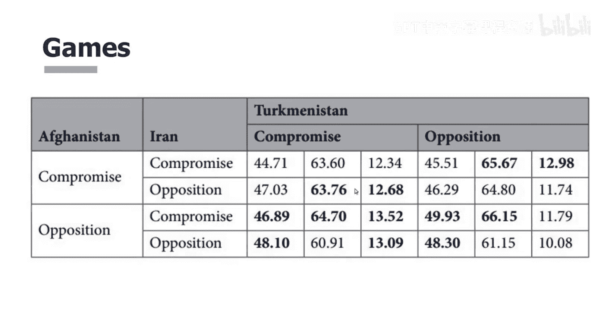

通过博弈论分析，可以计算出在非合作框架下的一个可能均衡点，从而得出三国各自的水资源供给与需求分配方案。这种方法并非为了从外部强制各国执行某种策略，而是为了理解在理性决策下可能出现的局面，为谈判提供参考。

## 案例二：动态水资源管理的博弈优化

第二个案例来自马来西亚，涉及一个更动态的水资源管理系统。这里有两座水坝（龙芽坝和森美亚坝），需要根据每小时的水流流入情况、需求变化来动态调整水量的摄入和排出。

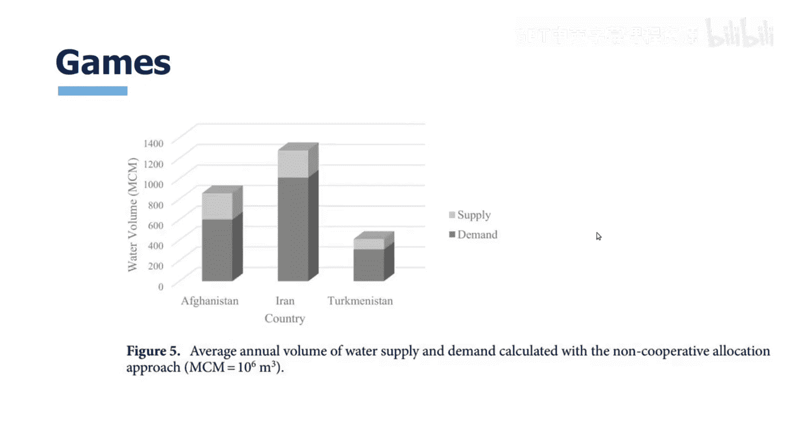

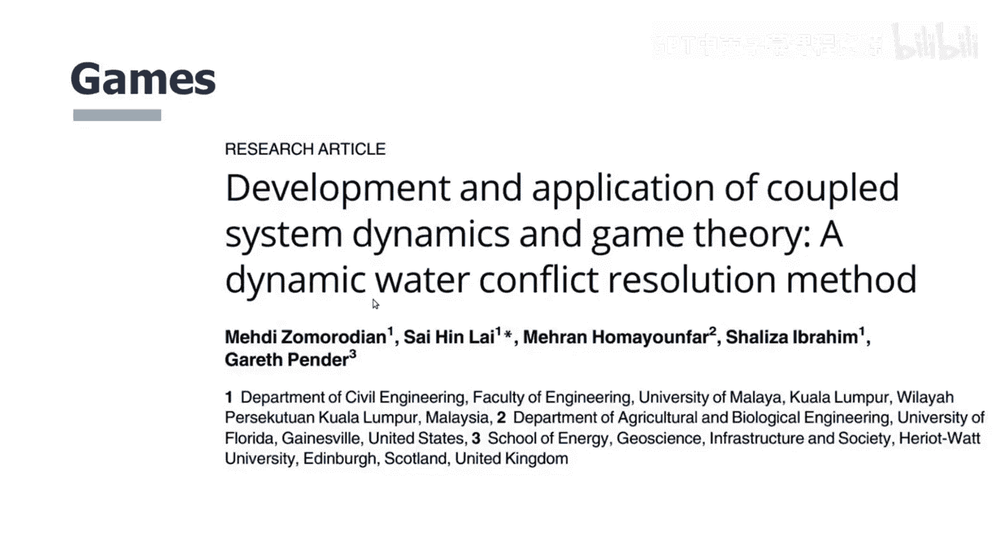


这个问题可以建模为一个**动态博弈**或优化问题。核心变量包括：
*   **流入量**：`I_longya`, `I_senmeiya`
*   **总可用水量**：`W_total`
*   **供给与需求**：`S(t)`, `D(t)`
*   **分配决策**：`x1(t)`, `x2(t)`（分配给不同区域的水量）

优化目标是在满足约束（如水库容量、最小生态流量）的前提下，通过一个类似博弈的分配优化器，平衡供给与需求。这同样涉及到不同区域（如城市与农村）之间可能存在的策略冲突，没有简单的最优答案，政治因素影响显著。

## 总结

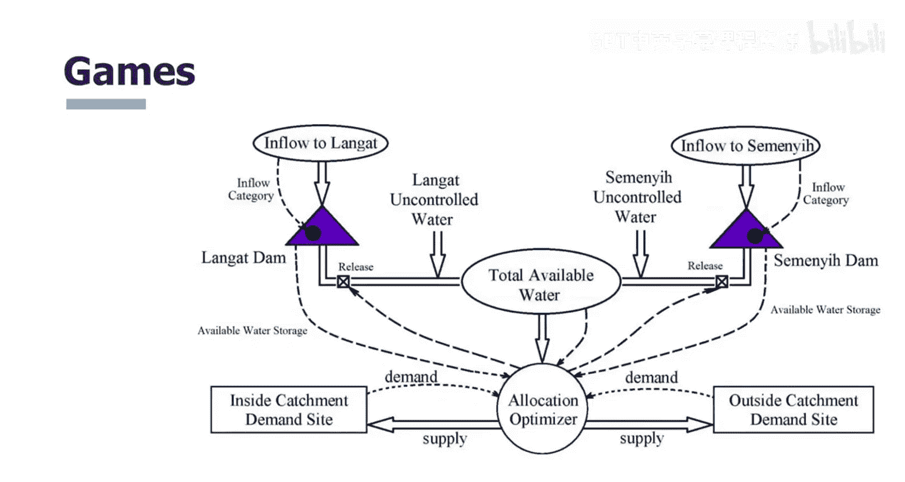

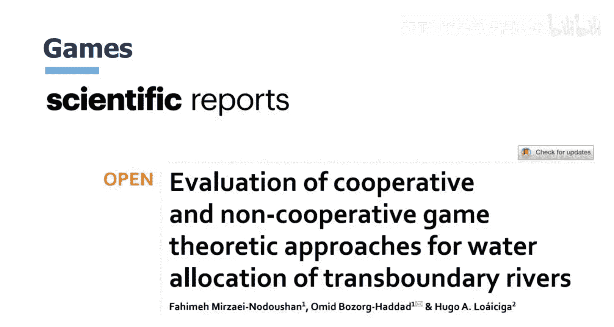

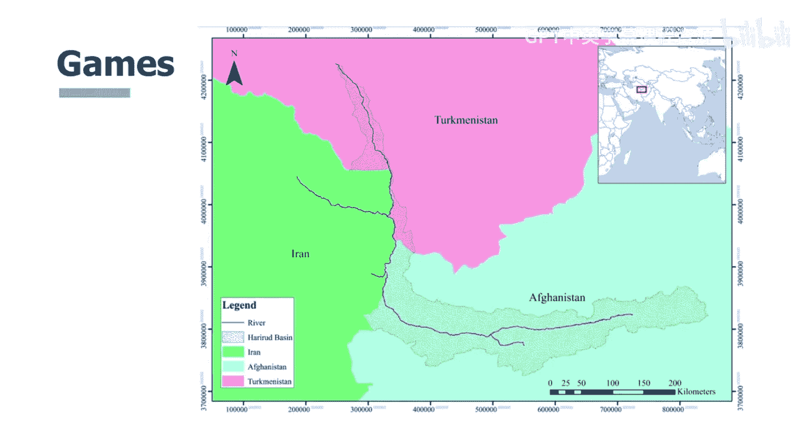

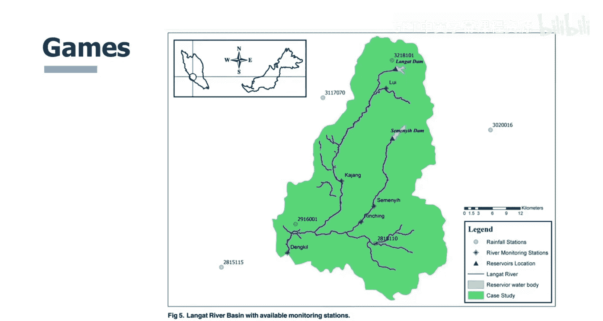

本节课中，我们一起学习了如何将博弈论框架应用于水资源分配这一复杂的时空决策问题。我们回顾了非合作博弈的基本概念，并通过阿姆河盆地的静态分配案例和马来西亚水坝的动态管理案例，看到了博弈论在分析多方利益冲突、寻找潜在均衡解方面的价值。这些现实问题与“外交博弈”相似，充满了政治角力和不同价值观的碰撞，而博弈论和信息经济学的思想能帮助我们更清晰地理解其中的决策逻辑和潜在结果。