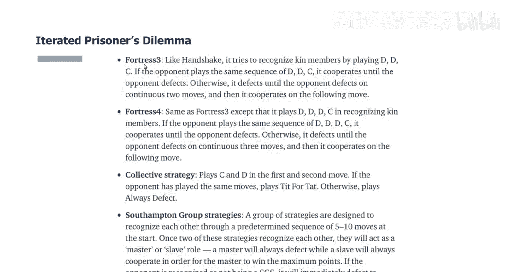
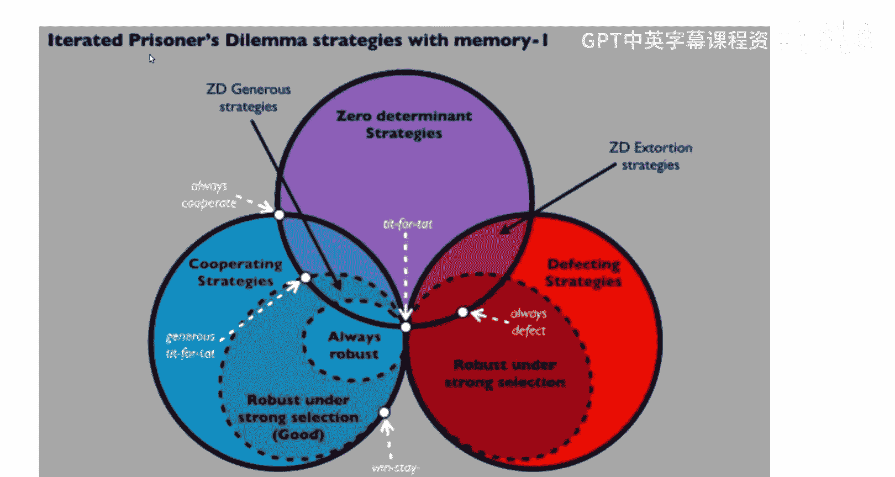

#  038：迭代囚徒困境（下）🎮

在本节课中，我们将继续探讨迭代囚徒困境，深入了解多种复杂的博弈策略。我们将看到，即使在一个规则简单的游戏中，寻找最优策略也并非易事，这需要根据具体情境进行深入思考。

## 多种策略概览

上一节我们介绍了“以牙还牙”等基础策略，本节中我们来看看更多样化的策略。存在许多其他类型的策略，我将列出其中一些，希望策略的数量能让你感受到问题的复杂性，并让你相信找到最佳策略并非小事一桩。在特定情境下，你需要仔细思考什么才是最佳策略。

以下是四种策略示例：

*   **以牙还牙两次**：第一回合合作。仅当对手连续两次背叛时，你才选择背叛。这不是直接的“以牙还牙”。
*   **坚定但公平**：第一回合合作。只要对方合作，你就继续合作。一旦对方背叛，你也背叛，但在对方背叛后，如果条件允许（基于对方的背叛行为），你会尝试再次合作。
*   **宽宏大量的以牙还牙**：与“以牙还牙”相同，但当对手背叛时，你有10%的概率选择合作。
*   **软多数**：第一回合合作。只要对手合作的次数大于或等于背叛的次数，你就继续合作，否则背叛。

以上是四种策略。接下来是另外五种策略：**强硬以牙还牙**、**两牙还一牙**、**渐进**、**软触发**、**GR触发**。

## 策略的核心目标

在迭代囚徒困境中，我们考虑的是多人游戏，且不一定知道其他玩家的策略。显然，如果你知道或能推断出其他玩家的策略，就可以尝试优化自己的选择。所有这些策略的最终目标，都是试图理解如何根据其他玩家的行为做出反应，以优化自己的收益结果。这正是我们讨论的所有游戏的核心玩法：如何优化个人回报，以及如何实现集体优化，从而获得最优的社区回报。

以SF Park为例，目标是留出一些停车位。如何在一个可能有多个玩家试图优化自身回报的游戏中，获得最优的集体回报？最终，你需要思考的是，如何优化游戏规则，使其既能最大化个人胜利，也能最大化集体胜利。这几乎是我们思考迭代囚徒困境时所扮演的角色。

以下是这些策略的具体描述：

*   **强硬以牙还牙**：第一回合合作。如果对手在过去三回合中的任何一回合背叛，则选择背叛，否则合作。
*   **两牙还一牙**：与“以牙还牙”类似，但当对手背叛时，你会连续背叛两次。
*   **渐进**：第一回合合作。只要对手合作，你就合作。在对手第一次背叛后，你背叛一次，然后合作两次。对于对手连续n次背叛，你采取相应行动，然后在对手合作两次后“冷静下来”以重置关系（如果对方也愿意原谅的话）。
*   **软触发**：合作直到对手背叛，然后惩罚（这里有四个D，然后两个C）。
*   **GR触发**：合作直到对手背叛，之后一直背叛。

这些是不同的策略。以下是另外三种：**多疑的以牙还牙**、**硬多数**、**反向以牙还牙**。

这些策略有点像“握手”协议，你在密切关注其他玩家的行为。

*   **多疑的以牙还牙**：与“以牙还牙”相同，但你在第一回合选择背叛。
*   **硬多数**：第一回合背叛。如果对手背叛的次数大于或等于合作的次数，则背叛，否则合作。
*   **反向以牙还牙**：就是“以牙还牙”的反向操作。第一回合背叛，然后采取与对手上一回合相反的行动。

这有点像我们之前讨论外交时提到的一些不同策略。你试图理解其他玩家在做什么，并据此调整自己的行动。

## 探测者策略

这里有一个策略，最近被证明在许多迭代囚徒困境游戏中是相当强大的策略。网上有很多此类竞赛，**探测者** 是一种似乎很有效的策略。

它的行动序列是：以背叛开始，然后合作，再合作，然后**如果**其他玩家在第二和第三回合都合作（意味着他们可能总是合作），则背叛，否则采用“以牙还牙”策略。

这几乎像下棋的开局。你以一个特定的序列开始，观察对这些开局动作会得到什么样的回应，然后根据得到的回应类型完全定义你后续的走法。这就是它被称为“探测者”的原因。

以下是探测者对阵不同策略的情况：

*   **探测者 vs 永远合作者**：对手总是合作（C），所以你总是会背叛（D）。
*   **探测者 vs 永远背叛者**：注意条件，对手总是背叛（D）。你的前三步是：背叛（D）、合作（C）、合作（C），然后因为对手总是D，你后续也总是D。
*   **探测者 vs 以牙还牙者**：你可以看到这里。对手（以牙还牙者）以合作（C）开始，但你第一步是D，所以对手第二步变成D；你第二步是C，所以对手第三步变成C。这就是“以牙还牙”。

你可以为所有这些对局打分，并思考哪一个会是最好的。这就是“探测者”策略。

## 其他高级策略

此外，还有基于我稍早前提到的“握手”类概念的各种策略，本质上你试图理解其他玩家在做什么，有点像探测者。例如：

*   **效应**：第一回合合作，如果对手行动相同则第二回合合作，否则永远合作。
*   **天真探测者**：偶尔以很小的概率背叛，探测是为了测试对方是否过于宽容的策略。
*   **悔悟探测者**：有点像天真探测者，试图在背叛后打破相互背叛的循环，探测对方是否原谅。
*   **自适应**：再次以一个固定序列开始，然后根据后续的最佳得分来决定行动。

这类自适应或探测策略，对于回合数很多、且假设对方策略固定的迭代类游戏来说，可能是一个不错的选择。思考这种多人游戏非常有趣，因为每个人都在试图优化自己的策略。

另一个有趣的策略是 **帕夫洛夫** 游戏策略。

*   你在前六回合采用“以牙还牙”。
*   你通过这个基于规则的机制识别对手。
*   然后根据你的帕夫洛夫策略，将对手分为四组：以牙还牙型、永远背叛型、多疑以牙还牙型、随机型。
    *   如果对方玩家在前六回合没有开始背叛，你称其为合作型，然后你将表现得像“以牙还牙”。
    *   如果对方玩家在连续六回合中背叛超过四次，你称其为永远背叛型，并将永远背叛。
    *   如果对手在六回合中恰好背叛三次，你认为它是多疑以牙还牙型，并采用“以牙还牙两次”策略以恢复相互合作。
    *   任何不属于最后三类别的策略，你都将称其为随机型。在这种情况下，你的帕夫洛夫策略将选择永远背叛。
*   为了处理对手改变行动的情况，你的平均收益每六轮计算一次。你基本上有一个滑动的窗口来计算回合。如果收益低于阈值，则重新开始识别过程。

这已被证明是这类迭代游戏中另一个成功的策略。

## 策略的复杂性与应用

再次强调，有趣的是，我不希望你记住或觉得需要记住所有这些不同的策略，但要认识到这可以变得多么复杂，有多少不同的策略，以及当你进入这个迭代囚徒困境时，一个听起来非常简单的游戏可以变得多么深入。

因此，基于“堡垒3”、“堡垒4”集体策略、南安普顿小组策略的策略，我不在这里详述所有安排，但本质上它们都是相同想法的变体，试图理解如何最好地创建一个能优化回报的策略。

这正是我希望你在我们第三门课程的这第二周思考的问题：我们如何想象设计游戏规则、回报和奖励，使得我们既能获得集体胜利（如SF Park），也能获得个人胜利？

对于SF Park来说，这很容易理解：我们试图思考如何设计规则，使得总有一定数量的停车位可用，这样当人们寻找停车位时总能找到。这也有助于商店和城市。因此，要找到一种方法，让个人获得停车位的胜利，城市通过调整停车费率获得一点收入的胜利，尤其是该地区的企业获得顾客光顾的胜利。

这与迭代囚徒困境非常相似：有一群人在寻找停车位，他们可能采取不同的策略。在这样的游戏背景下，他们可能在一天或一周内多次寻找停车位。你如何优化这一点？因此，迭代囚徒困境再次像是一个缩影，思考如何采取一个最有可能获胜的策略。

## 零行列式策略

我们一直在讨论合作策略或背叛策略，还有另一个有趣的类别叫做 **零行列式策略**。我认为弗里曼和戴森在《美国国家科学院院刊》上发表的一篇论文非常有趣。特别是“以牙还牙”最终成为这三种策略的交集。你可以在维基百科上阅读更多关于零行列式策略的内容，它是这个囚徒困境的一种特殊类型解决方案。再次说明，这个游戏中涌现出如此多不同的策略，这很吸引人。

我们讨论了宽宏大量的以牙还牙、永远合作、永远背叛、输就改，这些在这个维恩图、这种思考方式中都是不同的策略。对于囚徒困境，最好的做法是什么？再次强调，我希望你记住的是，我们正在思考如何——几乎回到沃尔特的问题——在某种游戏规则的背景下，采用一些游戏策略，以有效地寻找稳定点，这些点将有效地为整体环境带来胜利（比如SF Park），同时也慷慨地记录个人收益。

如果你想想像水权这样的事情（我们在上一个视频中讨论过），你试图找到一种方法，让城市居民和农村开发者都满意，这样农民有足够的农业用水，城市居民有足够的生活用水，水资源也不会紧张。定义规则和政策以实现对每个人都有效的最优策略并不容易，部分原因再次在于，即使像囚徒困境这样表面上听起来超级简单的事情，也有许多不同的玩法，这些游戏中涉及很多内容。

---

本节课中，我们一起学习了迭代囚徒困境中纷繁复杂的策略世界。从基础的“以牙还牙”变体到高级的“探测者”、“帕夫洛夫”和“零行列式策略”，我们看到了在一个简单规则下博弈策略的深度与广度。关键在于理解，最优策略并非一成不变，它高度依赖于对手的行为、游戏的迭代次数以及整体的收益结构。无论是设计像SF Park这样的公共资源管理系统，还是解决水资源分配等现实问题，其核心都类似于一个多人迭代博弈：我们需要设计规则和激励，引导个体在追求自身利益的同时，也能促成对集体有利的稳定结果。希望本课能启发你思考如何在复杂系统中通过巧妙的规则设计，实现个人与集体的双赢。