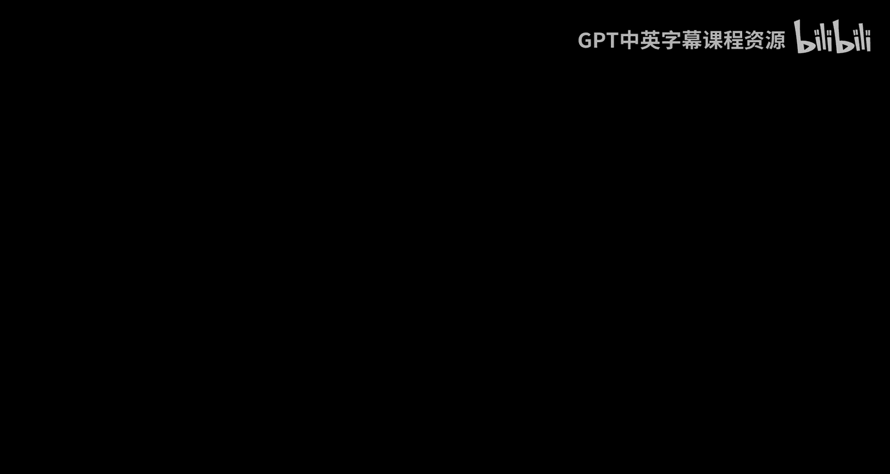
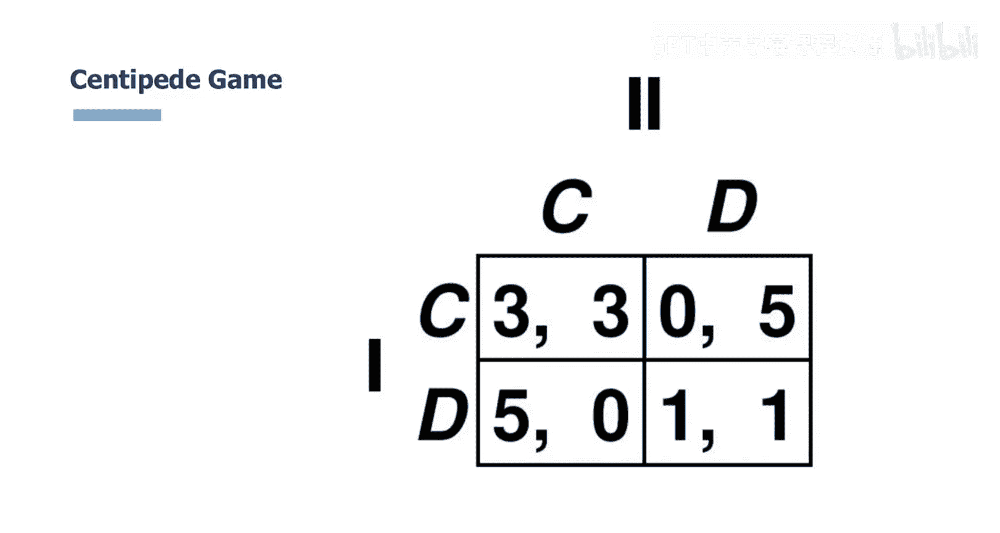

#  041：逆向归纳法与蜈蚣博弈 🐛



在本节课中，我们将学习一种经典的博弈推理方法——逆向归纳法，并探讨一个著名的应用案例“蜈蚣博弈”。我们将了解如何从博弈的终点开始，反向推导出最优决策路径，并分析在实际实验中，人类行为与纯理性预测之间的差异。

---

## 逆向归纳法介绍

上一节我们讨论了博弈中的基本概念。本节中，我们来看看一种从终点开始推理的经典方法——逆向归纳法。这种方法在求解许多博弈时非常有效，尤其是在信息完全、可以列出收益表格的情况下。

逆向归纳法的核心思想是：**从博弈的最终决策点开始，选择该点上的最优行动，然后反向倒推，确定之前每一步的最优选择**。这类似于动态规划中的思想。

---

## 一个电影选择的例子 🎬

为了理解逆向归纳法，我们来看一个简单的例子。假设有两个人（玩家1和玩家2）决定去看电影还是待在家里。这个博弈分为两个阶段：

1.  **第一阶段：选择电影**。玩家1先选择一部电影（假设只有《小丑》和《终结者》可选）。玩家2看到玩家1的选择后，再选择自己的电影。
2.  **第二阶段：决定去留**。根据第一阶段的选择，玩家1和玩家2各自决定是“去”电影院还是“留”在家里。

以下是他们的收益表格（第一个数字是玩家1的收益，第二个数字是玩家2的收益）：

| 玩家1选择 | 玩家2选择 | 玩家1行动 (去/留) | 玩家2行动 (去/留) | 最终收益 (玩家1, 玩家2) |
| :--- | :--- | :--- | :--- | :--- |
| 小丑 | 小丑 | 去 | 去 | (2, 2) |
| 小丑 | 小丑 | 去 | 留 | (0, 1) |
| ... | ... | ... | ... | ... |
| 终结者 | 终结者 | 留 | 去 | (1, 0) |

（注：此处为示意，原文中未给出完整表格，但描述了类似结构。）

**逆向归纳的推理过程如下：**

1.  我们首先看**最后一步决策者（玩家2）**。在每一个最终情景下，玩家2会比较“去”和“留”哪个收益更高（看收益对的第二个数字）。
2.  假设在某个情景下，玩家2发现“去”的收益是2，“留”的收益是1，那么他的最优选择就是“去”。
3.  知道了玩家2在最后一步的反应后，**倒推到前一步的决策者（玩家1）**。玩家1会预见到玩家2的选择，并在此基础上选择能使自己（收益对的第一个数字）最大化的行动。
4.  如此继续反向推理，最终可以确定玩家1在第一步应该选择哪部电影。

通过这种方式，即使博弈有很多步骤，我们也能通过从终点“逆向归纳”，找出一条确定的、最优的决策路径。**其核心逻辑可以概括为：已知终点最优解，反推起点最优决策**。

---

## 蜈蚣博弈：理论与现实的差距

逆向归纳法在理论上很完美，但“蜈蚣博弈”揭示了它与现实行为的矛盾。这是一个多阶段的顺序博弈，两名玩家轮流决定是“拿走”奖金池（终止博弈）还是“传递”给对手（让博弈继续）。

以下是博弈的一个典型表示（数字代表当前总奖金额，括号内为(玩家A收益, 玩家B收益)）：
```
阶段1: (1, 0) -> 传递 -> 阶段2: (0, 2) -> 传递 -> 阶段3: (3, 1) -> 传递 -> 阶段4: (2, 4) -> ... -> 阶段N: (大额, 小额)
```
**逆向归纳的理性预测：**
1.  在最后阶段（N），轮到行动的玩家会“拿走”全部大奖，因为这是最后一步。
2.  倒推到阶段N-1，玩家知道如果自己“传递”，对手在阶段N会“拿走”并让自己一无所获，因此他会在N-1阶段提前“拿走”。
3.  这个逻辑会一直倒推到**第一阶段**。因此，完全理性的玩家会在游戏一开始就“拿走”奖金，立即结束博弈。

**然而，实验发现：**
当真人参与这个博弈时，他们往往不会在第一阶段就终止。相反，很多人会选择“传递”，让游戏进行很多轮，最终双方都能获得比初始阶段高得多的奖励。这表现出一种**隐性的合作倾向**，与纯粹的个人理性预测相悖。

---

## 信息呈现方式的影响

一个有趣的发现是，**博弈信息的呈现方式会显著影响人们的行为**，即使博弈的数学结构完全相同。

以下是两种不同的呈现方式对比：

*   **方式A（传统表格）：**
    ```
    玩家A选择：拿 或 传
    如果拿 -> (收益A1, 收益B1)
    如果传 -> 轮到玩家B...
    ```
*   **方式B（棋盘式）：**
    ```
    白棋行动：吃子 或 移动
    如果吃子 -> 白得X分，黑得Y分
    如果移动 -> 轮到黑棋...
    ```

研究表明，当使用“方式B”（棋盘式）呈现时，参与者倾向于让游戏进行得更久（合作更多）。这可能是因为不同的呈现框架影响了人们对“竞争”与“合作”的直觉理解。

这个现象告诉我们：在设计决策系统或分析用户行为时，**不仅要注意逻辑结构，还要关注信息是如何被呈现和感知的**。

---

## K层思维模型

为了解释和预测人们在蜈蚣博弈等复杂互动中的行为，研究者提出了 **“K层思维”模型**。这个模型假设玩家会对对手的思考深度进行分层估计。

以下是K层思维的一个简要说明：

*   **L0（第0层）：** 假设对手的行为是完全随机的。
*   **L1（第1层）：** 假设对手是L0类型，并在此基础上选择自己的最优策略。
*   **L2（第2层）：** 假设对手是L1类型，并在此基础上选择自己的最优策略。
*   **以此类推...**

通过调查或实验数据，可以拟合出参与人群中不同K层思维玩家的分布。例如，一项针对4阶段和6阶段蜈蚣博弈的研究发现，使用K层模型可以很好地拟合实际观察到的玩家行为数据，这比简单的“完全理性”逆向归纳预测要准确得多。

**公式化表示**：如果大部分玩家处于较低的K层（如L1或L2），那么从高层次（L3+）玩家的视角来看，采取一些看似“非理性”的合作策略，反而可能获得更高的长期收益。

---

## 总结与应用启示

本节课中，我们一起学习了逆向归纳法和蜈蚣博弈。

1.  **逆向归纳法**是一种强大的理论工具，适用于求解完全信息下的顺序博弈，它通过**从终点反向推理**来确定最优策略。
2.  **蜈蚣博弈**作为一个经典案例，揭示了人类实际行为与理论理性预测之间的差距，人们常常表现出**合作倾向**。
3.  实验表明，**信息的呈现方式**（框架效应）和玩家对对手策略的**信念模型（如K层思维）** 是影响决策的关键因素。

这些洞察对于数据科学和产品设计至关重要。它提醒我们：
*   在设计算法或机制时（如网约车调度、拍卖系统），不能只依赖理论上的纳什均衡，必须考虑真实用户的行为模式。
*   通过改变规则的呈现方式或设计激励结构，可以引导系统朝着更合作、更高效的方向发展。例如，设计一个停车预约系统，如果规则能让用户相信“合作”（即提前预约、不随意取消）对大家都有利，就更可能解决市中心“绕圈找车位”的社会困境。



最终，理解博弈中的策略互动，能帮助我们在复杂系统中做出更明智的设计和决策。