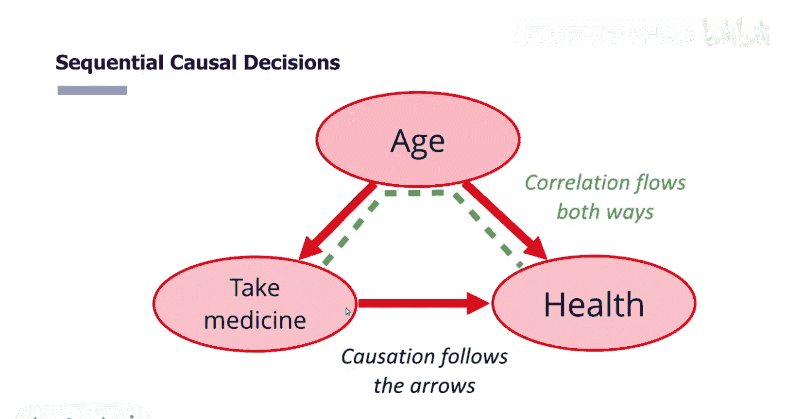
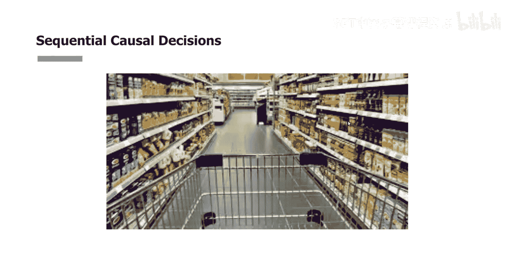
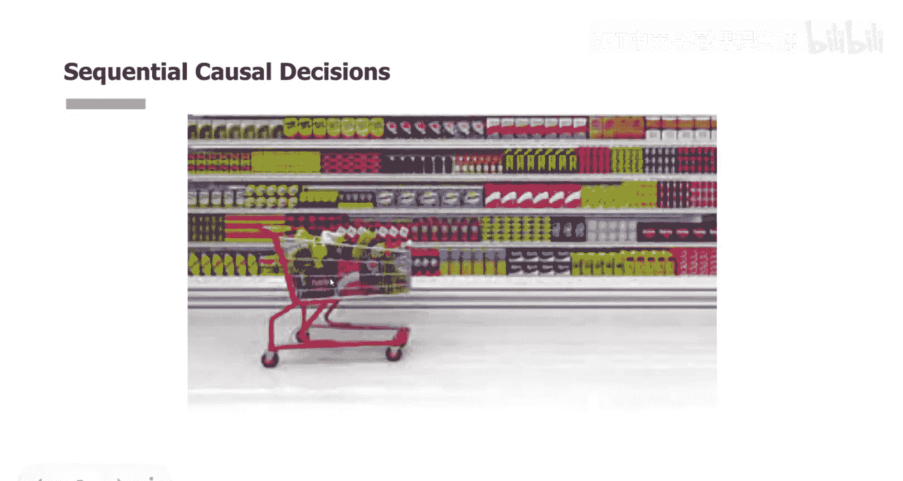
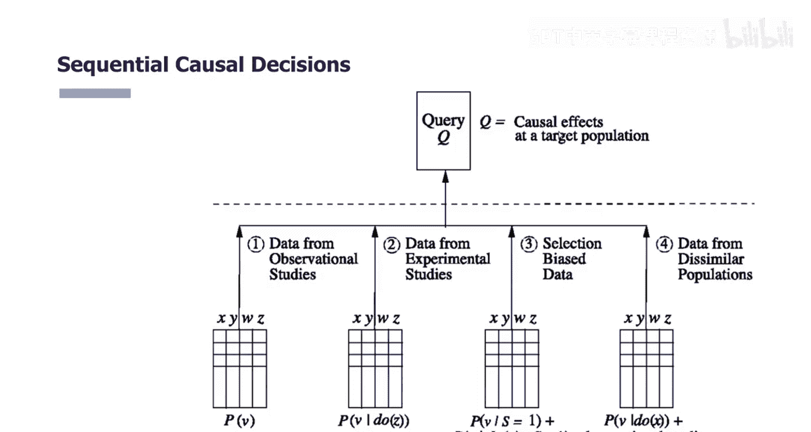
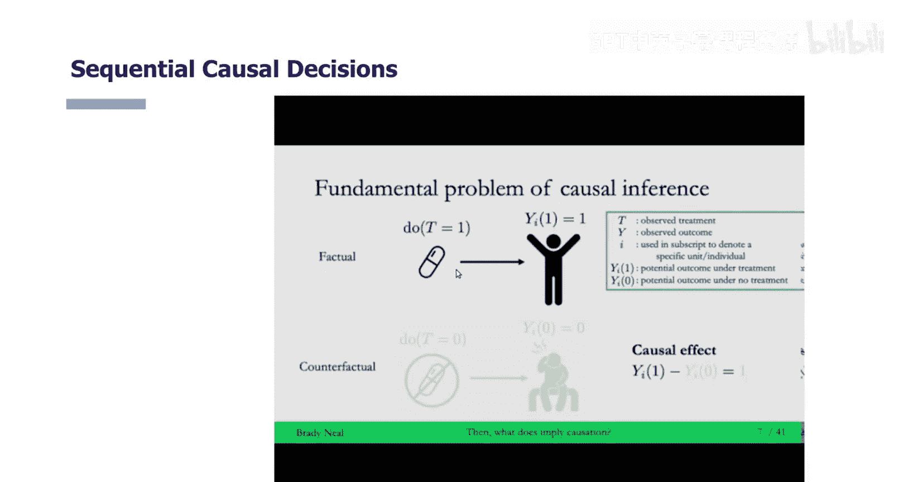
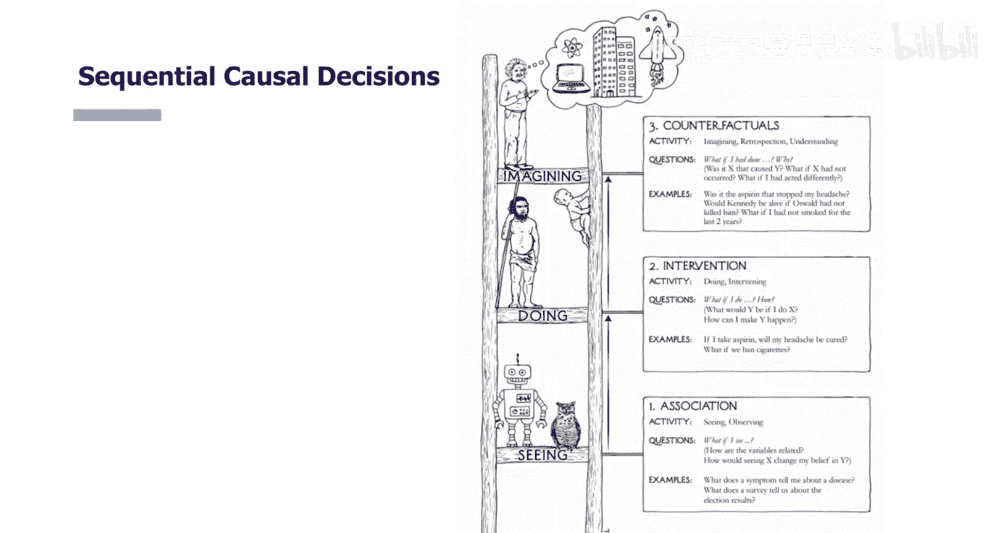

#  049：珀尔的因果阶梯 🪜

在本节课中，我们将学习因果决策的核心框架——珀尔的因果阶梯。我们将探讨如何从简单的关联观察，上升到干预分析，最终理解反事实推理，并了解这一框架如何帮助我们做出更好的序列化决策。

---

上一节我们介绍了在时间中做决策的总体概念。本节中，我们来看看一个强大的理论工具：珀尔的因果阶梯。这个框架将我们的认知分为三个层次，帮助我们区分“看到什么”、“做了什么”以及“如果当初……会怎样”。

## 从关联到干预

在数据科学中，我们常常从观察数据开始。请看下面的因果图示例：

在这个图中，变量 **Z** 同时影响 **X** 和 **Y**。这就产生了**混杂**问题。例如，年龄和是否服药都可能影响健康。如果我们只观察健康结果，就必须考虑这些混杂因素。

因果关系沿着箭头方向流动，但相关性可能通过多种路径产生。当我们进行序列因果决策时，必须区分**因果联系**和**统计关联**。我们的目标是利用真正的因果箭头来优化决策。

## 因果阶梯的三个层级

以下是Judea Pearl提出的因果推理的三个核心层级：

1.  **关联**：这是“看到”的层面。我们只关心事物之间的相关性，而不深究其因果联系。例如，观察到“服用维生素C的人更健康”。
2.  **干预**：这是“行动”的层面。我们通过“做”来探究因果关系。这需要用到**do-演算**。例如，“如果我服用阿司匹林，我的头痛会好吗？”或“如果我们禁售香烟，会发生什么？”
3.  **反事实**：这是“想象”的层面。我们追问“如果当初……”这类问题，以深入理解数据背后的原因。例如，“如果肯尼迪没有被刺杀，他现在还活着吗？”或“如果我过去两年没有吸烟，我的肺会是什么状态？”

## 决策中的挑战与应用

在现实决策中，我们面临诸多挑战。我们可能拥有海量数据，并对其进行查询。

*   我们可以从观察性研究中查询，这类似于从SQL表中提取数据。
*   我们也可以进行干预性研究，例如将个体分配到特定的治疗方案中，然后计算**条件概率**：`P(结果 | 治疗)`。这是一种更深入、更完整的数据分析方式。

然而，数据可能存在**偏差**，或者来自**不同质的群体**。这就引出了公平性问题。我们的目标是，即使面对有偏差的数据或不同质的群体，也能通过因果推理来校正这些偏差，从而理解真正的**因果效应**。

## 实例：商店定价策略

为了更具体地理解，让我们看一个贯穿本周课程的实例：实体商店（或线上商店）如何为商品定价以影响消费者的购物车。

假设你作为消费者在超市挑选商品。商店则试图通过动态调整价格来优化你的购物车内容。这与在线环境类似。商店的目标是理解消费者的选择序列，从而设定最佳价格点。

以下是一个决策序列的示例：

研究显示，当消费者以“前瞻性”方式思考时（例如，先拿了尿布，然后考虑热狗，再考虑热狗面包），购买某些关联商品的概率会显著增加。商店的任务就是预测这一系列**阶段化决策**，并通过价格策略来引导更有利的购物结果。

## 总结与展望

本节课中，我们一起学习了珀尔的因果阶梯。我们了解到：

*   **关联**层让我们描述世界“是什么”。
*   **干预**层让我们探索“如果我做X，Y会怎样”。
*   **反事实**层让我们深入追问“为什么”和“如果当初”。

我们的目标是沿着这个阶梯向上攀登，从被动的观察者变为主动的决策者。通过掌握因果推理，我们能够做出更好的序列化决策，无论是在商业定价、个性化医疗，还是在其他复杂的现实场景中。

在接下来的课程中，我们将深入探讨如何在实际问题中应用这些概念，特别是如何利用数据来理解和优化像购物车填充这样的序列决策过程。