#  050：时序医疗决策概述 🏥

在本节课中，我们将学习时序医疗决策的基本概念。我们将探讨如何在医疗保健中处理患者数据，并基于时间序列做出个性化治疗决策。课程内容源自Vanchar小组的一篇综述，重点介绍了从群体平均效应到个体化治疗的挑战与方法。

## 从群体平均效应到个体化治疗

上一节我们介绍了课程的整体框架，本节中我们来看看医疗决策中的一个核心矛盾：群体平均效应与个体化治疗之间的差异。

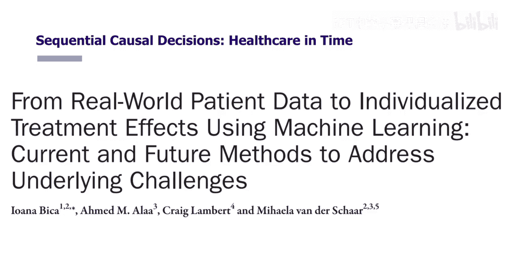

在长期医疗实践中，我们通常希望为每位患者优化治疗方案。然而，临床研究往往只能提供**平均治疗效应**。这意味着，基于大量具有不同特征的患者群体，我们可以提出一个总体有效的建议。但如图所示，平均效应曲线可能掩盖了个体间的显著差异。

我们真正需要了解的是，对于每位特定患者，其治疗反应曲线究竟如何。换言之，我们希望做出**最优个体化决策**。然而，在因果决策的框架下，我们面临一个根本性难题：对于任何个体，我们只能实施一种治疗方案，并观察到相应的结果。我们无法同时知道如果采用另一种方案会发生什么，这被称为“反事实”问题。因此，在因果背景下，确定最优的个体化治疗方案是一个重大挑战。

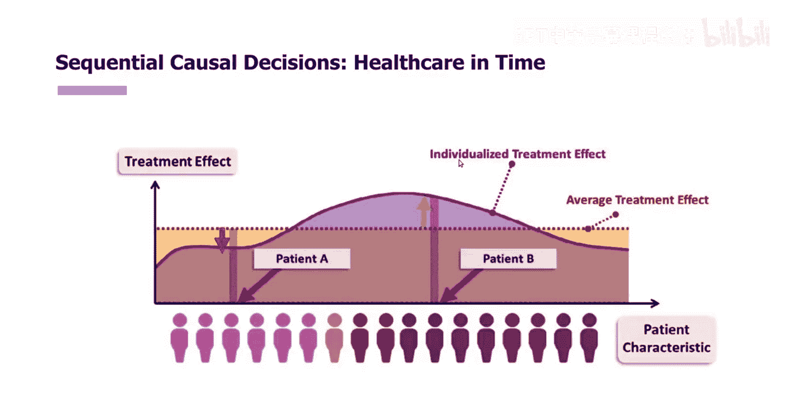

## 患者数据类型与决策场景

理解了核心挑战后，我们来看看支撑决策的数据类型以及常见的决策场景。

处理时序医疗决策的一种思路是，系统性地思考可获得哪些患者数据，以及我们将要做出何种类型的决策。以下是通常可用的数据类型和决策点：

**可用的临床数据**（原则上）：
*   人口统计学数据：如年龄、性别。
*   健康状况：合并症、遗传信息。
*   测量指标：实验室测量值、生命体征、症状、身体质量指数。
*   治疗历史：既往治疗类型。

**治疗决策类型**：
*   治疗选择：二元选择（如用/不用某种药）、分类选择（多种药选其一）、组合治疗。
*   剂量优化：确定特定药物的最佳剂量。

**关注的结局**：
*   单一结局：如康复概率。
*   多重结局：如同时考虑康复概率和治疗副作用。

因此，我们的治疗决策最终归结为：通过权衡治疗的额外益处和副作用，寻找**最优的单一或组合治疗方案**，或**最优剂量**。尽管我们拥有相当数量的数据，但做出有根据的决策仍然非常困难。理想情况下，我们希望为个体提供更好的方案，并尽可能使其随时间可调整。

## 电子健康记录与机器学习模型

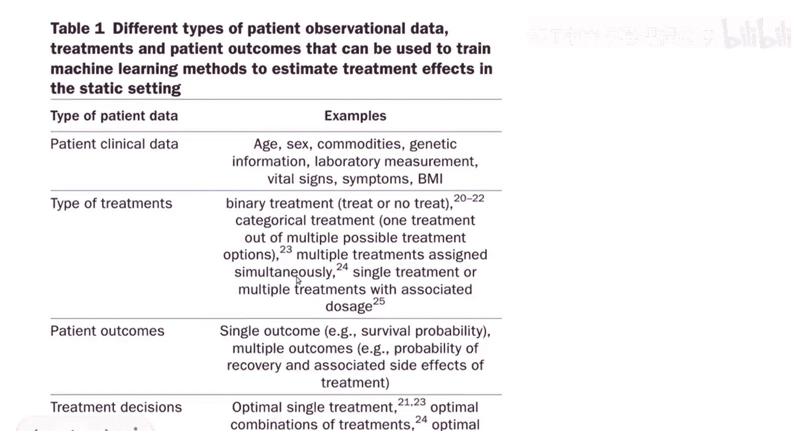

了解了数据类型，我们自然会问：如何利用这些数据？电子健康记录为机器学习模型提供了丰富的素材。

理论上，电子健康记录能为机器学习模型提供大量材料。这些用于医学的机器学习模型可以学习患者的真实因果模型。尽管实现这一目标尚需时日，但本课程所倡导的“在时间中做决策”的方法，正是朝着这个方向努力。

随着我们获得越来越多的数据，并且更擅长构建此类模型，这种基于因果结构的决策方式将变得越来越普遍。

设想一位乳腺癌患者。我们拥有诊断数据，如肿瘤大小、年龄、阳性淋巴结数量、手术类型、遗传标志物等。我们的目标是预测下一步该做什么。这可能是一个二元选择：**是否进行化疗**。这里的治疗变量 `W` 可以编码为：`W = 0`（不治疗）或 `W = 1`（化疗）。我们只能观察到实际实施的那个选择所对应的结果。

如图所示，虚线代表我们无法观察到的反事实结果，实线代表我们实际观察到的结果。我们的目标是从一组个体（可能来自临床试验或电子健康记录）的数据中，拟合出治疗与不治疗之间的**因果效应**。

## 建模方法：单一模型与双模型

面对“反事实”难题，我们有哪些建模方法呢？主要有两种思路。

我们可以通过两种不同的方式来估计这种效应：
1.  **单一模型**：将治疗指示变量 `W` 作为输入特征之一，构建一个预测结局 `Y` 的模型。公式可表示为：`Y = f(X, W)`，其中 `X` 是患者特征。
2.  **双模型**：分别为治疗组（`W=1`）和对照组（`W=0`）构建两个独立的模型。即构建 `f1(X)` 来预测如果治疗的结果，构建 `f0(X)` 来预测如果不治疗的结果。

对于化疗决策的例子，我们试图回答：做还是不做？我们可以用单一模型处理，其中包含治疗指示变量 `W`；也可以将其视为两个独立的问题（治疗 vs. 不治疗）分别建模。最终，我们都希望将决策个体化，尽管这在群体层面上已经颇具挑战。

## 可用模型与软件工具

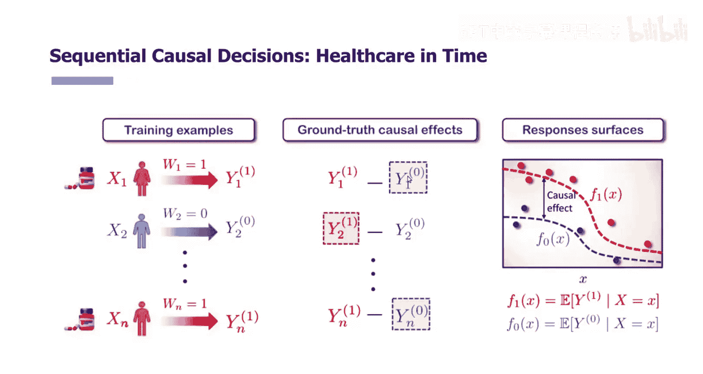

选择了建模思路，我们需要具体的工具来实现。以下是一些常用于此类任务的机器学习模型和相关软件。

这是一篇综述或教程类论文，其优点在于介绍了该领域人们使用的一些不同软件和机器学习模型类型。其中一些模型，例如**因果森林**，我们将在后续课程环境中接触并了解。这些模型之所以适用，是因为它们能够处理复杂的交互关系。

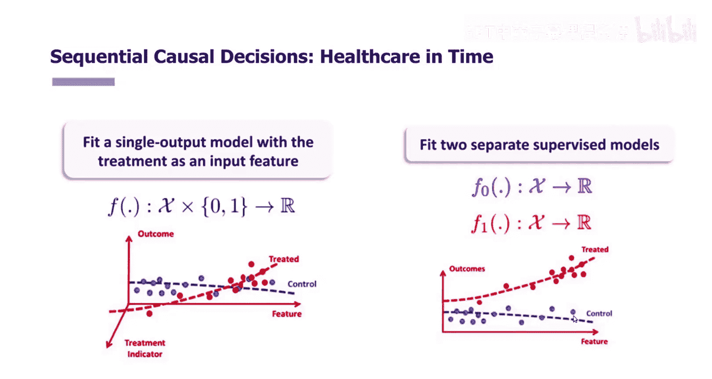
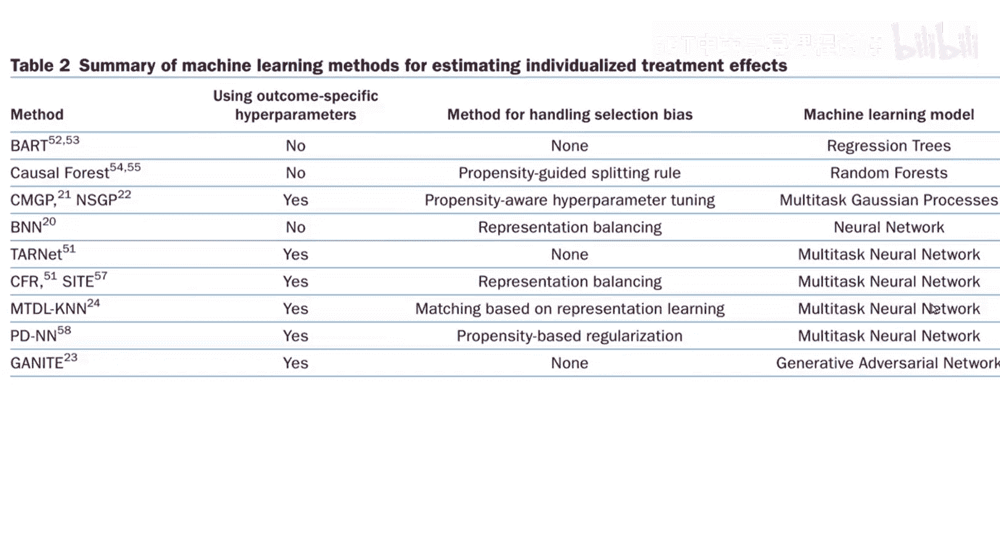
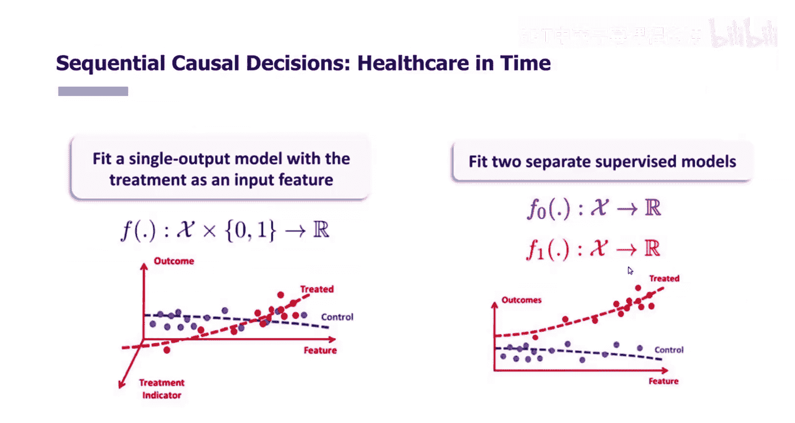

常用的模型包括：
*   **回归树与随机森林**（如因果森林）：擅长捕捉特征间的非线性关系和交互效应。
*   **高斯过程**：提供预测的不确定性估计。
*   **各类神经网络**：能够学习高度复杂的模式。

理解并解释这些模型所拟合的“响应曲面”，是我们真正的目标。

## 时序预测与优化决策

最后，我们将所有环节串联起来，看看如何在时间序列上实现动态的预测与优化。

核心思想是：我们有一位最佳护理状态下的患者前来就诊。我们拥有其诊断信息和纵向历史数据（这些时间点可能间隔不均，但记录了其随时间变化的轨迹）。我们的目标是计算其五年生存率曲线。借助电子健康记录，我们能够整合大量信息并进行预测。

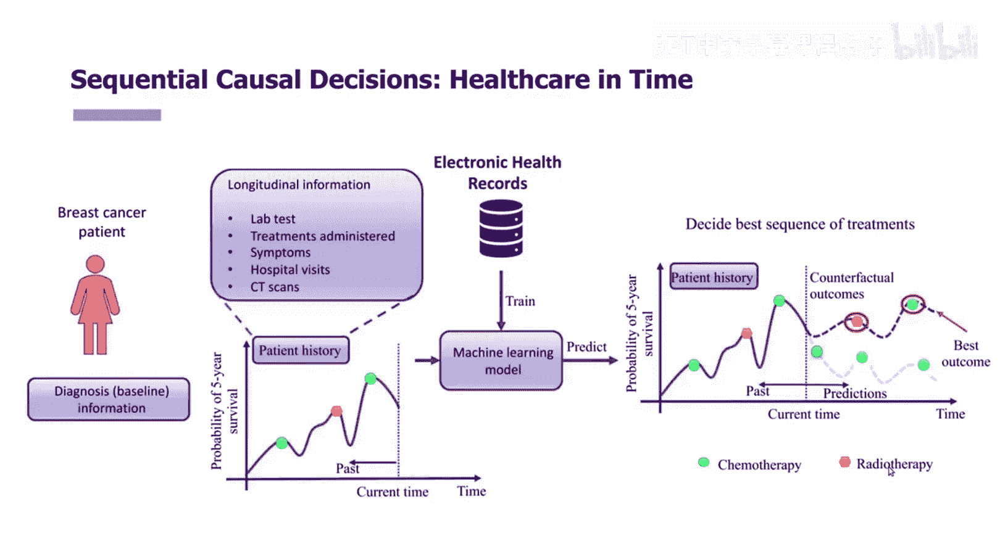
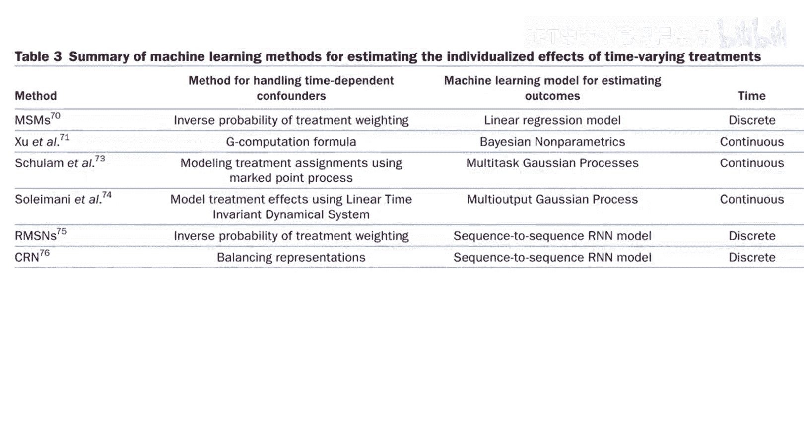
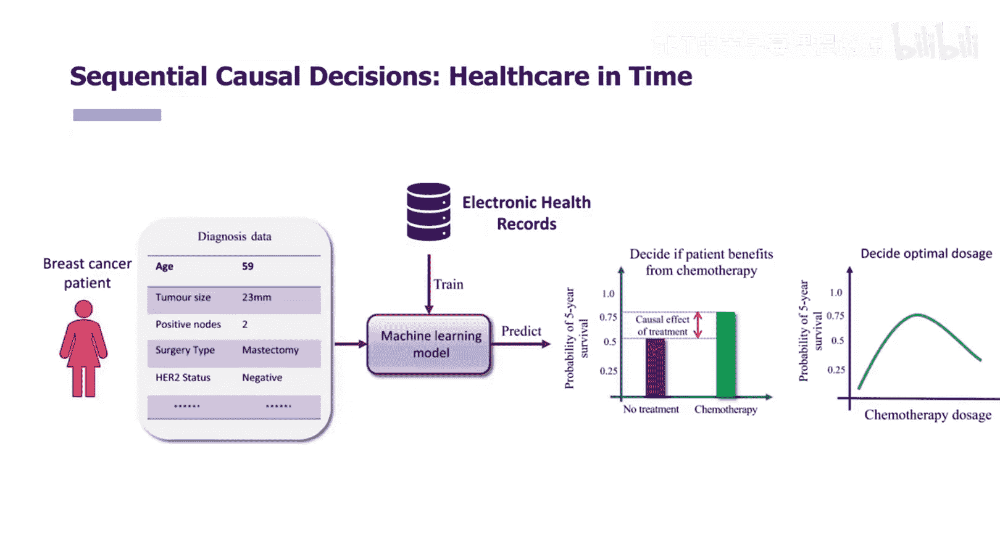
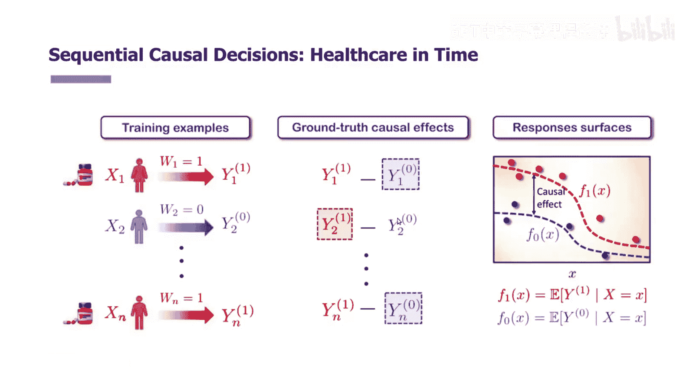

对于这位个体患者，我们有其过去的历史。理想情况下，我们能处理这种反事实推理——虽然我们只能分配一种实际路径，但我们试图进行“如果……会怎样”的预测，即如果我们选择了另一条路径会发生什么。然后，我们将据此进行优化以获得最佳结果。我们可能需要在化疗和放疗之间选择，或在治疗与不治疗（0/1二元）之间选择，这也可以扩展到多类别选择。

已有许多论文运用不同方法在此领域进行探索，有些处理离散时间，有些处理连续时间。所有这些研究的共同论点是，我们试图从训练样本、患者特征 `X1...XN` 以及理想情况下随机的治疗分配中，以最佳方式理解不同的响应曲面。我们可以用两种不同方式（单一模型或双模型）进行拟合，使用不同的模型，并在此基础上进行优化。

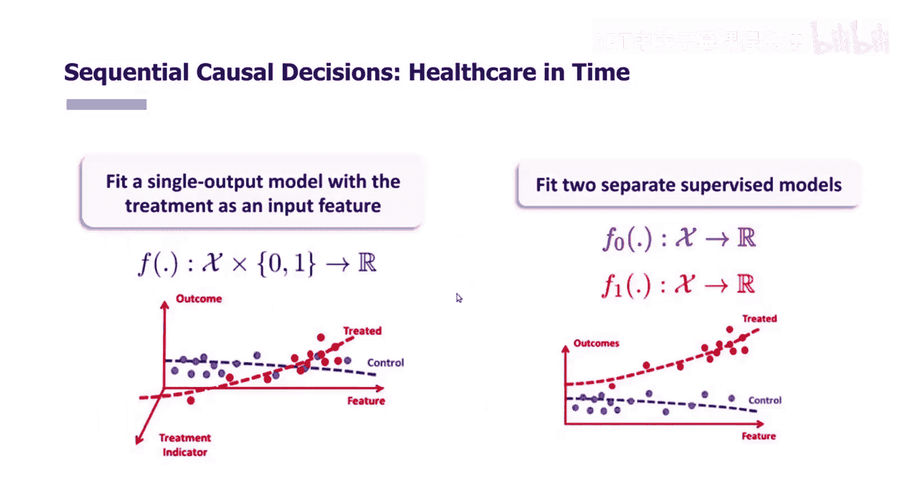

## 总结

本节课中，我们一起学习了时序医疗决策的概述。我们探讨了从群体平均效应推断个体化治疗的挑战，回顾了医疗决策中可用的数据类型和场景。我们介绍了如何利用电子健康记录和机器学习模型（如因果森林）来构建因果模型，并讨论了单一模型与双模型两种主要建模方法。最后，我们了解了如何在患者的时间序列数据上进行预测，并优化治疗决策。希望本节内容能帮助你理解如何为医疗保健构建这类因果模型，我们将在后续课程中继续深入探讨。