#  051：使用EconML进行因果A-B测试 🧪

在本节课中，我们将学习如何利用工具变量和EconML软件库，在存在混杂因素和不完全依从性的情况下，进行因果推断式的A/B测试。我们将通过Tripadvisor会员计划的实际案例，理解其核心概念和实现步骤。

---

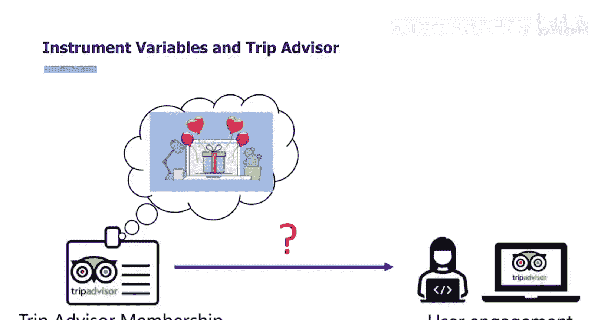

## 概述

A/B测试的核心问题是比较两种不同处理方案（A与B）的效果。在因果推断的框架下，我们不仅想知道哪种方案更好，更希望理解其背后的原因。这在实际应用中常面临两大挑战：**混杂因素**和**不完全依从性**。本节课将介绍如何使用**工具变量**和微软开发的**EconML**库来解决这些问题，从而获得可靠的因果结论。

---

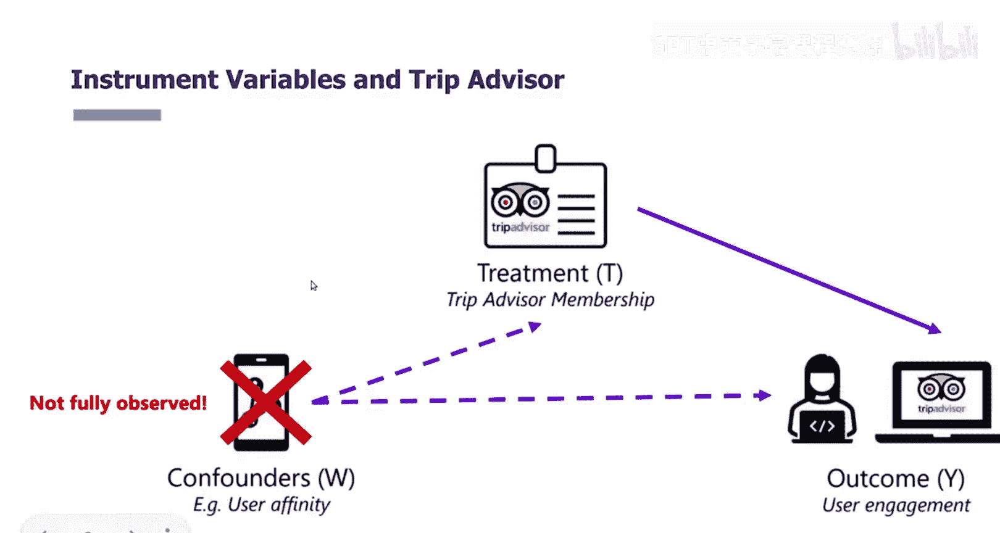

## 混杂因素与不完全依从性的挑战

上一节我们介绍了因果推断的基本思想。本节中我们来看看在实际A/B测试中遇到的两个主要障碍。

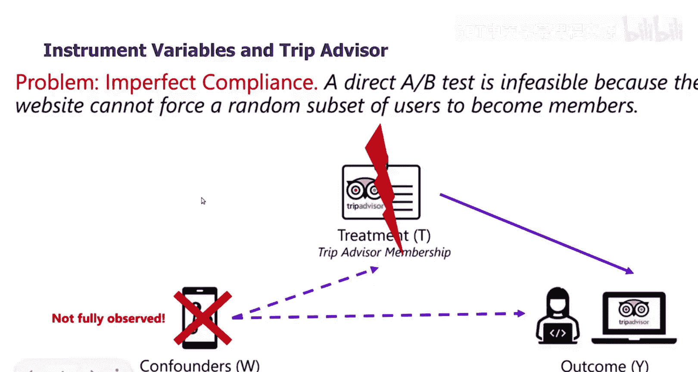

**混杂因素**是指那些同时影响**处理分配**和**结果变量**，但未被完全观测或控制的变量。在我们的案例中，用户的“亲和力”可能同时影响其是否选择成为会员（处理）以及后续的网站参与度（结果），但它难以被直接测量。

**不完全依从性**是指并非所有被分配到某一处理组的用户都会实际接受该处理。例如，我们不能强迫被随机选中的用户注册成为Tripadvisor会员。这导致直接比较“成为会员”与“未成为会员”两组用户的结果会产生偏差。

---

## 解决方案：工具变量法

为了解决上述问题，我们引入**工具变量**。其核心思想是找到一个变量 **Z**，它满足以下两个条件：
1.  **Z** 会影响处理分配 **T**。
2.  **Z** 不直接影响结果 **Y**，它只通过影响 **T** 来间接影响 **Y**。

在Tripadvisor的案例中，他们设计了一个A/B测试：随机将用户分配到“简易注册流程”（A组）或“常规注册流程”（B组）。这个**注册流程的难易程度（Z）** 就是一个工具变量。它随机分配，会影响用户最终“是否成为会员（T）”，但理论上不会直接影响用户未来的“网站访问次数（Y）”。

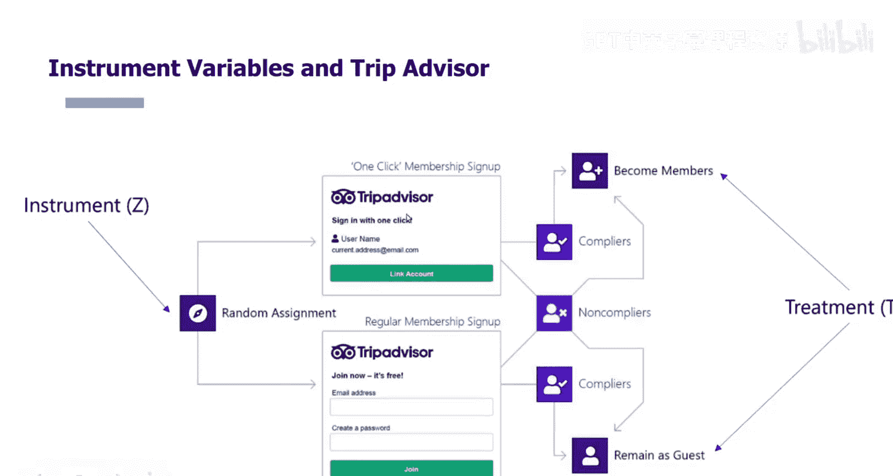

以下是核心关系的图示和公式表示：

```
Z (工具变量: 注册流程) → T (处理: 是否会员) → Y (结果: 访问次数)
    ↑ (不影响)
W (混杂因素: 如用户亲和力)
```

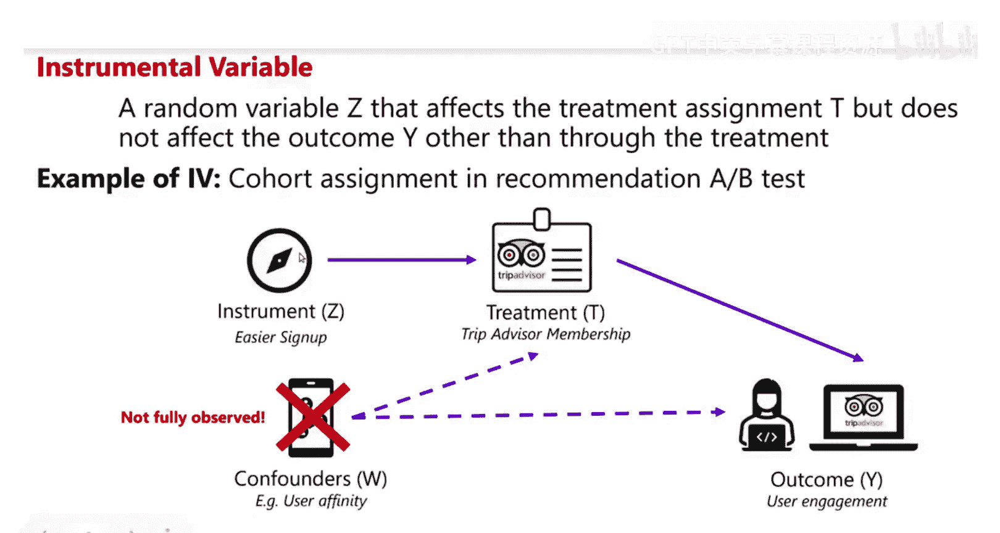

我们试图估计的模型是：
**Y = θ(X) · T + f(X) + ε**
其中，**θ(X)** 就是我们关心的**条件平均处理效应**，它可能随用户特征 **X** 而异。

---

## 案例数据与变量说明

以下是Tripadvisor案例中使用的关键变量：

*   **Y (结果变量)**: 实验后14天内的网站访问次数。用于衡量用户参与度。
*   **T (处理变量)**: 用户是否最终成为了会员（是=1，否=0）。
*   **Z (工具变量)**: 用户被随机分配到的注册流程类型（简易=1，常规=0）。
*   **X (协变量/用户特征)**: 用于捕捉用户异质性的特征，例如：
    *   实验前访问特定页面（如酒店、航班）的天数。
    *   用户所在地区、操作系统。
    *   实验前的消费金额等。
*   **W (混杂因素)**: 未完全观测的变量，如用户对平台的固有偏好。

---

## 使用EconML进行实现

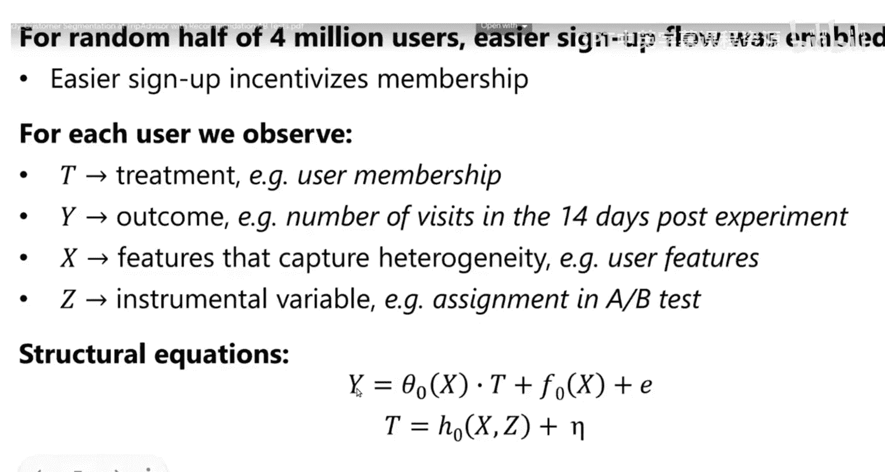

EconML是一个由微软开发的Python库，它让因果推断模型的实现变得简单。以下是使用EconML中**DRIV**模型的核心代码步骤：

首先，导入必要的库并初始化模型。我们选择使用随机森林作为基础学习器来建模Y和T。

```python
from econml.iv.dr import LinearDRIV
from sklearn.ensemble import RandomForestRegressor, RandomForestClassifier

# 定义模型
model = LinearDRIV(
    model_y=RandomForestRegressor(),  # 用于估计Y|X的模型
    model_t=RandomForestClassifier(), # 用于估计T|X,Z的模型
    model_final=None, # 最终效应模型，可为线性或其他
    featurizer=None,  # 可选项，用于处理特征X
    fit_cate_intercept=True
)
```

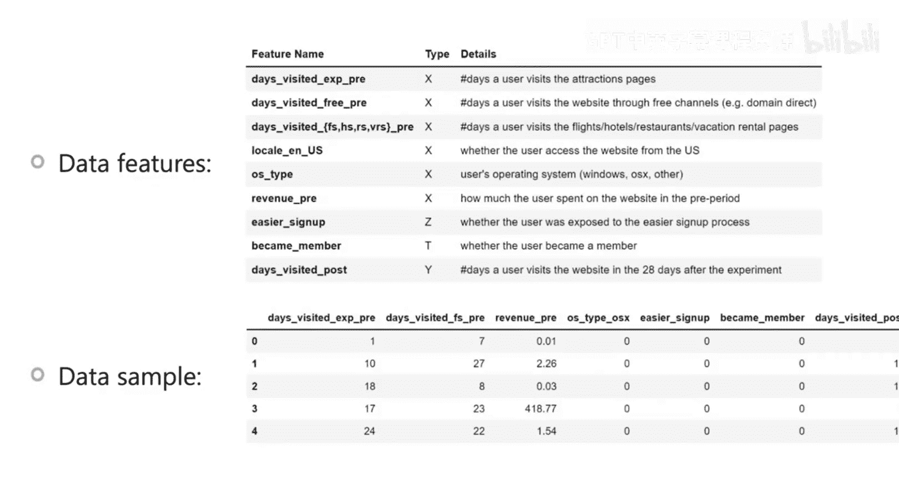

接着，使用数据拟合模型。这里需要提供结果变量、处理变量、工具变量和协变量。

```python
# 拟合模型
model.fit(Y, T, Z=Z, X=X)
```

模型拟合完成后，我们可以进行因果效应估计和统计推断。

```python
# 估计条件平均处理效应 (CATE)
cate_estimates = model.effect(X_test)

# 进行统计推断（如计算置信区间）
inference = model.effect_inference(X_test)
confidence_intervals = inference.conf_int()
```

最后，我们可以评估哪些用户特征对处理效应的异质性贡献最大。

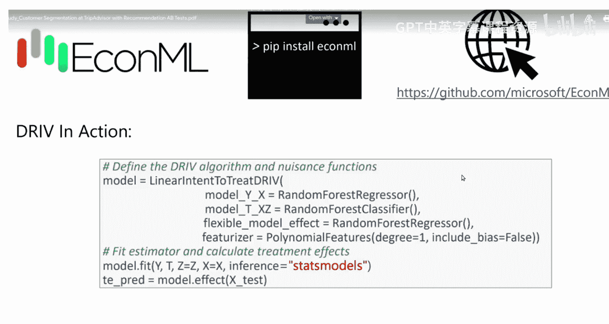

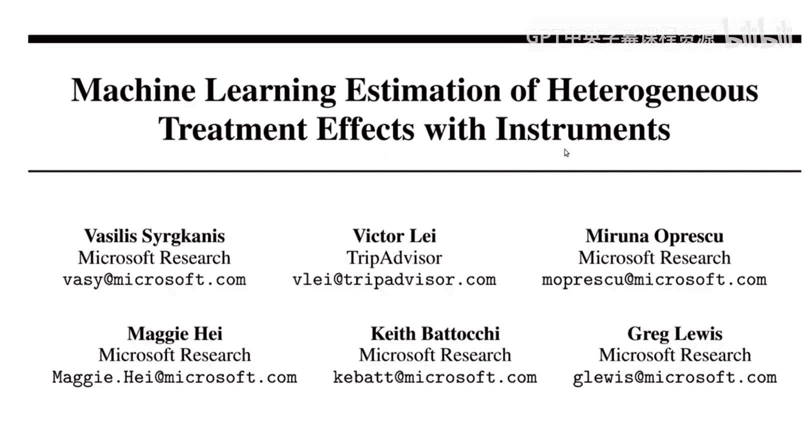

```python
# 获取特征重要性（了解哪些X导致效应不同）
feature_importance = model.feature_importances()
```

---

## 算法原理简述

DRIV算法的核心是通过构造**正交损失函数**来估计条件平均处理效应 **θ(X)**，其大致分为五个步骤：
1.  使用一半样本（S1）初步估计 **θ(X)**。
2.  在S1上，分别建立Y对X、T对X、Z对X的回归模型，得到估计量 **Q̂**, **P̂**, **R̂**。
3.  在S1上，将 **T · θ(X)** 对 X 进行回归，得到函数 **f̂** 的估计。
4.  在另一半样本（S2）上，构造一个基于工具变量 **Z** 的伪结果变量 **Ỹ**。
5.  在S2上，通过最小化关于 **θ(X)** 的均方损失函数，最终优化得到效应估计值。这本质上是一个在假设空间内寻找最优解的过程。

---

## 结果解读与总结

应用上述方法后，Tripadvisor发现了一些有意义的洞察。例如：
*   **用户的操作系统**是导致会员计划效果出现异质性的一个重要因素。
*   实验前访问**度假租赁页面**的天数也是一个显著的特征。
*   而实验前的用户消费金额（收入）则预测能力不强。

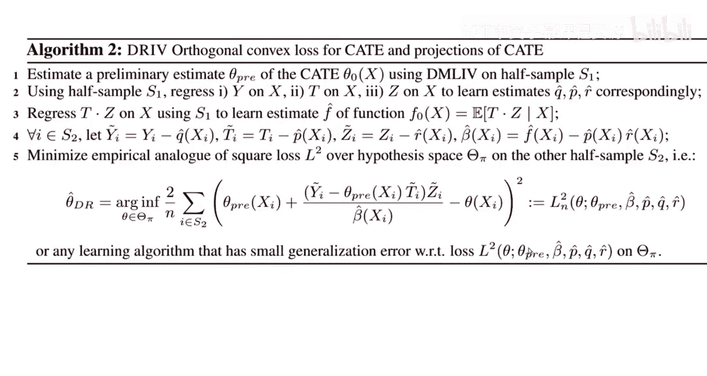

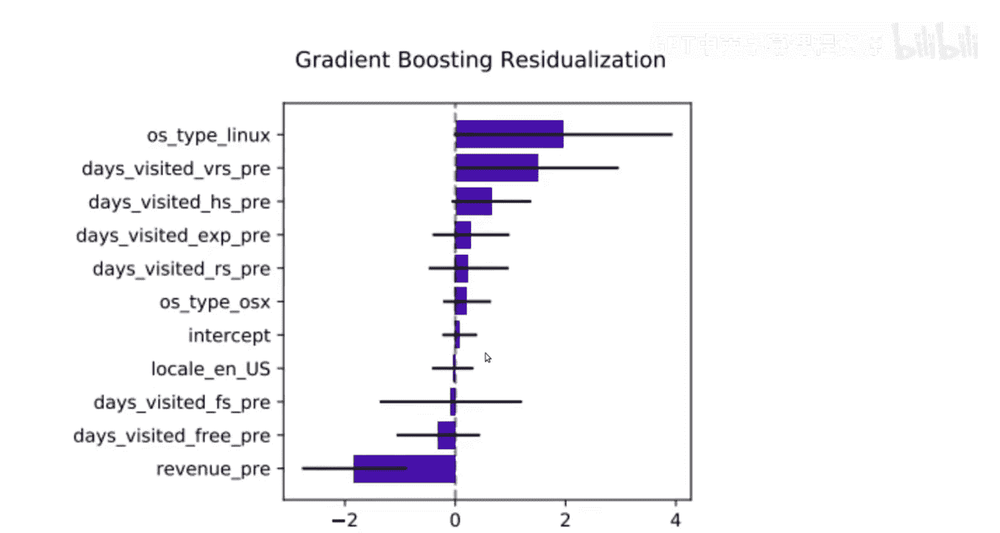

本节课中，我们一起学习了如何将经典的A/B测试问题置于因果推断框架下。通过引入**工具变量**，我们能够有效应对**混杂因素**和**不完全依从性**的挑战。借助像**EconML**这样强大的开源工具，我们可以相对便捷地估计**条件平均处理效应**，从而不仅知道哪种处理更好，还能理解它对哪些类型的用户更有效。这是进行数据驱动的、有时效性的决策的关键一步。