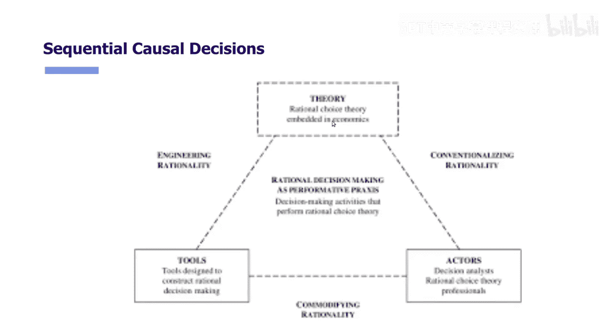
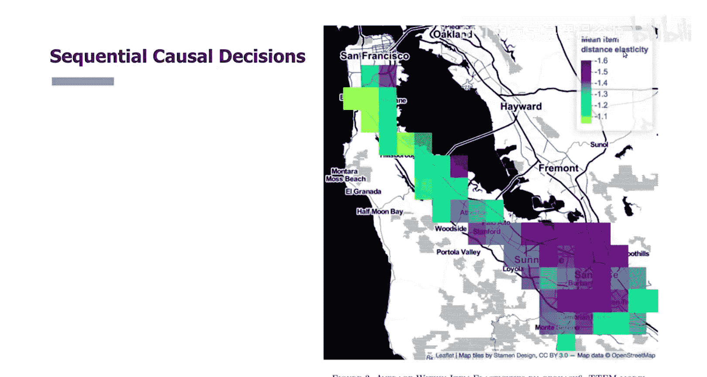
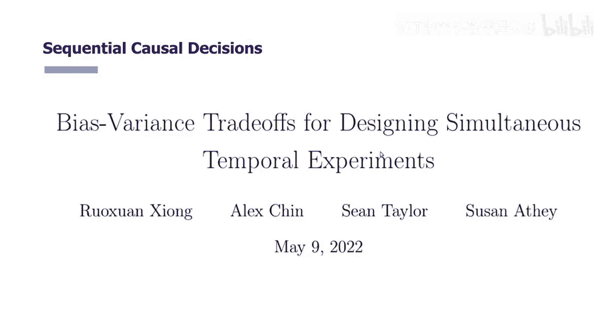
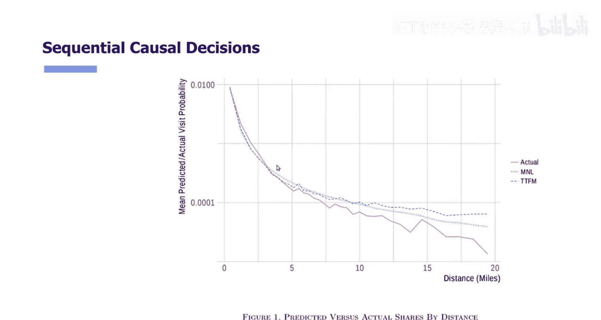
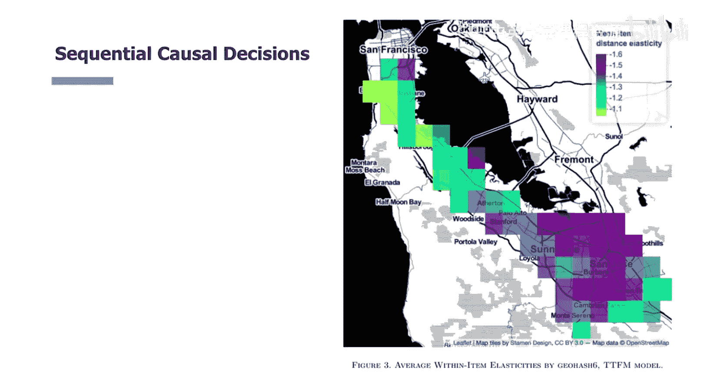

#  052：地理决策分析 🗺️

在本节课中，我们将探讨地理决策分析。我们将学习如何将地理描述与时间描述结合，以理解空间和时间因素如何共同影响决策。课程将介绍相关研究案例，并解释核心概念如弹性分析，帮助初学者理解如何在实际问题中应用这些方法。

---

## 地理与时间因素的结合

上一节我们讨论了时间序列决策，本节中我们来看看地理因素如何影响决策。研究问题在于：当我们同时考虑地理描述和时间描述时，决策会发生什么变化？这主要基于Susan Athe、David La及其同事的研究。

他们首先研究了餐厅选择，考虑了通勤时间、成本、食物类型等因素，数据来自湾区。该研究很好地推广到许多具有空间和时间成分的场景，因此在建模中同时处理两者非常重要。

---

## 数据来源与研究方法

研究使用了匿名地理位置数据的大数据集。通过分析午餐时段的餐厅选择，他们探讨了以下因素：

*   工作地点到餐厅的距离
*   食物类型
*   价格水平
*   营业时间

这些分析最终指向一个核心问题：能否理性地决定在特定位置开设何种类型的餐厅最为合适。这关联到经济学中的**理性选择理论**。

---

## 理性选择理论与现代工具

理性选择理论在经济学中历史较长，但如今正被来自电子设备（如报告地理位置数据的手机）的海量数据以及现代机器学习方法所革新。

这意味着我们拥有了：
*   **新工具**：处理大规模地理时空数据的能力。
*   **新行动者**：能够更快速调整和控制的决策主体。

因此，理性选择理论的内涵变得比早期经济学文献中更为丰富和深入。

---

## 弹性概念解析

研究中的一个核心概念是**弹性**。它衡量的是，当某个变量（如价格或距离）发生变化时，需求量会发生多大程度的变化。

你可以将弹性理解为一种斜率。在经济学中，价格弹性公式通常表示为：

**弹性 = (需求量变化百分比) / (价格变化百分比)**

或者更一般化地：

**弹性 = (因变量Y的变化百分比) / (自变量X的变化百分比)**

研究中，他们计算了特定餐厅相对于位置、距离和价格的弹性，其数值在1.1到1.6之间变化。

---

## 餐厅选择案例详解

以下是研究的具体分析步骤：

1.  **数据追踪**：通过匿名手机地理位置数据，追踪用户在午餐前的位置以及随后前往的餐厅。
2.  **因素分析**：考察如Yelp评分等因素是否影响午餐选择。
3.  **模型构建**：为用户选择餐厅的效用建立模型，影响因素包括：
    *   **价格**
    *   **声誉**（来自Yelp或同事间口碑）
    *   **顾客偏好**（如对泰国菜或日本菜的偏好）
    *   **距离效应**（距离越远，效用越低）
    *   **时间效应**（季节性或一天中的时段）

通过拟合模型，研究者可以从数据关联走向因果推断，甚至进行反事实分析，例如：“如果我在特定位置以不同价格开设一家新餐厅，预期需求会是多少？”

---

## 弹性在实践中的应用

研究通过图表展示了不同价格点和菜系（西餐 vs 亚洲菜，廉价快餐）的需求变化。关键发现是，距离对访问概率有显著影响。

例如，根据主模型（图中蓝色虚线），随着距离增加，前往餐厅的概率急剧下降。从2.5英里增加到5英里，或从5英里增加到10英里，访问概率会大幅降低。

这意味着，可以根据人群密度和距离函数来预测“需求弹性”，从而估计随着顾客距离餐厅变远，需求会下降多少。

---

## 地理区域的弹性差异

研究最终生成了显示不同地理区域弹性差异的图表。湾区南部区域与更靠近旧金山的区域，其需求弹性不同。

这种差异是以下因素的函数：
*   该区域的餐厅密度
*   价格点
*   该区域工作者的偏好
*   人群偏好和声誉（例如，特定办公园区的人可能喜欢去相似的餐厅）

---

## 本周另一案例：时空实验设计

本周我们将讨论的另一个案例是关于设计同步时空实验的。这类似于Uber等场景中感兴趣的问题，涉及：
*   **购买概率弹性**
*   **品牌选择概率弹性**
*   **购买质量弹性**

实验设计涉及随时间推移分配不同的处理（如WL1, WL2, WL3），并观察其对需求的影响，同时考虑混杂因素。

核心问题是：能否以优化目标的方式临时分配处理？能否让每种处理在时间推进中几乎独立地发挥作用？这涉及到在存在混杂因素的情况下，理解不同处理方案对需求的影响。

---

## 总结

本节课中我们一起学习了地理决策分析。我们探讨了如何将地理与时间维度结合建模，介绍了**理性选择理论**在现代数据背景下的新应用，并深入解析了**弹性**这一核心概念，即`需求量变化百分比 / 价格（或距离等变量）变化百分比`。通过餐厅选择的案例，我们看到了如何利用匿名地理位置数据预测需求，并理解不同区域的弹性差异。最后，我们预览了时空实验设计在处理像Uber这类动态市场问题中的应用。这些方法使我们能够更好地预测行为，并做出更理性的商业和策略决策。