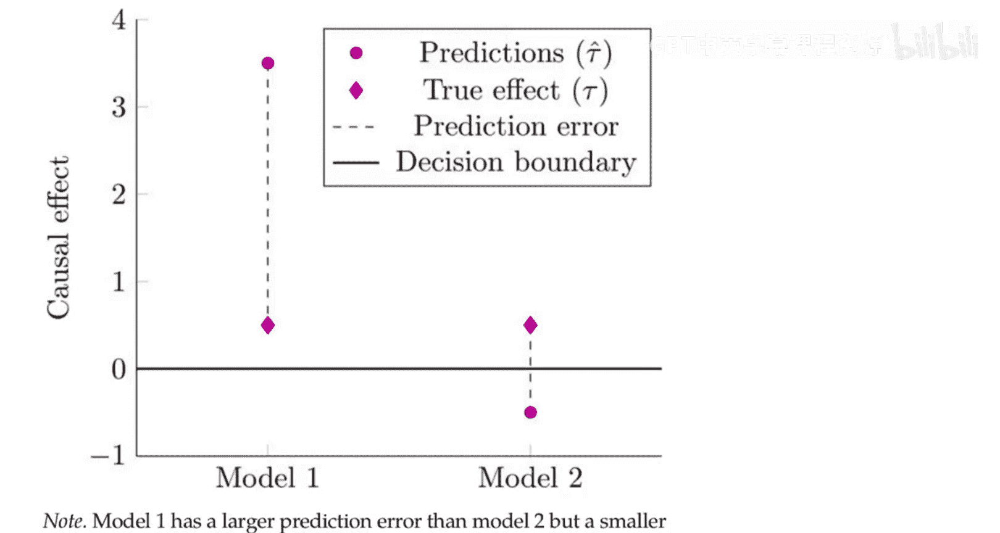
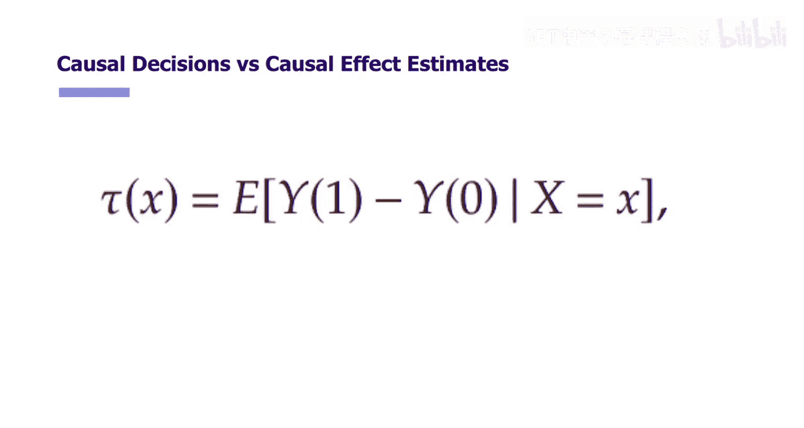
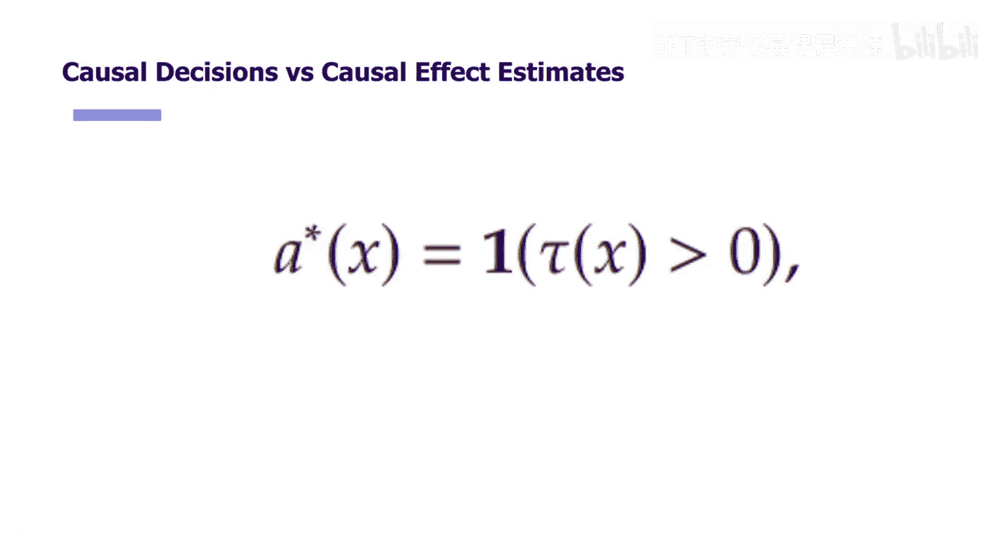
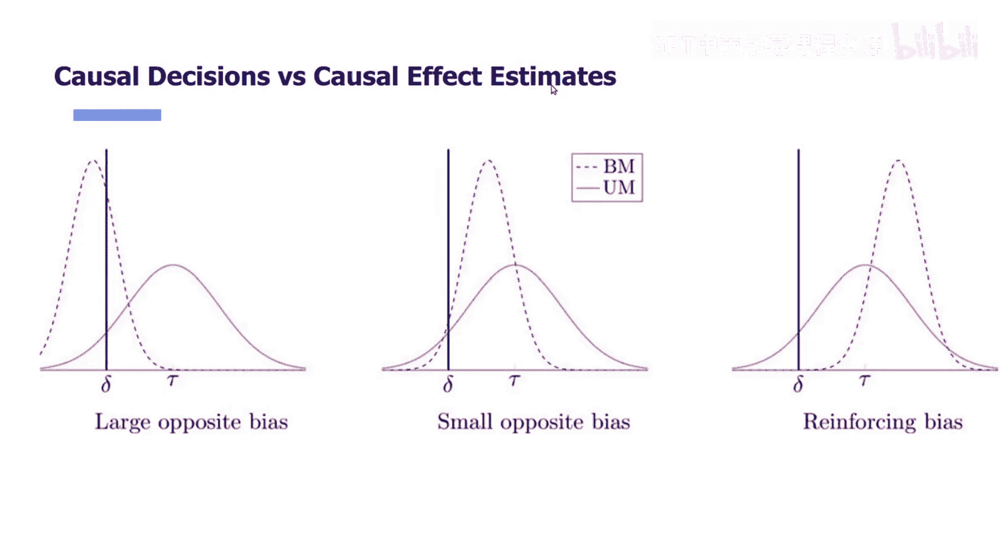
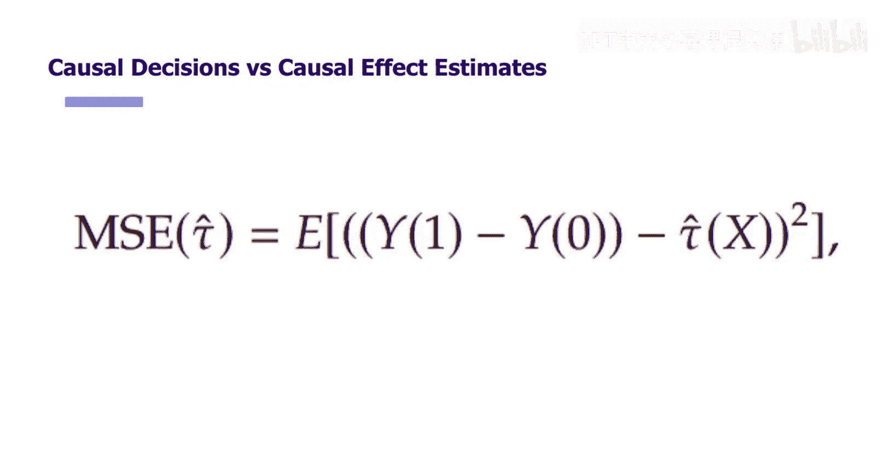
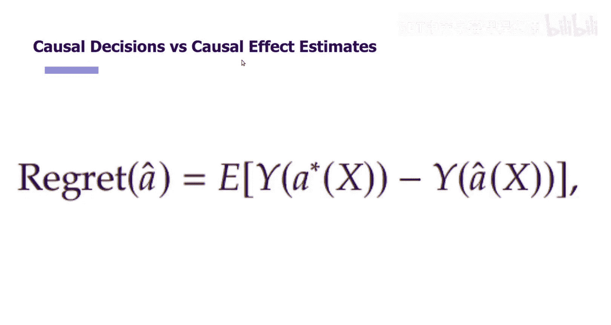
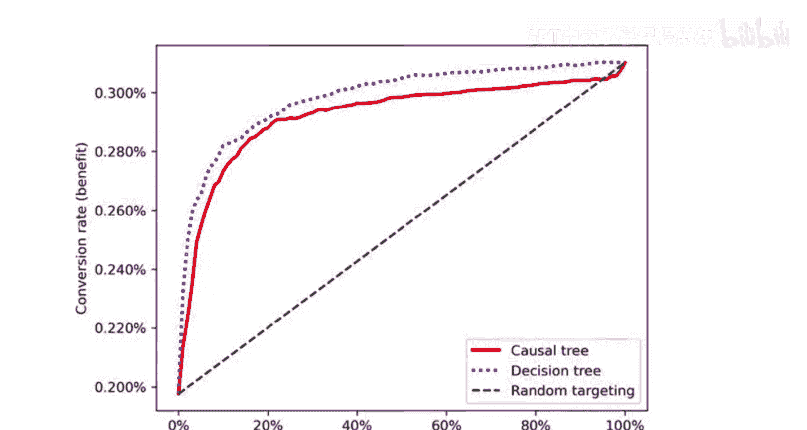

#  053：决策需求与效应估计的区分 🎯

在本节课中，我们将探讨因果决策与因果效应估计之间的核心区别。这个区别类似于分类问题设定的决策边界与回归问题定义的连续估计之间的差异。理解这一点对于选择正确的模型和方法至关重要。

## 分类与回归的类比

上一节我们介绍了因果推断的基本概念，本节中我们来看看如何通过分类与回归的类比来理解决策与估计的区别。

下图展示了两个不同的模型（模型1和模型2）在预测真实效应（蓝色菱形）时的表现。因果效应的决策边界是0：效应高于0时，采取治疗决策是值得的；低于0时则相反；等于0时为中性。

模型1的预测始终在0线之上，而模型2的预测则跨越了0线。因此，尽管模型2的预测误差可能更小（在某些从业者看来更好），但模型1对于治疗决策而言是更优的模型。

如果我们把分类类比看作如何做出最佳决策（即因果决策或分类问题），那么像模型1这样对“治疗谁”进行分类，实际上比尝试进行回归（可能导致预测误差更小但分类效果差）更好。

换句话说，你的目标（是设定决策边界还是进行精确估计）会直接影响你应该选择哪种类型的模型。分类模型可能伴随更大的预测误差，而回归模型则追求在更广泛数据范围内更精确的预测，但其在“治疗谁”的刚性决策上可能不那么出色。

这很快引出了一个重要观点：好的分类器和好的回归器是截然不同的。适用于其中一种的方法未必适用于另一种。这一点需要牢记。

## 因果效应估计：回归视角

当我们从估计因果效应的角度思考时，任务通常是回归类型的。目标是理解在给定协变量 `X` 的特定值下，治疗（`T=1`）与不治疗（`T=0`）的期望结果差异。

由于我们只能观察到其中一个潜在结果，因果效应 `τ(x)` 的估计公式为：
`τ(x) = E[Y(1) | X=x] - E[Y(0) | X=x]`

这种估计是许多因果模型的核心任务，旨在为我们未知的情境进行推断。这本质上是一种回归。

## 最优决策：分类视角

另一方面，我们常常试图做出相对于某个阈值的最佳行动或决策。例如，我们设定当效应 `τ(x) > 0` 时才进行治疗。

我们的决策目标是最优化行动 `a*(x)`，其公式为：
`a*(x) = I( τ(x) > 0 )`
其中 `I(·)` 是指示函数。

这可以被视为一个分类问题：根据特征 `X` 将个体分为“治疗”或“不治疗”两类。另一种理解方式是考虑有偏模型与无偏模型。

下图展示了三种无偏模型（实线）和三种有偏模型（虚线）。决策边界是那条垂直线。

以下是不同偏差情况下的决策影响：
*   如果一个有偏模型大幅向左偏移，那么基于回归模型进行分类可能效果更好。
*   如果模型在治疗组和未治疗组的主要区域大致重合，那么选择哪个模型差异不大。
*   如果存在一个大幅向右偏移的有偏模型，那么使用有偏模型实际上可能比无偏模型更好。

本节内容基于一篇关于“因果决策与因果效应估计”的论文，课程资料中会提供该论文供深入阅读。

## 机器学习框架下的思考

我们可以用机器学习的方式进一步形式化这两种目标。

对于因果效应估计（回归目标），我们通常最小化均方误差：
`MSE = E[ (τ(x) - \hat{τ}(x))^2 ]`
这类似于最小二乘估计。

对于因果决策（分类/决策目标），我们更关注于最小化“遗憾”或最大化期望效用。这类似于多臂老虎机问题中的“探索-利用”框架，目标是定义最佳行动 `a*`。

论文指出，区分你是在思考因果决策还是因果效应估计，对于你尝试做的事情有重大影响。在某些场景下，如果你不特别担心混杂偏倚，只是寻找最优行动，那么处理系统可能会同样有效。

## 实例对比与启示

在最后一个例子中，论文提出了一个强有力的论点。下图对比了决策树（蓝色虚线）和因果树。

在思考像转化率这样的收益时，两者得出了非常相似的收益结果。基于为其他目的收集的、可能存在偏倚的数据进行再利用，来尝试找出最优行动时，在该场景下定义分类问题可能比定义回归问题容易得多。

这带来了许多值得思考的地方。它帮助我们看清分类与回归的细微差别，以及不同类型模型的微妙之处。

*   **最优行动**：可以多思考多臂老虎机问题，真正尝试弄清楚在哪些协变量定义下应该治疗或不治疗。
*   **严格因果模型**：则更偏向回归型模型，其对数据的要求要深入得多。

这是一篇非常有趣且发人深省的论文。

## 总结

本节课中我们一起学习了因果决策与因果效应估计的核心区别。我们通过分类与回归的类比理解了这一区别，探讨了从回归视角进行效应估计和从分类视角进行最优决策的不同目标与方法，并在机器学习框架下形式化了这两种思路。关键启示在于，明确你的分析目标（是做决策还是做估计）至关重要，因为它直接影响模型选择，并且有时基于有偏数据寻找最优行动可能是一种实用且有效的策略。