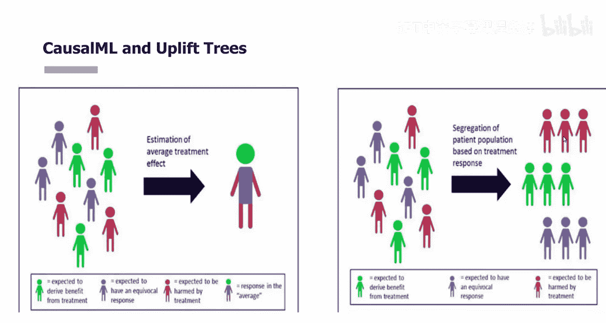
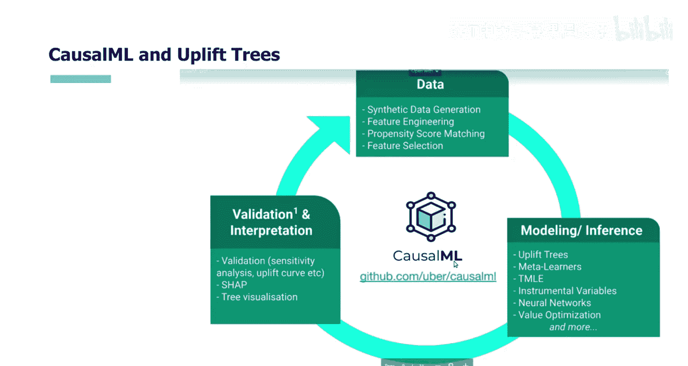
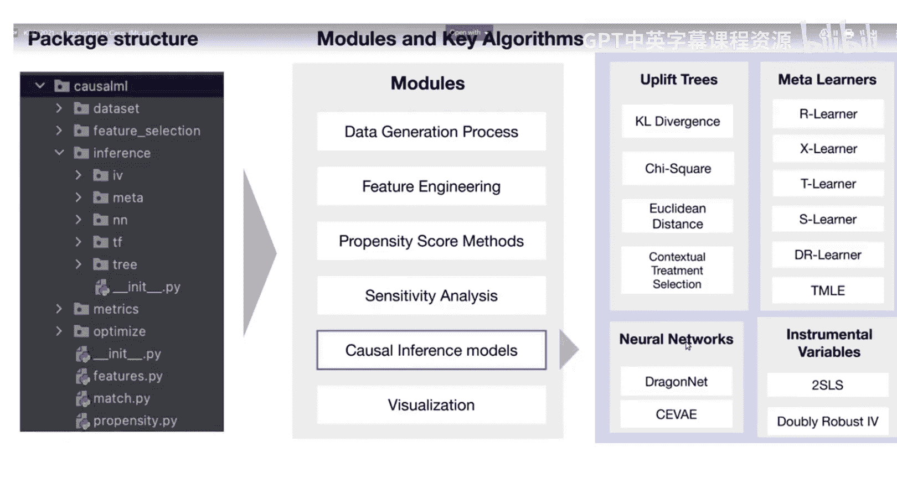
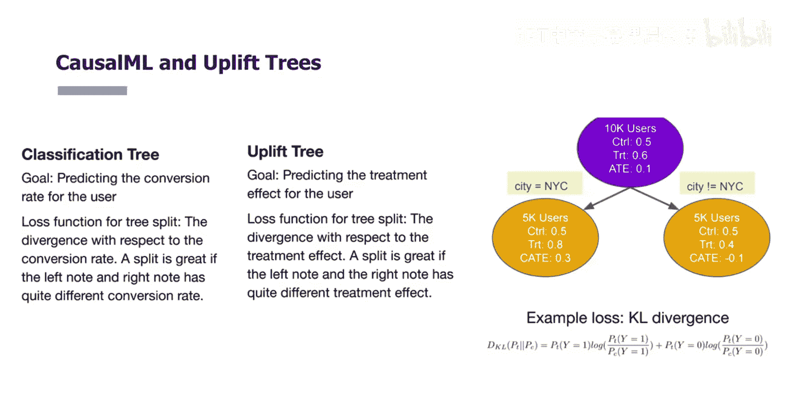
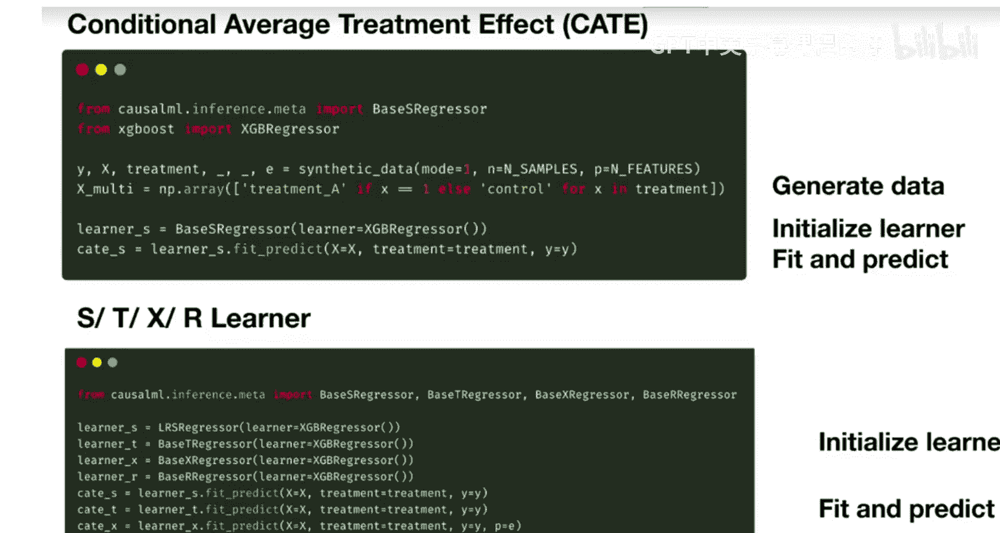
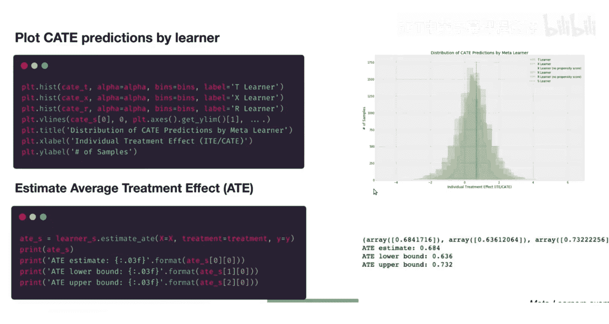
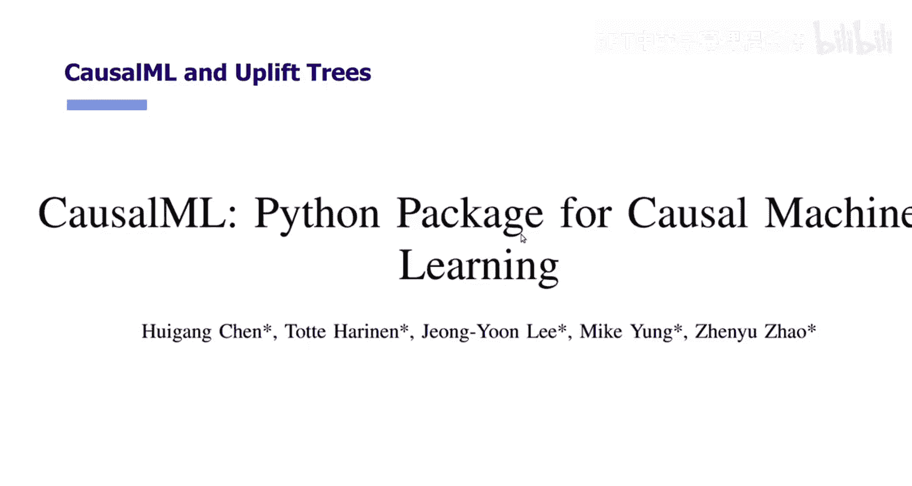

#  054：CausalML与增益提升树 📈

在本节课中，我们将学习CausalML与增益提升树。这是第二周内容的最后部分，将帮助你进一步理解如何在因果框架内处理数据。

## 概述

我们将探讨如何从估计平均处理效应，转向识别最可能从干预中受益的特定人群子集。这涉及从回归型拟合转向分类型拟合，也称为增益建模。

## 从平均效应到个体增益

上一节我们讨论了回归与分类问题。在因果ML和增益提升树方法中，思考方式如下：你可能已经获得了某种平均处理效应的估计值。

**平均处理效应（ATE）** 公式可表示为：
`ATE = E[Y(1) - Y(0)]`
其中 `Y(1)` 是接受处理的结果，`Y(0)` 是未接受处理的结果。



然而，当你拟合了一个非常异质性的人群并找到平均处理效应后，下一步真正需要的是理解如何定义该人群中哪些区域最有可能从处理中受益。

你可以将此视为从回归型拟合转向分类型拟合。这也被视为一种增益建模形式。其核心论点是：能否找到那些对特定治疗反应最佳、因此受益最大的人？同样，能否理解哪些人可能产生不利影响，从而真正不应被选择进行治疗？

以下是关键候选人群分类：
*   **预期受益者**：这些个体预计会从处理中获益。
*   **反应欠佳者**：这些个体可能有一些不太理想的反应。
*   **潜在受损害**：这些个体甚至可能因处理而受到伤害。

因此，我们的论点是：我们拥有人群的子集，并且我们获得了一个最终由回归型拟合定义的分布函数。我们正试图定义谁将从特定处理中受益最多，以及谁将受到伤害。

## CausalML框架与工具包



在因果ML框架中，我们引入了EconML和CausalML。有三个已开源且基于非常活跃的研究小组的代码库。这些都是我希望本课程的任何学员都能感到舒适并花时间使用的代码，它们能真正帮助你回答这类问题。

想象你的数据，你可能有一个数据生成机制。在CausalML中，你可以进行以下操作：

以下是CausalML工具包的核心功能列表：
*   **特征工程**：我将在最后稍作强调。
*   **倾向得分匹配**：用于获取工具变量。工具变量是指能够定义谁被选择接受处理、谁没有被选择的变量。
*   **特征选择**：与特征工程紧密结合，旨在识别谁将从特定处理中受益最多。
*   **增益提升树与工具变量**：这是我们本周的主要重点之一，我们已经稍作强调。
*   **价值优化**：再次与谁将从处理中受益最多以及治疗选择相关。
*   **验证与树可视化**：这些都是此代码库的一部分。

### 包结构简介



CausalML包有不同的模块：
*   **特征工程**：已强调。
*   **数据生成**。
*   **倾向得分方法与工具变量**。
*   **敏感性分析**。
*   **模型**：这真正是我们在这里讨论的核心。
*   **可视化**。

我们尚未详细介绍这些不同类型的学习器，时间有限无法深入。但下一张幻灯片将帮助你初步了解不同类型的学习器。你可以将它们视为最终尝试拟合数据或理解数据中情况的方法。

**工具变量**：我们曾在分类或回归设定的背景下略有提及。如果你有一个工具变量来决定是否进行处理，那么论点是你有更好的机会理解你的平均处理效应，从而理解分布函数。

**神经网络**：在拟合质量方面，神经网络也参与其中。这方面有很多工作，我只是试图让你了解正在发生的事情。

## 元学习器与增益提升树

在元学习器中，我们有不同的学习机制类型。以下是涉及的几种：

以下是四种主要的元学习器类型：
*   **S学习器**：将处理组和对照组数据完全合并进行训练和预测。
*   **T学习器**：为处理组和对照组分别建立模型，然后组合它们以估计条件处理效应。
*   **X学习器**：将处理组和对照组分开，进行训练并保留预测值，与实际值分开，最后在控制和治疗阶段进行估计。
*   **R学习器**：试图找到一个最优的τ*（tau star），本质上是在模型和估计器中优化条件平均处理效应τ。

这四种方法是CausalML软件包的一部分。

接下来是**增益提升树**，这是我想在这个对CausalML相当简短的介绍中让你有所感受的另一件事。同样，你可以阅读更多关于它的论文。

你可以构建你的增益提升树，其过程几乎类似于决策树，但现在是在条件平均处理效应的背景下进行思考。你考虑分布并试图找到谁将受益最多——这就是我们所说的“增益”的含义。

然后，你有一些方法，如**KL散度**、**卡方**、**欧几里得距离**等，它们可以帮助定义在哪里进行分割，以及在哪里论证效果会提升。

例如，对于增益提升树中的**KL散度**，你可以看到我们如何定义分割。在增益提升树中，目标是预测用户的处理效应。我们可以为此树分割定义一个损失函数，在本例中就是KL散度。这个散度是关于处理效应的，如果左节点和右节点（即这两边）的处理效应差异很大，那就非常理想。例如，以纽约市与非纽约市作为一个简单例子，差异很大，因此你可以进行分割。

这本质上是一棵树。你也可以做一棵分类树来预测用户的转化率，并且同样关注树分割的损失函数，再次论证如果你有一个好的分割，左右之间的转化率差异很大。

这再次回到了分类与回归的问题，我们试图论证：理想情况下，你可以找到最能描述那些将从处理中受益的个体的最佳特征集。

## 代码示例与价值函数





为了让你感受一下代码的样子，这里有一点代码示例。我希望听这节课的许多人都熟悉Python，至少我希望如此。如果不熟悉，这实际上是一个很好的学习机会，也是本课程的益处之一。

以下是使用CausalML的基本代码结构示例（伪代码风格）：
```python
# 导入必要的库
from causalml.inference.meta import LRSRegressor, XGBTRegressor, MLPTRegressor
from causalml.inference.meta import BaseXRegressor, BaseRRegressor
# 生成合成数据
X, y, treatment = generate_synthetic_data()
# 定义学习器并拟合条件平均处理效应
learner = BaseXRegressor(learner=XGBRegressor())
cate = learner.fit_predict(X=X, y=y, treatment=treatment)
# 可以比较S、T、X、R学习器的表现
```

我们可以计算一个分布函数。论点在于，对于这些条件处理效应，存在一个分布。你可以想象几乎像一个垂直的条形图，右侧表示从处理中受益，左侧则表示不那么好。个体处理效应就是定义人们在这个条形图上的位置。

这是平均处理效应的估计图。我希望这个概念空间是有意义的。论点在于，这同样回到了之前讲座中关于分类与回归类型的论点。论点是你可以在代码中定义一个价值函数。



**价值函数** 再次试图在了解回归情况下的背景下，找到那些将从处理中受益最多的用户。因此，会有一部分人，在考虑定向成本和定义的条件处理效应的情况下，进行干预是有意义的。你可以决定你真正想要优化这部分人。而对于其他部分人，效果则不那么好。

因此，论点再次是：你可以考虑干预的成本以及干预的收益，从而考虑价值——尤其是在商业类型的背景下，这可以带来很多意义，并且确实有助于优化决策。

## 因果思维流程与总结

这里的结束思想更像是一个流程图，展示了你如何想象引入因果思维方式。

以下是整合因果思维的决策流程：
1.  **数据来源**：是进行了实验，还是观察性数据？实验是否在控制协变量和混杂因素方面定义良好？
2.  **处理混杂**：如果存在混杂因素？是或否。如果没有混杂因素，可以直接进入模型。否则，可能需要检查是否存在某种工具变量，这引向倾向得分，然后可以返回进行估计模型。
3.  **处理依从性问题**：如果你进行了实验但存在依从性问题，则可能需要对不完全依从进行调整，并且必须仔细思考如果依从不完全可能意味着什么。
4.  **验证与优化**：然后可以进行验证模块（引入增益理念）和优化模块（再次定义那些从干预中受益最多的个体）。

这就是对部分代码和理念的快速概述。你们中的一些人可能会觉得花时间研究这些代码是有益的。我认为就像Econml一样，它是定义良好的代码。

我将只提两篇论文。一篇在你的阅读清单上，是关于改进特征选择的，我试图为增益建模稍作强调。另一篇是他们的Python包介绍，相当简要地描述了我们刚刚讨论过的CausalML代码。



本节课中我们一起学习了CausalML与增益提升树的核心概念。我们探讨了如何从平均处理效应转向识别个体增益，介绍了CausalML框架及其工具包，包括元学习器和增益提升树的工作原理。最后，我们通过代码示例和因果思维流程，展示了如何将这些概念应用于实际数据分析，以优化决策并识别最有可能从干预中受益的个体。