#  056：因果树模型 🌳

在本节课中，我们将要学习因果树模型。这是一种思考如何基于信息进行分割的巧妙方法，类似于决策树，但应用于因果信息的背景之下。

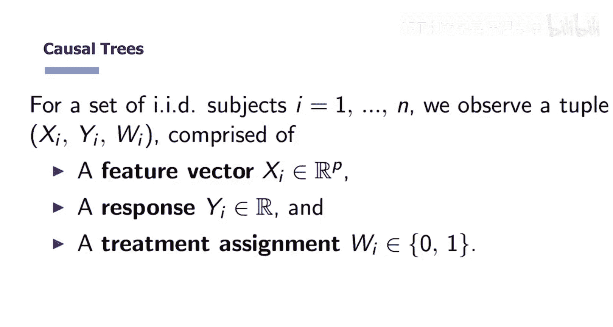

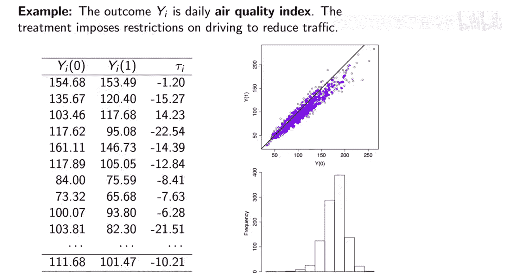

## 概述

上一节我们介绍了因果推断的基本挑战。本节中，我们来看看因果树模型，它是一种结合了决策树思想和因果推断原理的方法，旨在从观测数据中估计异质性处理效应。

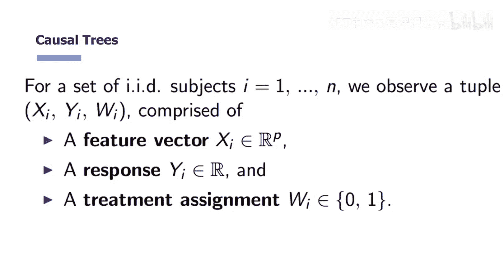

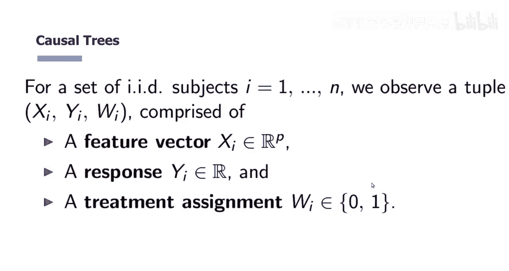

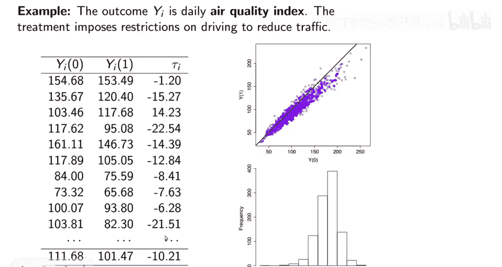

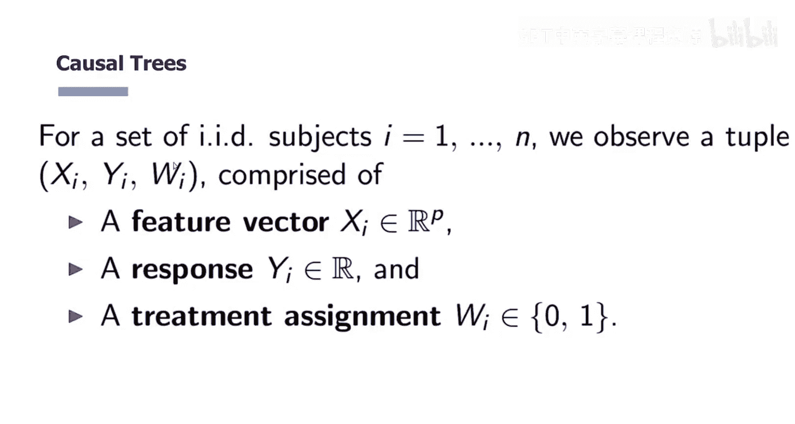

## 核心概念与问题设定

我们假设有一组研究对象。在理想情况下，我们认为这些对象是独立的，这是一个较强的假设，在整个因果推断中都需要注意此类假设。

每个研究对象 `i` 包含以下信息：
*   **协变量 `X_i`**：可以将其视为特征向量，就像在机器学习中一样。
*   **结果 `Y_i`**：响应变量或结局。
*   **处理分配 `W_i`**：通常是二元变量，取自集合 `{0, 1}`，例如0代表对照组，1代表处理组。

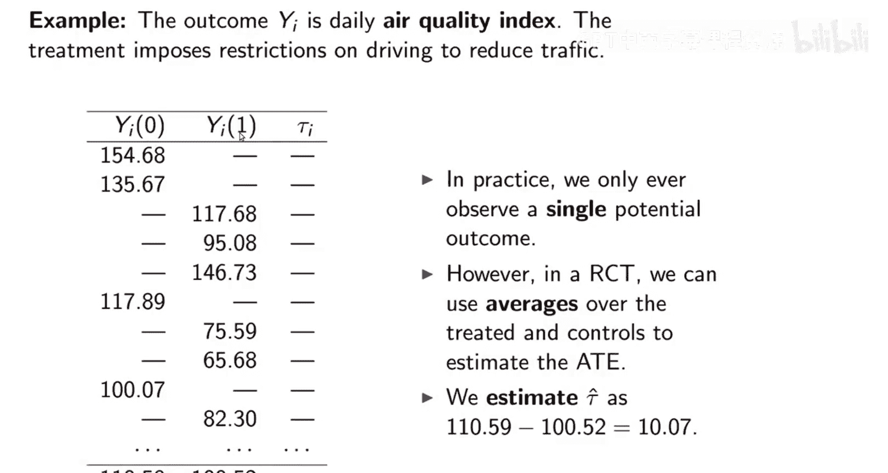

我们试图理解处理 `W` 对结果 `Y` 的影响。核心问题是，对于每个个体，我们**只能观测到一个潜在结果**。我们无法同时看到同一个体在接受处理（`Y_i(1)`）和未接受处理（`Y_i(0)`）时的结果。这造成了数据的缺失。

如果我们能观测到所有潜在结果，问题将变得简单。我们可以直接拟合一个统计模型，例如比较 `Y(0)` 和 `Y(1)` 的分布，并计算**平均处理效应**。

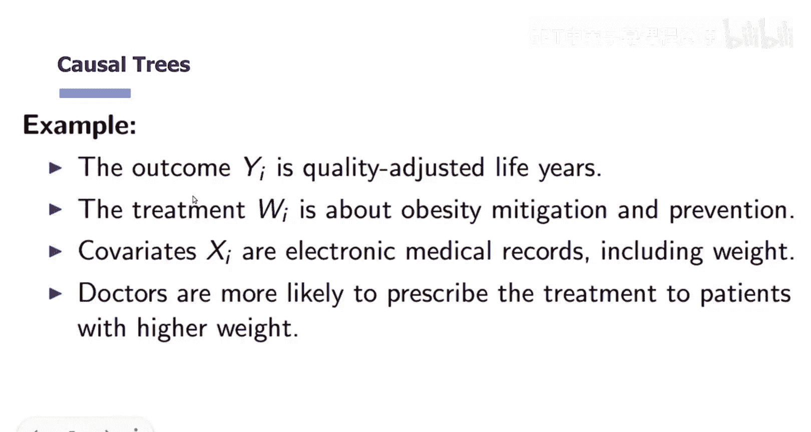

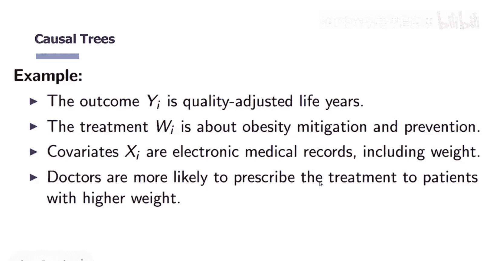

平均处理效应的公式定义为：
`ATE = E[Y(1) - Y(0)]`
其中 `E` 表示期望值。

然而在现实中，我们只有观测数据。在随机对照试验中，由于处理是随机分配的，我们可以通过比较处理组和对照组的平均结果来无偏地估计ATE。但在观测性研究中，处理分配往往不是随机的，这就引出了**混杂**的问题。

## 混杂与倾向得分

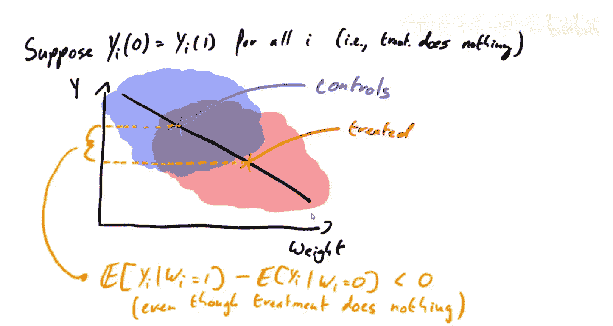

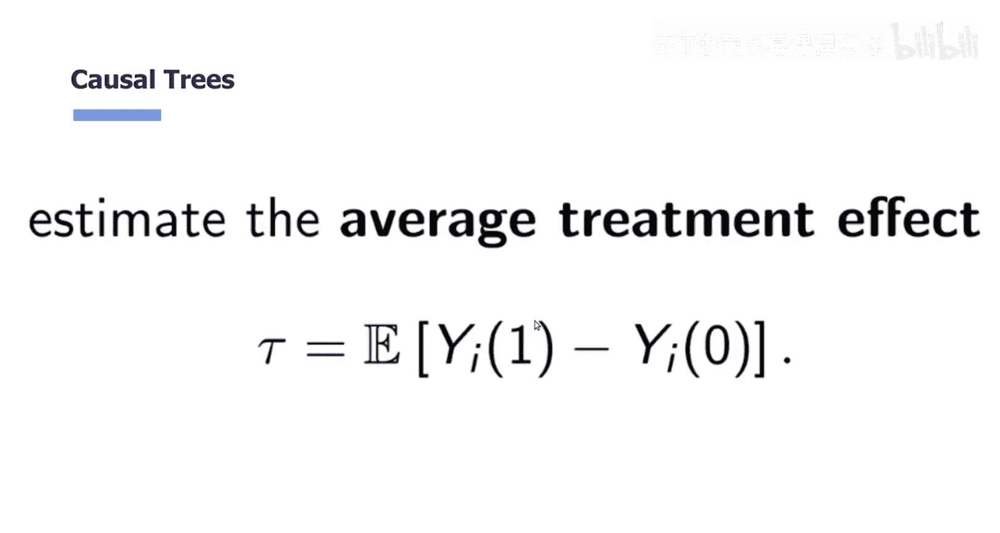

混杂是因果推断中的一个巨大挑战。例如，在评估一种肥胖症药物时，医生可能更倾向于给体重更高的患者开药。如果体重同时影响用药决策和治疗结果，那么体重就是一个**混杂因子**。

在这种情况下，直接比较处理组和对照组的平均结果是有偏的，因为两组患者的初始体重分布不同。

为了在观测性研究中调整这种混杂，最常用的方法是使用**倾向得分**。

倾向得分的定义是，在给定观测协变量 `X` 的条件下，个体被分配到处理组（`W=1`）的条件概率：
`e(x) = P(W=1 | X=x)`

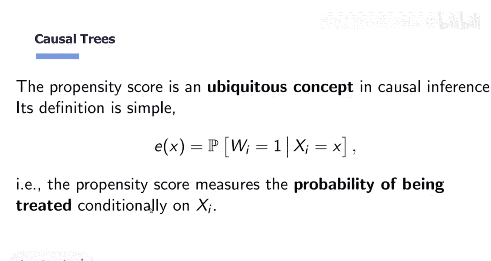

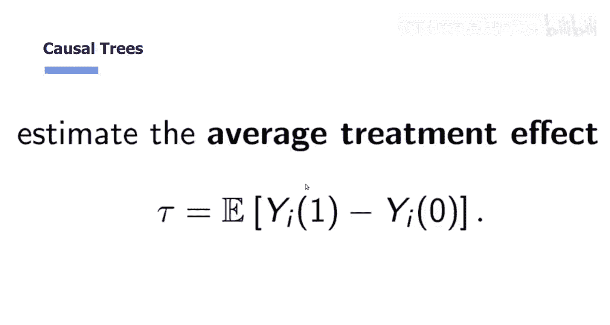

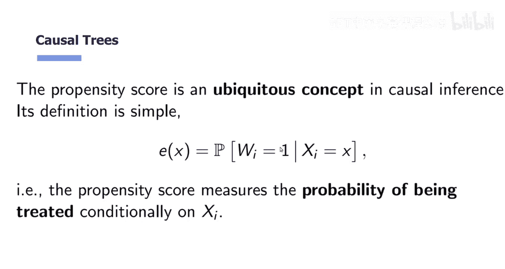

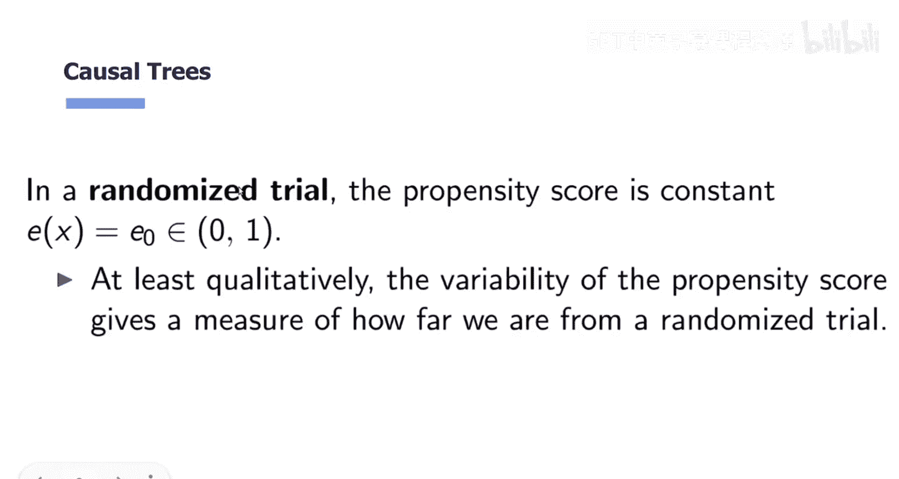

倾向得分在因果推断中无处不在。它的定义简单，但意义重大。在RCT中，处理是随机分配的，因此倾向得分 `e(x)` 是一个常数（例如0.5）。在观测性研究中，倾向得分反映了处理分配依赖于协变量的程度。通过建模和调整倾向得分，我们可以模拟RCT的条件，从而更准确地估计处理效应。

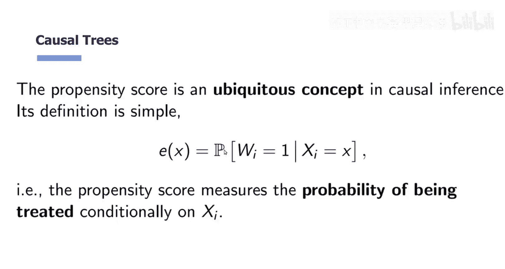

## 因果树模型介绍

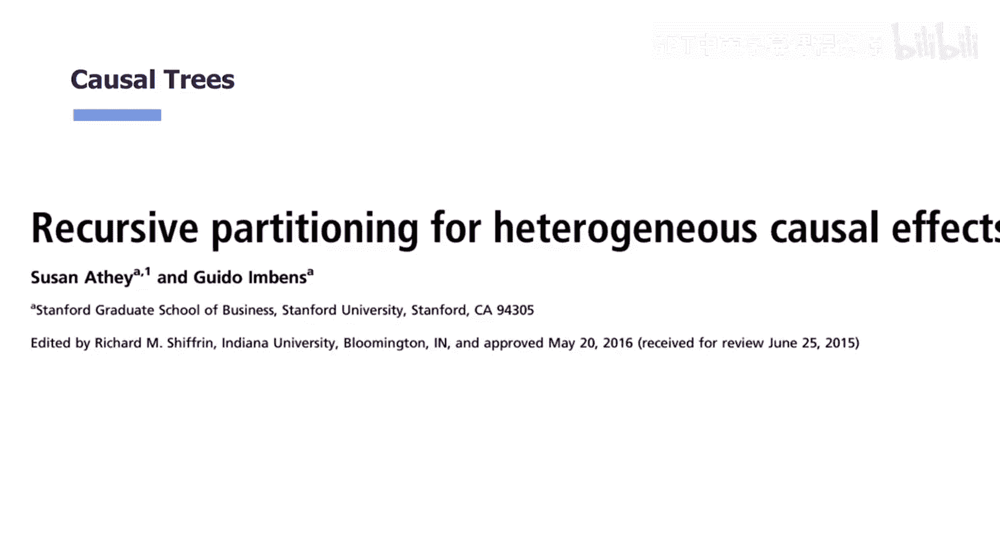

上一节我们介绍了混杂的挑战和倾向得分的概念。本节中，我们来看看如何利用树模型来解决因果估计问题。

因果树模型的核心思想来源于Susan Athey和Guido Imbens等人的工作（例如2016年的论文“Recursive Partitioning for Heterogeneous Causal Effects”）。它建立在**无混杂性**假设之上，即假设在给定协变量 `X` 后，处理分配 `W` 与潜在结果 `{Y(0), Y(1)}` 独立。

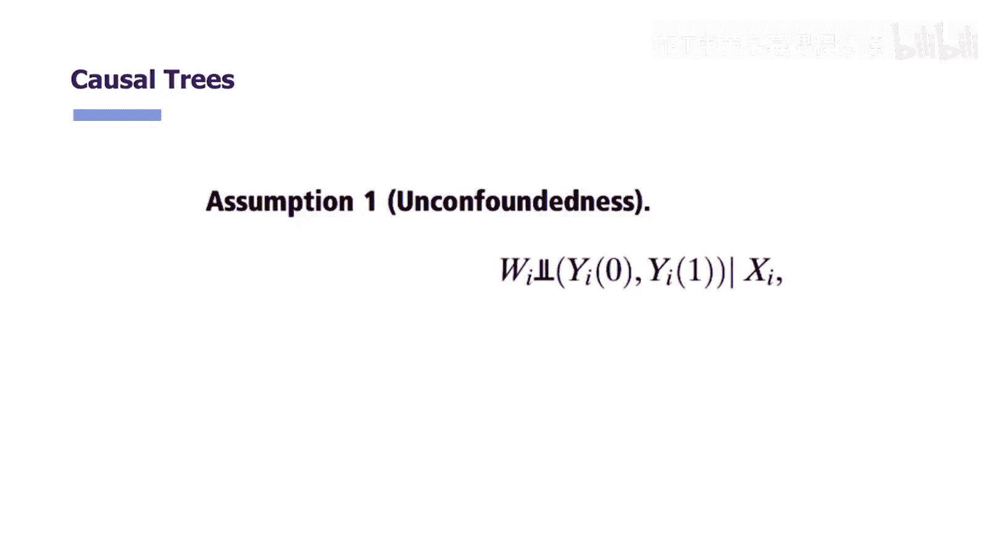

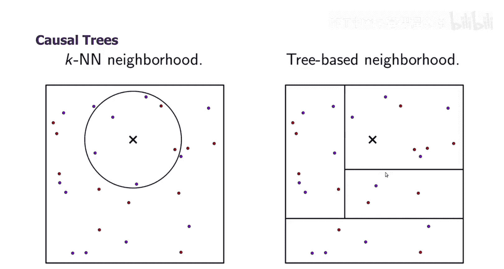

你可以将因果树理解为一种“自适应的最近邻”方法。给定协变量（特征向量）和结果，我们试图估计条件期望函数 `μ(w, x) = E[Y | W=w, X=x]`。

以下是构建因果树的一种直观方法（称为T-Learner）：
1.  将数据按处理状态 `W` 分成两组：处理组（`W=1`）和对照组（`W=0`）。
2.  分别用两个独立的模型（例如两个决策树）拟合这两组数据：
    *   模型 `μ_0(x)` 用于预测 `Y | (W=0, X=x)`
    *   模型 `μ_1(x)` 用于预测 `Y | (W=1, X=x)`
3.  对于一个新的样本点 `x`，其个体处理效应的估计为两个模型预测值之差：
    `ITE(x) = μ_1(x) - μ_0(x)`

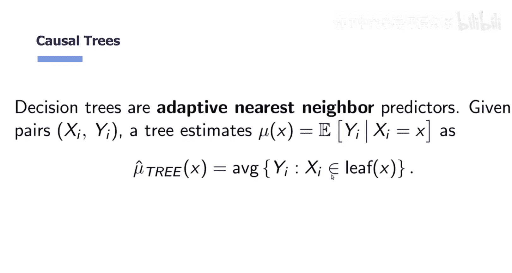

树模型通过递归分区，将特征空间划分成一系列矩形区域（树的叶子节点）。在每个叶子节点内，样本的协变量相似。然后，我们可以在每个节点内分别估计处理效应。这种方法非常直观，易于向临床团队或业务决策者解释，这也是其吸引力所在。

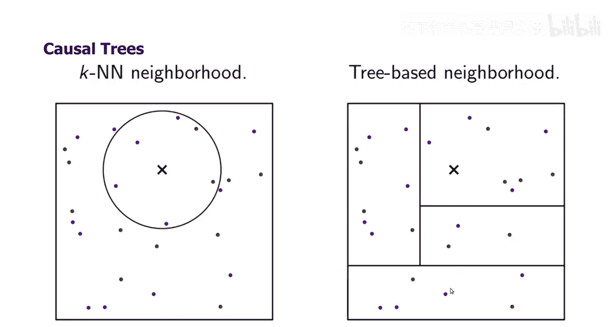

## 总结

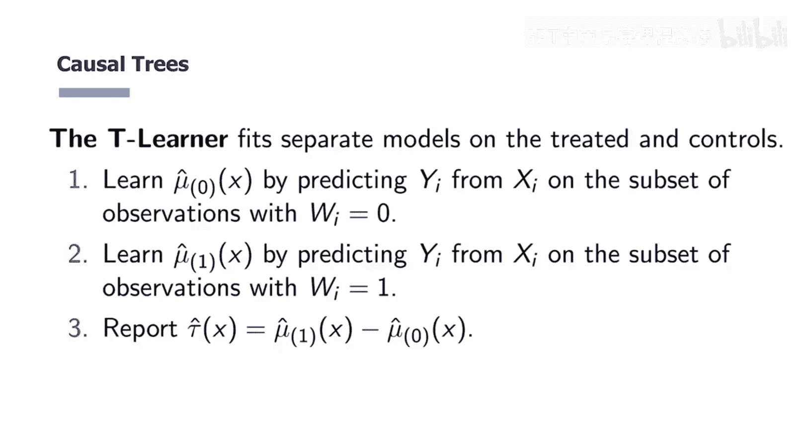

本节课中，我们一起学习了因果树模型。我们从因果推断的基本问题设定出发，解释了为何观测数据中存在“反事实”缺失的挑战。接着，我们探讨了观测性研究中的核心难题——混杂，并介绍了用于调整混杂的倾向得分方法。最后，我们详细介绍了因果树模型，它如何将决策树的分区思想应用于因果效应估计，通过分别建模处理组和对照组，并比较其预测差异，来估计异质性处理效应。这是一种结合机器学习与统计思想的直观且强大的方法。