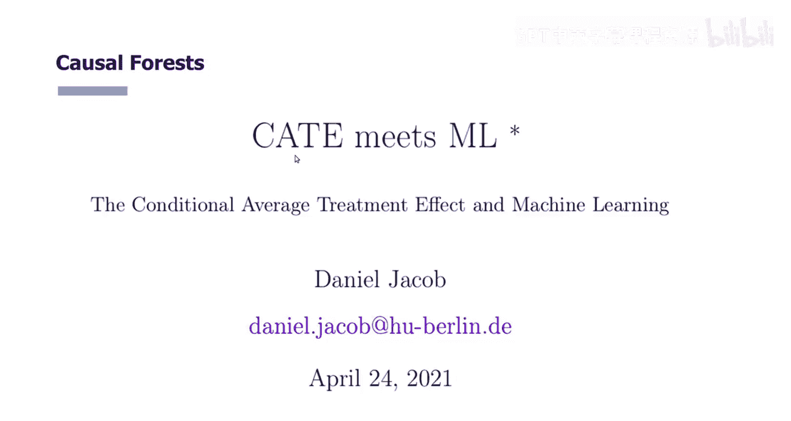
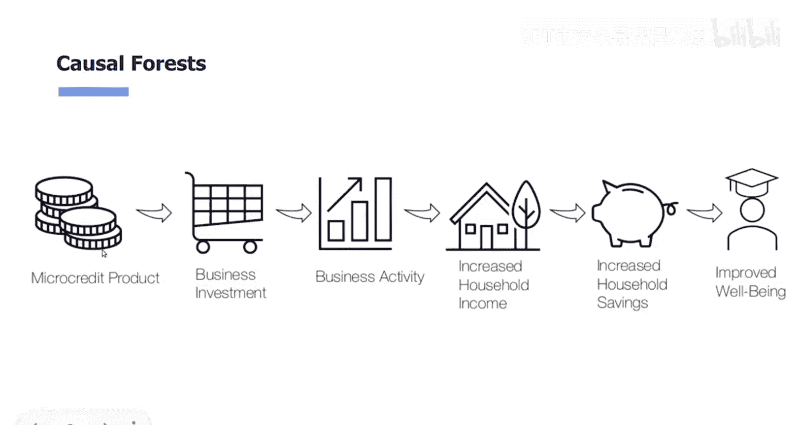
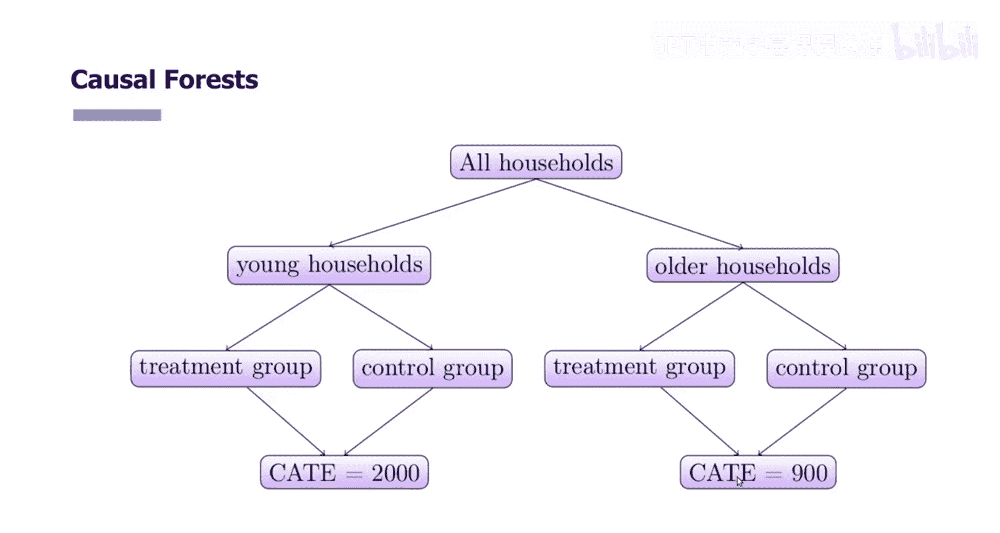
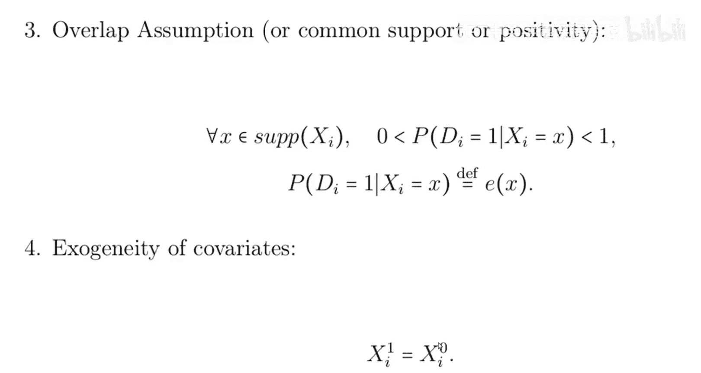
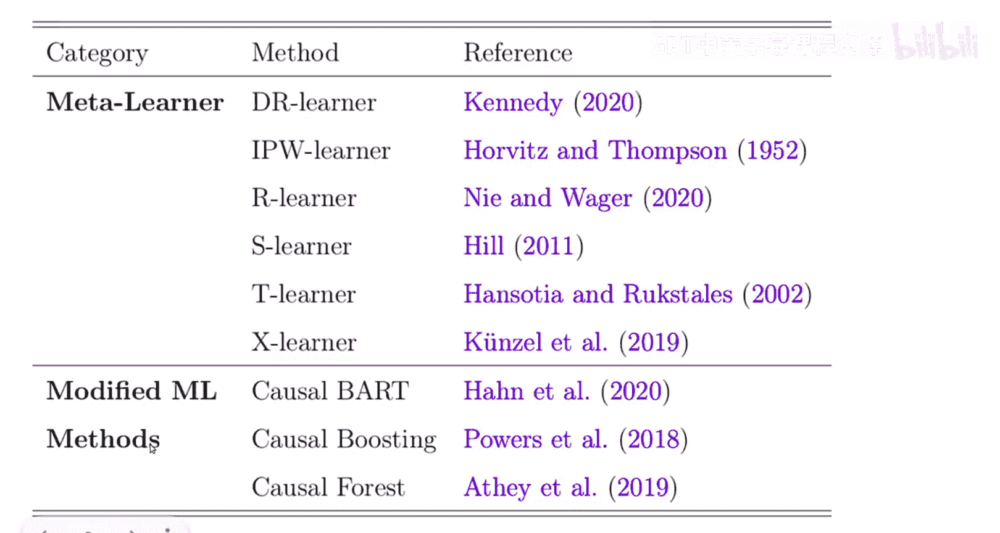
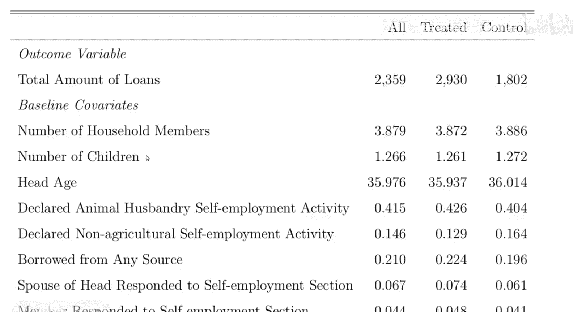
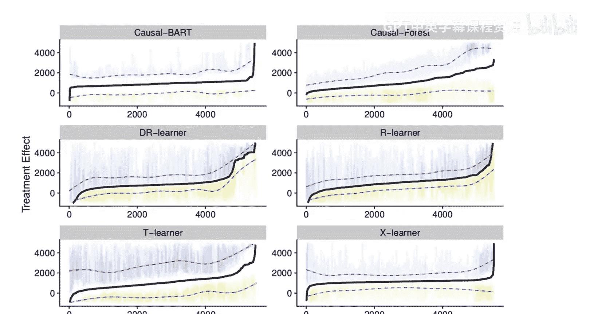
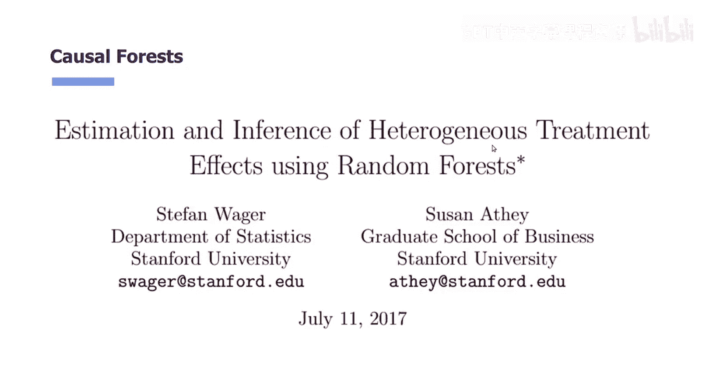
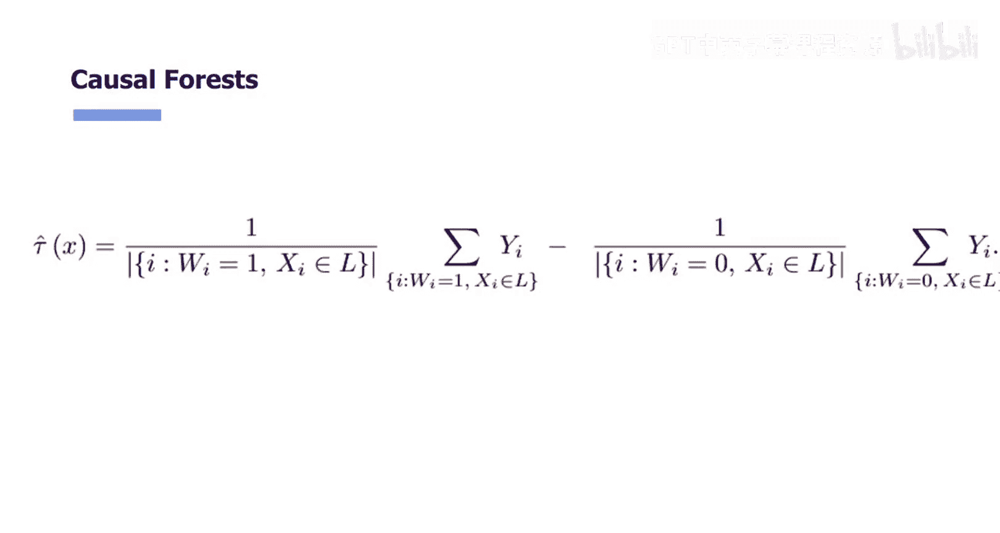
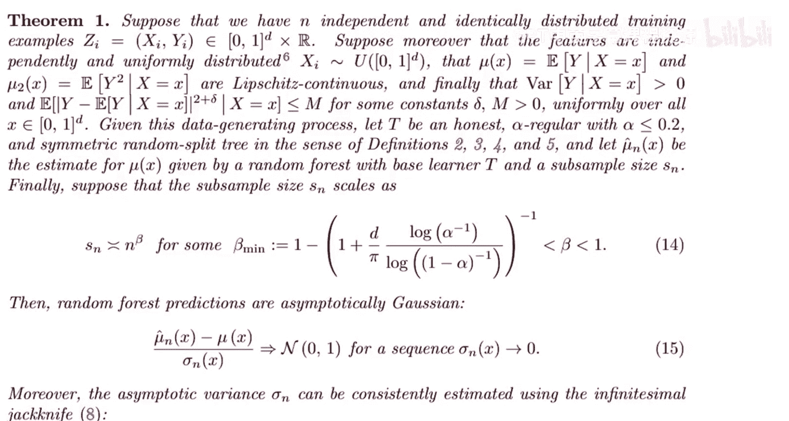

#  057：因果随机森林 🌲

在本节课中，我们将直接探讨因果随机森林。这是我们本周课程的核心内容，旨在帮助大家理解如何利用机器学习方法处理观察性研究数据，以估计异质性处理效应，从而做出序列化的因果决策。

## 概述

我们将从Daniel Jacob的一篇论文入手，该论文回顾了多种计算条件平均处理效应的方法。通过一个关于小额信贷产品的具体例子，我们将理解如何识别哪些个体最有可能从某项“处理”（如提供贷款）中受益。这涉及到将传统的随机对照试验思想，扩展到更复杂的、存在混淆变量的观察性研究场景中。

## 核心概念与假设

上一节我们提到了观察性研究中的挑战，本节中我们来看看为了进行可靠的因果推断，需要满足哪些关键假设。以下是四个基本假设：

1.  **条件独立性**：在给定协变量 **X** 的条件下，处理分配 **D** 与潜在结果 **Y(0), Y(1)** 独立。公式表示为：**(Y(0), Y(1)) ⟂ D | X**。
2.  **稳定单元处理值假设**：每个个体的潜在结果不受其他个体处理分配的影响。
3.  **重叠性**：对于任意的协变量 **x**，个体被分配到处理组和对照组的概率都不为0或1。这定义了倾向得分 **e(x) = P(D=1 | X=x)**。
4.  **协变量平衡**：处理组和对照组的协变量分布应尽可能相似。

只有满足这些假设，我们才能从观察数据中无偏地估计因果效应。

## 从随机森林到因果随机森林

理解了基本假设后，我们来看看如何将熟悉的机器学习模型用于因果推断。随机森林是一种强大的预测模型，而因果随机森林是其针对因果估计的扩展。

其核心思想是：我们不再直接预测结果 **Y**，而是预测处理效应 **τ(x)**。在构建决策树的每个节点时，分裂标准不再是最大化预测精度，而是最大化处理组和对照组之间结果差异的异质性。也就是说，算法会寻找能够最大程度区分处理效应高低的协变量分割点。

最终，对于一个新的个体，其异质性处理效应 **τ̂(x)** 可以通过其在森林中所有树叶节点的处理效应估计值平均得到。公式表示为：
**τ̂(x) = (1/B) * Σ_{b=1}^{B} (μ̂₁ᵇ(x) - μ̂₀ᵇ(x))**
其中，**B** 是树的数量，**μ̂₁ᵇ(x)** 和 **μ̂₀ᵇ(x)** 分别是个体 **x** 在第 **b** 棵树中对应的树叶节点内，处理组和对照组的平均结果估计值。

## 理论保证与应用示例

因果随机森林的一个优美之处在于其理论性质。在满足“诚实树”等条件下，估计量 **τ̂(x)** 是渐近正态的。这意味着我们可以为其构建置信区间，从而评估估计的可靠性。这解决了传统机器学习模型用于因果推断时缺乏不确定性度量的问题。

回到小额信贷的例子，研究人员拥有包含贷款状态（处理/控制）和一系列家庭协变量（如成员数量、户主年龄、就业类型等）的数据。以下是应用不同模型（包括因果随机森林）后得到的处理效应估计图：

虽然不同模型给出的处理效应排序趋势相似，但其置信区间的宽度存在差异。这提示我们，在选择模型并基于其制定政策（如向哪些家庭提供贷款）时，需要谨慎考虑模型的不确定性。

## 总结

本节课中我们一起学习了因果随机森林。我们首先回顾了因果推断的必要假设，然后探讨了如何将随机森林改造为专门用于估计异质性处理效应的工具。因果随机森林允许我们在复杂的观察性数据中拟合模型，做出基于数据的序列化因果决策，并为这些决策提供一定的不确定性度量。这为在医疗、经济、政策评估等领域实施更精准的干预措施提供了强大的方法论支持。