#  059：打破推荐系统的反馈循环 🔄

在本节课中，我们将要学习如何利用因果推断的方法来打破推荐系统中常见的反馈循环问题。我们将探讨来自David Blei团队和Michael Jordan团队的研究，了解他们如何通过引入因果模型来改进推荐系统的多样性和效果。

---

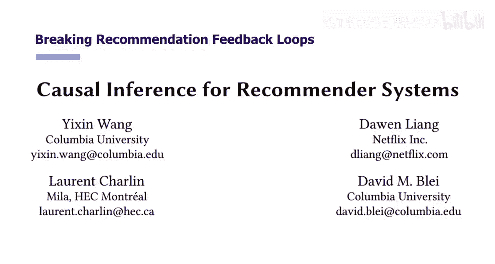

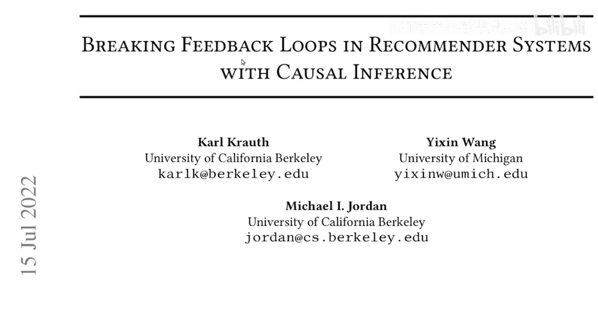

上一节我们介绍了“多重因果的祝福”这一概念，本节中我们来看看如何将这一思想应用于电影推荐等场景，并深入探讨打破推荐反馈循环的扩展研究。

这项研究始于David Blei团队的Nix和Wang的后续工作。他们思考如何更好地推荐电影，核心思想是避免持续推荐同一类型的电影，并提出可以利用因果推断来打破这种反馈循环。随后，Nix和Wang在Michael Jordan的团队中进一步深化了这一想法，开发了利用因果推断打破反馈循环的具体方法。

以下是推荐系统中反馈循环的核心问题描述：

*   一个推荐系统会推荐特定行为（如电影）。
*   如果设计不当（大多数系统都是如此），就会形成一个反馈循环。
*   这意味着系统会不断“深钻”到特定的类型、导演或演员集合中。
*   在评分和推荐之间存在反馈，导致系统不断生成相似背景的推荐。

我们可以从更时序或序列的角度来思考这个问题，这与我们“在时间中做决策”的整体主题相似。我们可以将推荐视为一系列持续到时间T的决策，在每个时间点都存在反馈和一个对应的估计量。关键问题在于，我们能否通过理解这些随时间推移的推荐序列之间的因果关系，来估计这种反馈的影响，从而做出更好的推荐决策？

我们将从第一篇论文开始。其核心思想是，如果最初有一个基于实际行为（无论是否推荐了某部电影）的相对简单的回归类拟合，你会有一个噪声项，并且本质上是在求解一个带权重的矩阵。你可以以一种朴素的方式将其拟合为一个正式的推荐模型，已有大量工作使用这类矩阵方法。

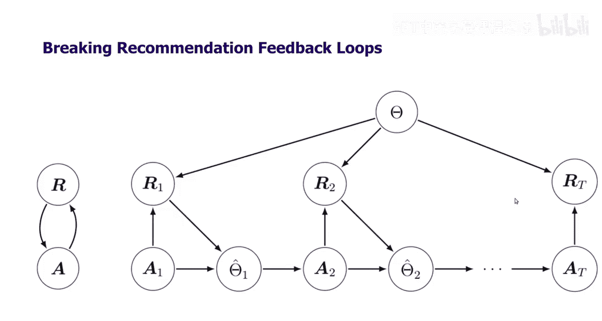

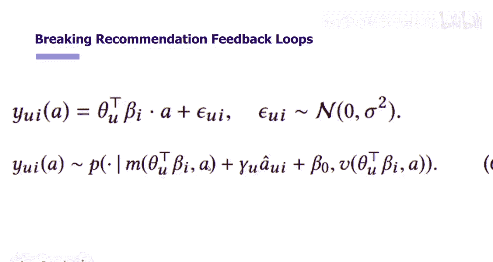

但他们提出的建议是，更好的做法是从因果角度思考。我们在此引入一个新的估计量，这个与因果相关的估计量用于预测特定行为，并带有一个乘数。这将是一个新的模型，并且是执行推荐的更好方式，它源于“多重因果的祝福”思想，即**去混杂因子**。

具体来说，你有一个关于**暴露**（exposures，即推荐行为）和**结果**（outcomes，如评分）的数据集。你试图从因果层面更好地理解如何改进推荐效果。

以下是核心的建模方法：

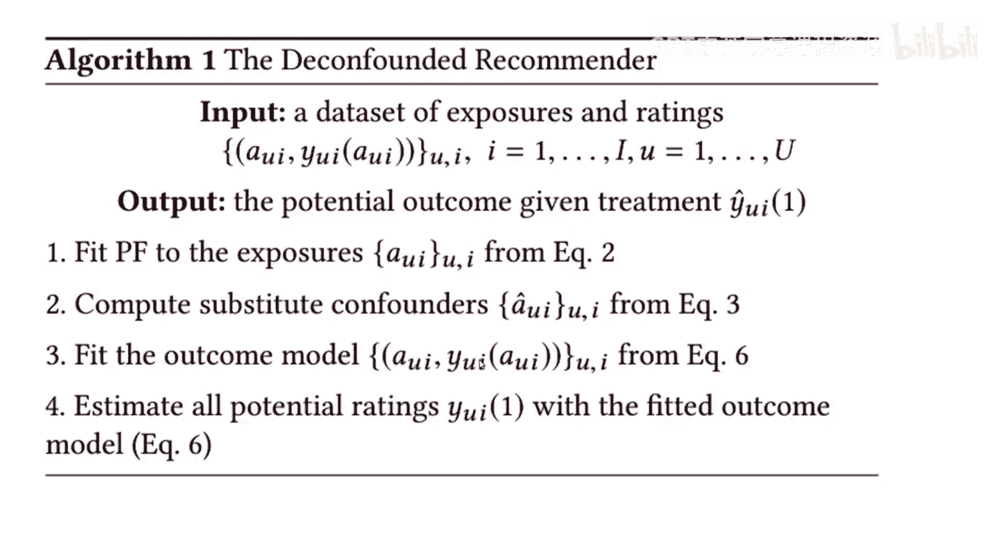

本质上，我们是在拟合一个**因子模型**。这是一个泊松版本的因子模型，其中潜在自由度（即潜在因子）对应着多重原因（即多个推荐曝光）。然后，你基于这些构建**混杂因子估计量**，接着为整个效应建立一个模型。这样做的效果会更好。

为了将其与我们最初引入的“多重因果的祝福”联系起来，本质上我们使用了一个包含两项的泊松模型，这两项都来自伽马分布。这个模型相对直接，可以使用**变分方法**进行贝叶斯拟合。你可以输入数据，推断出参数值，最终得到一个用于系统的改进模型。

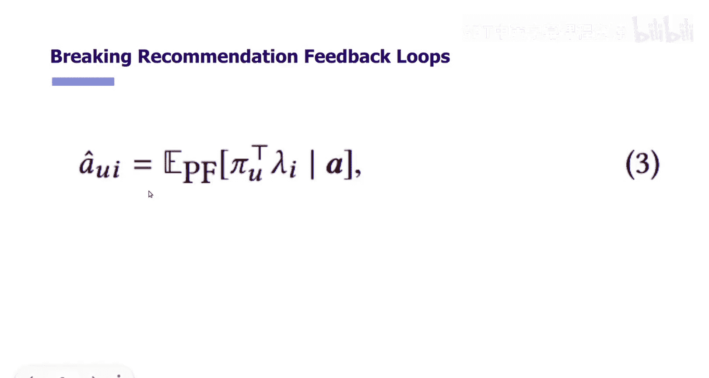

具体地，我们的泊松因子模型设置如下，其中两项来自伽马分布，条件于分配的处理（即推荐）。通过这样做，我们得到了一种新型的估计量，进而可以改进我们的系统模型。

---

现在，回到来自Michael Jordan实验室的第二篇论文。我们试图在时序背景下估计那个因果效应。本质上，我们将构建一个**KL散度**（Kullback-Leibler divergence）并进行论证。

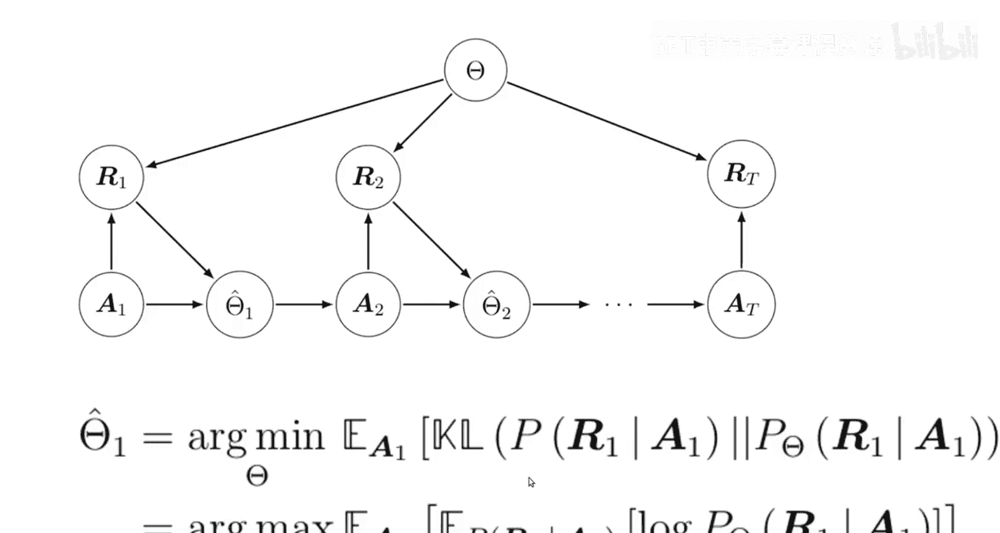

这个因果效应的估计量是一个期望，我们在比较两个不同的分布。最终的论点是，通过使用这个KL散度，我们可以拟合出一个估计量，并由此得到一些良好的性质。

以下是论文中的两个关键引理：

*   **引理1**：针对图1B中的因果图（即我们正在估计的项），我们可以使用该图构建一个估计量。这源于**do-演算**，即我们对推荐系统进行干预，决定推荐什么。通过正确的方式，我们使其成为一个乘积形式，因此现在是独立同分布的。论证表明，通过这种方式，我们可以打破反馈循环，使得我们的推荐行为是合理的。
*   **引理2**：针对同一个因果图，论证表明我们可以对KL散度进行论证。我们比较这两个不同的分布。论证再次指出，存在一种方法来估计这个量以打破反馈循环。

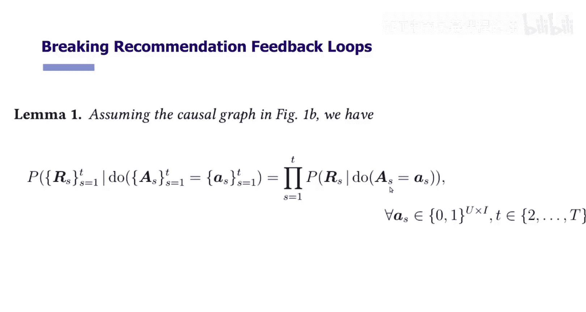

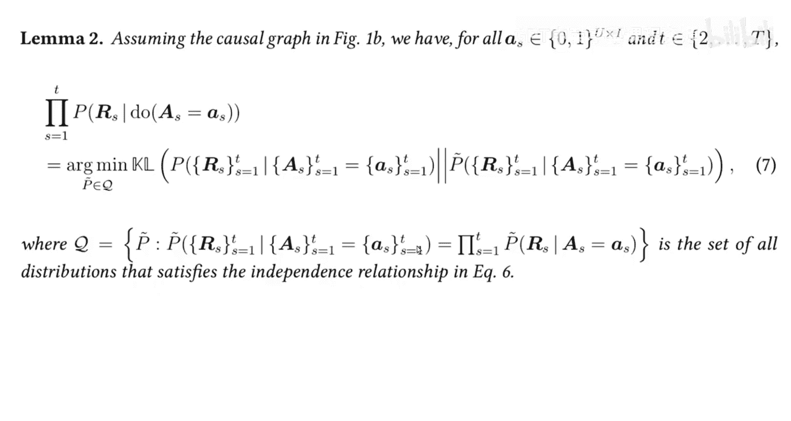

这意味着，我们可以用这些KL散度来估计因果项。我们可以在此基础上进行构建，其精神源于David Blei团队的泊松因子模型，但这是从KL散度和估计这些因果效应的角度进行的更深层次的思考。

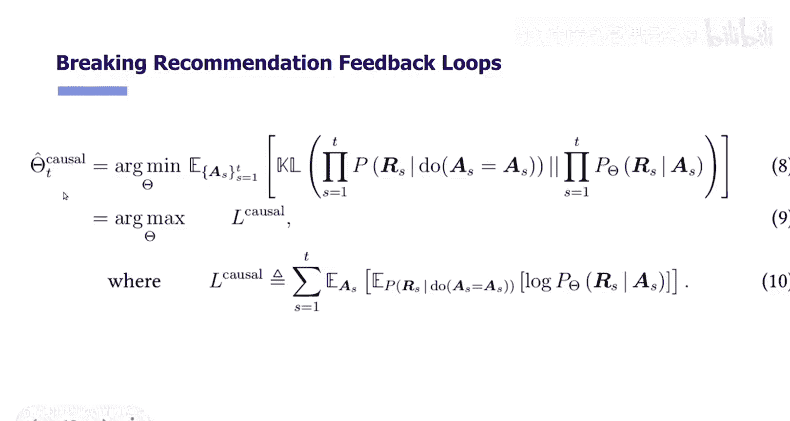

这意味着我们需要做出一些合理假设（这可以追溯到2015年Emonds和Ruben的论文）。我们假设存在一个**正值条件**，即概率严格大于零。那么，这意味着我们可以用这些因果效应估计量来估计它。再次利用do-演算打破因果反馈循环，我们得到了一个可以计算的清晰积分。

该论文的论点是，他们的算法打破了这些反馈循环，提供了更好的推荐。换句话说，它减少了局限性，给出了一组更合理的推荐。

---

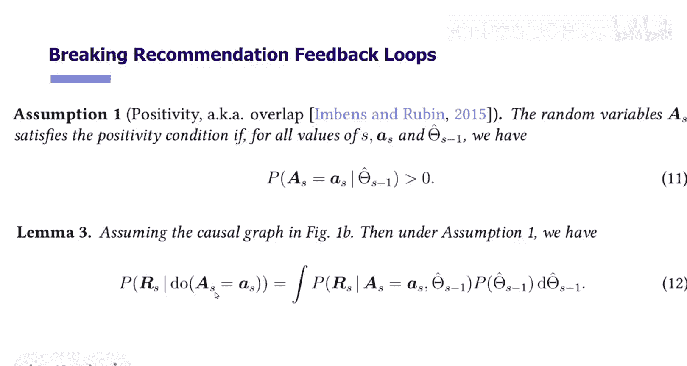

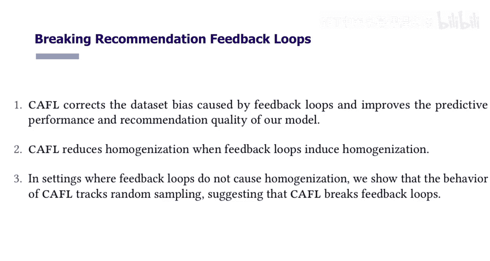

本节课中我们一起学习了如何利用“多重因果的祝福”的思想来改进推荐系统。核心概念在于，正如我们需要做出一系列序列决策一样，我们也需要做出一系列序列推荐。关键是如何以因果独立的方式打破反馈循环，避免系统陷入同质化的推荐（例如，只推荐同一类型、同一演员或同一导演的电影），从而实现有效的多样化。论证表明，这些推荐仍然是合理的，但它们在因果上已被拆解，从而获得了独立性。这是一篇可能具有重大影响力的论文。

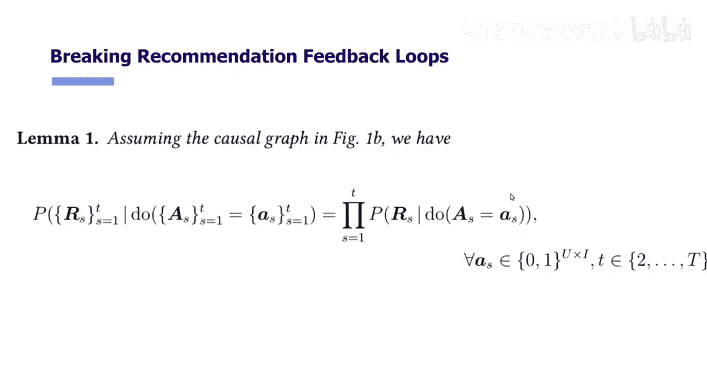

希望本节内容能让你对多重因果以及由此衍生的、构建更好推荐系统的想法有所体会。感谢你的关注。