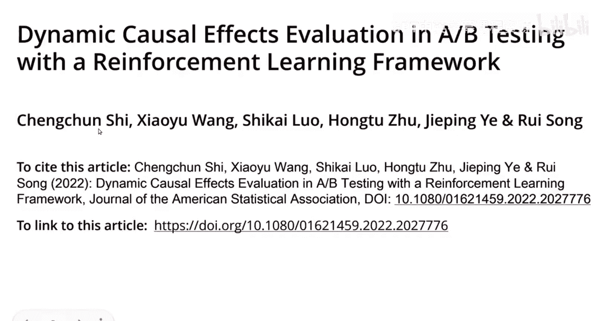
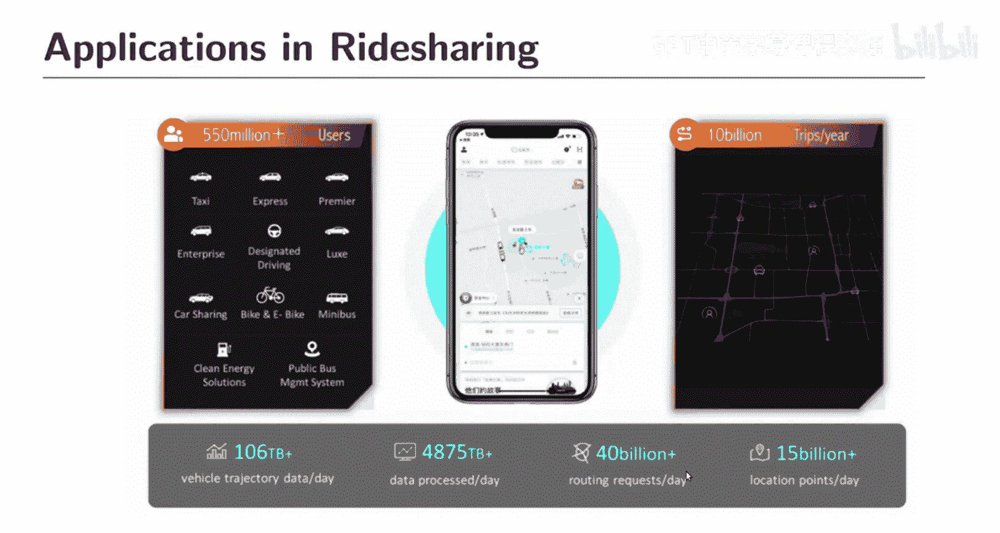
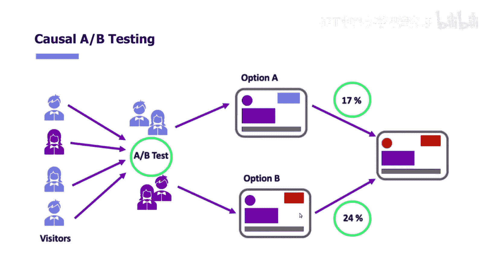
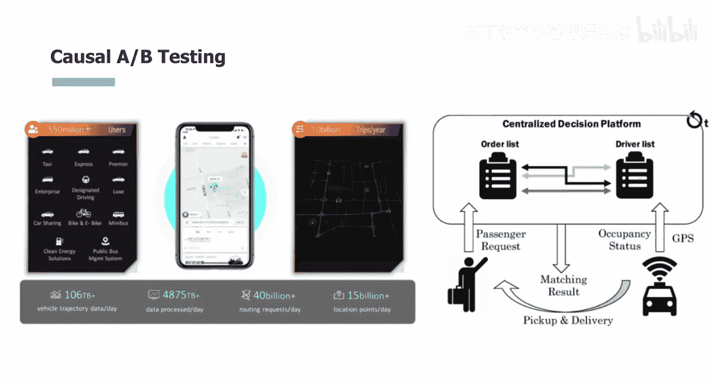
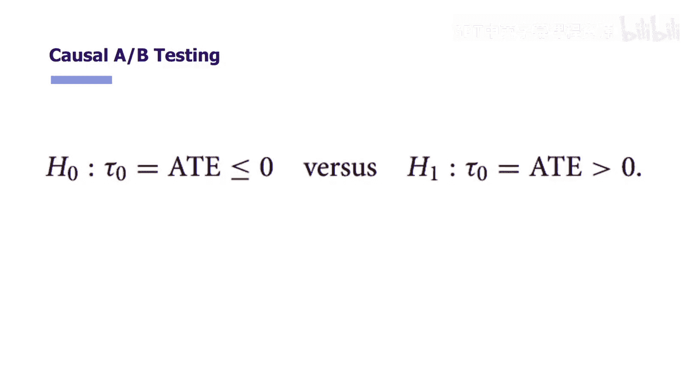

#  060：因果视角下的A/B测试 🧪

在本节课中，我们将学习如何将A/B测试应用于复杂的、具有时间依赖性的商业场景，例如网约车平台的派单策略优化。我们将探讨如何结合因果推断和强化学习的思想，来处理传统A/B测试难以应对的“遗留效应”问题。

---

上一节我们讨论了决策中的基本概念，本节中我们来看看如何将这些概念应用于一个动态的、持续进行的A/B测试环境。

当我从因果决策的角度谈论A/B测试时，这实际上是我们从专业课程一开始就在讨论的诸多理念的一个很好的延伸。我为此选择的论文是一篇相对较新的论文（2022年），其第一作者现在是伦敦的教授，并且我相信它得到了Ruong团队的支持。这是一篇非常有趣的论文，我将只能为你提供一个粗略的介绍，部分内容基于第一作者的一次演讲。

核心思想是如何帮助像网约车应用这样的平台。以Uber为例，它拥有超过5.5亿用户和大量数据。其根本目标是匹配司机（那些希望通过提供车辆和驾驶服务来谋生的人）和乘客（那些希望从A点到达B点的人）。平台每天需要处理海量的请求和地理位置信息。

作为对A/B测试的回顾，你有一群人（在本例中是网约车平台的用户），你的A/B测试是：能否以不同的方式为他们分配路线？例如，对于Uber司机，能否让他们只去最近的订单点？或者，能否评估其他可能产生更好长期影响的选项，例如通过战略性地规划车辆的调度位置，以应对当天稍晚些时候可能出现的请求？因此，在A/B测试中，你最终是在询问哪个选项更好，并试图评估其效果。

---

在Uber的案例中，你可以将其视为有一个订单列表和一个司机列表。乘客发出请求，司机提供车辆，问题在于如何实现最佳匹配。是否存在一种算法或策略，能比另一种做得更好？这同样是一种A/B测试的形式。

这篇论文背后的理念是，这几乎像是一个在线实验，可能持续两周。他们的时间单位大约是30分钟到一小时。你可以认为存在一个时间依赖的**状态函数** `S_t`，它指定了司机数量和呼叫订单数量。这个状态函数正是我们在专业课程中讨论过的概念。然后是**处理**，这相当于我们在A/B测试中询问的“旧策略 vs 新策略”。在这种情况下，可以采用类似“切换回”的设计：从旧策略切换到新策略，再切换回旧策略，如此反复。问题是，你能否清晰地决定哪个策略更好？

---

之前我们讨论A/B测试时，对象是类似网页这样的东西，我们只是简单地询问：考虑到进入销售漏斗或点击其他内容的人数，一个网页是否比另一个更好？而在这里，我们是在市场环境中评估一个策略，因此稍微复杂一些，但概念相同：两种不同的处理，你试图决定哪个更好（A vs B）。在这个例子中，我们考虑一个**结果** `Y_t`，你会看到我们将转向强化学习，并开始将其视为一个马尔可夫过程，这回到了我们在专业课程中讨论的内容。

我们可以将结果视为应答率、完成率和司机收入。我们的目标是尝试优化所有这些指标。换句话说，我们的应答率应该高，完成率应该高，司机的收入也应该高。

---

这里存在一些真正的挑战，这些挑战与我们思考A/B测试的其他方式截然不同，它们真正引入了在因果结构中运用强化学习的理念。

以下是几个关键挑战：

*   **遗留效应**：这意味着过去的行动会影响未来的结果。如果你仔细观察这类场景，这实际上相当常见。在许多应用场景中，尤其是在商业环境中，可能会出现过去行动对未来结果产生影响的情况。换句话说，影响并非立竿见影，可能存在时间延迟。因此，他们所称的“遗留效应”是他们所提出方法的一个关键方面，它确实有助于将这一点也纳入A/B测试。

*   **早期终止**：我们很早就讨论过这个想法，即我们希望能够在A/B测试中实现早期终止。我们不希望像在频率学派方法中那样，总是必须完成一定数量的测试。我们希望能够在明确显示一个策略优于另一个时就停止测试。这对于像Uber这样的商业应用显然很重要，因为设置这种测试可能相当昂贵，通过早期终止可以节省时间和预算。

*   **自适应随机化**：这涉及到尽快找到最佳策略的理念。因此，我们实际上是在尝试尽可能快地确定哪个策略是最好的。

---

作为对强化学习等概念的回顾，我们在专业课程早期也接触过。我们的智能体在不同时间针对环境（即特定状态）采取不同行动，并获得奖励回报，这个过程随时间向前推进。这里的论点是，我们存在遗留效应。

从我们的马尔可夫假设来看，我们有状态、行动和奖励，然后这些信息会反馈到下一个状态。具体来说，在传统的马尔可夫类型假设中，我们认为只有当前状态产生影响，过去的影响即使有也很小。但在遗留效应类型中，我们认为存在一种“向后耦合”的影响。

*   在传统马尔可夫模型中，状态 `S_{t+1}` 的更新仅依赖于当前时刻 `t` 的状态 `S_t`、行动 `A_t` 和奖励 `R_t`。公式表示为：`P(S_{t+1} | S_t, A_t, R_t)`。
*   在我们考虑遗留效应的情况下，我们认为之前的行动 `A_{t-1}` 也会对当前状态 `S_t` 产生影响，进而影响 `S_{t+1}`。当我们试图建模更强的时间依赖性时，情况就是如此。

---

在我们的强化学习方法中（由于Coursera课程的时间限制，我只能给你一个粗略的概念），本质上，在强化学习设置中，我们可以定义我们的**价值函数** `V^π(s)`。它是状态的函数，是一个期望值，包含一个折扣因子 `γ^t`，给定初始状态和奖励序列，我们可以在这个价值函数设置中评估我们的最优策略 `π*`。

当他们将其应用于Uber的背景下时，你可以比较策略A与策略B。显然，测试框架表明在这种情况下它是稳定的。你想要论证的是，一个策略相对于另一个没有优势。如果你进行A/B测试，你可能会看到结果曲线实际上开始交叉，因此你可以论证转向替代策略将会带来改进。

---

这确实是一个概念验证的演示。为了进一步强化这些理念，我们再次处理价值函数，我们在所有状态集合上对它们进行积分。本质上，这里有一个参考分布 `G`，我们假设它是我们状态序列上的有界密度。然后，我们可以根据这个定义我们的**平均处理效应** `τ`，它同样是一个期望值，因为它涵盖了所有可能的路径。

它是我们两种不同处理（通常编码为0和1，0代表参考或未处理组，1代表处理组）下的价值函数之间的差异。我们所做的是在他们的框架中进行假设检验，我认为这是一种非常合理的思考方式。

我们的零假设 `H0` 是：平均处理效应 `τ ≤ 0`。
我们的备择假设 `H1` 是：平均处理效应 `τ > 0`。
这就是我们在此寻找的结果。

---

我认为这是一篇非常有趣的论文，希望你会喜欢阅读和思考它。这同样是A/B测试，但现在进入了一个**市场环境**。

本节课中，我们一起学习了如何将A/B测试扩展到动态、有时间依赖性的商业决策中。我们探讨了“遗留效应”这一核心挑战，并介绍了如何借助强化学习中的状态、价值函数等概念，以及平均处理效应的假设检验框架，来更科学地评估和比较不同策略的长期效果。这为在复杂场景中进行因果推断和策略优化提供了有力的工具。