#  062：事件时序的因果关系解析 🧠

在本节课中，我们将学习一种用于医疗保健分析的新模型。该模型与我们之前讨论的内容紧密相关，但更为精确。我们将探讨如何在连续时间框架下理解因果关系，特别是处理非均匀采样的医疗数据，并利用模型来评估不同治疗方案的效果。

---

上一节我们介绍了在均匀时间点进行因果推断的基本概念。本节中，我们将探讨一个更贴近现实医疗场景的模型，其中观测数据和治疗干预都可能在不规则的时间点发生。

## 从均匀采样到不规则采样

通常，我们处理的时间序列数据是在**规则间隔**下采样的。例如，观测结果 `Y` 和治疗干预（类型1或类型2）都发生在预定的时间点上。同时，我们还会考虑**反事实结果**，即未实际发生的结果。

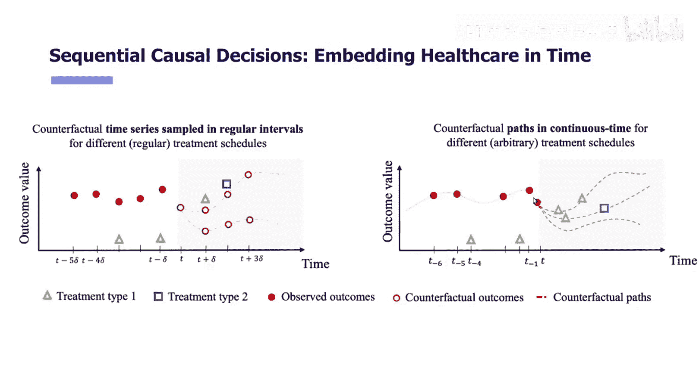

然而，大多数真实的医疗数据并非规则采样。观测结果和治疗选项都可能**在不规则的时间点**出现。治疗甚至可以在不同时间点多次施加或改变。例如，一个患者的治疗路径可能先采用一种方案，随后再切换到另一种。

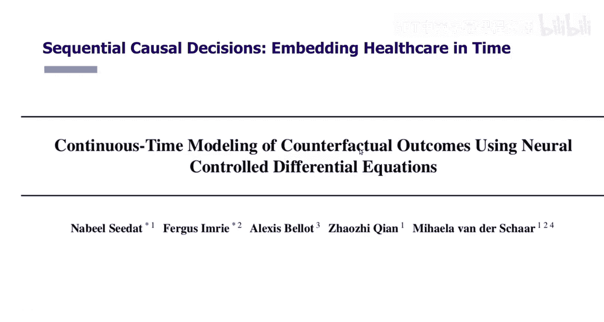

这种将过程视为**嵌入在连续时间空间**中的观点，是我们本周要讨论的第二篇论文的核心。该研究来自英国剑桥的一个团队，他们尝试使用神经网络方法来思考医疗保健问题。

## 连续时间模型与潜在维度

我们将不深入探讨神经控制微分方程的细节，而是聚焦于**连续时间模型**的核心思想，用于理解和解释反事实结果。

该模型的关键在于引入一个**潜在维度**，我们称之为 `Z`。你可以将其视为对观测协变量 `X` 的一种变换。这些协变量 `X` 本身就是在时间上**不规则分布**的观测值。

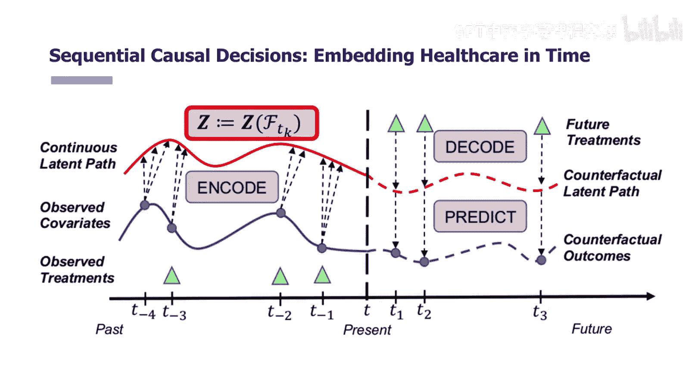

**核心思想**是：我们从一个由观测协变量推断出的**隐藏连续维度** `Z` 出发。所有变量都被嵌入一个连续时间框架中。然后，我们在不同时间点引入不同的治疗干预，从而在原则上实现了**序列化的因果决策**。当我们站在“现在”这个时间点，我们希望展望未来，通过思考最佳的未来治疗方案来改善结果，并将这些方案视为时间中的连续路径。

## 利用肿瘤生长模型进行探索

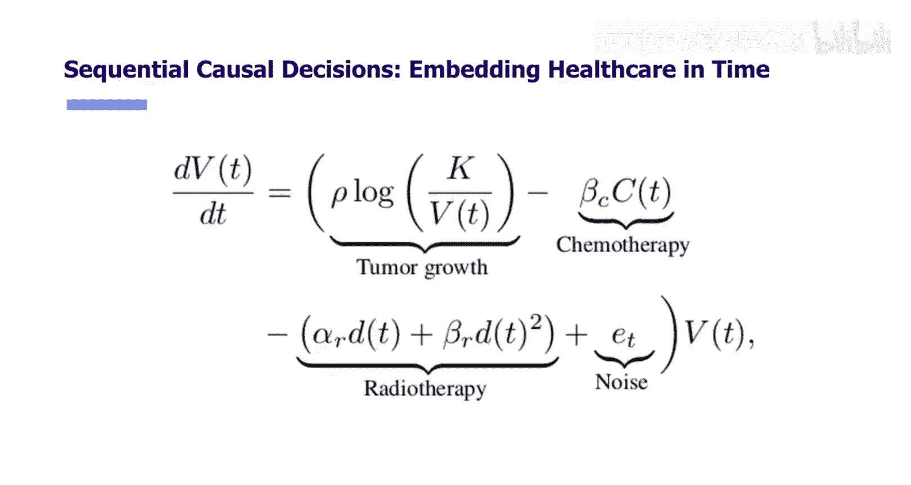

显然，这是一个巨大且重要的挑战。该研究团队采用了一个**肿瘤生长模型**来应对。

**使用模型的优势**在于，他们可以模拟所有可能的结果。通过输入数据（模拟不同患者条件下的不同肿瘤类型），并施加不同的治疗方案，他们可以在模型环境中探索所有在真实系统中被隐藏的可能性。在真实电子健康记录系统中，每个患者通常只接受一种治疗方案，只产生一个观测结果。但在模型中，我们可以同时获得**事实结果**和**反事实结果**。

**当然，模型的劣势**也很明显：它并非真实患者数据，我们可能对其过度信任。模拟的肿瘤生长并非真实的临床结果。这是一种权衡：我们获得了测试和理解机器学习算法的能力，但在应用于真实患者时需要格外谨慎。

该肿瘤生长模型本身是一个拟合了真实数据的微分方程。其基本形式可以简化为：

`dV/dt = (常数) * V(t)`

这个生长过程随后会受到肿瘤底层动力学以及不同治疗方案（如化疗或放疗）的调节。这些治疗可以在不同时间点以不同的时间常数施加。模型的强大之处在于，我们可以对所有可能的治疗方案进行采样，观察它们对不同类型肿瘤生长的影响。

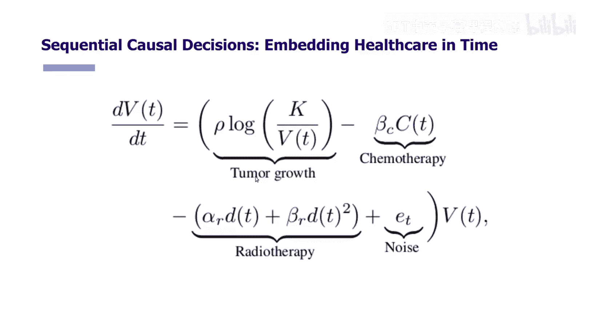

## 模型的核心数学表述

以下是该模型框架的核心数学描述：

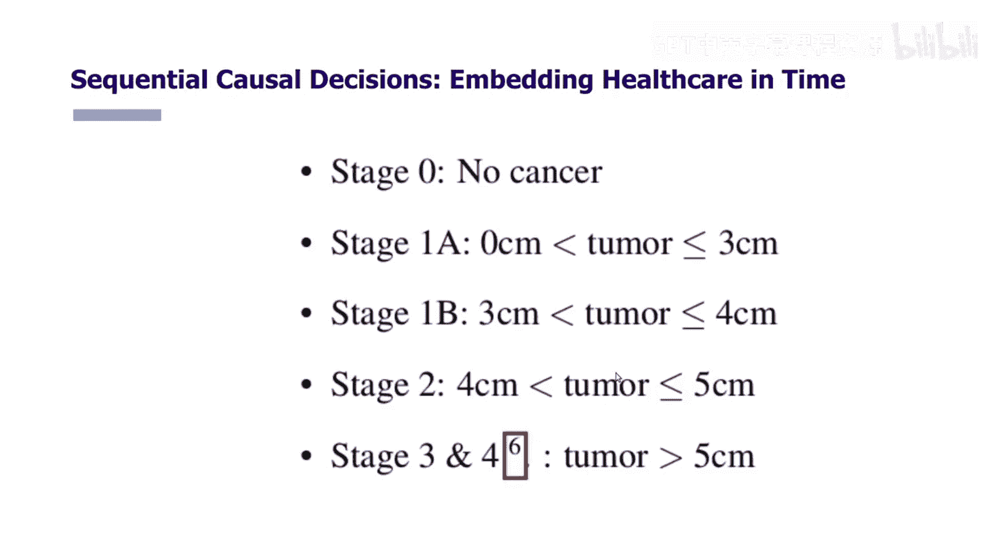

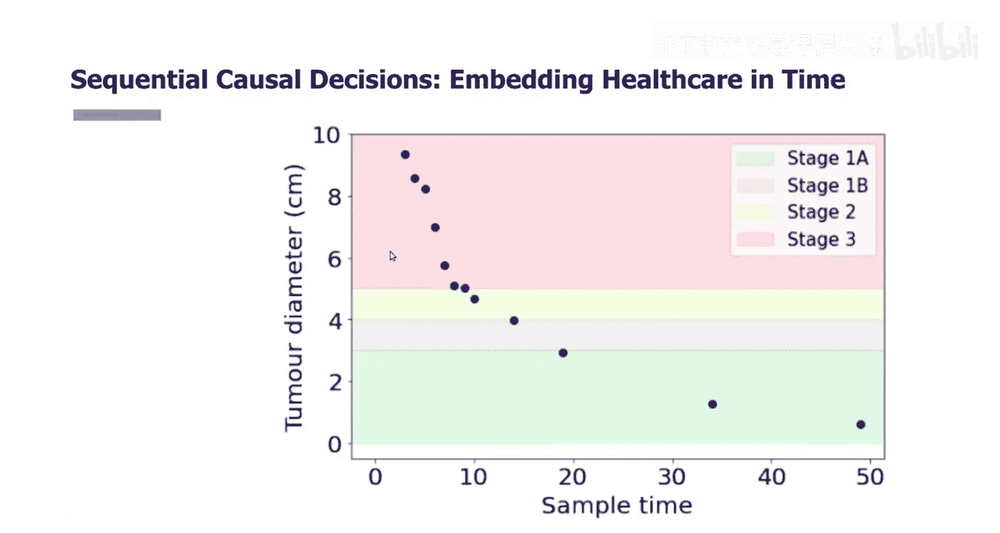

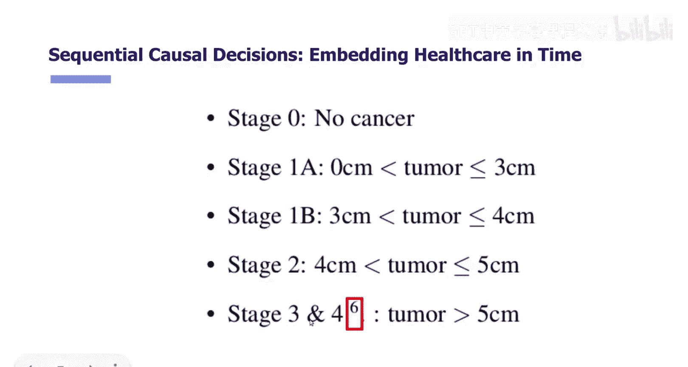

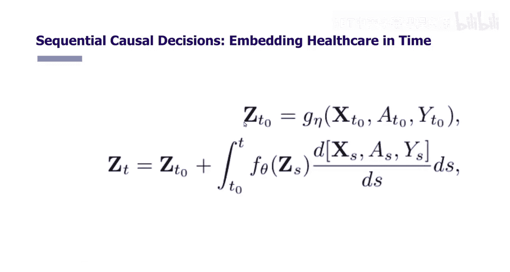

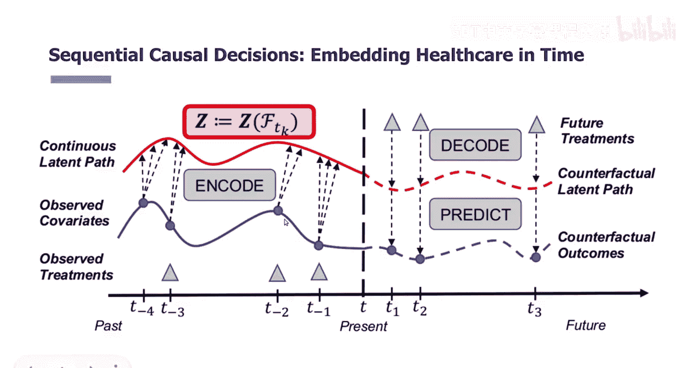

1.  **定义潜在状态 `Z`**：`Z` 是与潜在维度相关的变量，可以看作是对观测协变量 `X`、采取的行动 `A` 和初始结果 `Y` 的一种变换。变换依赖于初始条件。
    `Z(t0) = 变换( X(t0), A(t0), Y(t0) )`

2.  **潜在过程的动力学**：潜在过程 `Z(t)` 的演化由一个微分方程驱动：
    `Z(t) = Z(t0) + ∫_{t0}^{t} f_θ(Z(s), s) ds`
    其中，`f_θ` 是带参数 `θ` 的函数，它驱动着 `Z` 随时间变化的动态。

3.  **事件采样模型**：为了模拟医疗干预或观测发生的时间点，他们使用了一个**霍克斯过程**。这是一个修改后的泊松过程，具有自激励特性：
    `λ(t) = μ + α ∑_{t_m < t} exp(-β (t - t_m))`
    其中 `λ(t)` 是事件发生的强度，`μ` 是基础速率，`α` 控制自我强化的程度，`β` 是衰减率。这使得事件（如治疗或检查）倾向于在时间上聚集发生。

## 模型的应用与意义

通过结合肿瘤生长模型和霍克斯过程模型，研究者可以模拟观测数据，并探索整个反事实空间。这为评估模型、预测未来治疗、理解最佳选项以及为个体患者寻找**最优治疗计划**提供了一种方法。

例如，对于一个肿瘤直径并非简单指数衰减，而是可能出现波动的病例，你可以设想在不同的时间点引入不同的治疗方案，以在模型环境中控制病情。

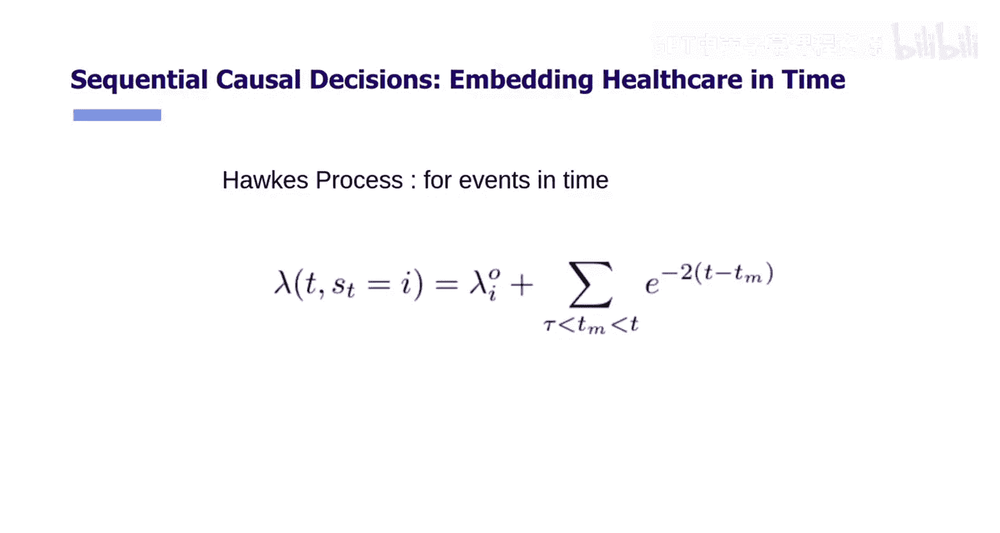

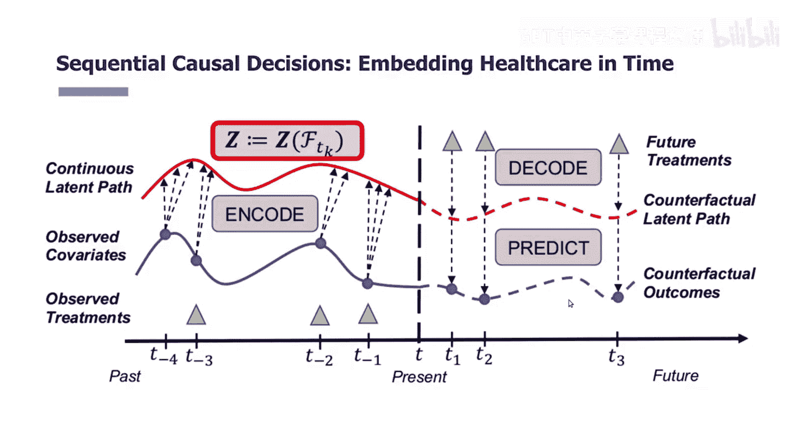

这项研究的核心问题是：我们能否从嵌入的时间动态中，做出一系列序列化的因果决策，以改善患者护理？该论文的论点是肯定的，并且已在模型环境中进行了测试。这虽然是迈向实际应用的一步，但提出了正确的问题并展示了可能性。

---

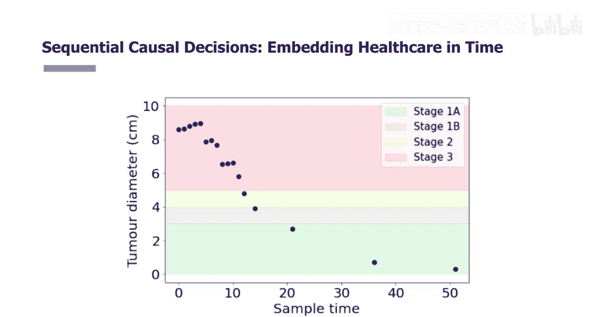

本节课中我们一起学习了如何利用连续时间模型处理不规则采样的医疗数据。我们介绍了通过引入潜在维度 `Z` 来建模观测数据，并利用肿瘤生长这样的理论模型来探索事实与反事实结果。虽然模型方法存在局限性，但它为在复杂时序数据中理解因果关系和优化序列决策提供了重要的框架和思路。