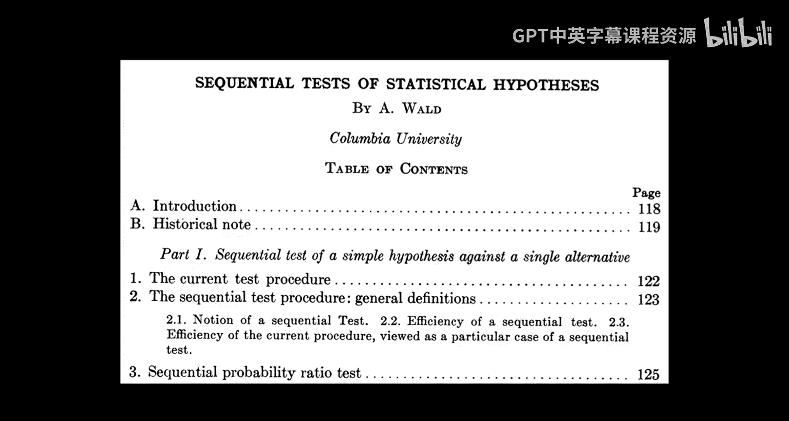
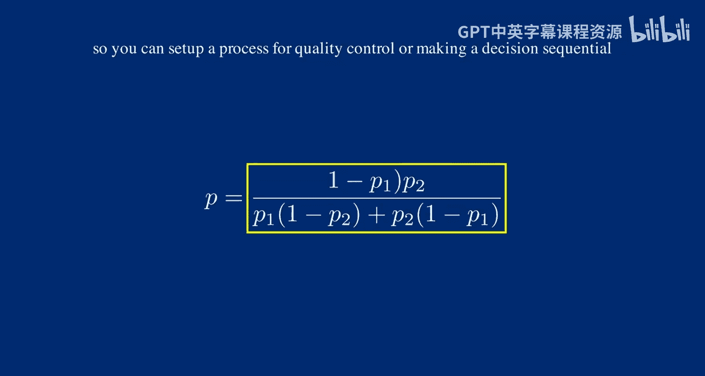

# 约翰霍普金斯大学《数据科学：时间中的决策｜Data Science Decisions in Time》中英字幕 p03 2_沃尔德序贯抽样法.zh_en -BV1NCuzzfEJa_p3-

Walt created an important paper in 1945， one that many of you may not have heard of， but many of you。

 I think， should have heard of。This is a paper that really established sequential probability ratio tests as PRRT and it was a important really paradigm type paper groundbreaking paper it to many people interested in Martin Gaes which is a concept we'll be covering some in this class and it also really led to a revolution in terms of thinking of sampling in time as compared to designing a test and waiting into a certain amount of estimates that come in In other words it enabled a type of hypothesis testing or a type of process control that it could occur dynamically and that's really important for all the things we'll be talking about in this class this ability to think about things happening in time and then making decisions about the data coming in in time so it still requires and I need to bring this out very clearly that youve thought about the。

that's creating the samples， in other words， if we think about in terms of frequency like statistics。

 we're still required to think in terms of what type of distribution is creating the data we're still required to think in terms of our types of errors or type 1 and type 2 errors these will come up more and more on the class we get further along but we're still required to think in terms of that but as opposed to thinking about it as a large set of data that kind of comes in at one point in time and then is analyzed there's a tremendous savings both conceptually and realistically in terms of being think sequentially so this type of again sequential sampling is a real light motif for much of this class so let me try and give you some feeling for that and then' return again at the end。

Whileil it's 1945 paper is on about sequential sampling。

 Imagine I've got something where I'm producing either squares or circles。 And again。

 these are like binaries think true false or a coin flip。 and I'm coming down in production line。

 and these a very common sort of approach。 maybe these are drawn from an urn。

 I want to predict what's happening。 This is a binomial distribution。

 I can say the probability of1 versus the other P versus1 minus p and then I'm drawing this n factorial deial and minus deial in front is a count to argue that I don't care what order they're drawn in。

 And ultimately again， this is just a coin flip。 so coin flip like setting with a factor of1 half。

 Now in the coin flip again one half， but in this case we can think about this as a sequential racial probability test。

 which again is wild 1945。 I take the ratio between my two hypotheses。

 p1 and p0 or the two hypotheses。 and I'm going to not worry about the binomial factors in front。

 I just take the ratio。

Between them that's what this box was illustrating and then I can just ask about for my alpha and beta and my type1 and type 2 errors。

 I can define a ratio between them and effectively a cutoff so if I've got 10 observations I can argue how confident I am of one likelihood ratio versus the other likelihood ratio so again as the data is coming in。

 I'm forming an estimator， I'm forming a likelihood ratio estimator and I'm using that in order to make a decision in other words we can put an error bar into how correct or not we are our growing sense of one error versus the other and our willingness to accept error in one or the other and again in type 1 versus type 2 so what we do is define our ability or willingness to take on type1 and type2 error and basically we can then formalize a very powerful sequential probability ratio test to enable us to sample until we。

either accept the null， the original hypothesis or reject the null and this could be thought of as something that might help with manufacturing line or any other process that's moving sequentially again we're thinking probabilistically when we say sequentially in this setting so A1 B1 pair say A and BN pair if we're thinking about it in terms of being more than one dimension we can be for a binary it could be for a Gaussian type distribution but essentially what it does again is give us a way to think about setting where we can compare sequential likelihood so again these can be designed and designed in such a way that we can control our particular values of type1 and type 2 error and by controlling that amount of type 1 and type2 error we can cleanly make a decision do we keep on going do we stop what do we do and again this is the power of a sequential likelihood。

If knew some feeling for the importance of Wt and what he accomplished in his 1945 paper。

 I also suspect your understanding this will get deeper as we go further into the class in fact I'm fully anticipating and hoping for that。

 but what I wanted to give you a feeling for on this fairly brief introduction was the sense that there is a new type of a test here one that depends even in 1945 depends on data being collected sequentially in an ongoing sense as to what the hypothesis is telling you。

 in other words again， controlling type1 and type2 error and do we keep testing do we accept the null to accept the initial hypothesis or do we accept the alternate hypothesis and the argument again being that if we collect enough sequential data。

 we can reach a point where we can make a firm decision again。

 subject to our acceptance of type 1 and typey 2 error。

 we can make a firm decision that we accept the null the kind of status quo type hypothesis or that we reject the null and accept the alternate hypothesis or。

We simply need to keep on testing and this way of again crazy the problem。

 I think is really important for everything we're talking about in this class so again thank you for taking the class and I hope you'll enjoy thank you。

