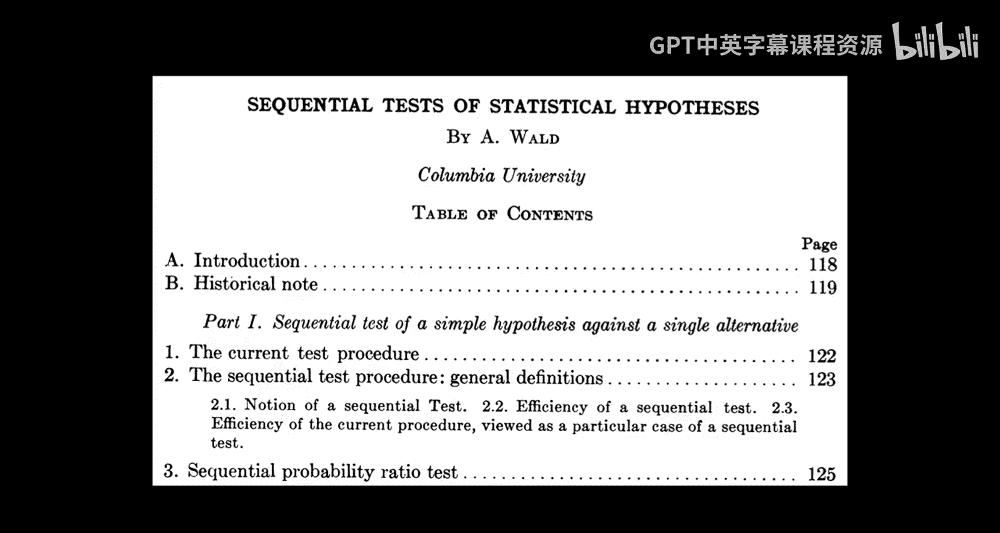
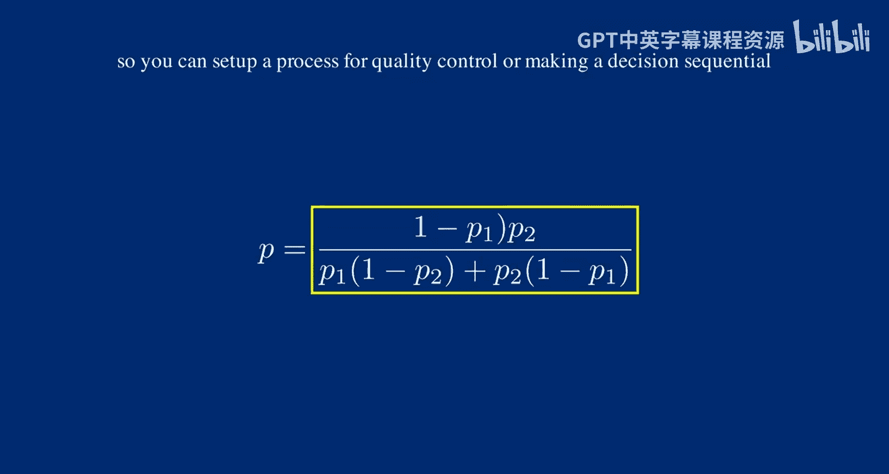

# 数据科学：时间中的决策｜课程 2：沃尔德序贯抽样法

## 📖 概述
在本节课中，我们将学习沃尔德序贯抽样法。这是一种在数据随时间不断产生时，动态进行假设检验的方法。我们将了解其核心思想、运作原理以及它在现代数据科学中的重要性。

---

## 📜 背景介绍
沃尔德在1945年发表了一篇重要论文。这篇论文确立了序贯概率比检验，这是一篇具有开创性意义的范式论文。它启发了许多人对马丁格尔理论的研究，这也是本课程将涉及的概念。更重要的是，它引发了一场关于“随时间抽样”的思维革命，与传统的“设计好检验然后等待足够多数据”的方法截然不同。

换句话说，它使得一种能够动态进行的假设检验或过程控制成为可能。这种能够思考随时间发生的事件，并对随时间流入的数据做出决策的能力，对我们课程中讨论的所有内容都至关重要。

## ⚙️ 核心前提
需要明确指出的是，这种方法仍然要求我们思考生成样本的机制。从频率统计学的角度来看，我们仍需考虑数据是由何种分布产生的。我们仍需考虑第一类错误和第二类错误。随着课程的深入，这些概念会越来越多地出现。

但是，与将数据视为在某个时间点一次性收集完成然后进行分析的传统思路不同，序贯思维在概念上和现实中都能带来巨大的效率提升。因此，这种序贯抽样思想是本课程的一个重要主题。

## 🎯 核心概念与示例
为了让大家对其有更直观的感受，让我们来看一个例子。

想象一个生产线上不断产出方形或圆形的物品。这类似于二元结果，例如真/假，或抛硬币。这是一种非常常见的场景，也可以想象成从一个瓮中抽取球。我们想预测正在发生什么。这是一个二项分布。

我们可以设定一种结果的概率为 `p`，另一种为 `1-p`。当我们进行 `n` 次抽取时，顺序并不重要。本质上，这就像一个抛硬币的场景，只不过概率不一定是1/2。

在这个抛硬币式的场景中，我们可以应用沃尔德在1945年提出的序贯概率比检验。我们取两个假设（例如 `p1` 和 `p0`）下的概率比。我们可以忽略前面的二项式系数，只计算它们的比值。

以下是其核心公式的简化表示：

`似然比 = (在假设 H1 下观察到数据的概率) / (在假设 H0 下观察到数据的概率)`

## 📊 决策机制
基于我们设定的第一类错误（α）和第二类错误（β），我们可以定义两个阈值。

随着数据不断流入，我们形成一个估计量，即似然比估计量。我们利用这个估计量来做出决策。换句话说，我们可以为我们的判断设置一个“误差带”，来衡量我们对一种错误相对于另一种错误的容忍度。

我们所做的是定义我们承担第一类和第二类错误的能力或意愿。然后，我们可以形式化一个非常强大的序贯概率比检验，使我们能够持续抽样，直到我们：
*   接受原假设
*   或拒绝原假设

这种方法可以应用于生产线或任何其他顺序进行的过程。在这个语境下，“顺序”意味着我们是以概率化的方式思考的。

## 🔄 方法的扩展性
对于二元情况，我们可以设定A和B两个阈值。如果我们考虑多维情况，它也可以应用于高斯型分布。本质上，它为我们提供了一种比较序贯似然的方法。

这些检验可以被设计出来，并且设计方式允许我们控制特定的第一类和第二类错误的值。通过控制这些错误量，我们可以清晰地做出决策：是继续抽样，还是停止？这就是序贯似然法的力量所在。

## 🧠 总结与展望
希望本节内容能让大家对沃尔德及其1945年论文的重要性有所体会。我也相信，随着课程的深入，你们的理解会进一步加深。

在这个相当简短的介绍中，我想让大家感受到的是，这里存在一种新型的检验方法。即使在1945年，这种方法也依赖于数据被持续、顺序地收集，并根据假设告诉你信息来做出判断。

换句话说，控制第一类和第二类错误，并决定是继续检验、接受原假设（初始假设），还是接受备择假设。其核心论点是，如果我们收集了足够多的序贯数据，我们就可以达到一个点，在接受了特定错误率的前提下，做出一个明确的决定：要么接受原假设（现状假设），要么拒绝原假设并接受备择假设，或者我们只需要继续检验。

我认为，这种构建问题的方式，对于我们本课程讨论的所有内容都至关重要。