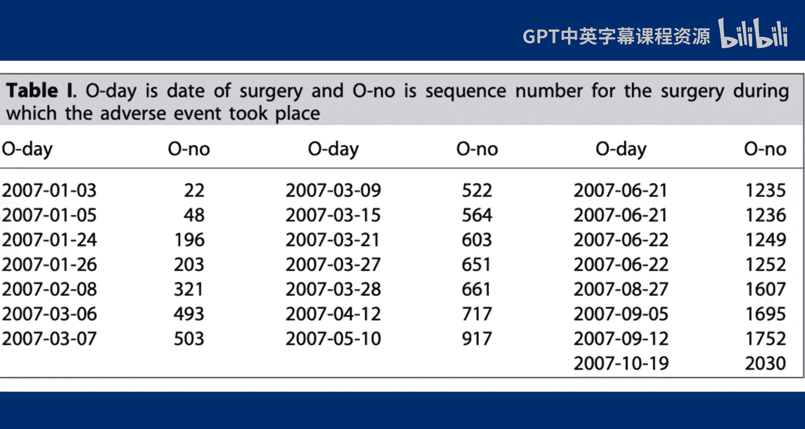
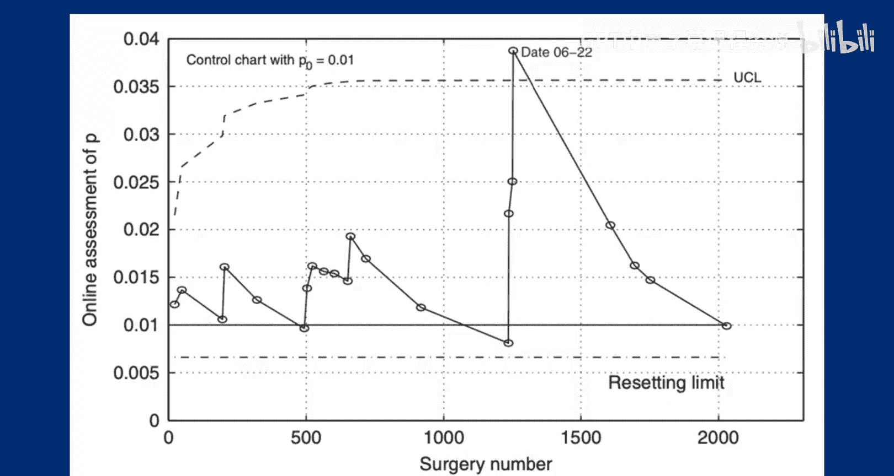
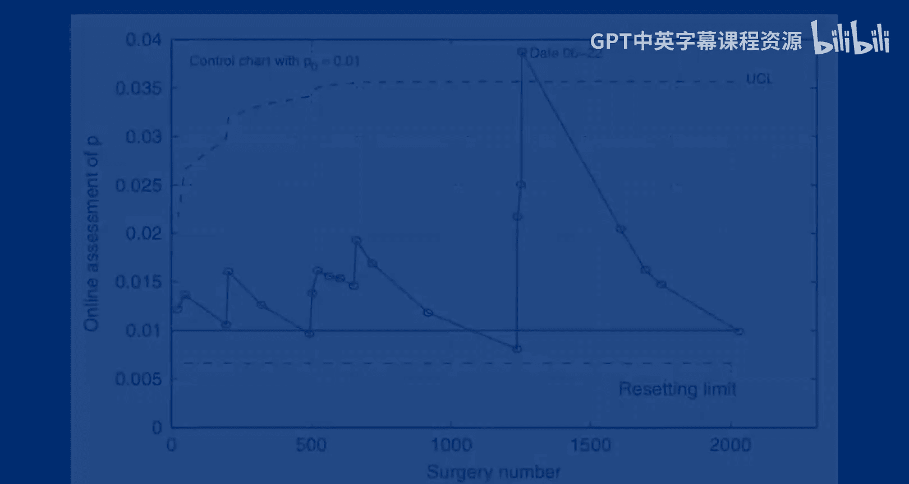
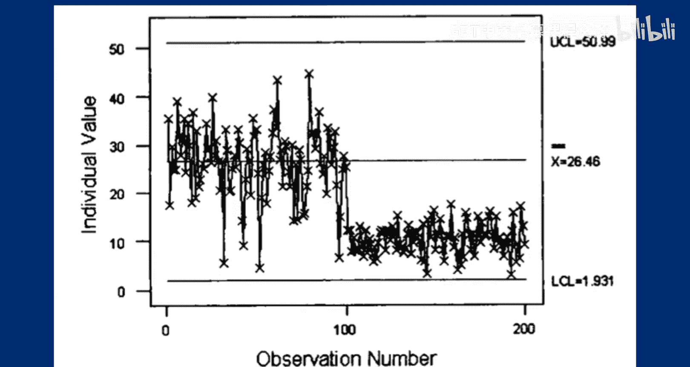
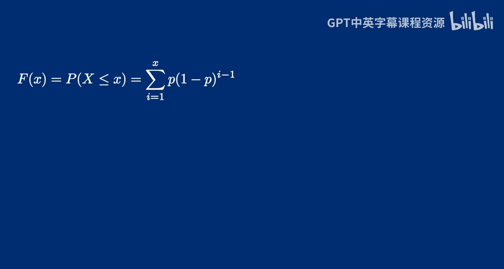
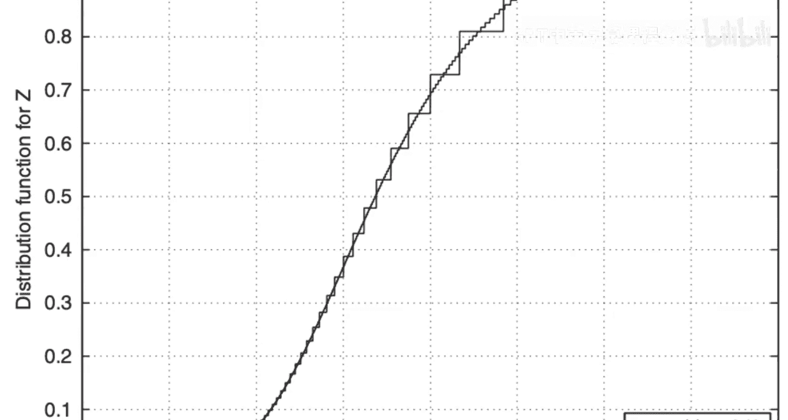
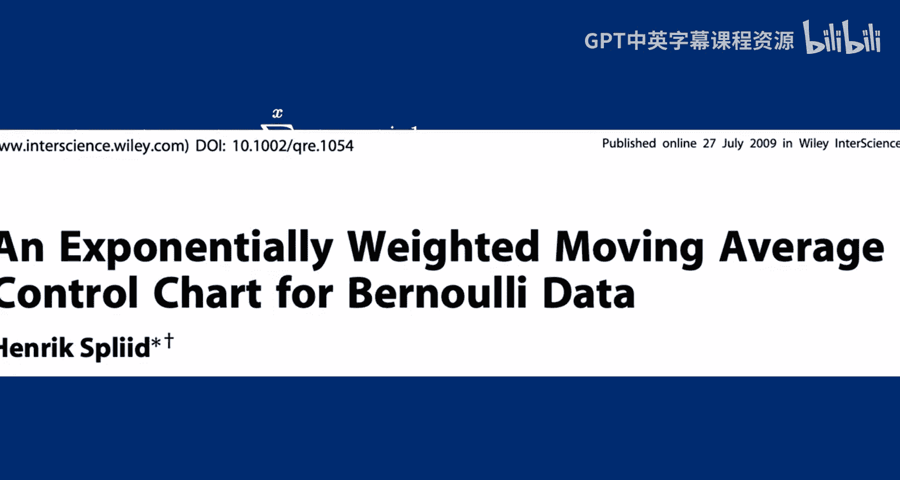
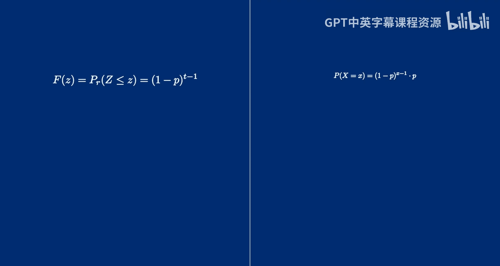
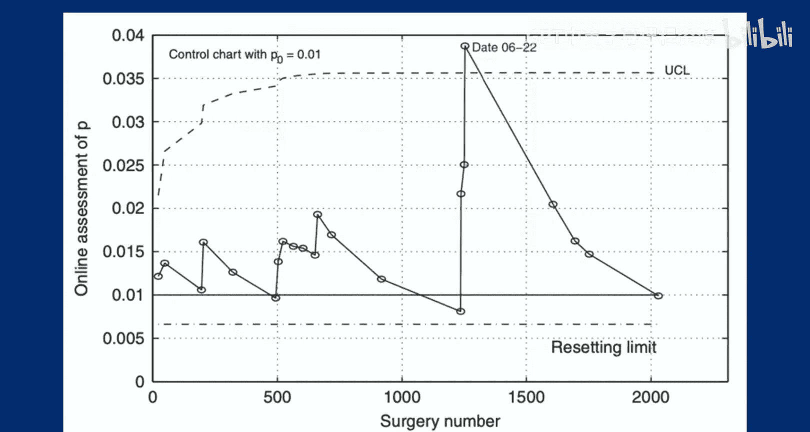
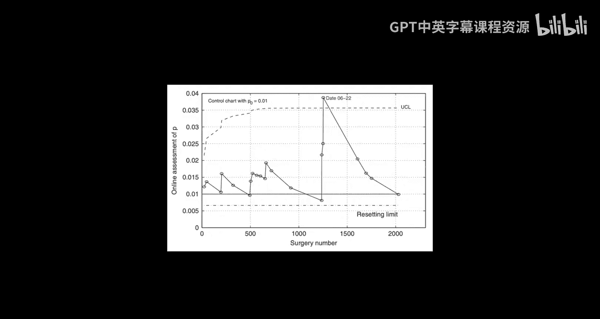

# 约翰霍普金斯大学《数据科学：时间中的决策｜Data Science Decisions in Time》中英字幕 p04 3_质量控制图.zh_en -BV1NCuzzfEJa_p4-

Conttrol charts are often found industry， and some of you listening may even have used them。

They provide a particularly simple and compelling way to visually control an often very complicated process。

 In that regard， they have an extreme utility。And thus， by monitoring the control chart。

 the overall outcomes defined by the process are kept in control with a feature rate。 really。

 I'm sorry， a failure rate that is at the desired point。That's a good feature is all I mean。

So if things start to deviate towards a higher failure rate。

 indicating that a process has control problem。Then the production line or the surgery center can take proactive action that is essentially。

Positive， and that's really a one sided control chart。Now that's the most active side。

 the failure rate increasing， but we could certainly have two sided control charts。

And that works in essentially the same way。These two sided control charts are probably less common for those of you that have worked with these in industry。

 but they essentially are also monitoring the ongoing process to understand what's going on。

So we can think of this as a distribution function that we're following。

 a single parameter defines it， and we're looking for deviations from that parameter。

So I'll now go into this in a little more detail， and I hope this helps you to see further into how we can make better decisions based on data。

 data that's streaming data that's coming in a sequential or online setting。

 How do we make better decisions in time that， again， is the light motif of our course。

 And this type of analysis again， I would argue， is a problem that's just increasingly important in our modern。

 connected world。 Imagine you are in charge of running in the surgery department at a large hospital。

 Most of the times things go smoothly。 It may be busy and may feel near or even out of control times。

 but you've got good nurses， excellent doctors and a scheduling process seems to be working well。

This chart shows events， times that have gone well versus badly， and we can count them。

 And with low probability， maybe one out of 1 thousand00 times， things go wrong。

 Maybe it's an equipment malfunction。 Maybe it's a patient not showing up or an error reric procedure。

 but we want to keep those times when it goes badly under control。 We want to keep them。

At 1 to1000。 So how do we implement a sequential test to help us evaluate when things are going smoothly and when there's a problem。

These ideas grow very nicely from Walt's 1945 work。

 and the general idea is to look for rare events with a tool called a control chart。

And this is essentially the same as those diagonally stretching lines that we went over with Walt's original gaze from 1945。

 So shown here is a control chart where the probability P of the bare event that we're trying to control is seen visually and that lets us bound and see how to control it because we can see that at the midpoint it's gone out of control。

 Here's a similar one observation number individuals and it's little bit harder to see what's going on。

 but not that much chart。 we have got an upper control level and a lower control level。

 We've got individual values and we can look to see whether things are under control。

So the assumptions here are very similar to the ones that Wald made。

 We have to assume that our events are Iid， identical， independently distributed。

 and we will work within this idea of a geometric formula。

 which again is the discrete form of the exponential that is the continuous。

 which is inner event intervals， meaning we are waiting We're looking for x minus1 good events but we've got a one bad event at the last event X。

 And this is a geometric formula。 We're looking again for that first coin flip that's gone bad。

 So P of x capital X here again as our random a variable x is the instances values so that render variable being equal to x。

 and then we're count。 that's all we're doing。 We're looking for how many times do we hit those rare events。

And this is a very reasonable way to think about things。

 and it helps us again by counting to see where things are gone wrong。 Now。

 this may look like we're looking forward to the rare events or of the failures。

 But that's not exactly what we're trying to do We're simply accepting in our chart of surgical events here。

 that we well eventually see a failure and asking how long it is between those failure。

 obviously the longer it is between events that are considered failures， the better。

 that's what we're trying to control， We want those long events to be as long as possible。 And again。

 this is a geometric distribution。 So our statistical question then is kind we determine that value of P。

 that distribution of rare events that are controlling this geometric distribution。

 the times when it has gone badly， can we keep that as long an inter interval as possible or if we've got to change point that's going to change that to make it more common。

 Can we see that。 So this math， I hope you'll see is' fairly straightforward relatively easy to see into。

 So we can think of this again as a geometric。

shown on the right here， P of capital x equal to x means that our value。 we've got1 minus p。

 That's again， the alternative p it's a binomial again， like a coin flip to the x minus1。

 so that probability has happened more frequently。 those events have more frequently than the rare event which is the P event and capital f of x here on the left is our cumulative think of that as the CDf cumulative distribution function So that's going to go between01。

 and we can write that as probability of x less than or equal to x。

 there's a sum of all of our events equal1 up to x。

 and we're asking as we go from0 to1 on our cumulative distribution function what is happening So again。

 this is going to be a geometric distribution that we're dealing with。

 We've got n minus1 events going well before we've got the n1 that is the failure here and again that is what's shown here on the right。

 So we think about now our sequences How many sequences do we have。

 and how can we watch as they come in and maybe patients in the surgery center and。Watch。

 record outcomes and make sure that we are staying under control So what's intriguing here in the paper that we're dealing with is this idea of a transform to take this geometric distribution and help the geometric distribution how the geometric distribution really jump out unders when things have gone out of control and this is a way of almost like setting a debugging alarm we have potential problems on a rare event scale and this helps us to see when we've hit this rare event settings Now there's been many transforms that have been applied for this In fact。

 I like one of the earlier papers because the transform is particularly simple and a bit easier to see into but this one I also think is really very good because it helps you more to see how things are into control in the earlier paper just to help you see a of a bit into that that was the vivo distribution in the earlier paper and then there were just two parameters Eta and beta and that was like a scaling factor on a capital X here and a power to raise to the new variable and it fact。

made it into an exponential， but the one we're dealing with here， which again。

 I think is even more insightful， especially in more of an applied setting。

 the transform is a little more complicated， a little bit more difficult to see why it works but the fact is that it does work and that's really what I want to emphasize is that it helps you to set up a control chart by the nature of the transform and again。

 the transform is really a way to help this insight into the probability in the geometric distribution to come out even more clearly。

 and the key concept here again is this idea of an exponentially weighted moving average and effectively what we're doing when you see this a little bit more you'll see where this is coming from but effectively we're just transforming in such a way that as a moving average in a weight。

 we can see whether we're in control or not in control。

 in other words we're building a moving average that helps us to see what's going on。 And again。

 just as a reminder this is very similar to Walt's 1945 work in terms of sequential。

TestingSo now I hope you'll bear with me just a little bit more as we go deeper into split paper and explain how you can make a transform that looks like this。

 this is our CDf on Z going between zero and1 and you can see that there are two different values of P here map into the essentially the same cumulative distribution function and this is what's important is that we can do this and this comes from this paper here from 2009 split I don't know if I pronouncednounce the name correctly we'll call it Henri call the paper from Hendrick because I think that's easier than his last name but this was the paper that use this transform that we're talking about So by doing this transform on Z we get a probabilistic sense for how P is distributed in the words the transform helps us to see more clearly into what is going on within P So Z is our transform and effectively what we're doing again we're starting with our cumulative distribution function here on the left we're applying again a transform to take our values of。

Into a frame that helps us more cleanly and quickly to see how a P is distributed， in other words。

 to see whether we are in control or not， and that Z transform， which again involves a log function。

 helps us to see more clearly into the nature of the control problem。

So I'm hopeful that this has been giving you some idea of what's going on。 Here's Z again。

 This is a log of x minus half and one/ half is important。 The log。

 you can see that why I've been emphasizing the exponential side of this。

 and then you can think of the log of1 over p minus1 over half effectively what we've done is by this transform moved it into a frame where when we take our cdf are big f of z。

 we moved into a frame where independent of p they're all going to follow a very similar curve again where p will be the value of our rare events。

1 minus p being our more common event and the one that we're trying to control。

 So this explains again the very first figure that I put up after the table which was to demonstrate that we can look at our cumulative set of p's as it moved along And again this comes from being able to do this cumulative distribution function and C into the values of the table that we started with。

 So our data。

Thathan has been transformed， and we then are able to have control over our process。

So the math in this example is particularly intriguing， at least to me。

 since it suggests how transformsative events can help us to see further into what the data is telling us。

Later on in the course， we'll have a chance to think him talk about Martinales another concept some of you may have run into and the approaches from Martin Ga's that really started with fell's thesis work in the 1930s and earlier times with gambling。

 it gives us interesting ways of thinking about limits of distributions through happening with sequential events and these exponentially weighted。

Moving to average charts。Remind me very much of the power of data presented visually over time in making decisions。

So， in sum。I hope that this short section has helped you to see further into how decisions can be made in time based on data。

Again， time meaning that we've got sequential or online data coming at us and we're trying to improve our decision making ability。

 and as I've mentioned， this type of analysis and a type a problem is just increasingly important in our modern connected world。

