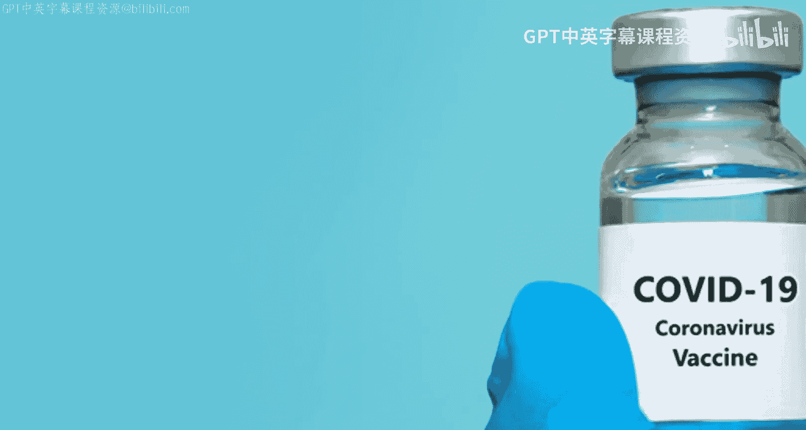
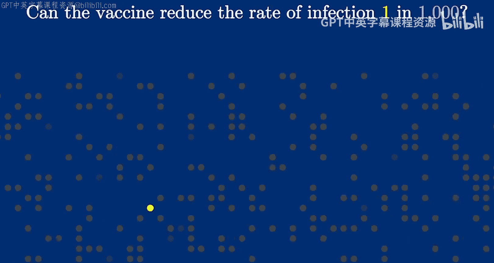
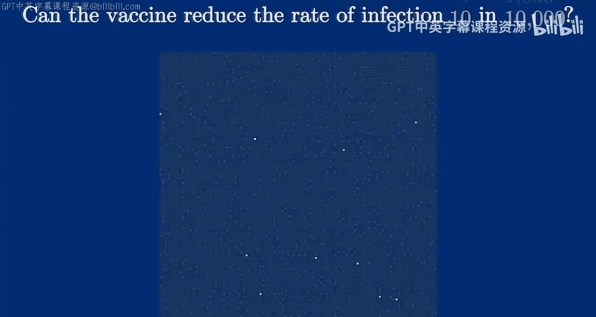
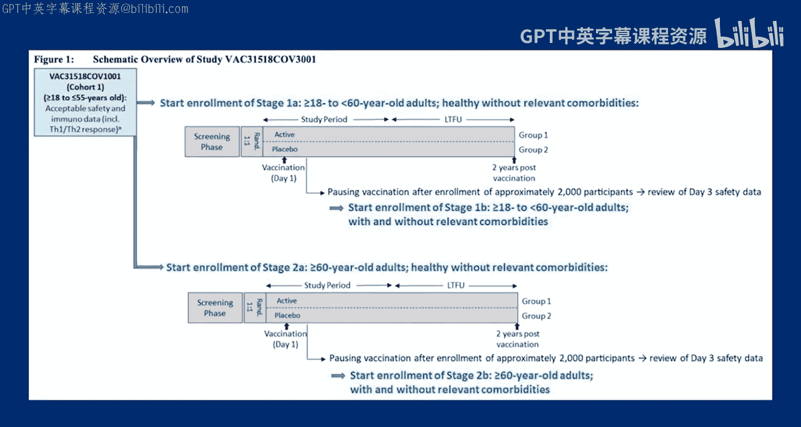
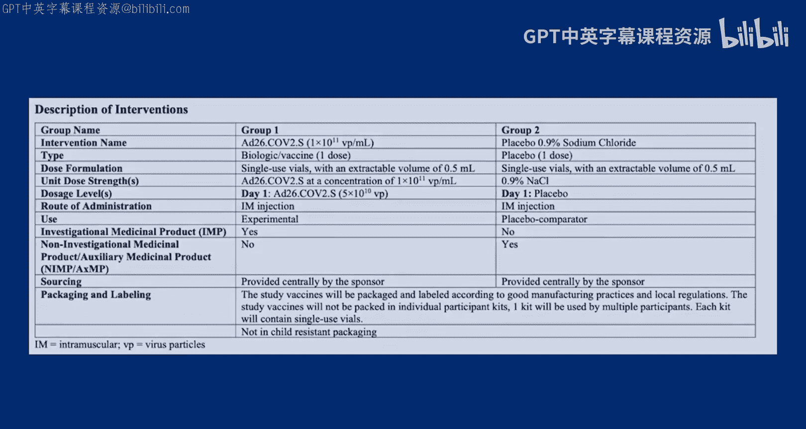
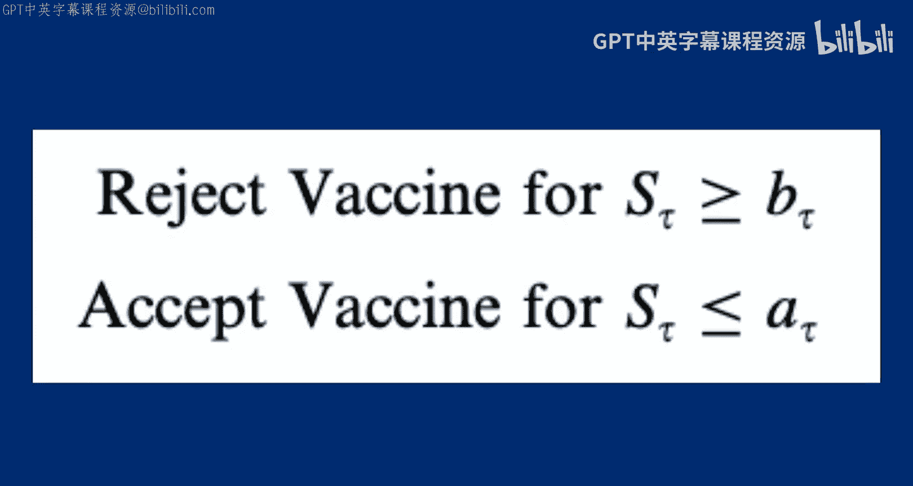
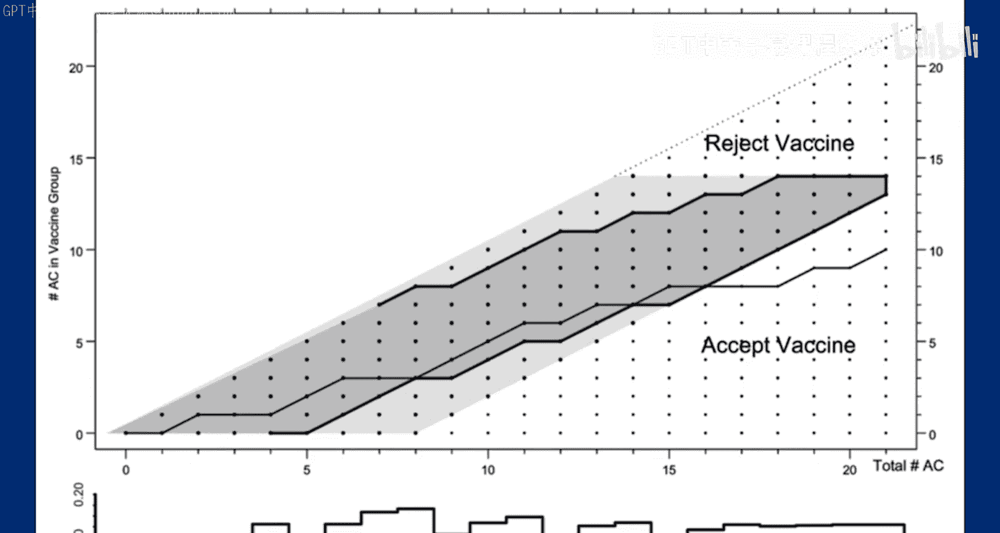
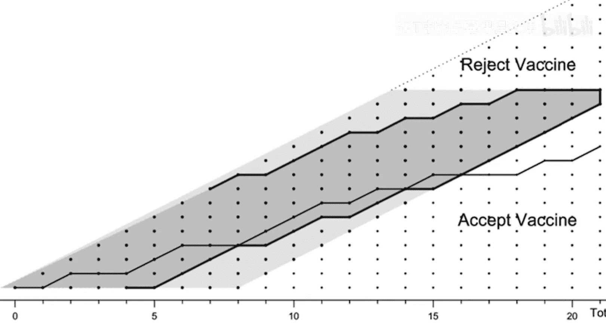

# 约翰霍普金斯大学《数据科学：时间中的决策｜Data Science Decisions in Time》中英字幕 p05 4_疫苗序贯测试方法.zh_en -BV1NCuzzfEJa_p5-

Over this last year。As I record this， our world has been dramatically changed by Coved 19。Now。

 the growing light at the end of the tunnel for many of us。Has been the development of vaccines。

I suspect many of you by this point have already taken a vaccine or have been considered it。

But it's really important that we ask， how safe are these vaccines？

And if you're hesitant to accept a vaccine， why？Is that based on an understanding of how vaccines have been designed and tested and judged to be safe？

A lot of what we're covering in this class。Merely dates back to sequential testing for vaccines。

 like drugs or other things。 so I think we can all benefit from a reasoned analysis of how these sequential testing ideas can provide insights into the relative safety of vaccine。

These are critical times for doing tests correctly， and they can be done correctly。

 So what we'll talk about in this section is the testing route that Johnson and Johnson used for their vaccine。

There are different tests that could be run for different types of settings。

 This is only one our sequential testing route， but I think it'll come away feeling that the ways used to test vaccines。

 including the sequential testing we're talking about now。

 to verify the safety of the vaccine are very strong and very well reasoned。

So you really can take confidence that a vaccine has passed。These tos。That it is a safe product。

 It is a safe thing to be taking， and it contributes to controlling。Cvet。

 it contributes to making the world safer for all of us。

Imagine that you have a possible vaccine for Covid。

 How would you prove to the world that you have a workable solution。In your imagination。

 the vaccine is 100% effective。But is that going to be the case？How do you tell。In the real world。

 you'll have some participants where it's effective。And some， not effective。

This means that you can't just tell everyone immediately that they should take your vaccine and be safe。

So how do you go about showing yourself？And the rest of the world， they've got a good vaccine。

This is the problem of sequential testing， and it's also a problem of drug development。

 of medical treatments， and of obviously vaccines。 So see here on the right our Covid 19 model vaccine。

 Now we can look at this through the lens of sequential testing。

And the idea， as I've already mentioned， dates to Wals ideas from the 1940s and means that we think about the vaccine as having a fixed percentage of effectiveness。

 and we want to observe large numbers of individuals sequentially and count the numbers that get better or the don't in this case that get infected with the effects with the CoVID-19 and those that don't。

So theres some key assumptions here first， whether they do have a situation with a single parameter that describes the vaccine effectiveness。

 and two that this number is not changing with time。So as we imagine injecting the vaccine。

 like in this picture here， sometimes it's real and sometimes it's placebo， and how do we do。

 how do we test， we find out who given a shot。Catches coved and who doesn't。And we count。

 It's all about counting。 So ideally， we're again， assuming the virus itself stays the same and the vaccine is equally effective or noneffective over the whole population in which we're assuming a relatively simple but still quite robust and reasonable assumption that we just have a single distribution that could capture at all。

 But with this idea， we can describe a test again， a sequential test that defines whether the vaccine is very likely to be effective or whether it should be withdrawn and that whether we should continue to work on other vaccine ideas。

 So， for example， here we've got a cartoon animation and we can work within this to tell the FDA and our eventral vaccine customers about how well we expect the vaccine to perform。

So the sequential test that we run is in exploring having many people come down with COVID versus how many people don't come down with COVID in two populations。

 the first population is unvaccinated and the second population is vaccinated。

Now if the vaccine is effective， then we should see a smaller number of viral COVID infections in the test population that has been vaccinated compared with the non vaccinated population。

So we ask then if we look at 1 thousand0 people， can the vaccine reduce the infection rate down to one。

 that would be ideal。What about our population of 10，000 people？

It should be the same percentage。So if we imagine a time invariant measure of effectiveness。

 the virus is not changing and the population is essentially the same， then we can run our test。

And throughout this， we have to worry about false positives and false negatives。

 We can't expect to measure this perfectly， but we can try to anticipate that we will have some percentage of false measurements。

For example， we might have only nine true positives in that set of1 that we had thought were infected。

We call the false measures of two types， type 1 and type 2 errors。

 and we need to convince the FDA and the general public and ourselves that we have correctly measured how effective the vaccine is for preventing Covid。

 So， again， that's our challenge。 Can we statistically prove this。And we do this by counting again。

 We keep a running tally of the number of infections in our two populations and our confidence as we get these counts that we are seeing an effective vaccine。

 And that's the flavor of the approach that Johnson and Johnson used in their vaccine。

 You can see their description upon the screen with a little bit more detail。

 We're exploring just two possibilities， two hypotheses。

Essential that we have a work ofable vaccine versus one that we don't。😊。

So in the equation I had up earlier with R， we are comparing the relative risk。

 this is the value of R to a threshold。 And we use R for that notation。

 we've got an alternate hypothesis， which is where we would stop work on the vaccine。

 it's a relative risk in the opposite direction。 This comes from counts defining R。

 and don't be confused by our use of relative risk here， just realize it's testing。

 itss counting over two groups。 Those given the vaccine and those not。

 And the question we're asking again is whether we see an improvement or not and the numbers of those that are exposed to the virus。

Now， this is their study design that I put up a minute ago。

 and they used two stages and in both stages there are two groups。

 and again the two groups are one getting the vaccine and the other one not。

And the only difference between the two stages is the ages associated with the patients。

And you can imagine different effectiveness for the can vaccine in these different age groups。

So we can think then of our errors of two types， Al and beta。

 and this is very common to be thinking of these two types of errors， Al is our type 1 risk。

 beta is our power， type 2 risk， and you can think of alpha as being the consumer risk。

 really simply defined here as you see on the screen as the probability that you've accepted the vaccine versus the vaccine is unsafe。

Beta again is the type 2 error and it's the opposite risk。So。

We want obviously to control our type 1 and our type 2 error。

 and when you volunteer to be in a vaccine trial， it still means getting a shot。

 but you won't know if it's the vbo or the Kennedy。Vacine。

Now this may sound like it's unfair to those that are getting the candidate vaccine。

 but you need to remember that at this stage we wouldn't know if the vaccine is effective。

 so whether it get an impable or not， you don't know which one is necessarily better。

Again beta is the power， the type 2 risk， and you can think about this as the producer risk。

 in this case what we're effectively with beta asking is how many individuals do we have to test。

 that's the power in order to have an acceptable range of type 2 error。

 meaning again that we want the ability with reasonable effect size and beta is measuring both power and effect size。

 the probability that we would potentially reject the vaccine given the vaccine is safe。

 we want to control that。So this means， again that the one we being given the vaccine。

 the candidate vaccine may even be at greater risk， because just don't know。

 you wouldn't know without the outcome of this test which the two groups you'd like to be in。

 I have mentioned these two types of errors。 and these are associated again with our sequential testing approach or a sequential trial。

 And again， the first type we can think of as a consumer risk。

 And that means the chance that you had given a vaccine， but is actually not safe。 Again。

 a type of error。 The second type is the probability the vaccine was safe， but it had been rejected。

 And you can think of that when beta as a measure for the missed opportunity。

 So in a wed sequential hypothesis test。 We expect a certain fraction of trial participants to come down with Covid in both the vaccine treated and the placebo treated groups。

 And we're keeping a run in count。 It's just as simple as it sounds。

For those that have the disease versus those that don't in our two tests。

And we can also keep a account for side effects and we can even discriminate between mild and serious side effects or between long and short term side effects。

So in this view of a sequential tasks， we're asking about these counts over time relative to the numbers that we expect to see from a fixed probability distribution。

And this is the whole approach of sequential testing。So again。

 that fixed pre distribution is telling us about the possible effectiveness of hurricane。

 and we are assuming that it has one value， one parameter that describes the effectiveness。

 and we can continue to monitor our numbers。So in this type of sequential test。

 we can think of three outcomes at each point in time。

We obviously can continue testing for an in definite amount of time。

 but we might want to reject the vaccine。 That would be one candidate。

 We might want to accept the vaccine， and that those two would be the second and third outcomes。

 and all of those decisions are defined by the story ultimately that we need to tell the FDA and the public about how well the vaccine works。

So we do need to be careful and less confident that our statistics or counts correctly conclude the vaccine is eitherre working or not。

And this should immediately make you think of high numbers of tests， again。

 that's going to debateta the power， and that is the right intuition。

Another way to say this is that I can't tell if a coin is fair or not。

 meaning 50% or not with two or three flips。 Do I you have1000 flips。

 I've got a greater sense for whether it's a fair coin or not。 If I have 10000 flips。

 then my confidence that the coin has a particular value P for it's by no probability of heads or tails is quite reasonable。

 In other words， I can conclude fairly that it's a fair coin with enough flips。

 So know if it's a 55% to say coin， then we can draw a sequential design diagram to summarize what's going on。

 I can keep coin if we have boundaries on our diagram for when to accept when to reject based on our errors。

 we can define a broad region for when to keep testing are three options。

 and it'll look something like what we're putting up on the screen here。

 The actual numbers and the bounds are going to depend on the vaccine and the confidence we want to communicate how well we've measured the binial parameters for effectiveness。

 So again， a sub i b sub I or the boundaries on our test they will look like this diagram that's coming up on the screen。

 and this sets the bounds when we will stop when we。

Will keep going this will help us to evaluate fairly again how well we are doing with our testing because obviously again。

 as I mentioned in the induction we don't want to put a vaccine the maker of the vaccine doesn't want to the public health authorities don't want to put a vaccine on the market that is not past these tests so in other words we're only going to put something out on the market that is reasonable so again our Xxes here is the sequential number of tests and our A and RB sets those solid lines so we've got accept vaccine range reject vaccine range and continued testing range and these are the three ranges that our sequential tests is coming in so again as we are counting as we are looking over the numbers we are plotting on this kind of a graph and we can think of these as setting bounds and so I hope this helps you to see a bit further into walls's ideas for sequential sampling and how they could be applied。

For vaccine development， and I'm also hoping that this is helping to seen the nuances of vaccines are proven to be safe and effective because they can be statistically proven to be safe and effective。

 and that's an important message， public health message of what we're talking about here that something as really quite terrifying as the coronavirus and COVID-19。

 the disease that flows from that， we can control it through vaccines and through everyone contributing by educating others about vaccine testing and taking the vaccine themselves in order to be safe。

So the safety of drugs and vaccines is central to public health， I think we can all agree on that。

Theres really no interest for a business or for a government or really for anyone in bringing a drug or a vaccine to market that creates new health risks or new health problems for anyone。

 In words， why would you make anyone sicker。By giving them a new drug or a new vaccine。

 it it wouldn't make any sense。 So it's a balance of cost and benefit。

 It's a balance of relative risk。And again， I just can't imagine any pharmaceutical company trying to make money from something that has no benefit to patients。

 it would not be a business model that makes any sense。 So， while。

 I think we all need to be good citizens。 We need to be fairly evaluating our own ideas of relative risk。

I also think that we need to be good public citizens and we need to take great pride in the work that was done to bring these vaccines to the general public to really bring them out in record time to test them to think through their relative risk in their relative gain。

 This was really a non-trivial effort， huge， huge effort on many， many people's part。

 And part of this was the testing that we just went over testing them to really be comfortable and confident that they really did make a difference。

 And then at the other part is communicating that these vaccines are helpful that they really do make a difference。

 and I think at this point， the evidence is in that they really do help。

 they really do make a difference。 the testing that was done here on the Johnson Johnson one that we just went over again。

 non-trivial lots of effort， lots of people and I think again showed a safe product at the end。

 So I think if you are hesitating at all about taking a vaccine I would suggest you don't need to these are safe products。

And the testing that we just went through， I think is a very robust way to go about checking whether a vaccine is safe。

