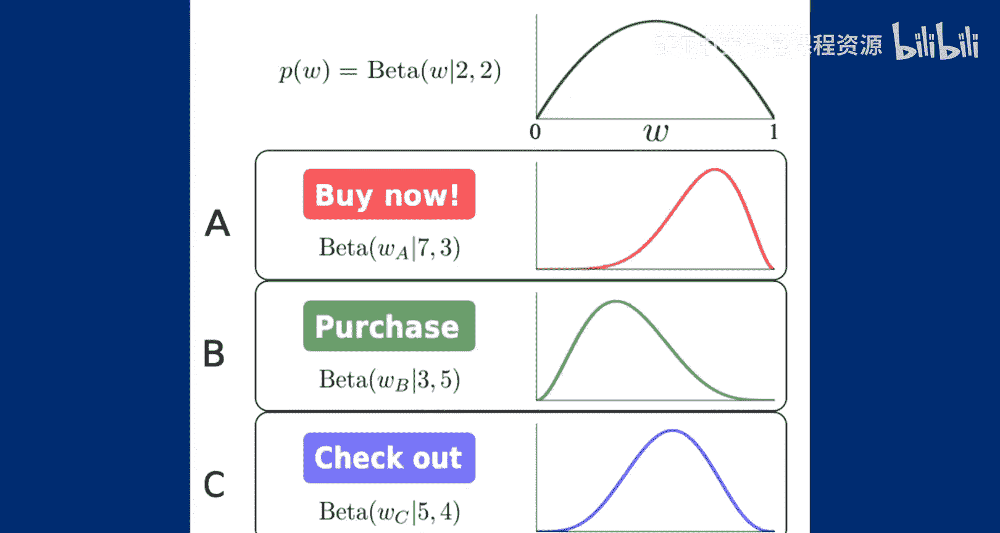
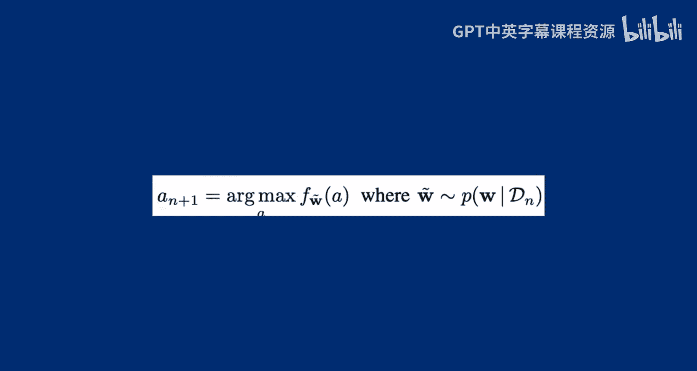
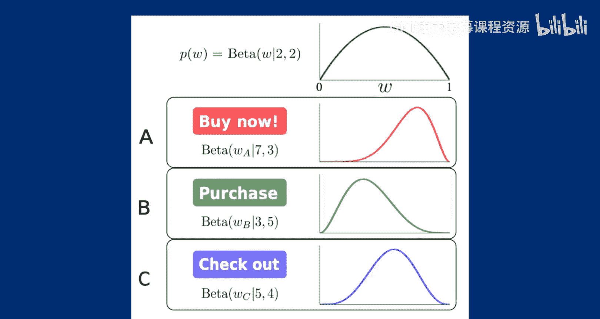

# 约翰霍普金斯大学《数据科学：时间中的决策｜Data Science Decisions in Time》中英字幕 p06 5_基于汤普森采样算法的A-B测试.zh_en -BV1NCuzzfEJa_p6-

Now， we'll talk about Thompson sampling directly。 This is an extremely nice algorithm from 1933。

 so not all that new。 and yet it's been rediscovered multiple times and multiple names。 Essential。

 it's bay sampling。 It's looking for an optimum。 and that's probably the most important thing to keep reminding yourself as we go through this。

 is that it's building on data。 So it's a sequential data generating or thinking mechanism。

 And what it's trying to do is as data comes in。 it's updating。 think again， bay。

 And as you continue to generate more data or as you collect more data。

 it's trying to make an optimal decision。 Now， this is different than W's theory。

 This is not trying to do hypothesis testing， it's not trying to control type 1 and type 2 error。

 It is trying to simply find the best decision。 You can see this as well， I think。

 best as an example of exploration exploitation。 meaning that it is trying over a very large potentially certain。

Almost infinite search space。 it's trying to find the best answer that it can find。

 so it doesn't want to get stuck in what you might think of as a local minima and therefore exploiting instead it wants to do a combination of exploration and exploitation。

So the other general frame for this is what's called multi-arm bandits。

 again a bandit is like a slot machine in Las Vegas or some other gambling spot。

 obviously one never wins， but the idea of a multi-armed bandit is that I've got multiple arms I can pull。

 think of multiple slot machines each with a fixed distribution function and I can optimize best by choosing the one that gives the best return。

 but in advance I don't know which arm is best。Thompson in Thompson simply in 1933。

 it was thinking in terms of drugs that were given to patients。

 How can I optimize the best drug for any particular patient， an extremely relevant。

 very contemporary problem。 The other place this has been used to law is things like A B testing。

 What's the best advertisement to show to a particular customer。

 And so that's where we be on our story today。Imagine I'm trying to optimize my web produce site。

 I've got a button at the end by now purchase checkout which one is best This is an example of A testing and in the betaberonly approach which is the simplest form of Thompson sampling and the way we'll start It's just counting binomial set distribution function and I'm trying to optimize which arm so to speaking of it' a multibandit is best A clearly is best here。

 and we would find this out from testing， I mean we don't know in advance again， which arm is best。

 is it a is it B is it C， how do we do it So we're asking a general question， which is optimal。

 which arm which a which drug in the original case of Thompson sampling。

 I'm applying say K different drugs are pulling K different arms How do I find which one is best You can think of this as a form of testing it's obviously optimal in the sense of a clinical trial as as it's optimal for AB testing and it's base So this formula is a reminder is base formula。

 we've got the product。

The right here of our prior P of w times our likelihood function。

 the pre of data given our bi parameter vector W and that's divided by normalizing factor which is often not known and our posterior on the left here is what we're trying to compute that's the most likely if you can think of this ultimately is we're trying to find our optimal value of W given the data in other words our data conditioning on the data that's the vertical line again。

 helps us to define the best so we can think about it is we're trying to optimize the customer experience。

 trying to find the best again button to put to get them to convert into buying something or if it's not a customer maybe it's say patient the best patient experience how can we find the best drug that maps up for a particular patient and we find the best whatever data we're trying to present to someone that gives the best outcome Our data then is something like this A subi y sub a sub or the equivalent of the different outcomes on the different arms that have been chosen Y sub is a binary。

That telling us 01 how the particular outcome is varying so a better way maybe of saying this is a subi is going to tell us how many different arms we've got think of it as an index into them y sub is again like the outcomes did they purchase they not did the patient get better or not if we've got K of these so again theyre assumed to be independent or most reasonable starting point it ends up that the easiest for binomial is to work with conjugate pairs and in a Bayesian setting the beta distribution is the conjugate prior and posterior so we can use it on both sides so the probability of w given alpha and beta which are parameters the equivalent of what we were calling W moment back for the beta distribution it's a product over k betas so w sub then is this index over the alpha beta and then we've got pseudo counts This is what's beautiful about working with the alpha beta on the beta is that we just increment the counts。

A0 and then a1， the top and bottom of these two are just indicator functions which are incrementing depending on how many successes or families we've got。

 So for the a sub by arm we're keeping track and it's just as I said account it's the nice thing about the beta benoli in a way of thinking about a product over these different counters So what that means is on the bottom here we're updating as a product and we can think of this as our prior going into it because the conjugate pair and effectively all we're doing is taking our best estimate of W from the product of these different beta distributions。

 So ass again a reminder on the top here is what we have for n sub A1 an indicator function and slightly cut off above that is the similar one or N sub a0 those are again our update counts these are pseudo counts。

 So the conditional on the each of the beta w sub As where a goes from1 to K that's a count over our arms or drugs or。

Buts that we're trying to indicate on we're just counting the response and then we can just optimize so then we can sample our newest estimate for the best drug to give the best ad to present is a sub n plus1 is an arc max over our posterior distribution F W squiggle on a where that W squiggle is going for a posterior。

 remember our posterior is our best estimate W。Given our data and this again is Bay。

 how that is we're updating sequentially as data comes in。

 we're swapping the posterior for the new prior and that flavor of updating in Bayase has been given the name Thompson sampling I think another very common name probably in some ways even more common these days is Bayase optimization because ultimately it comes from bayase formula and it is an optimization over that formula you'll see other names for it as well I'm not going to go through the whole list of names but there's quite a list of them and we'll cover a few of them as we keep going through the rest of this week。

 but again the flavor of this is that we're trying to optimize our posterior meaning again that we've got a distribution function in the posterior that's been defined from our data and we use this as a form of exploration exploitation where what we're doing again is taking that posterior output based on the data。

optptimizing our next draw based on that Now you should also realize from this is that we are trying to find the R max。

 we're not trying to catalog that whole posterior。 This comes down to a very nice algorithm very simple algorithm really for Thompson sampling again for the beta Bnoli bandit caremed bandit or aB tester or drug refiner alphapha beta hyper parameters for the beta prior again that's like the W we initialize we set our accounts on ends sub a both011 to0 and then we simply repeat for all of them we squiggle so to speak line four here。

 we take our optimum on w sub a which when I was starting to say sququiiggle over beta and then what we did is that we optimize do our pseudo count and we'll end up with our either by now would being the best here or purchase or check out in other words what we did was to optimize on through that algorithm optimize for what the best arm was but we did it in such a way that we also had。

Sampling over the falls。

So Ive giving you some flavor now for how Thompson sampling works。

 there's a lot of variations on this and we'll spend some time as well this week trying to give you flavor of some of the other erations that been down around Thompson sampling again the central idea is based which goes back even further obviously in the 1933 but on top of that it comes down to how best to use data coming in which is really the core of our sequential sampling or making decisions in time approach in this course So the argument again is how do I manage data coming in in such a way that I can try and optimize the decision and that's the core of Thompson。

