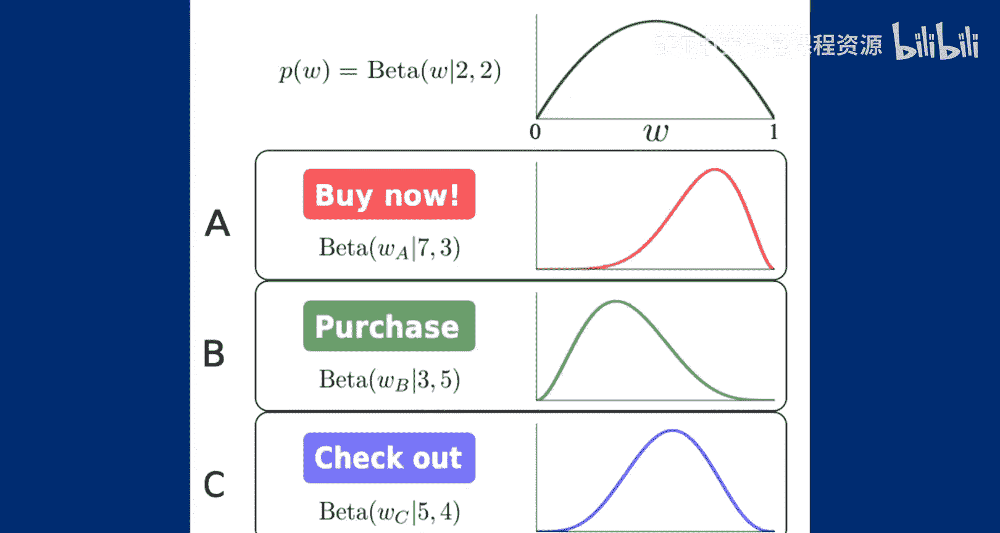
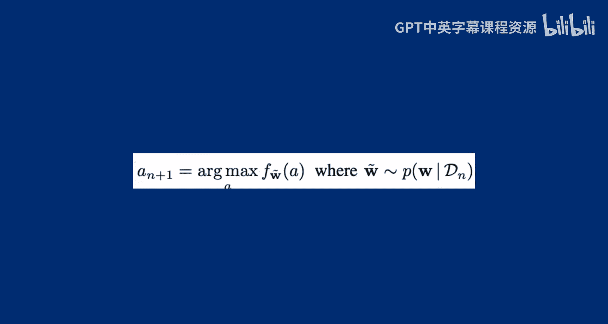
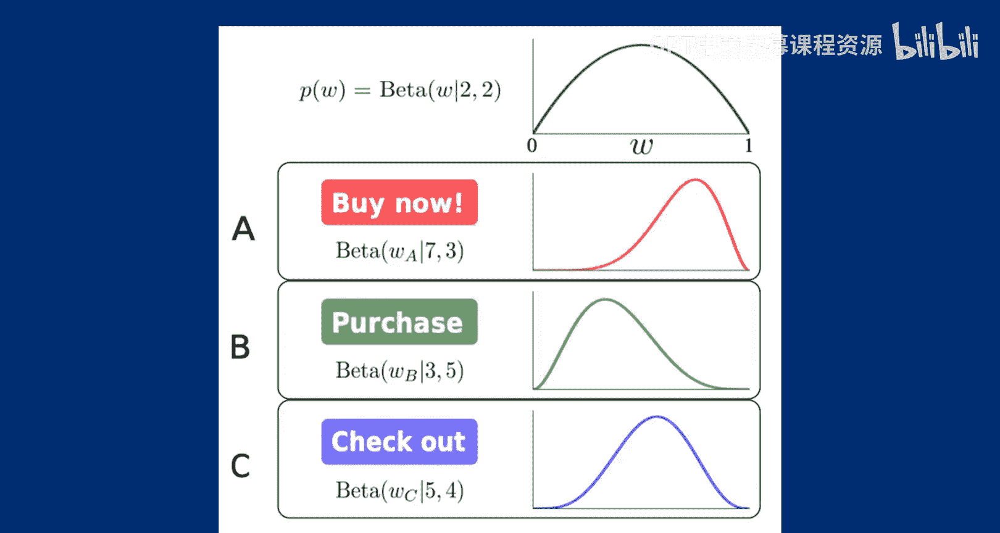

# 数据科学：时间中的决策｜6：基于汤普森采样算法的A/B测试 🎯

在本节课中，我们将直接探讨汤普森采样算法。这是一种非常优雅的算法，其核心思想可以追溯到1933年。我们将学习它如何作为一种贝叶斯优化方法，在数据不断流入时，通过平衡探索与利用来寻找最优决策，并应用于A/B测试等场景。

## 算法核心思想与背景

汤普森采样是一个历史悠久的算法，它基于贝叶斯思想，旨在寻找最优解。在学习过程中，最重要的一点是记住：**它建立在数据之上**。它是一个顺序的数据生成或思考机制。

它的目标是，当新数据到来时，它能进行更新（再次强调，这是贝叶斯思想）。随着你生成或收集更多数据，它试图做出最优决策。

这与Neyman-Pearson理论不同。它不进行假设检验，也不试图控制第一类和第二类错误。它只是简单地试图找到最佳决策。

## 探索与利用的框架

你可以将汤普森采样视为**探索与利用**的一个绝佳例子。这意味着，在一个可能非常大、甚至接近无限的搜索空间中，它试图找到它能找到的最佳答案。因此，它不希望陷入所谓的“局部最优解”而过度利用；相反，它希望结合探索与利用。

这个问题的另一个通用框架被称为**多臂老虎机问题**。老虎机就像拉斯维加斯或其他赌场的吃角子老虎机。显然，玩家永远不会赢，但多臂老虎机的思想是：我有多个“手臂”（选项）可以拉动。想象有多台老虎机，每台都有固定的分布函数，我可以通过选择回报率最高的那台来优化收益。但在开始之前，我并不知道哪条手臂是最好的。

## 汤普森采样的起源与应用

汤普森在1933年提出这个算法时，考虑的是给病人用药的场景：**如何为特定病人优化出最佳药物**。这是一个极其相关且非常现代的问题。

这个算法被广泛应用的另一个领域是**A/B测试**。例如，向特定客户展示哪个广告效果最好。这就是我们今天要讨论的故事背景。

想象我正在优化我的网站产品页面。我在“立即购买”或“结账”按钮的末尾有一个按钮，哪个是最好的？这就是A/B测试的一个例子。

## 贝塔-伯努利模型

在最简单的汤普森采样形式，也是我们将要开始的方式中，它只是对二项分布进行计数。我试图优化哪个“手臂”（在多臂老虎机问题中）是最好的。在这里，A显然是最好的，我们可以通过测试发现这一点。我们事先并不知道哪个手臂最好，是A、B还是C？我们如何做到呢？

我们提出一个通用问题：哪个是最优的？在原始汤普森采样的案例中，我可能应用K种不同的药物或拉动K个不同的手臂。我如何找到最好的那个？你可以将其视为一种测试形式。显然，在临床试验或A/B测试的背景下，它是基于贝叶斯思想的最优方法。

## 贝叶斯公式回顾

这个公式是贝叶斯公式的提醒：

**P(W | Data) ∝ P(W) * P(Data | W)**

右边的 `P(W)` 是我们的先验概率，`P(Data | W)` 是我们的似然函数（给定参数向量W时数据的概率），除以一个通常未知的归一化因子。左边的 `P(W | Data)` 是我们试图计算的后验概率。最终，我们试图找到给定数据后最可能的W值。换句话说，**我们以数据为条件**（由竖线表示）来定义最佳值。

我们可以这样理解：我们试图优化客户体验，试图找到最佳的按钮来促使他们购买商品。或者，如果不是客户，可能是病人，我们试图找到对特定病人最有效的药物。我们试图找到能带来最佳结果的、呈现给某人的最佳数据。

## 数据表示与更新

我们的数据类似于这样：`A_i` 和 `Y_{A_i}`。`A_i` 表示选择了哪个手臂（选项）的索引，`Y_{A_i}` 是一个二元结果（0或1），告诉我们特定结果如何。`Y_{A_i}` 表示结果：他们购买了吗？病人好转了吗？

如果我们有K个选项，一个合理的起点是假设它们独立。对于二项分布，最容易处理的是使用**共轭先验**。在贝叶斯设置中，**Beta分布**是伯努利分布的共轭先验和后验。因此，我们可以在两边都使用它。

`W` 的概率（给定参数α和β，这相当于我们之前提到的参数向量）是K个Beta分布的乘积。`W_a` 是每个手臂对应的α和β参数的索引。然后，我们有**伪计数**。使用Beta分布的α和β参数的妙处在于，我们只需增加计数。

`α_0` 和 `α_1` 是这两个参数的顶部和底部，它们只是根据我们获得的成功或失败次数而增加的指示函数。因此，对于每个手臂 `A_i`，我们进行跟踪，这本质上就是计数。这是Beta-Bernoulli模型的一个优点。

## 算法流程

这意味着，在底部这里，我们将其作为乘积进行更新。我们可以将其视为我们的先验，因为它是共轭对。实际上，我们所做的就是从这些不同的Beta分布乘积中获取W的最佳估计。

再次提醒，顶部是 `N_{a,1}` 的指示函数（成功计数），类似地还有 `N_{a,0}`（失败计数）。这些是我们的更新计数，即伪计数。

因此，以每个Beta(`W_a`)为条件（其中a从1到K，代表我们的手臂、药物或按钮），我们只是计算响应次数，然后进行优化。

## 采样与优化决策

然后，我们可以从我们的后验分布中采样，以估计下一个最佳选择。下一个要测试的手臂 `A_{n+1}` 是后验分布 `f(Ŵ_a)` 上的**argmax**（取最大值对应的参数）。这里的 `Ŵ` 是从后验分布中抽取的样本。

记住，我们的后验是给定数据后对W的最佳估计。这又是贝叶斯思想：我们随着数据顺序流入而更新，将新的后验作为新的先验。这种贝叶斯更新的风格被命名为**汤普森采样**。

我认为另一个现在可能更常见的名称是**贝叶斯优化**，因为它最终源于贝叶斯公式，并且是对该公式的优化。你还会看到它的其他名称，我们不会列出所有名字，但有很多。在本周接下来的课程中，我们将介绍其中一些。

## 算法总结与核心

这种风格的核心是，我们试图优化我们的后验。也就是说，我们有一个由数据定义的后验分布函数，我们将其用作一种**探索与利用**的形式。我们所做的是：基于数据产生的后验输出，来优化我们的下一次选择（抽取）。

你还应该意识到，我们试图找到的是**argmax**（最大值点），而不是试图记录整个后验分布。

这归结为一个非常简洁、简单的汤普森采样算法（针对Beta-Bernoulli老虎机、A/B测试或药物优化场景）。

**算法步骤如下：**
1.  设置Beta先验的超参数α和β（这类似于初始化W）。
2.  将所有手臂的成功计数 `N_{a,1}` 和失败计数 `N_{a,0}` 初始化为0。
3.  重复以下过程：
    *   对于每个手臂a，从其后验Beta分布 `Beta(α + N_{a,1}, β + N_{a,0})` 中抽取一个样本 `Ŵ_a`。
    *   选择具有最大样本值 `Ŵ_a` 的手臂作为下一个尝试对象：`A_{next} = argmax_a (Ŵ_a)`。
    *   展示该手臂（例如，显示按钮A），观察用户反馈（成功/失败，即1或0）。
    *   根据观察结果，更新所选手臂的计数：
        *   如果成功：`N_{A_next,1} += 1`
        *   如果失败：`N_{A_next,0} += 1`

通过这种方式，我们以某种方式优化了最佳手臂，但我们也对“错误”（即探索非最优选项）进行了采样，以确保不会错过潜在更好的选择。

## 结束语

现在，你已经对汤普森采样如何工作有了一些了解。这个算法有很多变体，本周我们也会花时间介绍一些围绕汤普森采样的其他思路。其核心思想是贝叶斯，这显然可以追溯到更早的1933年。除此之外，它归结为如何最好地利用不断流入的数据，这实际上是我们本课程中**顺序采样**或**在时间中做出决策**方法的核心。

所以，核心论点是：**我如何管理不断流入的数据，以便尝试优化决策？** 这就是汤普森采样的核心。

在本节课中，我们一起学习了汤普森采样算法的基本原理。它起源于1933年，是一种基于贝叶斯思想的顺序决策方法。我们了解到，它通过平衡探索（尝试新选项）与利用（选择当前已知的最佳选项）来工作，核心是不断用新数据更新后验分布，并从中采样以做出下一个最优选择。我们看到了它在多臂老虎机问题、A/B测试和临床试验等场景下的应用，并梳理了其针对二项式数据的简洁算法流程。这种在数据流中动态优化决策的能力，正是“在时间中做出决策”的精髓所在。