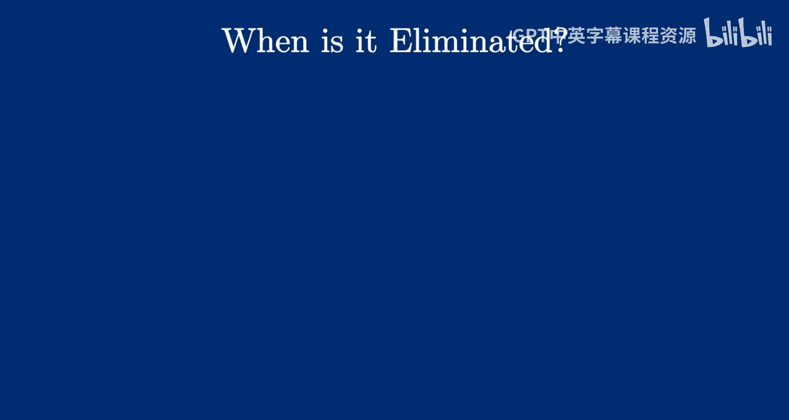
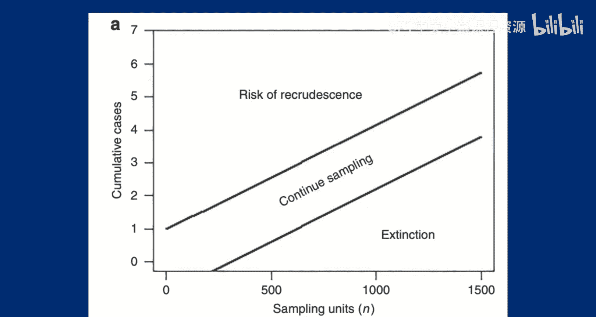
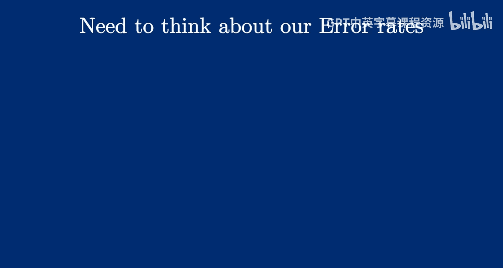
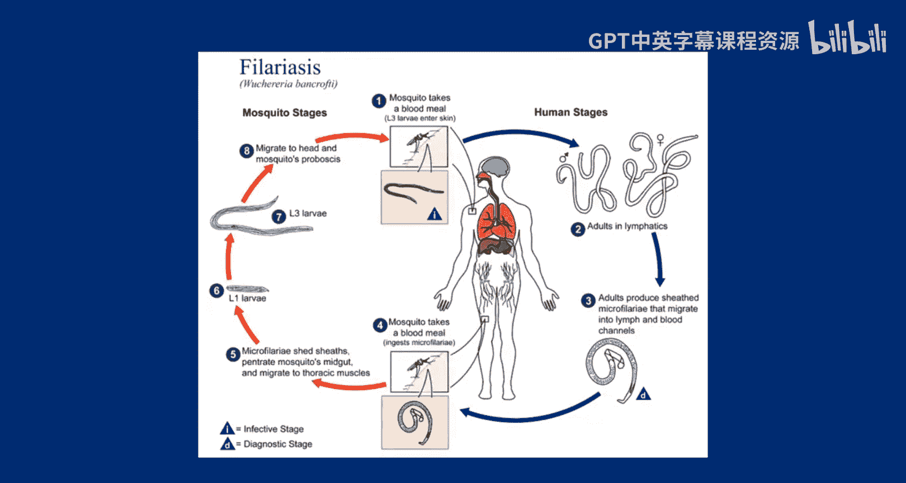
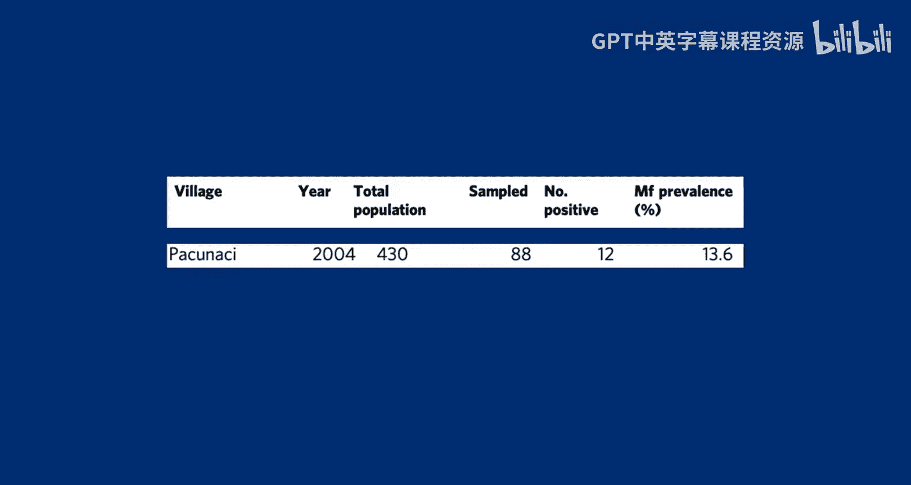
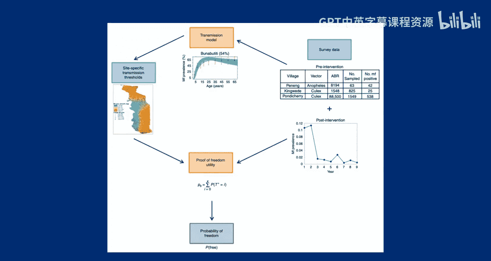
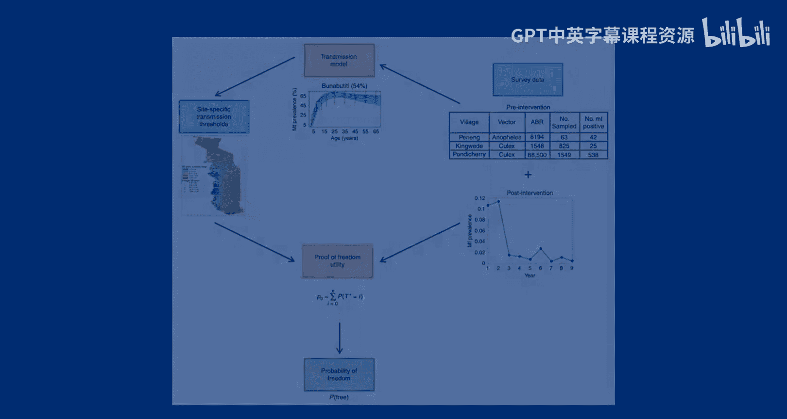
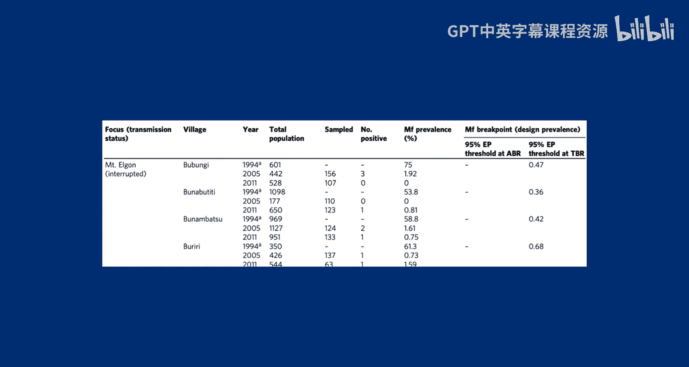
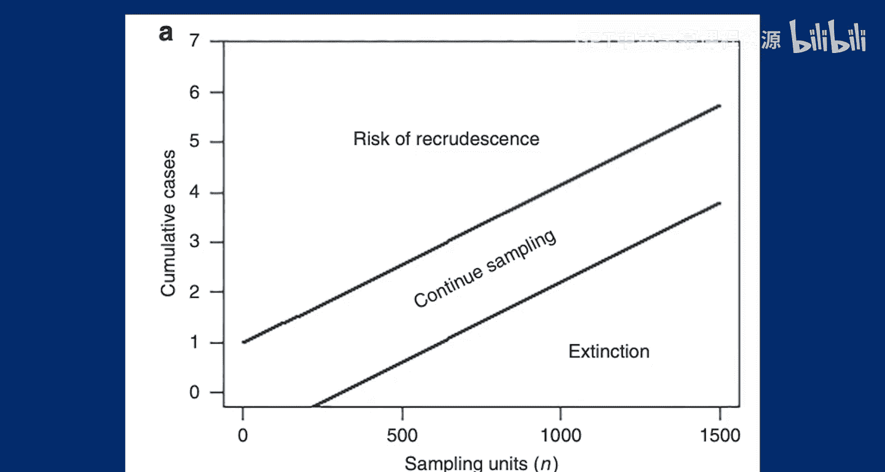

# 约翰霍普金斯大学《数据科学：时间中的决策｜Data Science Decisions in Time》中英字幕 p07 6_被忽视的热带病：风险识别方法.zh_en -BV1NCuzzfEJa_p7-

With this section， we make the transition from wild sequential sampling into Thompson sampling。

This is actually a very natural transition it might seem a little unusual to have two first names into different authors that speak Walt and Thompson but they both made major contributions and in related but slightly different ways。

 so in wall sequential sampling， as you already know we talked about how to know in a series of sequential samples when given a certain level of type 1 and type2 error we can stop or when we need to continue sampling。

 in other words when we can reject an hypothesis or accept an the hypothesis or need to continue sampling。

 and our entry to the second week here is to help you see that that same type of sampling the wall sequential sampling can be applied to something like neglected tropical diseases knowing when they have stopped and we'll be continuing this on the neglected tropical diseases with Thompson sampling directly which will then be addressing the question of should we apportion of resources in other words can we identify hotspots and adjust our resources。

 which is a type of sampling that connects very much with。

Wd but is related to knowing really in the case of these tropical diseases where the hotspots are and it's a classic example of what's called exploration exploitation。

 so that's our two parts here from neglected tropical disease so in this first part coming up we'll be talking about how to think about tropical disease not always pleasant but something that unfortunately does happen and we do have tropical diseases。

 so how we think about these especially neglected tropical diseases and how we measure when something has gone to extinction so that's the first part and that's now coming up。

So neglecting tropical diseases can be terribly disfiging a real。

 real problem the question is how do we eradicate them， how do we bring limit to zero。

 they're carried largely by things like mosquitoes， black flies， their parasitic infections。

 we can monitor the amount of mosquitoes with this parasite we can think about the people involved and treatment。

 the easiest is to avoid the contamination， and the question ends up ideally， can we control it。

 can we bring it to the point where it simply eliminated where there's particular particular diseases are not something that we as a society or world population need to worry about right now is are largely as it sounds in tropical areas。

 the particular approach the vector that brings it out limits where it can be found。

 but as an example really of classic wall sampling。

So again， recall from our first week， we can define three outcomes as we take sampling along the X axises。

 we can continue sampling， we can decide that it's extinguished meaning that there's no risk or we really do have a risk and we have to keep going and this is set these lines again by our tolerance or error。

 our tolerance or type 1 and type 2 error so our false positives and false negatives so what we want to think about again very clearly is when we decide that something has been extinguished。

 how good is our error in that， how much do we trust our ability to have concluded that it is completely been extinguished and is no longer something we have to worry about and that presumably just like with the shipmentman in our first case last week is something we have to continue to monitor now with foresis which is our example of un triple disease this is carried by missquito I'm just trying to give you a sense of how this is run but essentially there's an interplay。

Betweenween the mosquito stage for this infection and the human stage and the human stage obviously can lead to major illness and it something that we would love very much to avoid so you can follow out the number in here you can also check on Wikipedia if you want to read more about it but the mosquito takes of blood me all that's number one and then effectively it branches out from that point so we can look in certain villages in Africa and this was from 2004 not the populations fairly small 430 people 88 people were sampled 12 were positive and so then we can define a prevalence these are basically just statistics on the number of people estimated from this population and from this particular region that would then have this particular neglected tropical disease so again largely black lives in mosquitoes and they have to be carrying that disease so not something that the majority of the world population needs to worry about but extremely scary and important disease in certain regions of the world so。

And knowing where it is and how it works is going to be important。

So here we are looking at a particular electrorop disease site specific region。

 we've got a transmission model， and as we survey these particular regions。

 you can see that this cycle could potentially happen。

 other words we could define a proof of freedom function and that would tell us effectively and we would hope that within our type1 and type 2 errors that we really have extinguished the risk from this particular disease。

 so this is the kind of ideal cycle where as we look in the number of people that are impacted as age we could imagine turning that down to the point where the likelihood of being impacted if one was living in one of these regions where black by and mosquitoes are carrying disease。

 the likelihood of being impacted as decreased， and so the idea would be that as you can see in this figure on the right that we can drive the proportion down。

 other words that we can bring the amount that's in。

The bites per year or the infections potentially causing the disease。

 the vector can be brought down to the point where these bites are not necessarily at risk of carrying disease。

 but the trick again， the real issue here is can we define a model for measuring the prevalence of the disease along with a series of samples in such a way that we are confident as a society that we have brought the risk down to zero。

 so here's another way of looking at this， this is for Mount algon which is a particular location where things were sampled different years。

 you can see the total population so relatively modest again these villages are relatively small。

 the number of people that are sampled in each of these villages， the number that are positive。

 and then we can define our prevalence and a breakpoint and again these thresholds。

 these 95% thresholds are set at different bites from the insect vector that's carrying it。

And again this is a terribly disfiguring disease， this elephantiais again is the one on focusing on there multiple neglected tropical diseases all carried by black fliesies and mosquitoes and also again endemmic only to certain parts of our world but terribly disfiguring diseases and awful in the sort of things that we would love I think to see go away so again the entry point for this second week is this idea that wild sampling can help us to address this。

 it can help us to understand when these are an issue and we need to continue sampling or risk of our disease coming back as present。

 or potentially when it's extinguished and then potentially we can evaluate whether we want to continue sampling in the same level of concern maybe a kind of monitoring type of sampling would be more appropriate but we could then with Walt enable a more modest spend with a more effective outcome for addressing these kinds of diseases and again this is why。

Usinginess is bridge into this because it's an important connection from last week to this week。

So I hope Ive given you some sense for Wals sequential sampling applied to neglected tropical disease。

 The idea being in this instance we want to sample with an acceptable level type 1 and type 2 error to the point where we can confident say that a disease has gone and that's incredibly important for a lot of these diseases that are justfiguring as you just saw and really frightening in many。

 many ways， so what we'd like to do again is to design our error tolerance and design our sampling strategy given a certain level of tests so that we can know that a disease has gone and that would be extremely important for some of these neglected tropical diseases as it sounds they're not funded very well that don't affect a large number of people but they're extremely scary and frightening sorts of diseases so if we could find ways to eradicate I think especially in terms of our kind of world spending on these types of problems that would be phenomenal and fantastic and that's again an example of where wild sequential sampling can。

Help us to understand how to eradicate them。 So now coming up in our next item for our week two is related to this one is how do we go about。

Improving our ability to know where to put limited resources。

 the again is an example of Thompson sampling， which is really much related to the idea of how do we decide where it's most important to put our effort and again it's a classic example of exploration exploitation so that's coming up next。

