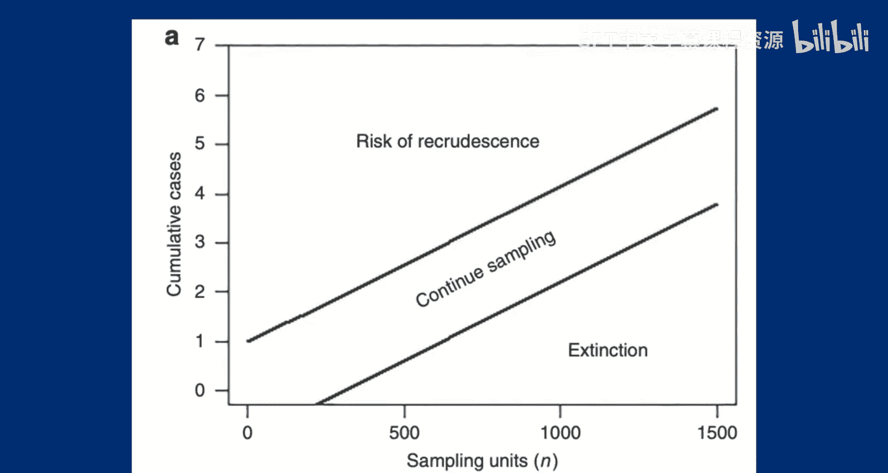
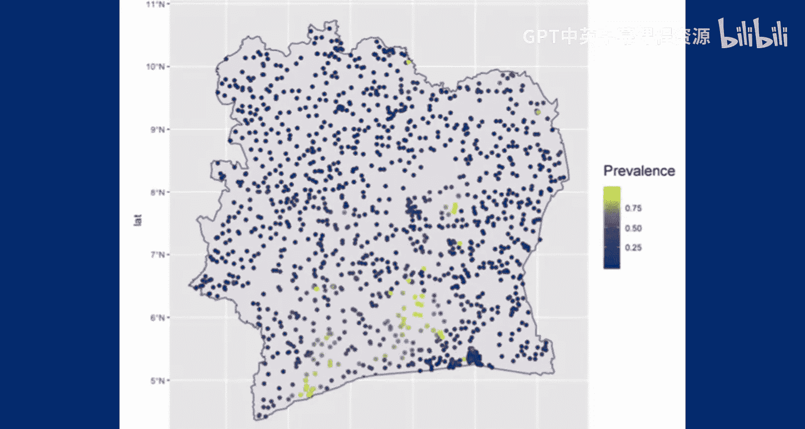

# 约翰霍普金斯大学《数据科学：时间中的决策｜Data Science Decisions in Time》中英字幕 p08 7_被忽视热带病的空间维度分析.zh_en -BV1NCuzzfEJa_p8-

We're now doing the second part of our neglected tropical disease subset model so to speak and Thompson sampling The argument here is we move from is the disease gone to where is it worst and what we mean by where is it worst is where should we put our resources This is an example of really AB testing optimization Ba optimization in the word for Thompson sampling that's very much in the Vogue these days and the argument in general is I've got a very complicated terrain that I've got to understand in terms of sampling so for example。

 in the case of an African country where disease may be present in some places and others I've got limited resources where is it hottest。

 where is the disease the most rampant and if I could figure that out where should I then emphasize my resources In other words。

 we have two things going on One was the sequential sampling like in Wald where we wanted to ask is it under control or not the other one。

Where is it hottest， Where is it worst and that where is it worst is an example of exploration exploitation。

 In other words， I could make a quick survey and say okay it's worst here and then spent all my effort looking at that spot and trying to eradicate it but it makes be worse in some of other the areas that I didn't sample very well so I've got to explore and exploit at the same time and coming with a good sampling function in a complex topography a complex energy function that you're trying to explore over is very challenging and Thompson sampling was really for 1933 the first real success in exploring and exploiting in the appropriate way and this is a general problem called multiam bandit and we'll be talking more about this as we go further into this week but the argument in this first and second part of our neglected tropical disease kind of subject subtop of what we're talking about is really an effort to introduce Thompson sampling and introduce this question of where are the hots spots okay so now let's go into this。

So neglected tropical diseases are real。Disfiguring debilitating issue that arises in some parts of the world and not everywhere。

 money is scarce。 dealing with these are horrendous for the patients。

 And I think obviously something we'd like to see disappear with time。 Find these hotpots， though。

 finding the regions where the disease is rampant is also a challenge。

 So in the first part of this two sections on corrected drop diseases and our sequential sampling we talked about when it is eliminated or how it's eliminated。

 Now we'll be talking about where it's eliminated。 And this is an example of exploration and exploitation or the general problem that Thompson sampling our second week is really after。

 And the argument that's being made with Thompson sampling is that it is essentially a Bayesian optimization issue。

 other words， we've got a prior， we've got some idea where things might be。

 And we can adjust from that。 So again， in wall sampling。

 we were dealing with setting where we talked about type 1 and type 2 error we started with say。

 a binomial for。

bution function it's not primarily Bayesian It's arguing that we want to set an hypothesis and accept reject hypothesis as data keeps coming in and we are trying to optimize our decision trying to basically make our decision as efficiently as possible in Thompson sampling related but different we're trying to ask a question of over many。

 many places how can we best optimize so we're still thinking about error rates before we were thinking about type 1 and type 2 error now in some ways we're also talking about our ability to find the best in a particular situation and the case obviously if our neglected tropical disease we're trying to find the hottest spots。

 we're trying to figure out where things are worse so we've got a field like this imagine a topographic map。

ditributive disease， risk and disease maybe be most mosquitoes or black flies that are vectors for the parasite in the kind of upper right。

 we've got a region where the disease is much much worse than other parts of this two-dimensional field And the question is how to portion our resources。

 how if we didn't know that it was in that region could we sample in order to find it。

 So in other words， think of this as the ground truth and now we're going to sample。

 well one way to do it would just be a grid and once we find something that's relatively hot like in that kind of upper right area then we would just emphasize our resources in that region that would be a form of exploitation。

 other words， we're having found one region we're just continuing to sample locally。

 it's the equivalent of like in a slot machine with multiple arms。

 we're just spliting one arm that we think is the best many， many。

 many times over So that means it's a huge amount of this area that's not explored。

 we've only seen this one area and we're exploiting that we found out and that may help it go but a better search strategy would be to do something like this。

 And that's what。

We're exploring with Thompson sampling， you can see that there's still a fair amount of exploitation in that area in the top right。

 but the places that are being explored have now scattered， in other words。

 there's more regions and some other lower but still hotspot zones have been identified and again we want to be thinking about is controlling the error meaning that we've actually found true hotspots can we as quickly as possible find these hotspots the argument is to create an entropy scale in this particular paper and I think a reasonable argument the entropy scale is just a P log P type entropy and note that one line。

 the top line is a greater than and the bottom line is less than or equal and so what this entropy scale is doing and that was the color in the last three figures is to try and emphasize those regions where we've got above or below some threshold a clear division and just like in the case of say shipmentmen going back to Wal we had to set some parameters this is very similar we've got a。

Where this value of theta is you could think of that as just an empirical or common sense， maybe 。

5 even is not an unreasonable value， but then we pick that Now the data here has letitude longitude that's that vector s sub I number of infected number of sampled in the N and Y and then x sub I which is a general covarit vector of all sorts of other things that are involved in the data so D0 is script D0 is our data descriptor and imagine that this is imagine this being just like a multi-arm bandit where we're collecting a whole bunch of information but in this case it's a geographic spread which is effectively continuous as well as a count spread so to speak which is the number of infected individuals in our disease category here at different geographic locations and then again our other kind of variable here。

 the x sub I vector could include things like the water nearby the temperature。

 the humidity maybe mosquito blackfi densities， all sorts of other things so we've got。

Veryry nice data description here in terms of this set and again we're trying to optimize our sampling on this set so similar to the grid that was up a few minutes ago。

 what we're trying to do is emphasize the quality of our sampling against this set so we want to optimize the hotspots sometimes we want to identify the locations s subI where they the greatest numbers of individuals that are affected and from knowing that we would like to be able to argue that we can design the best intervention strategy in other words we can intervene in the most efficient way but again to do that we've got to optimize on this very complicated service again。

 there's a data organization level here which we're not spending time on but getting that in place the other thing to emphasize is that we can think of this in a continuous as well as discrete in the continuous space we can think about a little H subI which is almost like a local walk if you want a local connection from one zone to another and this is using this k of script A script A which is。

a kernel type function you can think of this as what's called creaking in Gaussian process world where effectively we're assuming that there's a connection in this case a spatial connection one one region to another and then what we can do is then optimize and this is that argument for the entropy from a few minutes back we have a capital H which was the P log P type scale with the discrimination about where we were in theta based on the data and again these conditionals or a form of Gaussian type I'm sorry Bayesian type analysis and then we've got that root log T and then we've got our local entropy and ultimately we would come back to is something that called diry here an ability to predict where the hotspots are so again the prevalent scales on the right and effectively what we're doing is emphasizing where in the country is the greatest risk and what we've done is by taking an estimate and continuous space which again is the cing type function for where things vary as well as a count type measure which is what's very much included in。

the capital H， the big entry measure， we're able to optimize our search strategy in in words we can argue that we better understand where in this particular country we should put our scarce resources。

So I hope you've now got a sense that finding these hotspots while clear a challenge is possible and it's possible to do it efficiently。

 this is an example of adaptive sampling or Thompson sampling or basing optimization different terms for essentially the same sort of argument to use a Bayesian type frame to improve the ability to estimate where the best payoff is going to be where the maximum should be and these kinds of optimization issues come up over and over again and again it's part of our sequential decision making can we optimize based on data we make a better decision based on data So this again is our introduction this part and the previous part to Thompson sampling which is again for our second week on making decisions in time Thank you。

