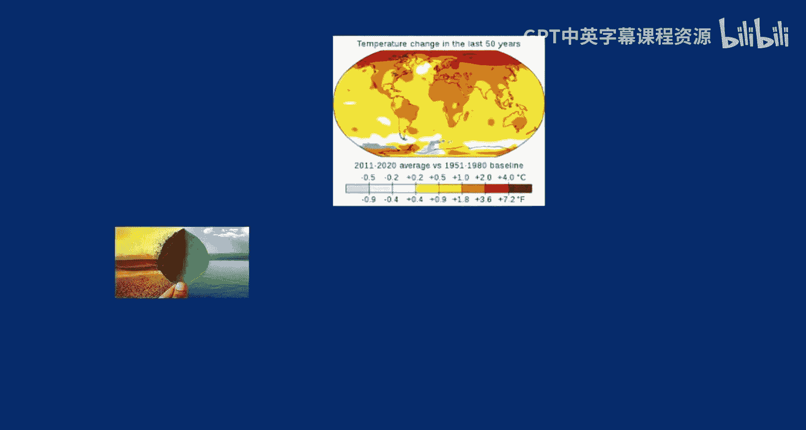
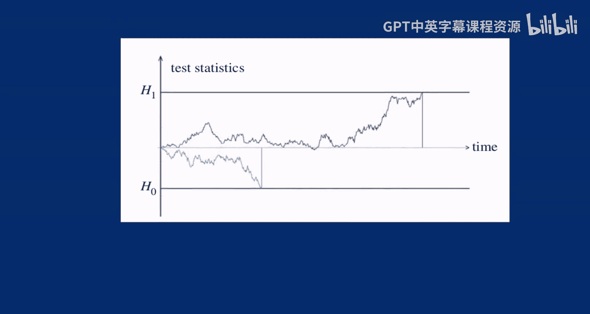
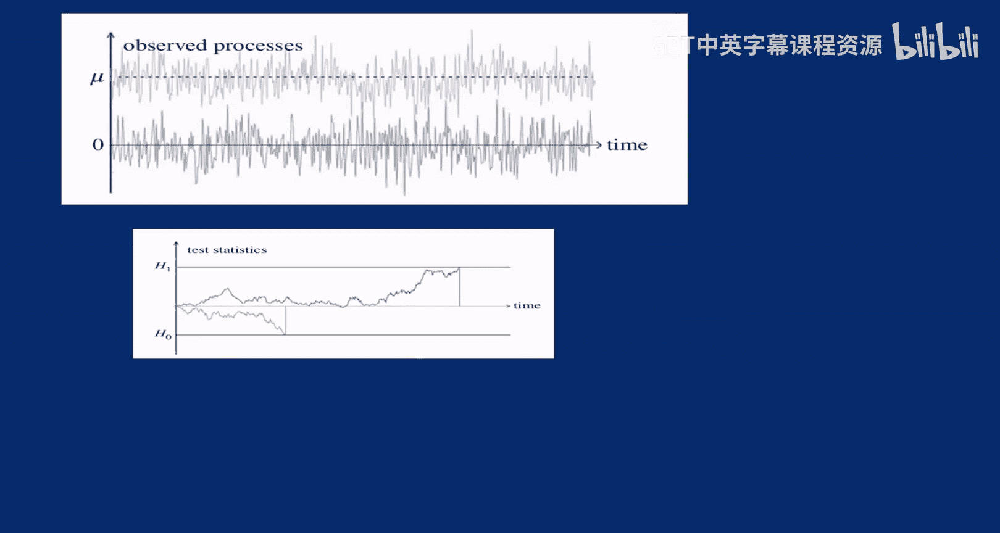
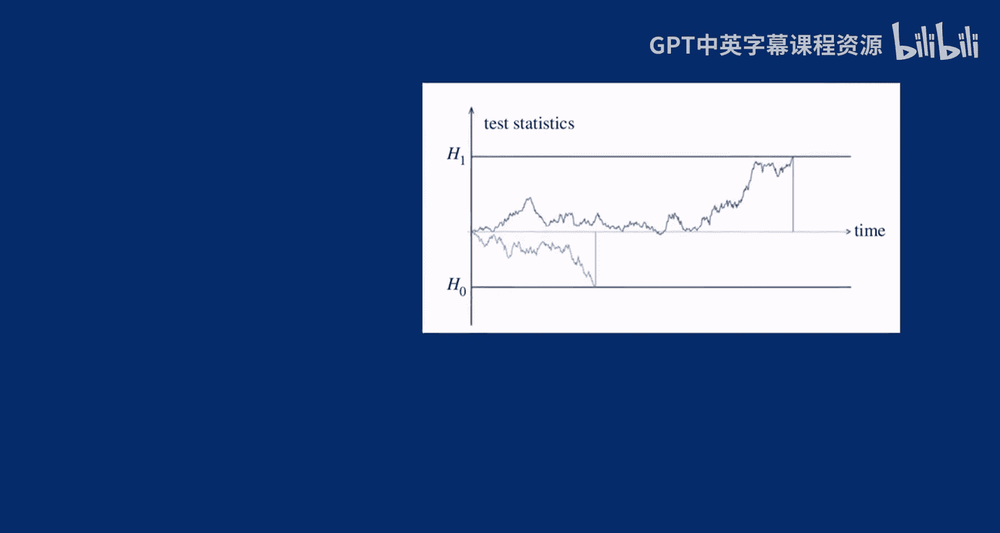
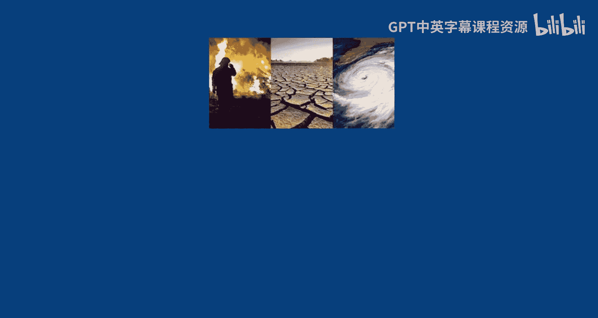

# 约翰霍普金斯大学《数据科学：时间中的决策｜Data Science Decisions in Time》中英字幕 p09 8_气候变化案例导论.zh_en -BV1NCuzzfEJa_p9-

This third week， we start a new type of sampling。 This is called change point sampling。

 And I think you'll enjoy it。 It grows very nicely from walled and our efforts with sequential sampling to do hypothesis testing。

 as well as Thompson sampling from week 2 in this section。

 we will now be understanding or attempting to understand。😊，Whether we can find change points。

 change points are tremendously important in many real world applications。

 We'll start this by thinking about what it might mean for climate change。 So。

 as I'm sure many of you are aware at this point in time。

 there is increasing evidence for real climate change， And the question is。

 could we have found this earlier， And could we have done something about it earlier if we had found it。

There's many other applications that are like this， for example。

 in a clinical setting you might be taking a particular drug and you could ask is there a change。

 what kind of change can you see the appropriateness or not of that change an example might be for example。

 drilling a little further down into that pediatric obesity with particular drugs could we help pediatricians treat childhood obesity better by understanding change points so those are just two relatively quick examples that' will be more coming up as we go through this but realize it grows very nicely from our first two weeks so again all of this is about making decisions in time based on data and this is again critical skill and something that I hope you will all be enjoying as we go through this material。

So an example is weather。Climate change。As we continue to move further along in this century and as we look around this。

 we see more and more evidence that climate really is changing。

 weather patterns really are changing and we can think of this almost like this leaf are we on the left or are we on the right。

 are we going to be seeing more fire， more hurricane cyclones more extreme drought these are weather patterns and changes that are quite scary and we can see this happening。

 this is from Wikipedia we can see this happening in terms of temperature changes in the last 50 years on this planet and at this point I think the consensuss that really is happening。

 there really is a change point。 one of the questions that flows though is whether it's something like this。

 can we see a clear change in a media if we think about this as like a time series where this is like a Gaussian process In this case。

 the mean is shifted it went from say zero mean to value of mu equal to some value and this would enable us to test hypotheses。

 This is similar to our wall。

theesis tests in week1 what we have here are two hypothesis H0 and H1 as our time series goes along you can see one realization is touched h0。

 the other realization is touched H1 and so we would say that of these two time series one confirmed H0 and one confirmed H1 in the case of climate change it obviously may not be quite so simple it may not be quite so easy to say we had one type from our time series or mu0 mu equal to mu In other words。

 when we look at our hypothesis tests thinking really almost like Wald in terms of a sequential stopping sort of thing where we're testing we would not really be able to look at the whole planet and say okay at this point。

 we clearly need to stop our climate from shifting in other words as we look at the temperatures and as we think of that as a time series it's more challenging to think about it in the context of microfactory producing。

things or some other thing almost again like Shiman with the medical type things。

 we can't easily go in and imagine how we would go about making a change。

 but we can still view this as a form of hypothesis testing。

We can still evaluate our increasing evidence over time for whether the fact or not of climate change is real。

 and I think again at this point， the evidence is pretty overwhelming that there is in fact climate change。

 but you could still be thinking about it through this kind of allow and as we go through the material in this week where we talk about climate change and again think about drought and other changing weather patterns。

 the question ultimately when you ask about is， is this really a change that we can clearly say confirms this particular hypothesis。

We've now given you a rough feeling for what it means to have a change point。

The quickest and simplest way that I know of to explain this is if we had one Gaussian again characterized by aine and a standard deviation and something shifts and that Gaussian is no longer the same Gaussian。

 meaning either the mean or the standard deviation or both has shifted。

 change point analysis should be able to detect that and as we get further in his algorithms realize that even relatively small shifts in a Gaussian。

 such as I just described， can in fact be determined， it gets more subtle and more involved。

 depending on the amount of noise， it gets more subtle and more involved。

 depending upon whether it's really a simple distribution like a Gaussian or a more involved distribution。

 it also gets more involved， depending whether we're going to do it online， meaning real life。

 real- time， or whether we're going to do it offline， meaning again we can do it in our leisure。

 in general， the more completely one analysis to be the more likely it is that you want the resource and the time to be able to do it offline obviously for many policy to questions。

such as climate change that may be perfectly fine， but for many other settings， for example。

 maybe a medical setting， you really would want people to do it online in real time and so this brings up interesting questions about the tradeoffs between accuracy and ability to compute an answer so you might think about it as a tradeoff between the pragmatic side how much you need the answer right now and the almost insurance or confidence side how much do you need to trust that answer that's coming up right now or could you put an error bar on that answer as it comes up so we'll be going through some of these questions we go further into this week but realize this will be a tension with these changepoint methods none of them are 100% perfect。

 none of them will work under all distributions most of them will work under some settings and you have to think about whether the right settings for the right methods have been selected。

