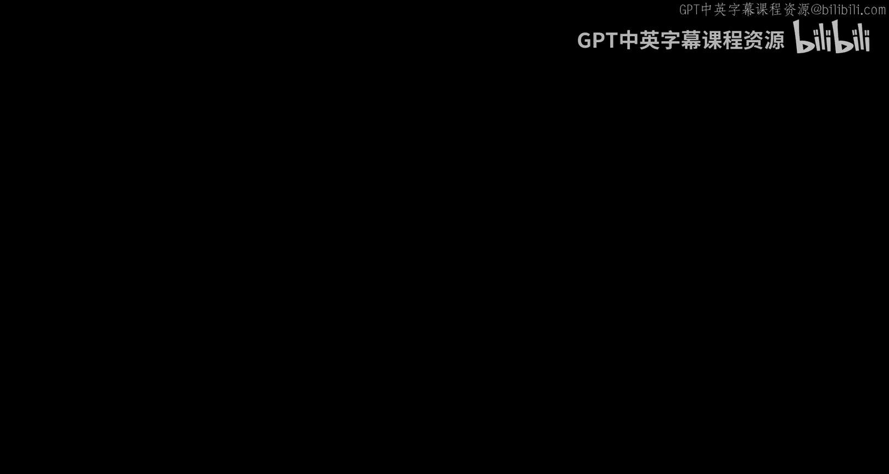
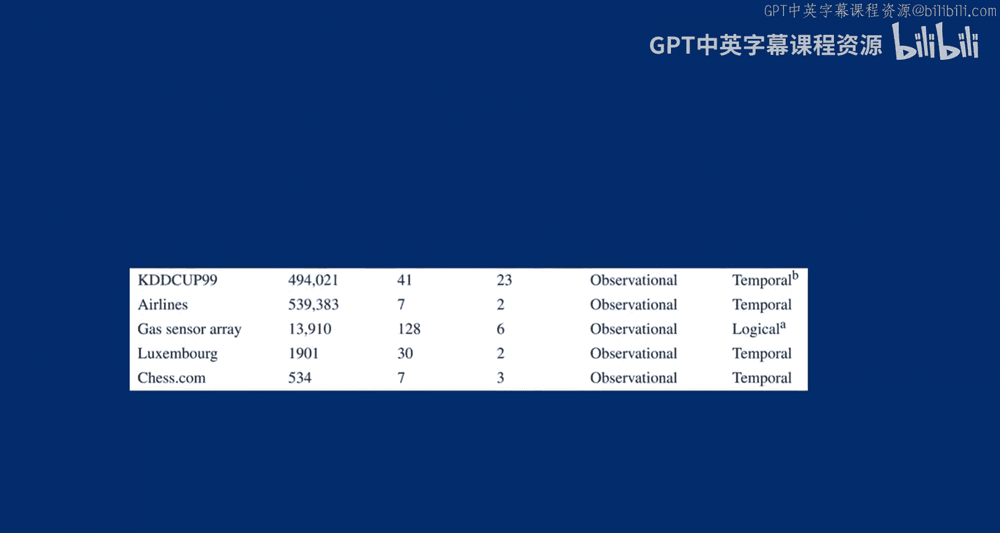

# 约翰霍普金斯大学《数据科学：时间中的决策｜Data Science Decisions in Time》中英字幕 p10 9_高斯模型在变点检测中的应用.zh_en -BV1NCuzzfEJa_p10-

We've now talked about change points in a general sense。

 and as we move further into this week's material， I hope to give you a sense for how you actually compute change points。

 Now there's code available for all these， and I urge due to check it out give references for it for example in R or in Python In this next bit。

 what I'd like to do is try and give you a sense for one particular type of changepoint calculation This one uses a set of sliding windows to sliding windows So the idea essentially is that you compute a candidate distribution in a reference window and then you've got another candidate distribution and you're comparing these two distributions。

 So you're asking a question over time as to whether those two distributions are the same or different you can think this is a form of hypothesis testing。

 So you're essentially asking is the distribution the same or different and moving along slide it along and at each point where it changes where those two are no longer the same then you reset your reference to the new distribution and keep moving along。

So this gives you a way to try and contain the amount of change by setting intolerance and the width of the window。

 but also gives you a way to detect multiple change points。

 which is not easy to do so in principle with this kind of a method the right choice of parameters。

 the right choice of tests you can tell whether there are multiple change points along a distribution。

 so let me try and give you a sense through what's up。Well'll now think about change points。

 as I said with a little more detail。 imagine that we've got two distributions as shown on this cartoon diagram here and these two distributions are here at this point clearly clearly separated So if I was to sample。

 call it as1 and S two from these two different distributions then I can imagine that if I had a time series and I was trying to evaluate whether it belong to one or the other I would clearly be able to separate them but these two distributions may not be stableple in time they may start to drift shown in T1 or T2 and as they drift。

 they may no longer stay separated in this cartoon illustration here they're moving。

 but they're moving in such a way that they remain separated this concept of data drift or things moving in time in addition to change points is an important important concept that comes up repeatedly in real applications and again the question is ultimately can we cl the discriminate between two different categories of events we have original data like this and this cartoon may。

Three different classes of original data from three different distributions。

 What happens over time do these distributions stay stable or not。

 So our question this week is really about change points again。

 and the question we're thinking about is possibly things have shifted。

 these boundaries have shifted， may we've still got three categories The distribution parameters have shifted and the question we're addressing is can we pick out on those changes can we pick up that the distribution parameters have shifted and we're going to be thinking here about two data sets to get ourselves started and we'll be thinking in what's called a non-parametric frame。

 which I know it sounds confusing many of you've heard this before。

 but nonparmetric is actually infinite parameters It means we've got no parameters that we set we're going to sample on these two data sets S1 and S2 and again we're going to be evaluating the probabilities that things are in either or one of these two sets So P1 and P2 are the probabilities that we are sampling from either S1 or S2 in these two data sets and ultimately we're asking a very simple question Are these two parameters the same P1 equal to P2。

Or are they different is P1 not equal to P2。 And again。

 we're going to evaluate our probabilities nonparametrically。

 which means we're going to evaluate them in the context of no parameters。

 That's I would argue more challenging but more potentially enlightenening way of viewing it because we can think over a larger set of probability functions to do this。

 we need to define what we'll call a distance function。

 This is ultimately the distance between our two probability distributions。

 And this is important because if we can't assign distance to our samples。

And we can't really compare them from one， say sample distribution to another。

 So in a rough algorithmic sense， we've got something like this first in these five steps from one decay。

 we're going to define two windows and those are potentially sampling from different time points we might think of these initially as are they the same distribution within one window as they are in the second window。

 So think of our M as being two samples， and then after we've done this first set from one to5 from6 to 15。

 we're going to do a second set of sampling in our stream we're basically going now adjust our two windows relative to each other and we're going to ask at each point and our sequential sampling whether we have the same or different。

 in other words， do we have events that are from the same per distribution or they from a different per distribution and you can see that's the change point algorithm that's exactly what we're asking from the very very beginning。

 if we think back to climate change or any other system where effectively we've got a set of points。

 we can assume they're from。Proability distribution。 and then we're going to ask as we keep sampling。

 are they the same or different。 So again what this means is we have to define our two windows and1 and M2 and then a parameter alpha which will be related to how much we're going to evaluate or adjust whether they are changed in other words a confidence if you want to raise it back in a wild sense that our distance between these two is above some critical threshold in which case we would argue that they're not the same if they're below that threshold and we the same So obviously as I a couple times we have to choose our parameters wisely how long should we sample in other words how big ourMs and wheres our alpha So the frame that we're going to be adopting is one that's been called a distance in the literature and mean then that we can define a distance use sub a between P and P prime subpreum means the largest distance between these two sets in and subpreum are the math terms that many of you have heard we're going to be sampling a from this script A and we're going to define。

ultimately as an empirical like fit in a nonparmetric sense between these two we're going to find two different ways of doing this。

 a P subscript A is our first one， This is between our two distributions P1 and P2 which ultimately are just sampled so again we're taking a supreum from our set of sampled ones from script a we' define a distance then between P1 and P2 you can think of these as again our two windows or two ms divided by the square root and note the brackets。

 this is a min over that set so we've got a distance defined now by this and here's our second measure we'll call it theta capital theta sub a between P1 and P2 and it's going to be somewhat similar in the sense that again we're assuming that we can define a subpreum over our two probabilities P1 and P2 and so we can take a square root in this case as opposed to a set characterization for them The comparison points are going to be2 one will be the littlecoxin signed rank test many of you have probably not heard。

It's a nonparmetric test commonant statistics， you can look it up on Wikipedia if when I go over here is confusing but essentially we're pulling data as pairs you can think of this as pulling from what we think is one distribution versus another distribution we're pulling them randomly from the set again we're assuming they're independent draw so we're assuming there's no correlations between our picking from these two pairs and as we pull them we're going to calculate a size distance between them x2 I minus x1 I that's a distance similar to the distance we had before and then a s between them which is dependent upon which one is bigger so we've got an ordering that we can do and then we can rank the pairs。

 so of this as a rank order test and we compute w here which is sum over these sine values think of this as as plus or minus times our distance and this is something that we compute in a very relatively straightforward way so this is coming from Wikipedia you can look it up。

too fast or not making sense for you， but effectively if I've got 10 datas pairs again that I've pulled from two different distributions。

 I can define the sign and the absolute value between them， there's since between them。

 then I can rank them， that's R and I can define the sign。Easy okay Commar gomov test。

 our second comparison test。 This is another standard nonparmetric test Again。

 something you can look up on Wikipedia。 if it's confusing。

 but we define our CDf or comm distribution function goes between  zero and1 in one sided Commar gomov test we're just comparing to a known distribution two sided we can compare the same sortjaity curve between two。

 then we compare our distances。 we've got an indicator function。

 which is computing how far upward going and then given that indicator function。

 we can always define a subpreum again infinite versus subpreum。

 we can define our supreum on F sub n minus f of x and so now we can test So we've got our new distributions defined this is a relatively straightforward test at this point。

2 million data points hold from different distributions every 20000 points though we're going change it So similar to the concept drift or data drift that I described at the very beginning。

 this is something where every 2000。That's going to change we're going to do this uniform on a minus P2 P distribution so these are easy distributions or p is equal to 5 so minus5 to 5 so 20000。

05 or 50000。05 and then W and KS are different versions and basically we do very well this new one does very well and this can be generalized to other types of settings so for example you could imagine electricity。

 there's data sets out there or For cover type or poker hand or PDD or airlines or gas sensor array or Luxembourg or chess there's a whole bunch of different data sets where effectively there's different categories and we could ask the question are they the same or are they different。

So I think you've seen hopefully especially by the end that there are many large and intriguing data sets out there where we actually do have labels and where we can ask a question about whether distribution has changed over time。

 and of course in the real world these are central questions you know real pragmatic experience type world do we have climate change do we have a disease that's changing do we have electricity demand that's changing in a particular way。

 these are all incredibly important questions and the methods that we just outlined give you a sense for it。

 but again not always easy to detect these change points。

 so when you potentially apply some of these if you do a project for example as part of this imagine and be careful in evaluating the range of values that you put in。

 in other words， you might want to check for change points with multiple different algorithms or multiple different parameters and only if you have confidence that you were seeing a particular change point。

Can you start to maybe drill down and ask questions about why that particular change point happened and what it might mean。

 but there's a lot of really intriing questions that flow from these kinds of methods that we've just covered Thank you。

