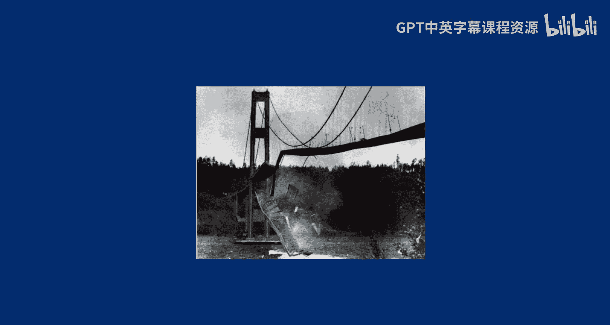
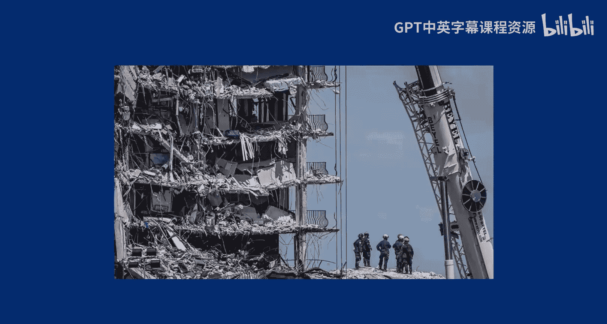
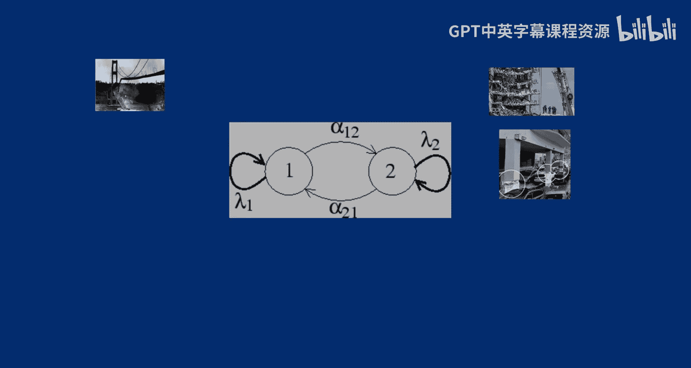
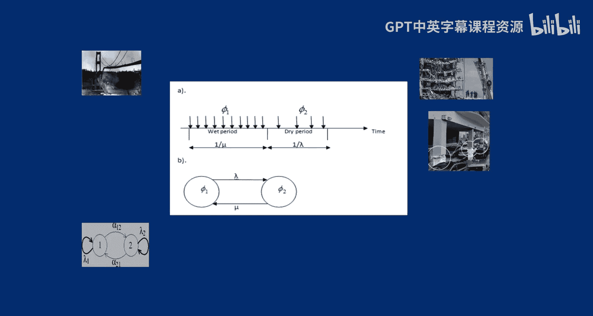
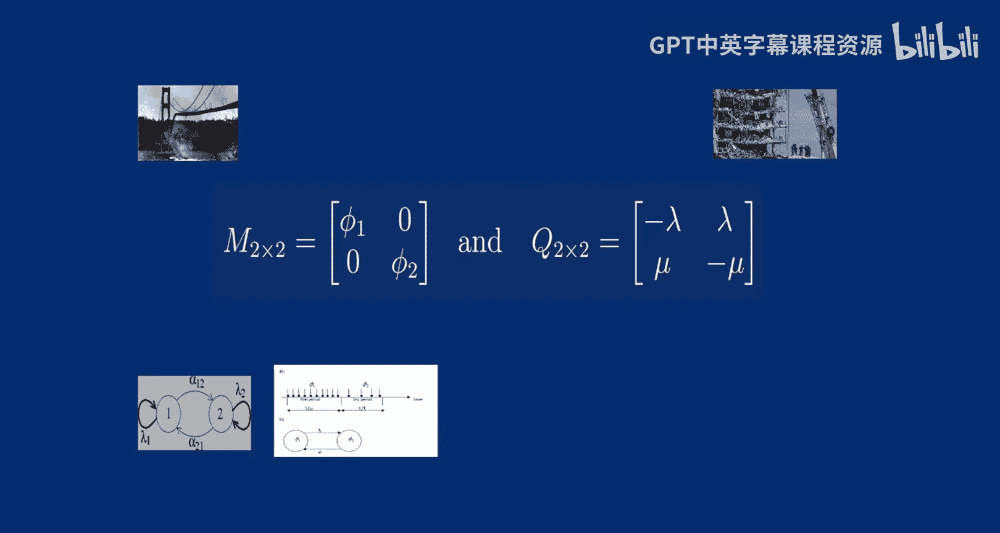
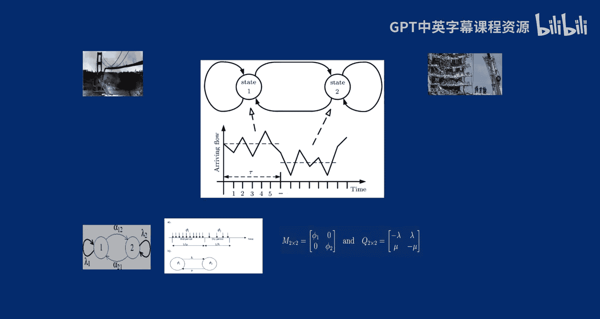
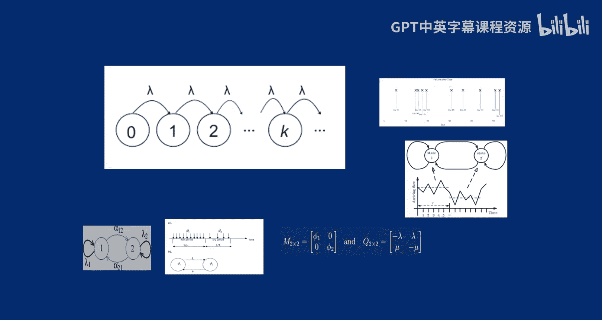
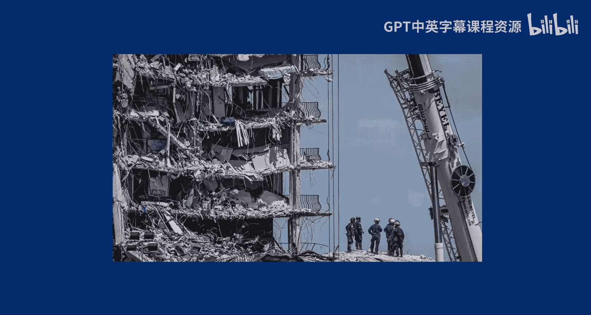
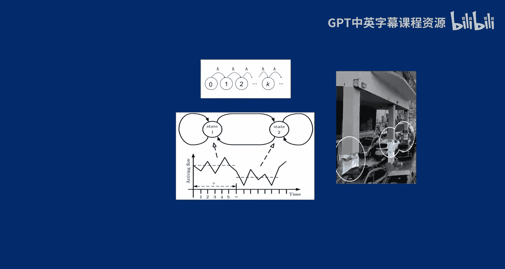

# 约翰霍普金斯大学《数据科学：时间中的决策｜Data Science Decisions in Time》中英字幕 p11 10_桥梁建筑：马尔可夫链在故障率建模中的应用.zh_en -BV1NCuzzfEJa_p11-

We now enter into our fourth week in this module， we'll be talking about Markov models。

 so as we go through this week realize there are definitely definitely connections back to or making decisions in time。

 What we'll be talking about is a class of models and class of approaches where we think about states and we think about transitions between these states and we think about then things changing in time In that sense it's very much like Wald's sequential sampling ideas。

 Imagine a process。 Now it's a Markov state， which will make more sense as we go through this week and imagine that as we go through that process。

 the set of states。 things are changing。 and this could be a model for failure。

 which is where we're going to start today this could be things like the surfcyclondo collapse or the verzo Nros Bridge。

 which we'll see in a moment essentially what we'll be asking is how could we adjust to prevent failures from happening How could we adjust our Markov state model and the transitions between those states in order to increase。

The likelihood that things stay in a good state in that sense it's very similar to Wald。

 think of the say factory producing widgets or think about medical decision making。

 think back to how we could detect medical fraud or malpractice。

 essentially we got a series of states。Call them days， call them months time going onward。

 And we want to understand over time how something is potentially creeping into a dangerous zone。

 If we can prevent that， we can prevent failure。 And so this goes to things like update schedules。

 maintenance schedules。 how to prevent something like surfside from happening again is ultimately a question of figuring out what sorts of prevent maintenances are needed over time in order to make。

within that building structure and obviously both of these were horrific examples Serside lots of lives lost and absolutely horrific The question in our Markov model that we'll be talking about this week is can we anticipate things like these sorts of engineering possible mistakes at surffside can we anticipate these problems issues both of state and maybe issues of design itself in order to understand as environment changes as time goes on can we anticipate what's going on and a model like this is relatively straightforward these are two states state1 and state two in the circles。

 transitions alpha 12 and alpha 21 Lambda 1 lambda 2 also are self-transs So essentially what we're asking is if say one is building standing in two is building collapse can we understand what drives a building towards collapse。

 Can we make a model that predicts what happens again over time that's more likely to make that transition。

From one to2 happen so this in general is called a Markov model the idea is that at each point in time it's dependent on where it was at the previous point in time So here's an example for weather。

 we've got like a wet period and a dry period two states very simple and in each case we're thinking about the periods of rain these are these arrows pointing downwards in wet period versus dry period we've got different frequencies of the rain happening and these can be modeled as a poisson type process one over mu1 over lambda these would be the rates that the rain is happening in you can see the lambda transition and the mu transition and effectively what we're thinking about is as we go from the wet period to the dry period we can construct a model and this is again just a simple Markov model it's two matrices and which is two by two and Q which is2 by2 P1 and P2 these are states that we you can see them now down below and Q the2 by2 is the transitions these are the likelihood of moving。

Between one versus another so we can then model using in this Markov model again。

 we can model the transitions so we've got events happening these again could be thought of as rain and then we've got transitions between states and this sort of thing that I think could be seen as a good model for failure modes that we more coming up on this this week。

 but if we think about Markov models say for a building over time it might look something like this。

 state one and state2 where we've got things happening again over time。

 think of this almost like rain and eventually if we're not careful。

 it moves into state 2 so state one again building standing。

 everything's fine state  two building collapse disaster know loss of life exactly the sort of thing we don't want to see So can we understand the periodic stresses on the system these are like these tau like events with the things happening and can we think about this as something that。

We can adjust for so think about something like this we've got days on like X axis here we're moving along in each day and periodically this could be like a poisson type process。

 again， something random and not very frequent we have stresses on our system and obviously these stresses could be predicted at some level especially in an engineering context。

 maybe they're sand shifting， maybe vibrations from construction next door that we want to think about this ladder of states that are happening during these stresses 01 through K。

 these different states， we want to think the events happening as pushing this not into a failure mode。

 but into a mode where we understand we've got to make some sort of corrective process where we've got to adjust what's going on so that we prevent failure so again thinking surf thinking the conduct collapse like in this case here。

 what we want to do is avoid this kind of a setting where the poisson like events create as a form of state transition in our model the small。

eventually add up to a large major failure， so we want to avoid this。

 we want to make a model where we understand what's going on and where ultimately we can think about maintenance。

 preventive type maintenance to prevent or decrease the likelihood of this sort of a transition happening again。

 K states transitioned between states self-transs we want to leave it say in state1 and not in state two。

 so we want to think about all these events that are happening over time as ultimately helping us to control the process in a positive way as opposed to the events over time driving us into a failure mode。

We've just gone over how a Markov model can help you to see into change in particular a well-defined Markov model can be just as good as something like a wild sequential test in terms of helping to define when states have changed in such a way that we reached the dangerous point so as a model for failure as a model for doing something like a sequential hypothesis test this works and there are many applications where constructing a Markov model may be very helpful in terms of designing and thinking about how to make sure that an engineering outcome is appropriate so again this is very much in the spirit of making decisions in time based on data how do we go about designing a model down how do we go about predicting change how do we won't go about ultimately adding and this will be our last week adding control and feedback like mechanisms so making Markov decisions in the same sort of process in time will again be our。

As we continue to go through this week four， we'll elaborate more on how Markov models are set up and how we think about adjusting them in such a way to capture important phenomena。

