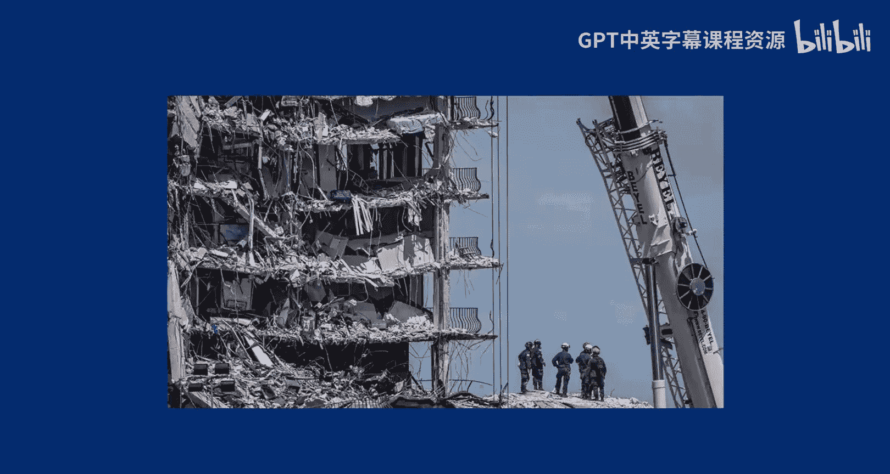
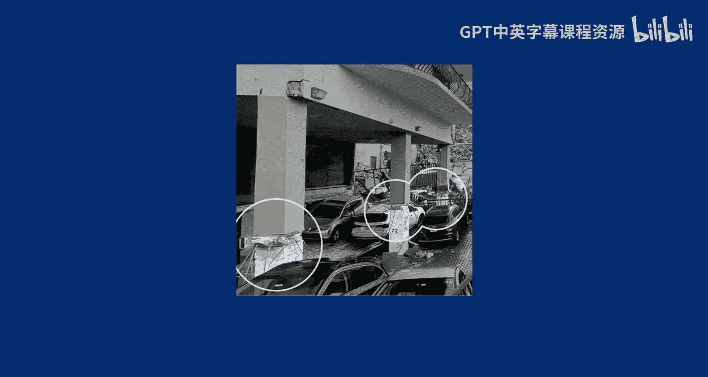
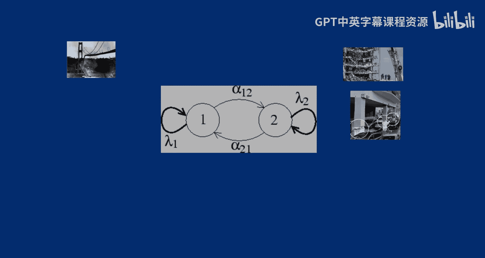
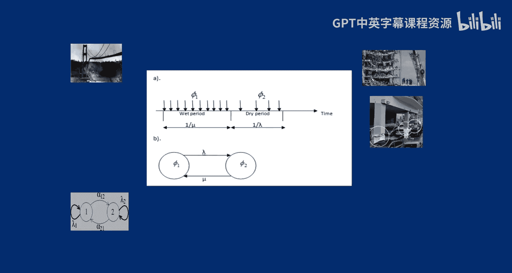
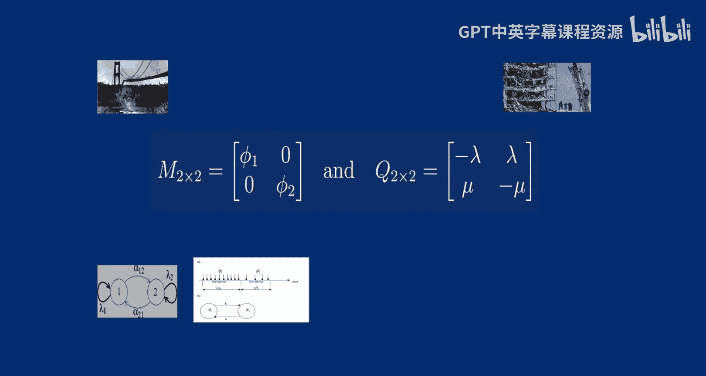
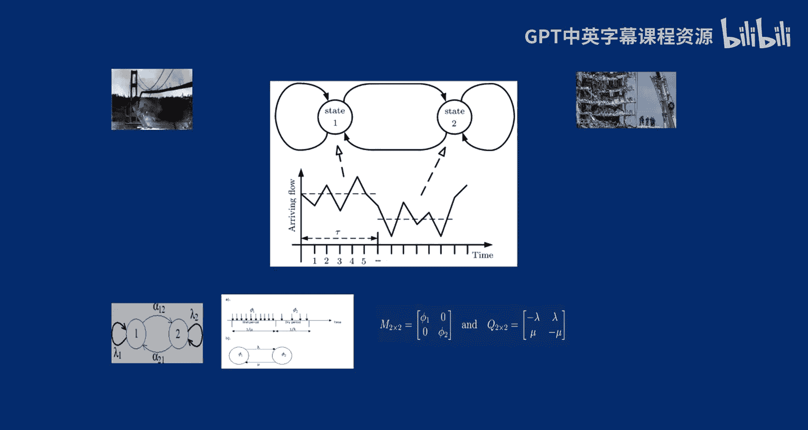
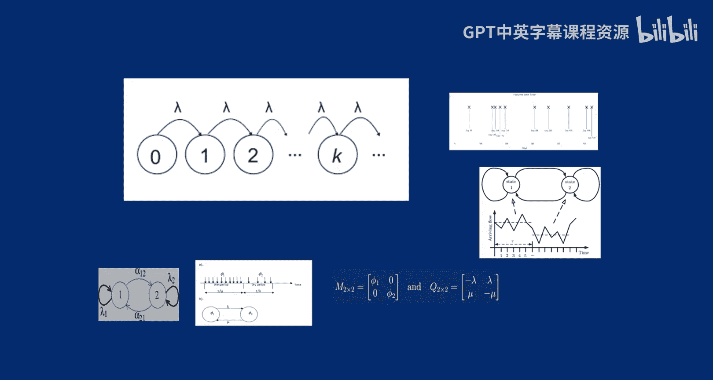
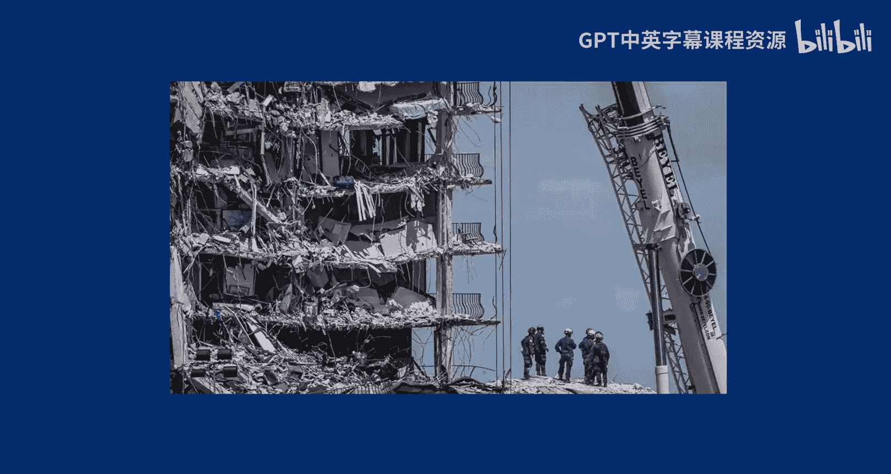
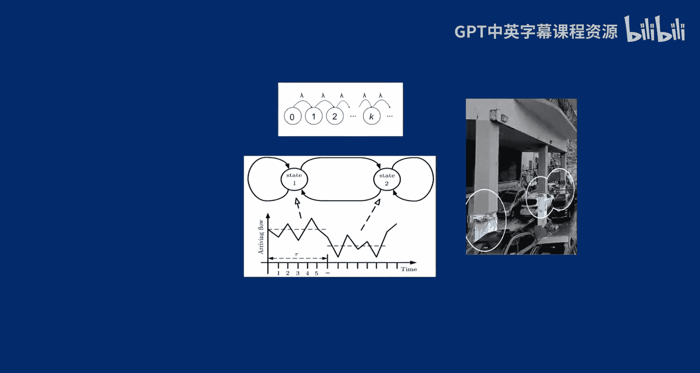

# 数据科学：时间中的决策｜4：马尔可夫链在故障率建模中的应用 🏗️

在本节课中，我们将学习马尔可夫模型的基本概念，并探讨如何将其应用于工程领域的故障率建模，以预测和防止灾难性事件的发生。

## 概述

我们进入了本模块的第四周，本周的主题是马尔可夫模型。在学习过程中，你会发现它与我们之前讨论的“在时间中做决策”有明确的联系。我们将讨论一类模型和方法，其核心是思考**状态**以及这些状态之间的**转移**，并观察事物如何随时间变化。从这个意义上说，它非常类似于沃尔德序贯抽样的思想。

## 马尔可夫模型简介

想象一个过程。现在它是一个马尔可夫状态（随着本周学习的深入，这个概念会变得更清晰）。想象一下，随着这个过程的进行，状态集合中的事物会发生变化。这可以是一个故障模型，这也是我们今天要开始讨论的内容。

这可以类比瑟夫赛德公寓倒塌或韦尔佐诺大桥等事件。本质上，我们要问的是：我们如何调整以防止故障发生？我们如何调整马尔可夫状态模型以及状态之间的转移，以增加事物保持在良好状态的可能性？从这个意义上说，它与沃尔德的思想非常相似。

想象一个生产小部件的工厂，或者思考医疗决策。回想一下我们如何检测医疗欺诈或医疗事故。本质上，我们有一系列状态。可以称之为天、月，时间向前推移。我们想了解随着时间的推移，某物如何可能逐渐进入危险区域。如果我们能阻止这一点，我们就能防止故障。这涉及到诸如更新计划、维护计划等事项。

如何防止类似瑟夫赛德的事件再次发生，最终是一个需要弄清楚随时间推移需要何种预防性维护的问题，以确保建筑结构的安全。显然，这两个都是可怕的例子，瑟夫赛德事件导致大量生命损失，绝对是一场悲剧。

我们本周要讨论的马尔可夫模型中的问题是：我们能否预测像瑟夫赛德这样的工程可能错误？我们能否预测这些状态问题和设计本身的问题，以理解随着环境变化和时间推移，我们能否预测正在发生的事情？

这样的模型相对简单。下图展示了两个状态（状态1和状态2，用圆圈表示）以及它们之间的转移（α12 和 α21）。λ1 和 λ2 也是自转移。本质上，我们要问的是：如果状态1代表建筑屹立，状态2代表建筑倒塌，我们能否理解是什么驱动建筑走向倒塌？我们能否建立一个模型来预测随着时间的推移，什么更可能促使这种转移发生？

## 马尔可夫模型的一般概念

这通常被称为马尔可夫模型。其核心思想是，在每个时间点，系统的状态仅依赖于它在前一个时间点的状态。

以下是一个天气的例子。我们有湿润期和干燥期两个状态，非常简单。在每种情况下，我们考虑降雨的时段（图中向下的箭头）。在湿润期与干燥期，降雨发生的频率不同。这些可以被建模为泊松类型的过程。1/μ 和 1/λ 可以看作是降雨发生的速率。你可以看到 λ 转移和 μ 转移。实际上，我们思考的是，当我们从湿润期过渡到干燥期时，我们可以构建一个模型。这又是一个简单的马尔可夫模型，它包含两个矩阵：P（2x2）和 Q（2x2）。P1 和 P2 是状态（如下所示），而 2x2 的 Q 矩阵表示转移概率，即从一个状态移动到另一个状态的可能性。

然后，我们可以使用这个马尔可夫模型来建模转移。我们有事件发生（这些可以看作是降雨），然后我们有状态之间的转移。我认为这类模型可以很好地模拟故障模式，这是我们本周将要深入探讨的内容。

## 应用于建筑故障的模型

如果我们考虑一个建筑随时间的马尔可夫模型，它可能看起来像这样：状态1和状态2，随着时间的推移有事件发生。可以把这个想象成降雨。最终，如果我们不小心，它就会转移到状态2。所以，状态1代表建筑屹立，一切正常；状态2代表建筑倒塌，灾难，生命损失——这绝对是我们不希望看到的情况。

那么，我们能否理解系统受到的周期性压力？这些就像是带有事件发生的 τ 类事件。我们能否将其视为我们可以进行调整的东西？

思考类似这样的情况：我们在X轴上标出天数，每天向前移动。周期性地，这可能像一个泊松类型的过程——同样是随机的且不频繁——我们的系统会受到压力。显然，这些压力在某种程度上是可以预测的，尤其是在工程背景下。也许是沙土移动，也许是隔壁施工的振动。

我们想思考在这些压力下发生的一系列状态（0到K）。这些不同状态中发生的事件，并不是将我们推向故障模式，而是推向一种模式，在这种模式下，我们明白必须采取某种纠正措施，调整正在发生的事情，以防止故障。再次思考瑟夫赛德事件或桥梁倒塌。

我们想要避免的是这样一种情况：泊松类事件在我们的模型中形成一种状态转移，小的、最终累积成大的、重大的故障。我们想要避免这种情况。我们想要建立一个模型，让我们理解正在发生的事情，并最终思考维护——预防性维护——以防止或减少此类转移再次发生的可能性。

我们有K个状态，状态之间有转移，也有自转移。我们希望它保持在状态1，而不是状态2。因此，我们想将随时间发生的所有这些事件，视为最终帮助我们以积极的方式控制过程，而不是让随时间发生的事件将我们推向故障模式。

## 总结与展望

我们刚刚介绍了马尔可夫模型如何帮助你洞察变化。具体来说，一个定义良好的马尔可夫模型在帮助定义状态何时以我们达到危险点的方式发生变化方面，可以像沃尔德序贯检验一样有效。因此，作为故障模型，作为进行序贯假设检验的模型，它是有效的。在许多应用中，构建马尔可夫模型对于设计和思考如何确保工程结果是合适的可能非常有帮助。

这非常符合基于数据在时间中做决策的精神。我们如何着手设计一个模型？我们如何进行变化预测？我们最终如何添加控制和反馈机制（这将是我们最后一周的内容）？因此，在相同的时间过程中做出马尔可夫决策，将再次成为我们的焦点。

随着我们继续学习第四周的内容，我们将更详细地阐述马尔可夫模型是如何建立的，以及我们如何思考调整它们以捕捉重要的现象。

在本节课中，我们一起学习了马尔可夫模型的基本框架，了解了它如何通过状态和转移来描述系统随时间的变化，并初步探讨了其在工程故障预测和预防中的应用。这为我们后续深入学习如何构建和优化此类模型打下了基础。