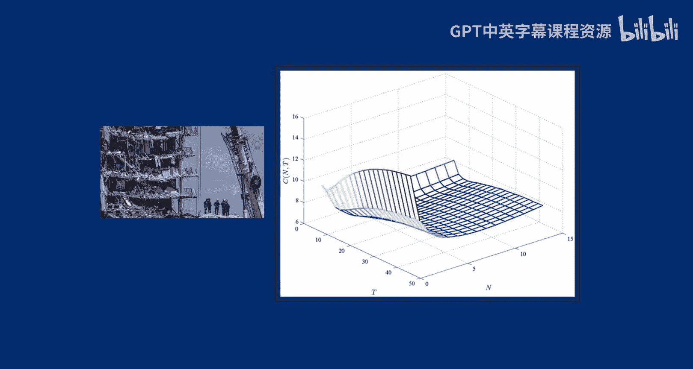

# 约翰霍普金斯大学《数据科学：时间中的决策｜Data Science Decisions in Time》中英字幕 p12 11_故障预案：几何模型构建方法.zh_en -BV1NCuzzfEJa_p12-

A model for this kind of behavior where things can go wrong very slowly over time is a geometric process。

 and the next part here we'll talk about a renewal geometric process as a particular type of model for failure in particular。

 there are two kinds of preventive maintenance that can be done one that can return the state to almost new another one that's part of a decaying process ones less expensive preventa maintenance one that can occur kind of within an episodotic cycle。

 the other one is more expensive。 Now this is just one particular model。

 and I hasten to add that like any model it's almost certainly wrong。

 but it gives you a feeling for how a particular schedule of preventive maintenance could extend the lifetime and therefore the safety of a particular engineered setting like the surfside condo setting this up obviously is difficult you don't always know the rate of failure you don't know the best schedule。

 but within certain classes of models。 and this is an example we'll cover。In the upcoming part here。

 within a certain class of models we can at least argue for an optimal schedule for maintenance and that will extend the total cost。

 so to speak of lifetime of that building and so that's a real advantage to people to do that。

Now I emphasized almost all models are wrong， but some really can be useful。 and statement due box。

 a really important statement for something like this condo collapse。 How do we prevent this。

 How do we prevent a structure from going bad Very similar again to Wald and it is there for factory production。

 how to prevent bad widgets from coming out from a particular factory， Whatever that factory may be。

 How to prevent shipment， how to prevent bad things from happening One model for this is a geometric renewal process。

 This I think is a very nice model because it's conceptually very simple。

 You can see we've got first second all the way up to n renewal stages our random variable Y capital Y here represents deterioration over time as we go from one in parentheses to two in parentheses to n parentheses。

 we're going through a different renewal stages。 within each one you've got an M1 M2 M sub n。

 Those set as seen in this equation here。 Those set the epics for each one。 So Jco1 m sub n。

 we don't know how big little M sub n is we know it exists。

Seet our preventive maintenance type periods and then we've got the outer model which is set by n。

 which sets the total time so we've got n renewal stages little m again is in this kind of model setting how long we go between between maintenances we can change notation slightly this is now x as opposed to Y and we can think about a first repair period all the way up to the n repair period whether the first repair period。

 we've got these preventive maintenances at the end of little windows you can see we've got an open circle you can think of these as being set you can think of them as being defined in some way but either way we've got a set a repairs that bring us back to a normal state and then we've got n of these again and we want to think about the lifetime for the building or the lifetime for the bridge or whatever item is and so what we can do is now optimize the cost we can think of a cost for preventive maintenance we think of a cost at the end of each of these major repair periods again we've got。

In large periods here So you have that number then of total repairs where you can think of it n minus-1 in the last one being a replacement。

 But either way we've got a cost。 the big variable here is this little m subi。

 we can think of an expectation and the little m sub I is being set by some probability distribution function。

 This is why it's called a geometric model because we're trying to define the expectation that's going to be defined as m times p which is a distribution function with m subi called m over all the magnetic values for m subi。

 So again each of these define a cost therefore， and that's what's been shown in this last figure here。

 This is a contour type plot cost is on y axis is。 that's cost of n and T So what we're thinking about is the total number of these major repair periods first up to n that also has an indicator in terms of T which is the length of time between these preventive maintenances and so if we're thinking of the surfside again and trying to prevent。

Collapse like in our scenario of things that we want to avoid we can put in different functions this for example。

 is a E distribution function for that little mci I。

 the time that it takes for something to cope out and we'll get different estimates for N and T but obviously if we choose our values of N and T。

 we can adjust for the cost and that's what we want to do， we're want to optimize。

So I hope I've given you some feeling for how a optimal schedule can be set out and how that can make a big difference in terms of the lifetime of something like a bridge or something like a building now obviously again setting these schedules is difficult。

 finding the right model for these is difficult， but the fact that there should be some sort of maintenance schedule set and that it can make a difference on the total lifetime and therefore the safety of the structure I think is really。

 really interesting and again it ties very strongly back to walled sequential sampling and hypothesis testing。

 all the ideas that we're exploring in our making decisions in time making the best use of your data。

