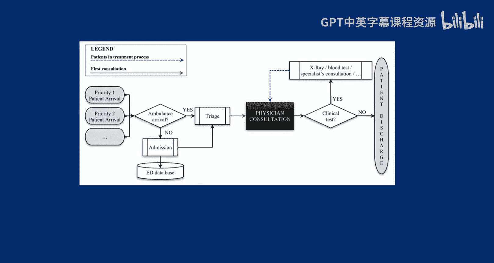
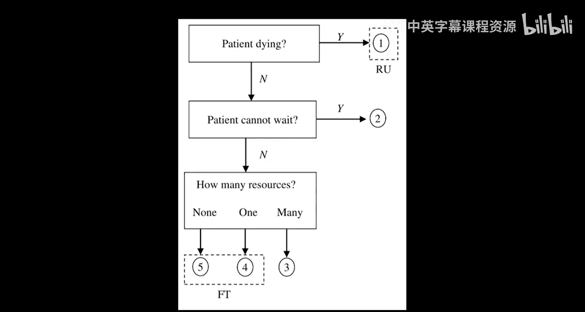

# 约翰霍普金斯大学《数据科学：时间中的决策｜Data Science Decisions in Time》中英字幕 p14 13_急诊科资源分配的决策优化.zh_en -BV1NCuzzfEJa_p14-

In our fifth week， we now explore Marco decision processes。 These are really quite interesting。

 And I think you'll see that they are nice capstone where we started with wont。😊，In particular。

 you can imagine， as opposed to a sequential series of events where you cannot change anything。

 You now have a sequential series of events where you can change。

And those changes you can make along the way enabling you to optimize。

 so that means you can control the process， at least in principle， to have a particular outcome。

 you can effectively therefore make sure modular probability and modular。

 all the unexpected things that might happen you can really come very close to con that your process or sequential series of events proceeds in a way that you want it to and you can do this under the confines of Markov model most readily there's other models as well but under a Markov model where you depend only on the knowledge're in a particular state to make the adjustment to the next particular state in the limit this goes into what's called reinforcement learning some of you may have already heard of reinforcement learning。

 some of you may not either way you can think of this is simply a series of events。

 states that we're changing from or into and at each point we also have rewards or we have penalties we can think about how we adjust our sequential decisions。

Based on these rewards and at the end what we want is to optimize our reward so we'll start this week about a discussion about emergency rooms and try and think through how one might staff those ultimately。

 this is meant to be an example， hopefullyll be an interesting example of how market decision processes can help in order to make certain class of things flow more smooth。

Imagine that you're running an emergency department not an easy job at all。

 but you've got patients presenting with all sorts of different conditions and all sorts of different timings urgency behind them is the patient dying because the patient cannot wait how many resources do you have what can do with those resources so you have to triage you have to treat these patients as they come in and think about how you can help them in this particular diagram we've got fast track so we can say how many resources we've got we can evaluate our fast track resources we've got presuscitation unit so patient is really near death those are instances of what we can do but really what you want to be thinking about here for our class right now is these blocks and the decisions that are house coming out we are making decisions on the data that's in front of us what's the patient' status。

 how many resources do we have？The paper we'll be talking about some in this week tries to make a better triage system so what they do is decide maybe we can divide this into four categories。

 urgent simple， urgent complex non-urent complex and non-urent simple and they call this complexity augmented triage and we've got a tool for improving patient safety and operational efficiency this was published into this 14 and a well-know journal and essentially patients present at different times during the day and you've got to think about staffing so as they present you've got them waiting in a room。

 you've got some sort of interaction you've going run tests you can decide what to do and again you were making decisions in time so you've got a rival triage waiting those are phase one and phase two your treatments tests and your disposition so these aremark of decision processes you've got an environment and agent actions states of rewards that things are coming out from what we're trying to do again is to optimize this it's not。

Simple arrow without any state and reward behavior behind it so the actions are tied into the ultimate rewards ultimately in all these situations we can think about it as we're presented with a situation we make a decision based on our environment based on our resources for example in this case and then we try and optimize we try and make this as strong a situation as possible here's another paper that also explored this problem triage again patients come in you've got first and second consultations in your waiting room and discharge here on the far right with clinical tests that can be performed essentially again this is the same sort of sequential design decisions that we were just talking about with the triage in this particular case we've got high priority patients。

 mediumn priority patients etc we can think about this again as a type of cu which is really essentially a Markov sequential design flow patients arrive with certain rate Lada it's probably a poisson process they're put into effect。

a Q this has another rate going into the physicians we'll call that the service rate mu and then we've got feedback this feedback of diagnostic tests etc is really important so this is the second paper accumulating priority cues versus pure priority cues for managing patients in emergency departments and the argument again is essentially a Marco decision process particular states are define and decisions are based on where we are within those states and this is important again because we are trying to optimize our decisions going back to our first diagram can we help patient dying can we help patient cannot wait how can we best make a series of sequential decisions in time。

So I hope you now have a better idea of how you might imagine making a better flow of patients through an emergency department or how you might imagine optimizing any sort of a cu where decisions are made sequentially and this is an example of the application of Wal's central ideas from the 1940s into modern really life and modern practice in all of these events it's got a common stratum of ideas and that is that we've got some sort of data it may be informed by a model or probability distribution and we're trying to make decisions based on that data and that goes back really again to the title of our course here making decisions in time and making the most of your data and these are really。

 really central to much of what our everyday world again is constructed of so the example we just went through which hopefully will be interesting to some of you may not be all of you but I think it's quite an interesting one nonetheless of how does one go about。

Trying to take something that is inherently complex。

 awkward and try and make it smooth and potentially as less awkward as possible and then again was the emergency departments and how patients are triaged or guided through these systems so again as a model for a Markov decision process。

 patients present events decisions are reached and we're trying to optimize something and that's I think a good entry point into our topic again for this week on Markov decision processes。

Thank you。