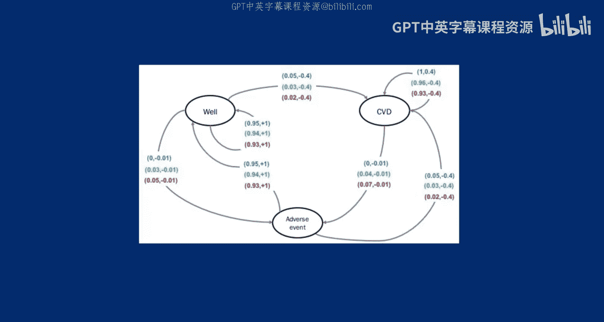

# 约翰霍普金斯大学《数据科学：时间中的决策｜Data Science Decisions in Time》中英字幕 p15 14_药物治疗方案优化策略.zh_en -BV1NCuzzfEJa_p15-

As another example of a mark of decision process， we'll be talking about trying to set drug therapy for hypertension。

 This is a really important problem。And one where while there are guidelines at a national level。

 it can be potentially more rationally phrased as a question for a Markco decisionsion process and in a Markcodiion process formulation as you'll see。

 we can define transition rates and again these could even be defined individually and ultimately what we're aiming for is control of blood pressure。

 so this is something that I think you'll get some feeling for as we go through。

 think of this as an application of these ideas of sequential sampling because essentially what we've got is a state in this case a patient's ability to control their blood pressure and then we've got potentially in action which in this case is a drug and then we've got a reward which is the ability of that blood pressure to be under control so the argument that's being made here is essentially prototypical of many Markcodeion process type ideas meaning again that we've got a series of sequential。

stateates that are visited with different rewards and we're trying to optimize the outcome。

 in this case we're trying obviously to help people to get their blood pressure under control。

Imagine you're a physician and you're trying to improve someone's ability to prevent a heart attack。

 you're trying to get their systolic blood pressure under control。

 This is actually a very very challenging problem for many， many reasons。

 but one way of thinking about it is to simply say it's a Markov decision process your well maybe you've got some adverse events。

 maybe you've got cardiovascular disease， you can imagine having a sequence of different transitions depending upon your state。

 depending upon the rewards you could then take different actions。

 stop medication no medication change， maybe you're already on medications or increasing their medications and effectively the rewards as we imagine transitioning between these different Markov states well ultimately define your ability to control someone's blood pressure with these medications so the argument in these kind of Markov decision process models is can you think about a combination that best improves the status of care one way of thinking about this as well is to compare to the current status of care。

JNC8 or intensive JNC8 are two current approaches for making decisions and you can see these kind of flow diagrams two approaches for making decisions our dynamic Markov processes or model based on Markov decisions in general has the ability to be at least in principle generalized and applied an an individual level so for example it could recommend particular drugs maybe half dose or full dose and combinations very common for hypertension to have more than one drug active so one drug two drugs three drugs for drugs it depends on how particular patient is responding how many drugs you would imagine choosing。

 but if you're a physician your long- termm goal is to help the patient get their blood pressure under control so this paper from British medical journal。

Took these Marco decisionion process models and basically ran tests to try and evaluate how patients did within this personalized approach versus the kind of state of the art。

 the approach for JNC 8 and the argument they make is that this seems to work quite well and I think a preious argument in the future for doing similar things with other classes of disease。

 so for example， we've got our Markco decisionion processbased model in red。

 the other two colors are JNC8， the intensive and the standard。

 and these are different ages for male versus female as you parse this and it might be hard to get all the details here。

 but as you parse this what you should realize is that in many situations。

 I would argue really over this full sat a did as well or better here's in the way of looking at it。

 this is control of hisy blood pressure by the medications in these different protocols for these different age categories So you see youngest 18 and up。

On the far left into 60 plus on the right and again the Mark decision Pro based model does really。

 really quite well so what I think you want to take away from this again is that a decision like this can in fact be made by the class model sequential decision type models that we've been talking about so is an example a patient might come in with these demographic and other characteristics that you see in this column that column on the left and JNC8 would say no treatment but the Markov decision process model would say I have to so I've made a blocker and so it's personalized it's going to depend more directly on the feature space so the idea here and I really want to emphasize this goes back to a paper from this group and it's based on kind of standard now equation for how to optimize a Markov decision process so you can see the reward it's a policy pie and we've got states and actions。

S sub T and A sub T effectively what we're asking with a discount function lab to the T a sum over all of our states we're basically saying can we optimize again something like systolic blood pressure by choosing appropriate actions which in this case is drugs applied over time so again it's a state action pair and the idea then again going back to a first diagram is that we should be able to optimize treatment options for individuals and we can think of this again as trying to control and optimize the transitions so ultimately again what we're trying to do is to make sure people stay in the well state as long as we possibly possibly can and frequently what that means for cardiovascular disease is going to get their blood pressure So I I've given you some feeling for how a market decision process can be used in a clinical setting there's many other applications like this we'll be traveling over some of this territory in the remaining part of this week at the same time I want you to use your imagination and。

how as we've kind of entered our fifth week and our last bits on this term on this class。

 I'd like you to kind of use your imagination for how you could imagine taking data in sequential sequential forms of data and acting on that。

 thinking about how decisions can be improved by thinking about that data in the context again of Wal or the context of Markovtype models or Thompson sampling think about how you could optimize I think a lot of the lessons that we've been talking about over the last couple weeks really do extend well beyond some of the use cases that we've been talking about and you may be those of you listening to this may well be contributing to future developments with these kinds of methods。

