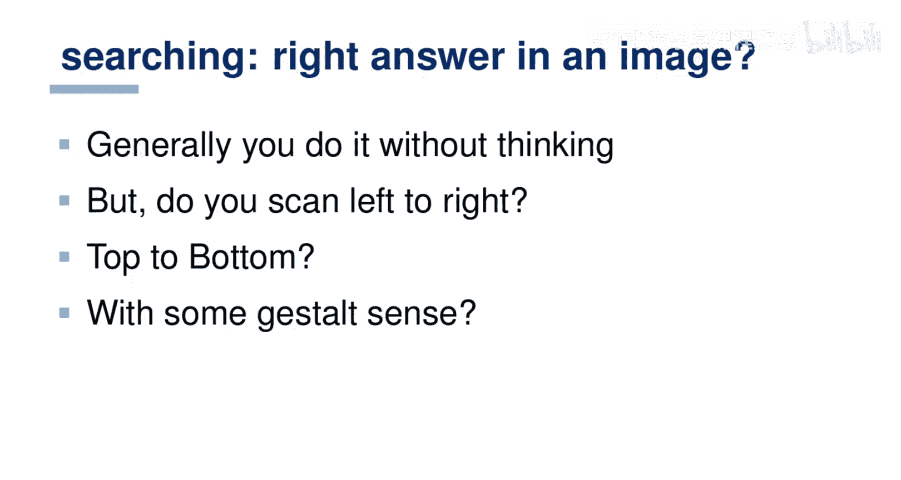
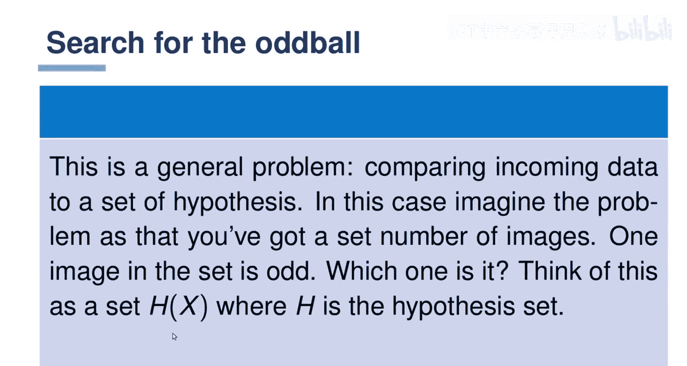
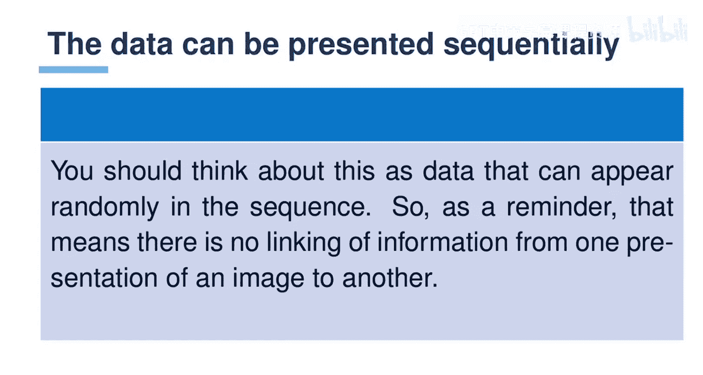
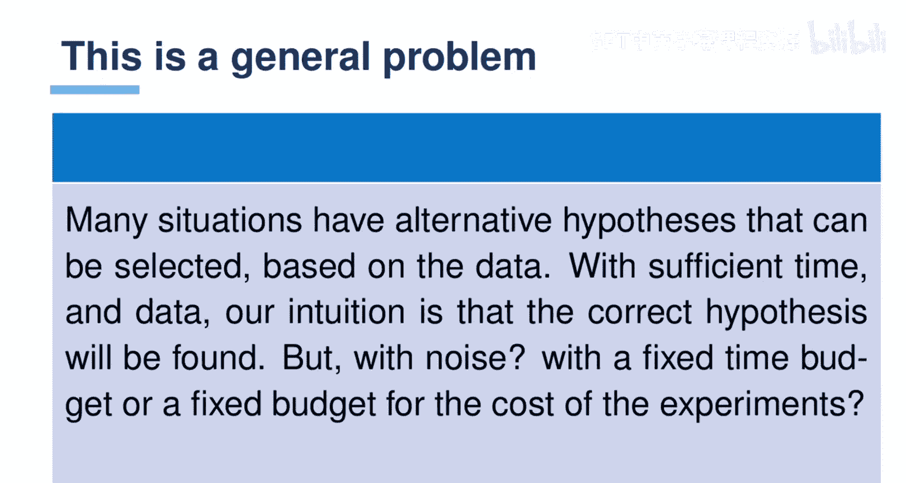
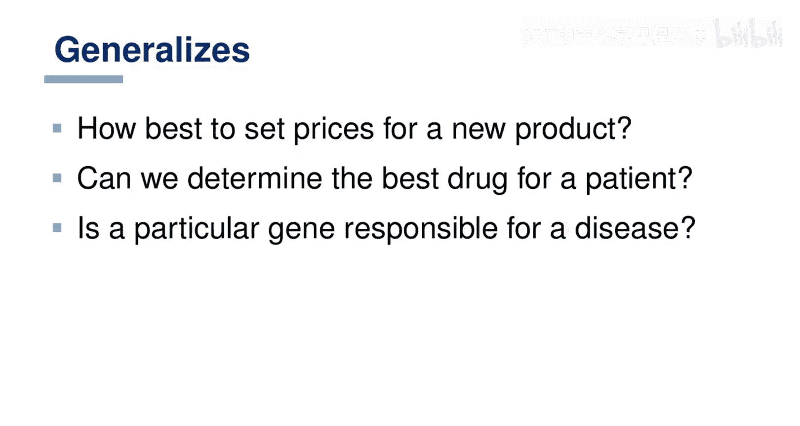

# 约翰霍普金斯大学《数据科学：时间中的决策｜Data Science Decisions in Time》中英字幕 p16 0_视觉网格图像中的异常识别方法.zh_en -BV1NCuzzfEJa_p16-

We'll now talk about image search。 This is a really interesting， motivating example。

 The question that we want to address here is， can you spot the odd one out。

 And this is an example of sequential hypothesis testing。

 which is really what we're after in this part of our coursera。

 So the question that's being asked is in the context of an image， But it generalizes really。

 really quickly， So imagine you've got an image， And there's something odd in it， Can you find it。

 How fast can you find it， And generally you would do this without thinking。

 It's all part of your visual system， You don't really think about it。

 But if you were to think about it。 How would you approach it algorithmically。

 Would you scan left or right， Would you go top to bottom。Maybe you have some sort of gsalt sense。

 which is another way of saying obviously unconscious but。

Finding this in the shortest amount of time is a really interesting question。

 And generally what you're doing is saying for an image。 I know that something's wrong in it。 So。

 you know I'm telling you that how do you how do you determine it。 What would。

 what would you think is going to be the fastest way to find that。

 And this kind of question about searching for the oddball is really a form of hypothesis testing。

 Imagine I've got incoming data I may have even in fact， quite a lot of it。

 Imagine streaming type of data could be streaming images And I've got a set of hypotheses。

 in general， we want to keep this relatively short in terms of hypo， but in principle。

 it could be any size set of hypotheses。 So the problem is now we've got the set number of images。

And one image in that set is odd。 let's say we've got 10 images or 50 images， but some set size。

 and we know one is odd。 Which one is it， Can you find out an odd， you know， men， meaning oddball。

 not just odd， even like number， but odd， meaning you know， something is unusual about it。

Sohow your hypothesis is that it could be any one of these so we're identifying when we say hypothesis here're identifying which image is the one that is off so you can't accept that all of them are uniformly the same one of them is off Which one is it So you can think of this as a hypothesis over this set X where these are the images and each is the hypothesis set and you're trying to find the odd one out Now something that I really want to emphasize that came up in our entry to the coursesera and I just want to reemphasize it now is that our data is being presented sequentially that is almost as if it's been presented in time。

 but unlike a regular time series where you can think about connections from one moment to another we really are thinking of this data is coming randomly in the sequence。

 in the words there's no linking of information from one presentation of an image to another they're all coming independently there are drawns to speak from a random distribution a distribution。

 you may know something about or you may know only a little bit about but it's from a probability。

Density that you're drawing sequentially from and then you're trying to answer something about that sequential set of images and again this is a really general problem。

 there are many situations where we may have alternative hypotheses that can be selected and that's being based on the data so imagine you're scanning this image maybe left to right with maybe 10 and you're trying to find the odd one out hypothesis in each set is is it a reasonable image or ist an odd image reasonable odd all the way through and with sufficient time and data kind of our intuition is that we can find the correct hypothesis in which you could find that oddball image but what would happen if you got noise what would happen if you had a fixed time budget or fixed budget related to the cost of the experiment these are very general problems that come up very quickly。

 even in this very innocuous and simple sounding question of a visual search so now I'm going to introduce this through this very very nice paper from 2010 from this group at Carnegie Melon and University of Pittsburgh and they were looking and comparing monkey。

Neurural processing of images and human visual processing。

 And again it's going at what we're talking about。 So bear with me。 So first thing。

 can you spot the odd one out here， I've given you an image note that it's just a field willll call it distraction field of two rectangles one on top of each other And for most of them maybe want to phrase it as the darker color is on top and the light color is done below but there's one that's off So how long did it take you to find it you'll see it it's right here。

 how long did it take you to find it that's the question you can time that you can time that in people and in a monkeyvisual cortex。

 you can actually play with pairs of images and look for cells that are responding to particular images here's another one how long will it take you to find it note it's the same idea I've got two different patterns。

 one on top of the other but in one case it's reverse And the question you want to be asking yourself is if I had to describe it as being on the right versus the left and I gave you a button to put。

Right versus left。 How quickly could you find it， So again， right over here。

How quickly would you have pushed something saying it was on the right， okay， how about this one？

For most people， this is easier。 and and you know I don't know。

 I can't survey all of you because I can't see everyone， obviously。

 but I'm hunching that most people， this popped out right away。

 This is like an X is that we would think about it。

 And then then the paper they would call these distractors， these kind of diamondshaped images。

 So this pops out。 And that does say something about our visual operating system and some patterns are easier than others for us to cleanly see。

 And that's really already quite fascinating。 But the real question again is can we start to understand why this pops out quicker than the other images。

 And so again， the hypothesis we're testing ultimately sequentially is which of these images is off and and ultimately we might be asking as well。

 why is it off。 So they're asking this again in the context of a visual search problem or a visual image type problem。

 But again， it generals it very quickly into our topic into our Coursera topic？

 Now this is really too much the summary table。 But effectively what they did is they looked in these neurons in the monkey and they looked at reaction time in。

And so you had a search index， how long it took you say as a human subject。

 he all set a neuron index。 So what they were getting at was in all the neurons they recorded for a particular pairwise set。

 and I'll show you how they did that in a few minutes。

 they could look for the nerve cells that were most responsive to particular aspects of these patterns And the question ultimately was are the neural substrates that's involved in the monkey system similar to the sorts of pattern matching ideas that we would have in people。

 in other words， can we identify these in the same way。

 So looked across six sets for example color you saw that pattern。

 you saw that and Cheevron you saw that in the first set and effectively what you're doing is you're given these two and you're asked can you tell So you can see the darker on top Earth the darker below the asterisks below versus on top and then the orientation on the Cheevron if you want maybe the x versus the diamond So this was set one and pairwise and then in set2 they varied things like the distance。

 this is the Cheevron and we're comparing the distance。Right， so middle near versus far。 So set2。

 set3 was variable Cheevron size。 So small， medium and large。 And again。

 asking ultimately can you discriminate between these different aspects of the feature set。

 This is somewhat similar to but now you've got a little bit different pattern that call that in inter contour distance。

 So far middle or near。 And again， it goes partly to the way your visual system processes information。

 But again， you'd be looking for the odd one out。 This is set 5。

 This is this aspect ratio was very so tall versus square versus wide。

 you can see it's the same pattern， that kind of a squiggle。

 But what you're varying is how tall it is whether it's square or whether it's wide。 And again。

 you can see there's a difference。 in each of these。 So in this case， it's like an s shape。

 In this case， it's like a rectangle with a line S shaped and a line and rectangle S shaped and a line and rectangle。

 And so can you again see the difference between the left and the right between these two between these pairs。

 So set 6， Now we've got the parameter constant tall。Versus square versus white。

 So what they essentially did then is for the monkey。

 they gave a series of images and these were alternating on and off and effectively what they were looking for was spike firing counts。

 So created electrode and not everyone likes these experiments and you know this past all the animal care。

Kind of issues We don't need to go there in terms of the Cora。

 but just realize this was done ethically and it's fascinating that we can record from these nerve cells。

 So anyway， in the monkey recording from these nerve cells and the question you're asking is do we get some of these stimuli with stronger firing rates And in particular。

 what's the difference in firing rate between say something like this versus something like this or between say this chvron versus this chevron or between this kind of a pattern versus this kind of a pattern and from the difference in the firing rate。

 the question is does that tell you something about how quickly the human subject can make a similar sort of pattern。

 So for the humans it's a fairly simple So it's six and the image is either on the left or the right and so you've got your index finger left and right index fingers on both sides and you're asking yourself is the odd one on the left or is it on the right and can you identify And again it should pop out of you you can see that these five or all similar this one is different。

 So the human subject obviously it's not invasive but the question is。

The human have something similar to the monkey and they would argue that it is and it's obviously because the mechanisms for visual search on this context are very similar。

 So this is the firing rate in the monkey， this is the behavioral one So the human with left or right index fingers and then you can see this goes from1 to 17 and I'll these same numbers here and effectively what they're asking is all these kinds of pairwise comparisons that we just went through in our six sets and asking whether whether there's any correlation between the mechanism seen in the monkey and the human。

 So again， this is an introduction to thinking about how you might pull out the odd one。

It's an introduction to sequential hypothesis search。

 the question we're trying to get out at this point in our coursera together and the question ultimately is you know some of these are going to be coming out on this region。

 some in this region can we understand what's going on within that kind of a mechanism and this really as you can see then depends on the feature and it takes different amounts of time because some of these things jump out at you right away and other words less so I would argue it's largely unconscious in the case of the visual processing system。

 which is at least in part why one could argue that there's immediate connect between what the monkey nerve cells are doing and what's going on in the human cortex but this generalizes really quickly So in other words。

 how do I set the best prices for a new product I've got to collect information I can set a price I can see the demand how many people are buying the new product。

 So I'm getting some sort of feedback I've got data coming in most certainly imagine you setting the prices independently so sequentially in time and I'm trying to。

The best price point you know how do I how do I do that I can set hypotheses and I'm therefore trying to find the best hypotheses which ultimately leads to the best price for the new product How can we determine to the best drug for a particular patient how I imagine sequentially searching in order to find the best response and therefore the best drug for a particular patient maybe I'm curious is there a particular gene I'd be responsible for a certain type of disease of genetic disorder type of disease These are all problems in sequential search and in hypotheses testing over that set So I hope with this that I've given you some feeling for how adaptive sequential search type questions can be defined and set out the visual search problem is aboating in one it's quite interesting and just really hope you'll enjoy this coming section Thank you。

