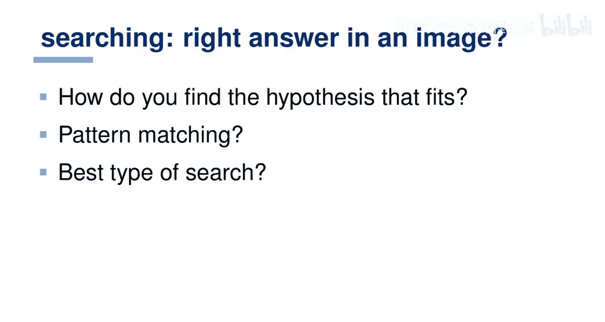
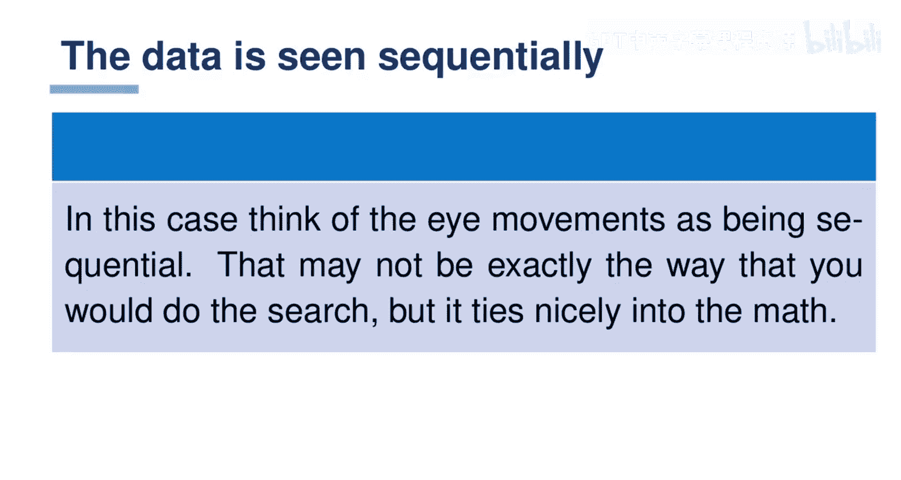
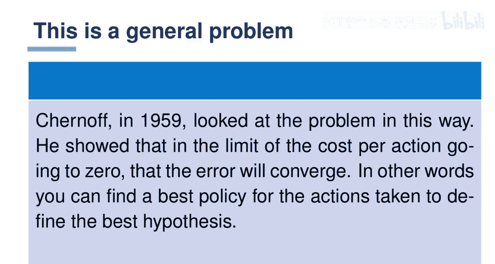
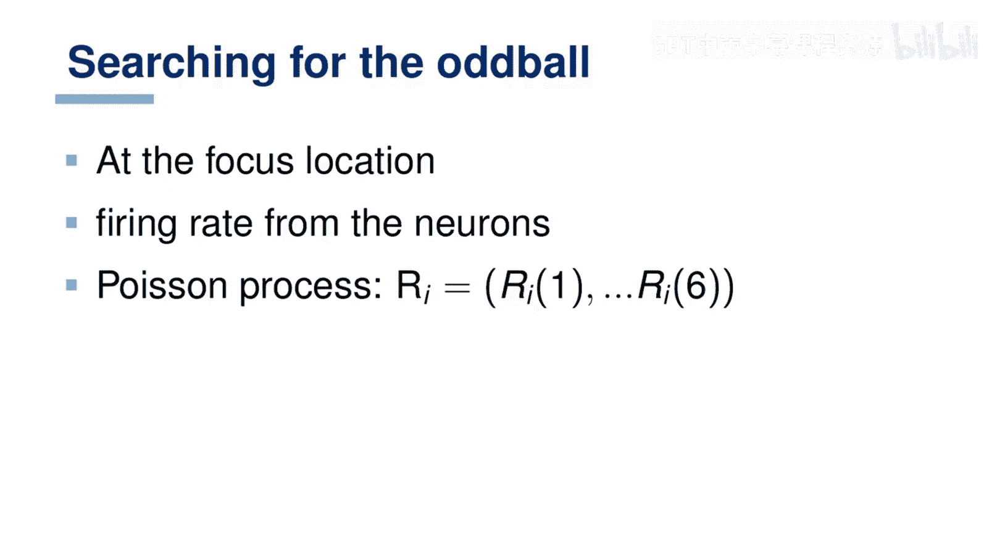
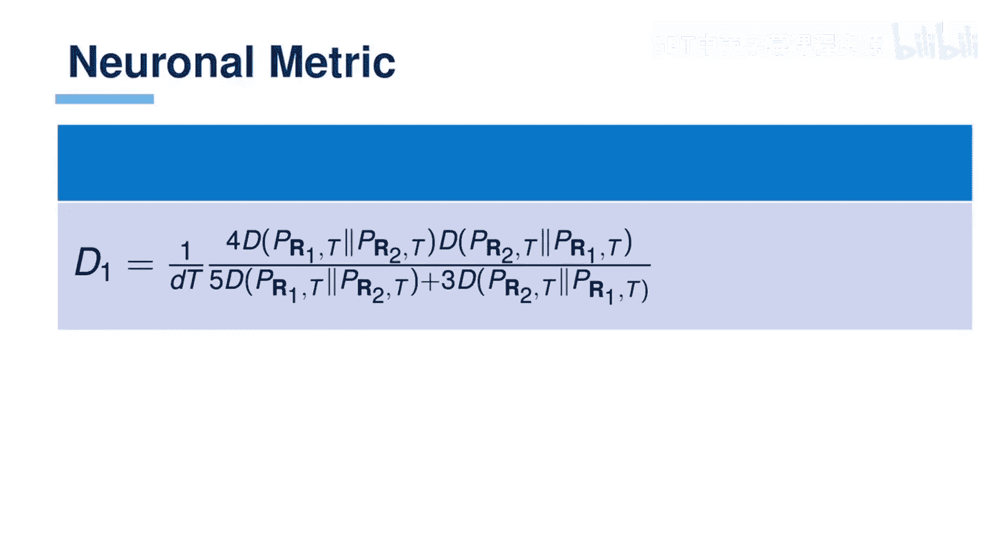
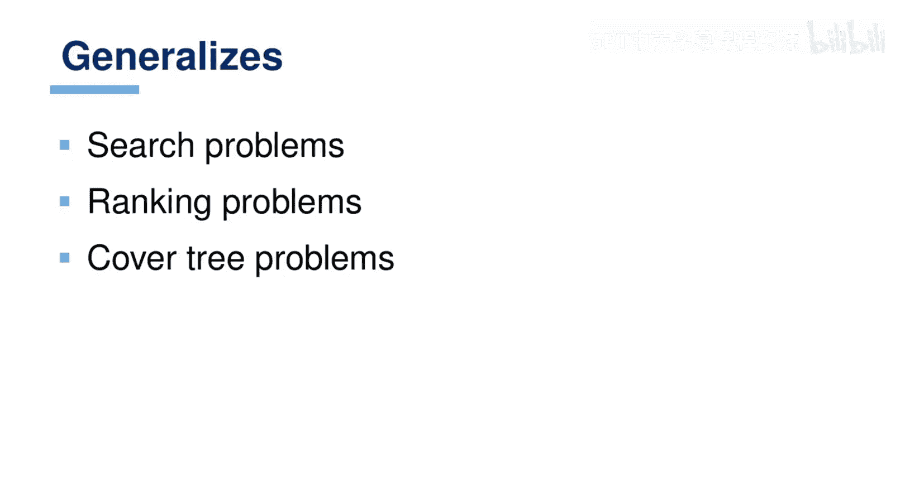

# 约翰霍普金斯大学《数据科学：时间中的决策｜Data Science Decisions in Time》中英字幕 p17 1_切尔诺夫理论在异常判定中的数学解释.zh_en -BV1NCuzzfEJa_p17-

We'll now talk about active sequential multiple hypothesis testing。

 This goes very nicely from a motivating example on image search。 And essentially。

 the answers and the questions we're asking are tied into the algorithm and the math that we're after in this one。

 So essentially， what we're saying is how do you find the right answer in an image。 In other words。

 how do you find the hypothesis that fits that really describes what's in there。

 Do you use something like pattern matching。 Do you do some sort of search， What do you do。

 How do you find it， obviously， in the case of this particular motivating example。

 Most of these are unconscious brain mechanisms， They're in your visual system。

 They're so to speak prewired。 But nonetheless， you're choosing from an active set of hypothesis is the idea。

 So this is really a general problem， In other words。

 given a set of images or a set of input data which we're thinking of I appearing sequentially。

 and some sort of actions that you can take on that data。

Can you find the best set of actions to find the best hypothesis to fit the data in which is an optimal set of actions that helps you most quickly to define and understand what's going on。

 So again， as a reminder， we're seeing the data sequentially。

 so we can think of this case of the eye movements as being sequential。

 and that may not be exactly the reality。 but imagine that you're fixed on one point in space and at each point in time and think the time now is being discrete。

 say each second in reach a millisecond， you move to another region of the search space。

 And this again as a very general problem we'll also be covering turnoff's paper from 1959 this week。

 and he's really the one that helped define this problem It grow very nicely from well。

 which is what we covered in the first of our course hour courses。

 Turnoff really extends this problem in a really interesting way。

 And what he's really getting out in this paper 1959 is how do I deal with a problem where I've got multiple hypopotheses and I can sequentially take actions on those。

 How do I optimize my search。 And he showed in the limit of the cost per action going to zero。

 meaning again that we don't worry about how much。

To run this that we can get converence in terms of the error。 In other words。

 there is the best policy for the actions to define the best policy。

 So this is the paper from Suarsan's group that we'll be talking about now， this is from 2012。

 the title is active sequential hypothesis testing with application to visual search problem and the problem is exactly what we went over earlier。

 which is I've got now a set of six images say on the left or on the right only one of the six is different than the other five。

 The question you're being asked terms of hypothesis type testing is can you see that odd ball。

 So in the one on the left it's the top right So if you think of it as four columns with three rows were in the top row on the right。

 And then in the other one， you can see that it's in the bottom left。

 So you've got again five that are the same and one that's different how quickly。

 how quickly does your system find it。 And this is obviously dependent on the type of pattern that it is know how widely spaced or not。

 whether it's color or not， etc。 But they recorded again from。

Macque monkeys and they recorded from cells that respond to these patterns so they're in their visual field and they would define then for each cell a firing frequency of baseline firing frequency。

 you could think that as being defined by just presence or absence is something in the field and then they could define as well the difference in firing for these different patterns so you could take the different pattern on with the diamond or the xa on the left or the square on the top or the bottom really the rectangle with a align in it being above or below and you could define then how different those two patterns were as seen within the nerve cells and the essential question then is from those nerve cell firing patterns can you understand think that as a readout on the hypothesis testing。

 can you understand which pattern it is and in the math version of this you can see we again get a correlations or the neurometric and the behavioral index are highly correlated and now try and explain how that works So the rotation here is you've got a cyto hypotheses H sub I I from1 M now M in our case might be6 because we're thinking of six images。

But you've got to set up hypotheses。 you're trying to figure out which is the odd ball again。

 So odd one is the one that's out。 And we're looking against that set of six hypotheses。

 Now we're picking actions。 That means in this instance。

 we're thinking about looking at different regions in the visual field。

 our actions are can be de noted by a here think of that as a set that's finite。

 we're going have say six different regions in space。 you could look for six different patterns。

 And X then is our distribution of data and both these can be incremented they're going up by n。

 again we're thinking like discrete type time。 and we're going at least one step。

 if not more steps defined the odd ball。 Now the other big assumption。

 which is part of turnoff and part of this whole field is that we've got probability agencyency functions。

 Now obviously， youm not always be able to define these。 But if you can define a Pdf。

 then you can answer this question mathematically。 So our Pd。

 we're going to call it Q and we're going to have subscript and superscript。

The subscript is where the I pattern that we're trying to look at A is the action so we've got a set of data that we're bringing in and we can measure that in this probability density function so against each hypotheses and against each action we've got an ability to discriminate the information that's coming in and so we can define c sub I J as our information that's this ratio tests and what W did in x sub n and a sub n and in what we're saying is that if we've got I and J and sorry misspo a minute and go I and J are the hypotheses in our set that we're discriminating between so we've got same set of action same set of data we're measuring them against two hypotheses。

 Q sub I and  Q sub J and these these two different PDFs again defined for each hypotheses since then we can define our information content against each of those different actions we can rewrite this very simply as the sum from1 and the log of each of our individual hypotheses against the action set and against the data。

' use another tool here that many of you probably heard of if you've not you can also look this up in Wikipedia。

 This is the KL divergence and the k divergence really helps us here。 it's not a true measure。

 it's asymmetric but it lets us define how carefully two different distributions agree or disagree so D on Q sub by a relative to Q sub A means we're comparing these two hypotheses I and J against the same action and we can measure those differences and because it've got the same action we can say okay we prefer one versus the other in other words we're getting more from one versus the other Now in the particular paper that we're talking about here in its application in this instance the visual search。

 we can define a simple basease rule， sequential update type rule this general is as you can apply something like this in other settings stupid it's a particularly nice rule in this instance so we can update our probability for a particular hypotheses and essentially all we're doing you can see we've got on the bottom like the weighted sum over all the subq sub js where J is can go over all。

For the I1， we're simply updating it that probability relative to the output from the action。

 so we can think of this as a posterior belief that's based on the data。

 and because we can compute that we can imagine taking and finding the best set of actions。

 So essentially we're building from the previous step and for acute distributions and we're going to take a series of steps。

 that's ultimately going to define what's called a policy meaning we can define the best set of actions that in the minimum time and ideal believe with minimum cost tells us the correct hypothesis meaning again in this case the correct odd ball out in our images so we can think of a sequence of action plans defining this policy and these current n times。

 we've got n time steps at each point in time we can like to stop and use the best current hypothesis or we can continue on and by doing that we're defining the total time for our search Now our kind of construct here and again somewhat artificial but I think really。

 really quite nice an easy one to think about is that there's equal probability that this odd image can be anywhere in that set of six so。

You can think of a bound on how long might take you to find it if you just simply looked around at all six and were able to have clean enough discrimination between each of them。

 but again， the images may be somewhat similar so maybe you have to look more than once in order to have a high probability that you' correctly identify which image is the oddball out so we're modeling this as a search that's taking place over time again you're looking at one of these at a time and at each time step you're just looking at one point in the visual field so as you look at your focused location。

 you getting firing rate from these neurons these are again from the monkey but you can imagine also mean from you because cicortex should be very similar so you've got a mean firing rate from the neurons these are going to vary depending upon what the pattern is in that visual field So think of this as a poisson process for the firing rate or one to r6 just to describe the different locations in the visual field and then we can define a neuroometric and I'm not going to derive this。

 this is in their paper you can see we're doing these kale divergencies on both top and bottom and we're comparing then our firing rates。

to our time and this leads to this figure that I put up earlier。

 So essentially then we do't need to define our sets， meaning our data， our actions and hypotheses。

 we need to define our probability denities。 those again should summarize for us the probability that we have seen a particular hypotheses for a particular set of data and a particular set of actions。

 That means we can again write a scale divergence， and that means we've got a generalization of all sorts of really interesting problems。

 search problems， ranking problems， Cory problems， these are all essentially the same where we're trying to understand which hypotheses is the most likely。

So I hope that has helped you to see further into this material， thank you。

