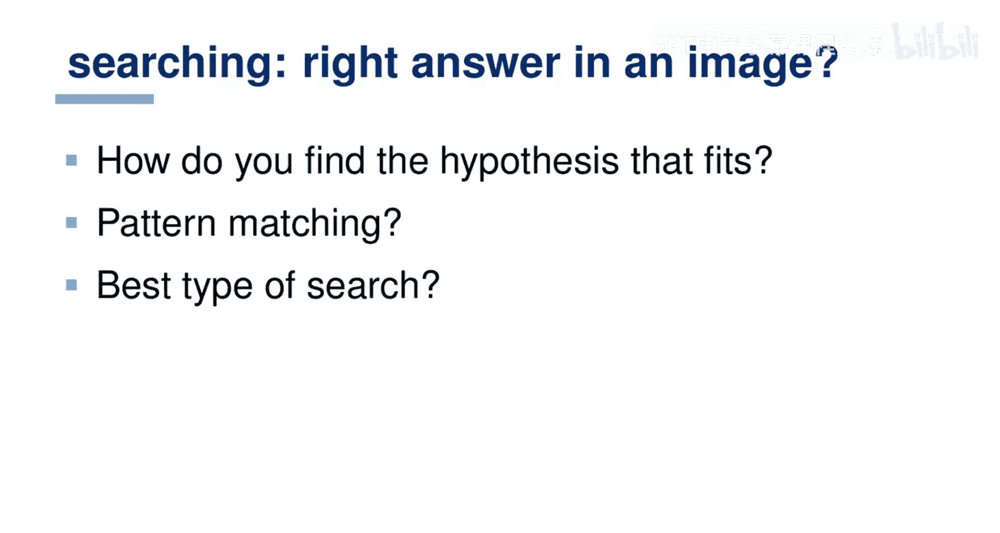
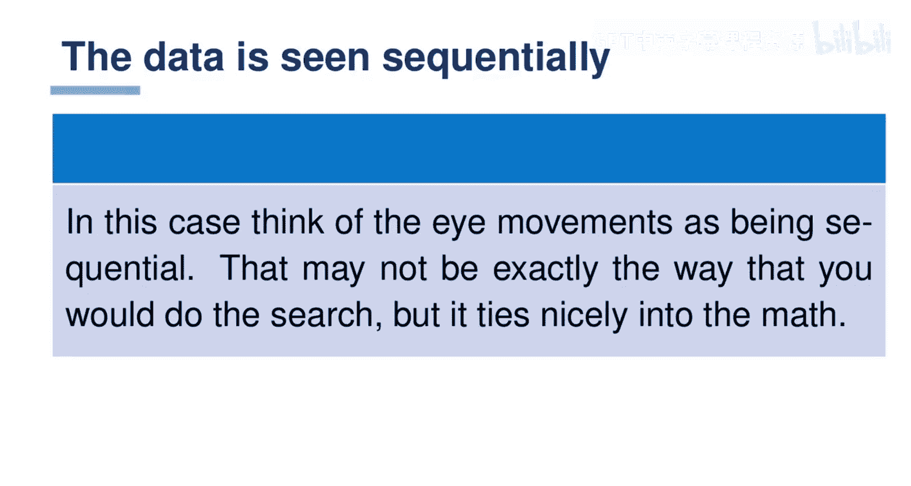
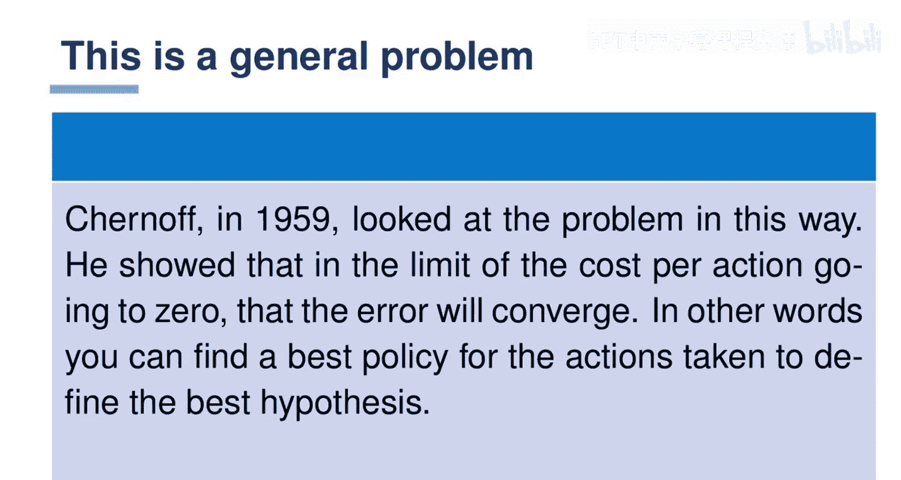
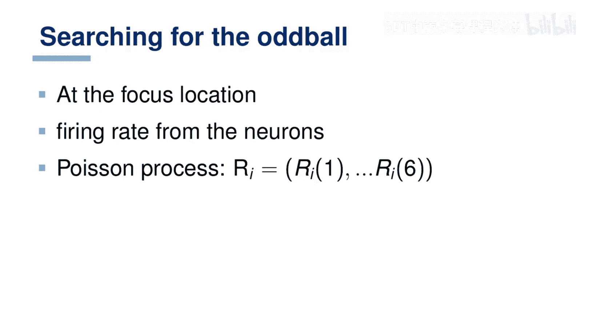
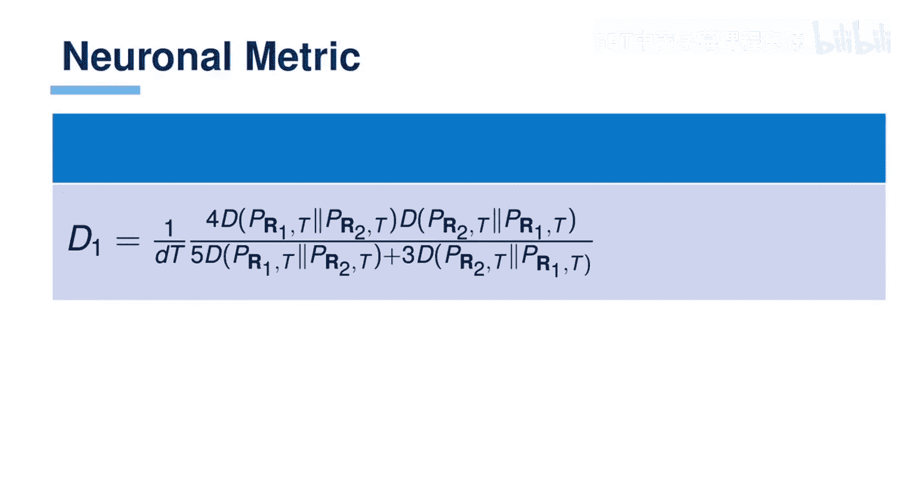
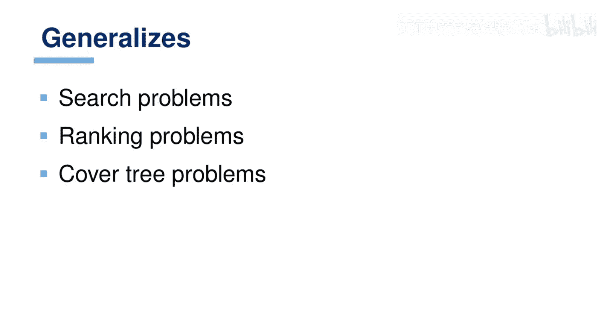

# 数据科学：时间中的决策｜课程1：主动序贯多重假设检验 🧠

在本节课中，我们将学习**主动序贯多重假设检验**。这是一种在数据按顺序出现时，通过主动选择行动来快速确定最佳假设的数学方法。我们将从一个图像搜索的实例出发，理解其核心思想、数学模型，并了解它如何应用于神经科学中的视觉搜索研究。

## 概述：从图像搜索到数学问题

我们从一个图像搜索的动机实例开始。核心问题是：**如何在一组图像中找到正确答案？** 换句话说，如何找到最能描述图像内容的假设？是使用模式匹配，还是某种搜索算法？在这个具体例子中，人脑的视觉系统会无意识地处理这个问题，本质上是从一组活跃的假设中进行选择。

这是一个普遍性问题：给定一组按顺序出现的数据（如图像），以及你可以对这些数据采取的一系列行动，**能否找到最优的行动集合，以最快地确定最符合数据的最佳假设？**

上一节我们介绍了问题的背景，本节中我们来看看其数学形式化描述。

## 问题形式化与核心概念

我们假设数据是序贯出现的。以眼动为例，可以想象你在离散的时间点（如每秒或每毫秒）将视线焦点从一个空间区域移动到另一个区域。这是一个非常普遍的问题。

1959年Turnoff的论文为此类问题奠定了基础，他探讨了当存在多个假设并能序贯采取行动时，如何优化搜索策略。他证明，在单次行动成本趋于零的极限情况下，我们可以在误差方面获得收敛性，即存在定义最佳策略的最优行动策略。

我们将重点讨论2012年Suarsan课题组的一篇论文，标题为《主动序贯假设检验及其在视觉搜索问题中的应用》。问题正是我们之前描述的：在左侧或右侧的一组六张图像中，有五张相同，一张不同（异常值）。假设检验的问题是：**你能找出那个异常值吗？**

例如，左侧图中异常值在右上角，右侧图中在左下角。你的系统多快能找到它？这取决于图案类型、间距、颜色等因素。

研究人员记录了猕猴视觉皮层神经元的放电活动。他们为每个细胞定义了基线放电频率，并测量了不同图案引起的放电频率差异。核心问题是：**能否从这些神经元的放电模式中，解读出假设检验的过程，从而理解是哪种图案？** 数学上，神经指标和行为指标高度相关。

### 数学符号与定义

以下是该问题的数学描述：

*   **假设 (Hypotheses)**： 用 `H_i` 表示，其中 `i` 从 `1` 到 `M`。在我们的例子中，`M = 6`，代表六个可能的异常位置。
*   **行动 (Actions)**： 用 `a` 表示，属于一个有限集合 `A`。在此例中，行动是注视视觉场中的六个不同区域。
*   **数据 (Data)**： 用 `X_n` 表示，是随时间步 `n` 递增的数据分布。
*   **概率密度函数 (PDF)**： 这是关键假设。对于每个假设 `i` 和每个行动 `a`，我们有一个概率密度函数 `Q_i^a`，用来描述在该行动下观测到数据的可能性。

### 信息度量与更新规则

我们可以定义信息比 `c_{i,j}`，来比较两个假设 `i` 和 `j` 在相同行动和数据下的差异。这可以简单地重写为对每个时间步数据对数似然比的求和。

这里我们引入一个有用的工具：**KL散度 (Kullback-Leibler Divergence)**。它是不对称的，但能帮助我们度量两个概率分布之间的差异。`D(Q_i^a || Q_j^a)` 表示在相同行动 `a` 下，比较假设 `i` 和 `j` 对应的分布，从而衡量我们从其中一个假设相对于另一个获得的信息量。

在该视觉搜索论文的具体应用中，他们使用了一个简单的贝叶斯序贯更新规则。以下是更新某个假设 `i` 概率的公式：

`P_{n+1}(H_i) = [P_n(H_i) * Q_i^{a_n}(x_n)] / [Σ_j (P_n(H_j) * Q_j^{a_n}(x_n))]`

本质上，这是在基于新数据（来自行动 `a_n` 的观测 `x_n`）更新后验信念。因为我们可以计算这个，所以可以设想寻找最优的行动集合。

### 策略与搜索建模

我们从前一步开始构建，对于给定的分布，我们将采取一系列步骤，最终定义一个**策略 (Policy)**。这个策略能在最短时间和最小成本下，告诉我们正确的假设（即图像中的异常值）。

我们可以将一系列行动计划视为这个策略，在 `N` 个时间步中，每个时间点我们可以选择停止并使用当前最佳假设，或者继续搜索。这就定义了我们的总搜索时间。

一个简单而有效的构建是：假设异常图像在六个位置出现的概率相等。我们可以估算出，如果只是简单地依次查看所有六个位置并能清晰区分，找到它所需时间的界限。但由于图像可能相似，可能需要多次查看才能以高概率正确识别异常值。

我们将此建模为随时间进行的搜索：每次只注视视觉场中的一个点。当你注视某个位置时，会获得神经元的放电频率（来自猕猴实验，但人类视觉皮层类似）。这些平均放电频率会根据该视觉场中的图案而变化。可以将其视为泊松过程。

由此，我们可以定义一个“神经度量”，论文中通过计算KL散度，将放电频率与时间进行比较，得到了之前展示的图表结果。

## 核心步骤总结

综上所述，要应用此方法，我们需要：

1.  **定义集合**： 明确数据 `X`、行动 `A` 和假设 `H_i`。
2.  **定义概率密度函数 (PDF)**： 为每个假设和行动对 `(H_i, a)` 定义 `Q_i^a`。这总结了在特定行动下观测到特定数据支持特定假设的概率。
3.  **计算信息差异**： 利用KL散度等工具，量化不同假设之间的可区分性。
4.  **序贯更新与决策**： 使用贝叶斯规则更新信念，并制定策略以决定下一步行动或何时停止。

## 总结与应用

本节课中，我们一起学习了**主动序贯多重假设检验**。我们从视觉搜索的实例出发，将其形式化为一个数学问题，涉及假设、行动、数据和概率分布。我们了解了如何使用KL散度度量信息，以及如何通过贝叶斯更新序贯地优化搜索策略。

这种方法泛化能力很强，适用于各种搜索问题、排序问题和分类问题。其核心思想始终是：**在序贯获得数据的过程中，通过智能地选择行动，以最快速度确定最可能的假设。**

希望这节课能帮助你更深入地理解这部分内容。