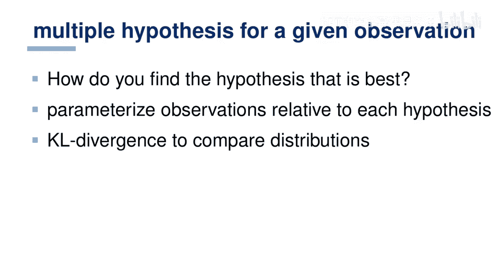
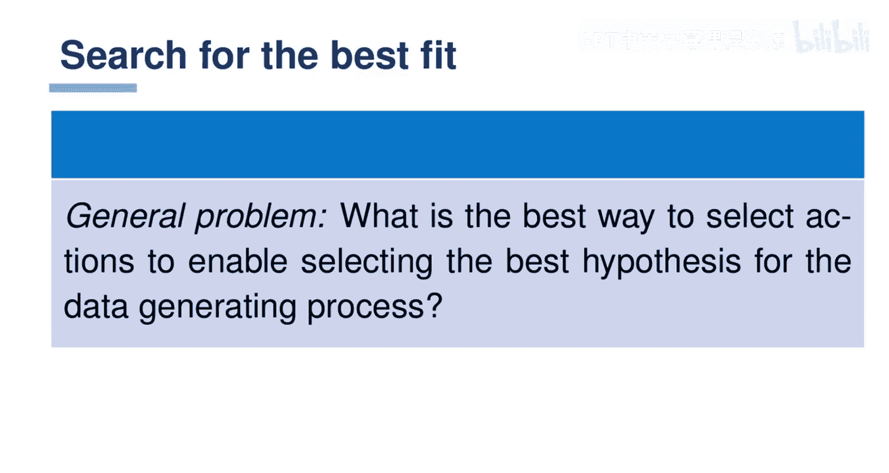
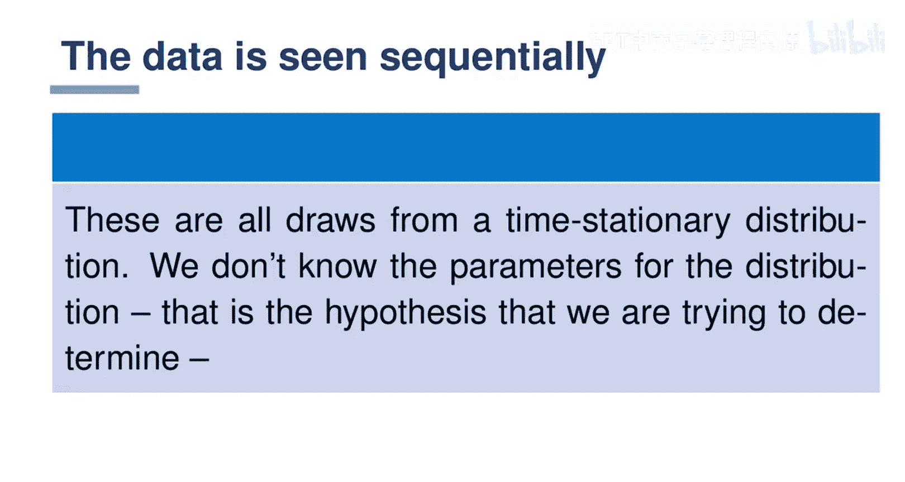
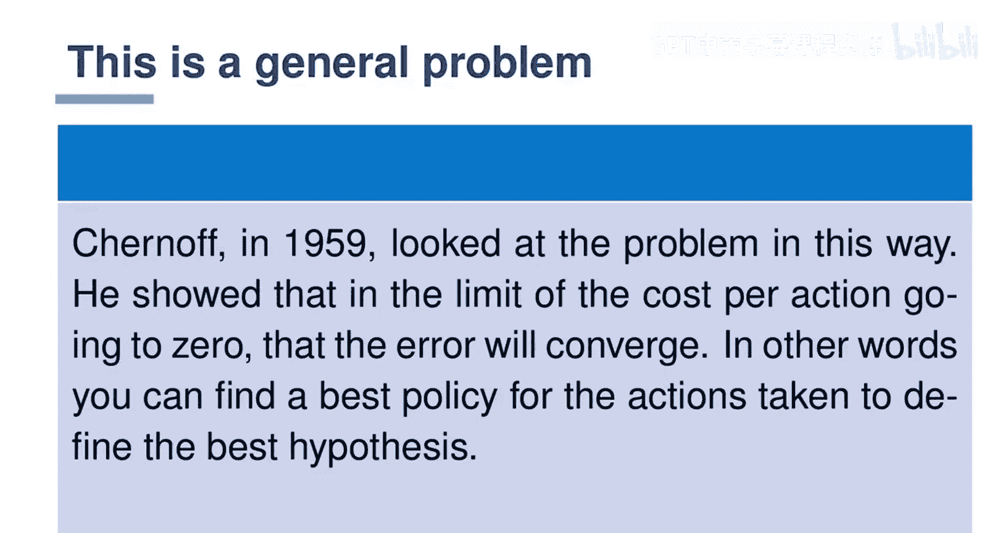
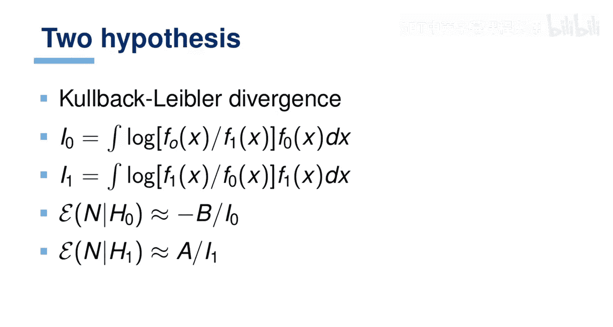
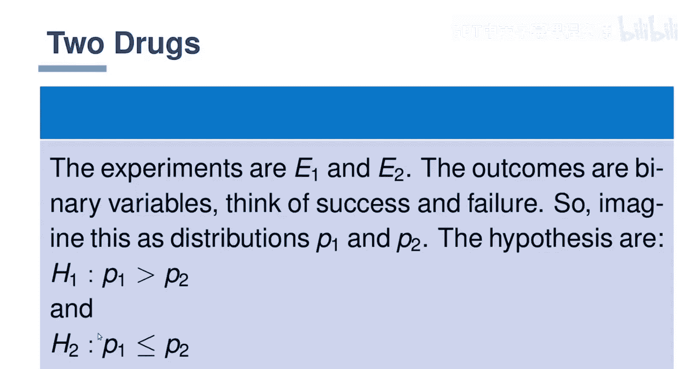
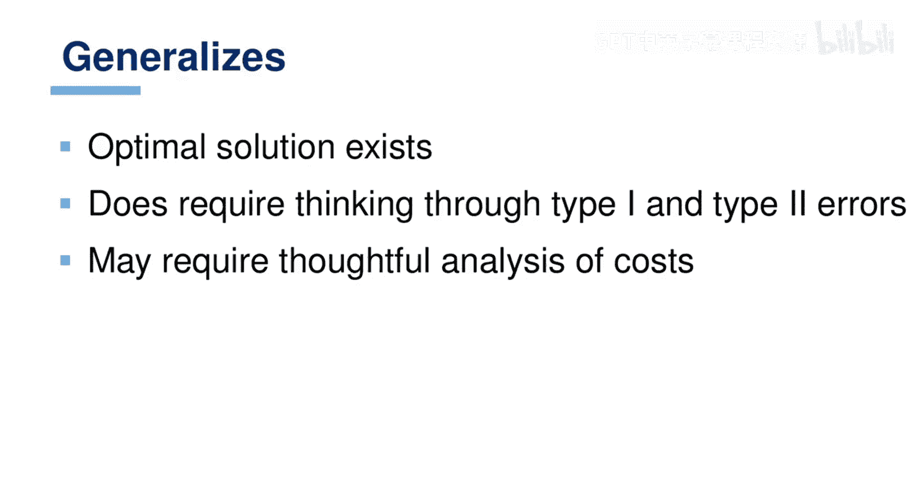

# 约翰霍普金斯大学《数据科学：时间中的决策｜Data Science Decisions in Time》中英字幕 p18 2_切尔诺夫1959年论文精要解析.zh_en -BV1NCuzzfEJa_p18-

We'll now talk about Turnoff's 1959 paper， another really outstanding paper。

 similar to the 1945 contribution。 It's really fundamental to what we're talking about in our making decisions in time using data effectively sequence of courses。

 So this paper was titled sequential design of experiments and it really is of another foundational paper。

 The idea is that we've got multiplepotheses for a given observation。

 how do we find the hypothesis that is the best one。

 the best encapsulates what we're seeing in the data。

 So imagine that we've got data that's stationary again， we' drawing it from a distribution。

 if it helps you think about the data generation process as being from a well definedfined parameterized the Pdf and that pdf you're drawing from you're taking your data poles from。

 And the question is what are the parameters that describe that Pf。

 What are the parameters behind that data generation process。 So again。

 these are parameterized observations that relative to each hypothesis。 And the other key here。

Is that we're using k divergence， called back divergence to compare the different distribution。

 So we're thinking about how these distributions by this divergence measure compare from one to another。

 So our general problem then is this idea of a search for the best fit， What's the best way。

 This is what drives ultimately asking the best way to select our actions， Because again。

 we're thinking about this as the active search to enable selecting the best hypothesis for that data generating process。

 How can we optimize this。 How do we go about thinking about it。

嗯。Again， as a reminder， our data is seen sequentially。

 these are all draws from as timetary distribution。

 other we're not thinking about a more challenging problem where the distributions change with time。

 We're not thinking about data where it's correlated in time。

 We're thinking about as I draws from timetary distribution。

 Now we don't know the parameters again for this distribution。 We know the set that they belong to。

 so we can define our set of hypotheses， but we don't know directly what is the data generation process。

 So that's the hypothesis that we're trying to define。

 We're trying to determine what is the best hypothesis for the data that we're generating。

 So in 1959， Choff really looked at this problem in a nice way。

 and it steps beyond well in a way that builds into a lot of contemporary research questions。

 Now he did show a mathematical result that's true in an interesting limit。

 like so many pure math results， it's fascinating， but doesn't immediately tell us how to do the algorithms or how to apply it to a particular problem。

 essentially what he did was to show that in the limit of the cost per action going to zero。

The error is going to converge so in other words， you can find the best policy for these actions and therefore the best hypotheses to define the best fit to the data。

 So what you want to be thinking about it is in the limit where the cost for each of our experiments essentially goes to zero there is an optimum there is a way to prove that we could converge to the error tolerance we want in a reasonable amount of time So mathematically this was this paper sequential sign of experiments at 1959 the ingredients you need to think about some little world are your tolerance for type1 and type 2 error。

 And again， these are traditional hypothesis testing flavors again。

 if anything I say here doesn't make sense， go to Wikipedia or your maybe undergraduate stats book and spend a little time reminding yourself about hypothesis testing and type 1 and type 2 error but essentially we're assuming you're comfortable with type 1 and type2 error and again。

 these are accepting incorrectly the hypothesis when it's actually false we're rejecting the hypothesis。

When it's actually true， there' are the type2 and type1 errors。 Now。

 the other ingredient here is the likelihood ratio test。 We encountered that within wall again。

 we're using it again in this course， and we're also using the co divergence sort the ingredients for turnoffs approach essentially we're asking the same thing as well did in 1845 as we've got sequential data coming towards us thinking streaming data and our contemporary language we can either continue to sample or we can stop if we're stopping it's because we're going to either accept or reject the hypothesis or think of this as H versus H1 alternate hypothesis maybe being H1。

 we're accepting or rejecting H0。 think of it as often called the null hypothesis。

 the beginning hypothesis。 So we've got H0 and H1 again H is often called the null hypothesis1。

 the alternate hypothesis and we want to either accept to reject H0 frequently， in fact。

 we we reject H0 as a reminder that's exciting because it means you found something and that would mean you're looking at H1 as the alternate hypothesis to explain。

The data。 So we're starting in this paper and terms paper again with just two to illustrate。

 And again， this happens very commonly in math。 you start with two， then maybe you do three。

 and then you say， okay， that generalizes similar here。

 we're starting with two or we're going to imagine that it generalizes beyond these two。

 So we're imagining parameters for our distributions。

 Think of them as single parameterized distributions theta is equal to theta or theta equal to theta 1 again。

 dramatically oversimplified but reasonable mathematically。

 If it helps you just think about these as binoml distributions with a single parameter。

 theta not and theta 1。 So then we can define our pdfs are density functions for these F of x。

 we're going to call f sub1 of x or f sub2 of x and these f sub 1 and f sub 2 again are the two different hypotheses H0 and h1 note the notation changes slightly here。

 we went from0 and1 to 1 and 2。 but we're still just thinking in terms of two hypotheses and the distributions now that define them。

 So then we can define S sub n。S sub n here now is our sum of the likelihood ratio test F1 over f0。

 So now we're back into the correct phrase F0 and F1 meaning our null and alternate hypothesis and we're just taking the log of the ratio of those So it's a sum as our data comes in and you can think about this as being ultimately a question about convergence of S sub n And so for those of you that had some prevalence6 before we've basically are addressing random sum of a random number random variables。

 but it's an a likelihood ratio test or taking this log of F1 over f0 we're taking a sum as sub n over that set。

 we're asking about what sort of convergence properties。

 we can define on a sub n in other words does it converge to something where we're sure that F1 is correct or that F0 is correct。

 how do we go about defining convergence towards a particular hypothesis that's ultimately what trooff is asking So going back to wall。

 effectively fact we've been define a and B which are depending on our type 1 and type2 errors。

 but they're basically aimed at whether we're going to stop。And either accept H or reject h。

 So we're going to reject H if our s sub n is greater than equal to a。

 we're going to accept h if s sub n is less than or equal to B。 So A and B。

 which are going to be functions ultimately of n are bounds that we can use to decide whether to continue sampling or to stop sampling Now the thing that tro also asks and it's a nice question and especially these days。

 something to very much take account of which is that there may be cost associated with these observation。

 So if you imagine each experiment being nontrivial to do。

 there may very well be a cost associated with each of these experimental collections of data。

 So as x sub I whether that's the data is coming in think about it how expensive or not it is to collect and that has to be folded in along with the type 1 and type 2 error So in generaloff's formulation then we're going to say R 0 is the error due to rejecting h0 and1 is there due to accepting H1 when it is false So01 again。

Notation and we can think now of the risk associated with these in terms of errors。

 we're going to write capital r0 as Rl times alpha。

 So this will be risk associated with the null hypothesis and nothing we've got a cost C times R error given a set n and according to H and similarly for R1 R1 times beta plus a cost associated with our error that is again N conditional on H1。

 So then we can think about alpha and beta as been probabilities or error types。

 this is really exactly what Walt was proposing。 a prior we've got some probability that we believe is associated with an alternate hypothesis H1。

 So effectively what we're doing is we're trying to minimize1 minus little W which is our a priori estimate W associated with R1。

 So W R1 relative to1 minus0。 So we're associated risk associated with R null and alternate hypothesistheses。

 Now in turnoffs way of thinking about it。If our cost approaches0。

 then we can write for alpha and beta in terms of A and B。

 so we've got nice clear expressions then that we can solve for A and B in terms of our type 1 and type 2 error but we can go beyond this we can think in terms of ourl divergence we can write I0 and I1 and again these are asymmetric go back depends on where I'm going so to speak with the density f0 or the density f1 that I'm integrating over taking again the log like the likely ratio test。

 the log of f0 over F1 again like the null versus the alternate those densities but I'm integrating I'm looking at it considering it relative to f0 the same relative to f1 for I1。

 so I've got two different information measures for how these densities compare then I can do my cost and think about this relative to I0 and I can say this cost really the error that's going to be balanced with the cost for n given h minus B approximately over I0 and a over I1 so again we've got our bounds。

 A and B and now we've got our information。Cont and this is a really nice way to see into it。

 So we can quickly generalize this to something like two drugs。

 Let's say we've got experiments E1 and E2。 Now it's much more clinical and maybe not just a visual test。

 We're trying to understand which drug is better。 So we've got different outcomes。

 now we're doing not0 and1 but1 and 2。 So don't be confused on the notation。

 and the outcomes are binary variables。 we're just think of this basically a success or failure。

 Again， very simplified makes the math easier reality， obviously maybe much much more difficult。

 but imagine it's either success or failure。 So now we've got distributions P1 and P2 H1 P1 greater than P2 H2 P1 less than or equal to P2。

 So these are hypothesis we're trying to define we're trying to understand through our experiments whether the drug is something that should be done or not。

 So in Chop's way of thinking about it， which is， I think a really nice way of phrasing it。

 We can define a maximum likely to estim for our values of theta。

 And this is a very common statistical framework for thinking it and define your maximum likelihood。

 ultimately， all you're doing is。

M1 successes relative to the total， M2 successes relative to the total。

 these would be drugs number one given， drugs number two given。

 so these are MLLE estimate maximumim estimates for P1 and for P2， so the carrot here the hat。

Means that we've made a vector associated with our maximum likelihood estimates for each drug。

 So we can think about this as our null type is that our maximum likelihood is it correct。

 And ultimately what turnoff is going to argue is that we can suggest that in the limit of enough events。

 we can trust the maximum likely estimator in our sequential sampling framework。

 So then the framework in turn off is we next think about the kind of alternate hypothesis。

 what's the next best within that alternate hypothesis framework。

 and what he would argue is we can do a weighted average over the drugs in the alternate hypothesis。

 again， it's not the same as the maximum likelihood estimator。

 but it's very similar So we're going to call that other one tilda。

 So now we've got our information content in our maximum likelihood estimator。

 we can think of as the null our theta sub n hat， we can think of that as the alternate。

 we've got our experiments。 again， we've kind of set of them and so then we can just define our information entropy。

 the log of the ratio of the g2 densities theta sub n hat and theta of n squiggle and then we're going to integrate。

Relative to theta sub n hat， there should be a common layer。

 and then we're going to integrate over in principle。 but it's a sum。

 So we're doing it discrete But regardless the way you want to think about this is that we're doing our information content and we're doing it in this instance relative to our theta sub n hat or likely estimator。

 So now we can define H1 say and this is the full generalization from omega1 set H2 is theta from omega2 set these would be disjoin sets。

 obviously， and so we're thinking about these as do we think of this almost less again like a null versus an alternate we're thinking about these two different sets but it could be H1 day。

 it could be a whole set of different hypotheses。 in each case we're thinking we've got a k divergence to measure all the observations one relative to the other And eventually what we're going to want is to know whether we stop or not。

 But in the limit and this is what really want to emphasize in this paper is that in the limit if we disregard the stopping room。

 we're just thinking about going indefinitely we're not thinking about。Cost。

 then the argument he makes is basically this the of n hat estimator goes towards the null they not with probability 1。

 in other words there's a convergence property。 and this is classic math way of thinking about it。

 I've got a capital I've got a be greater than0 such that my probability that some stopping time is defined that's greater than n is bounded by k times e minus b times n。

 So B is greater than0 K is some capital constant。 We're essentially saying there's some probability that we will define a stopping time。

 in the words that our sequential test will converge and in fact it's going to converge to our max un estimator。

 So that's independent cost， but it's nice， very very nice that there's a limit that we can define that limit and turn off again prove that that it exists。

 So this generalizes quickly again it suggested as an optimal solution to our sequential hypothesis testing problem It does require that we think through our type 1 and type 2 errors。

 we've got to decide where we're comfortable with putting those error bounds。

 and costs are kind of likely pencil D so to speak and。

59 paper in many more contemporary papers and especially in any real application。

 it would be really important to think about the costs associated with collecting this data。

 so defining your best estimator and defining your actions in order to optimally converge that fact that there's a solution is great。

 but you'd still want to see if you couldn't find it still more quickly。

 but again 1959 paper it's great that this does conver than it does give a nice really satisfying answer to these sequential hypothesis testing problems so I hope I've given you a sense now of how sequential hypothesis testing works and throughout this second specialization course will spend more time really I hope given you a sense of how these sorts of problems can be addressed Thank you。

