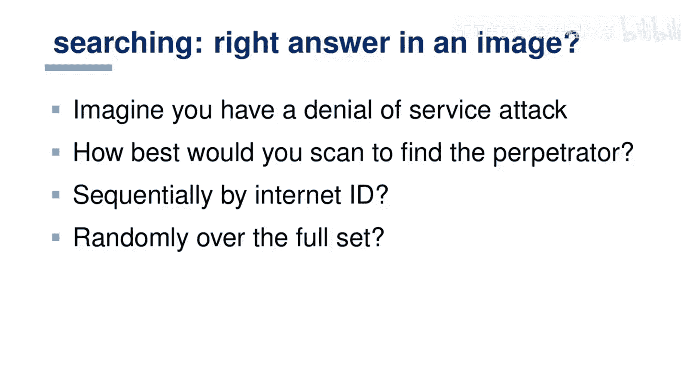
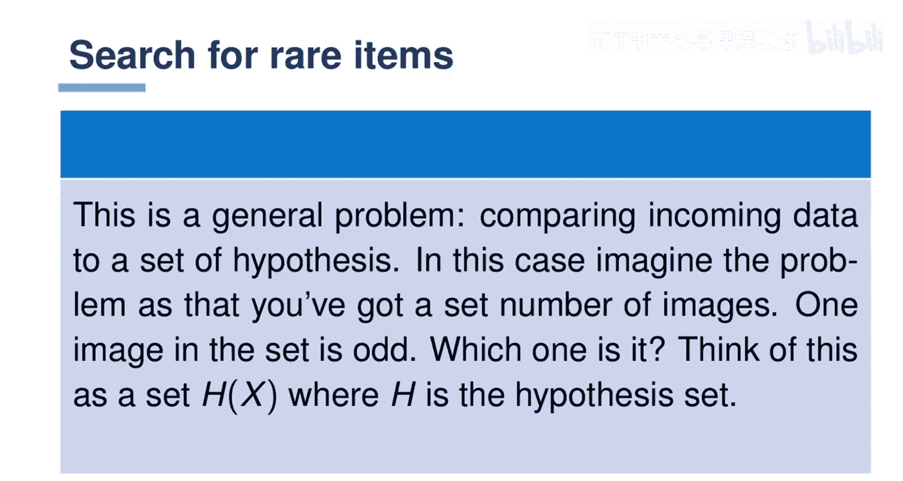
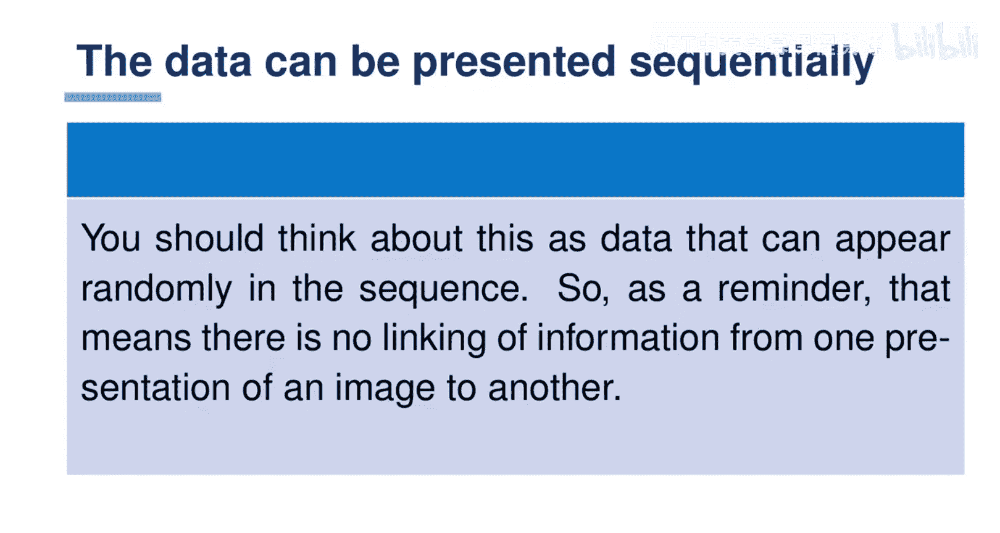
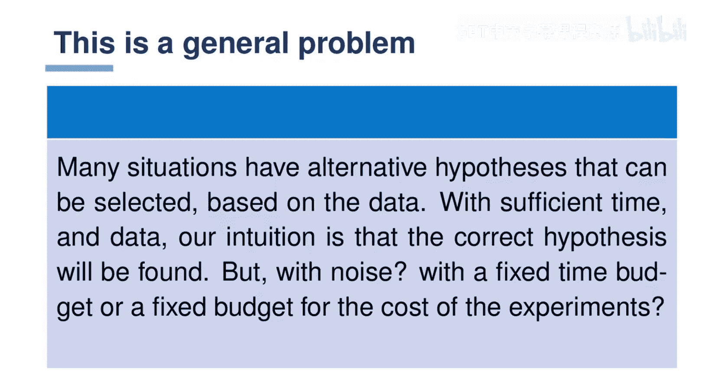
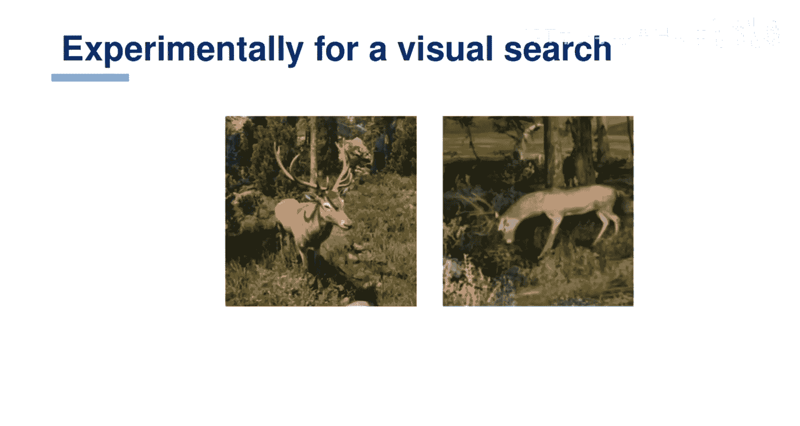
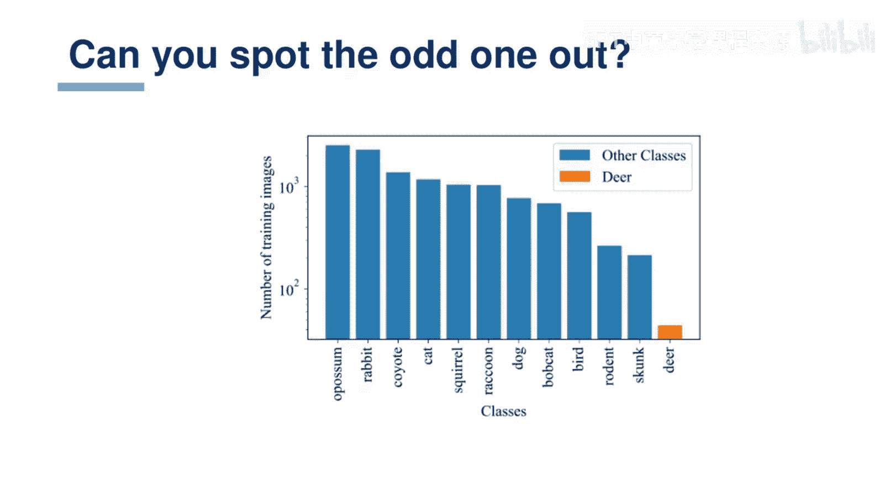
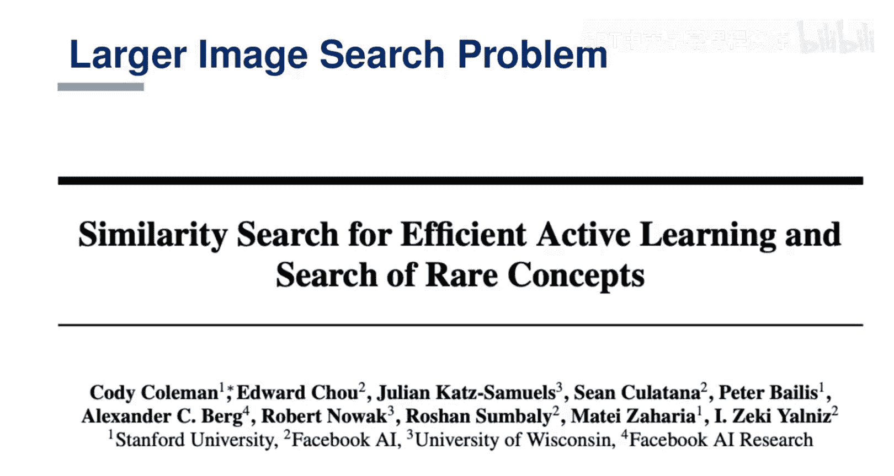
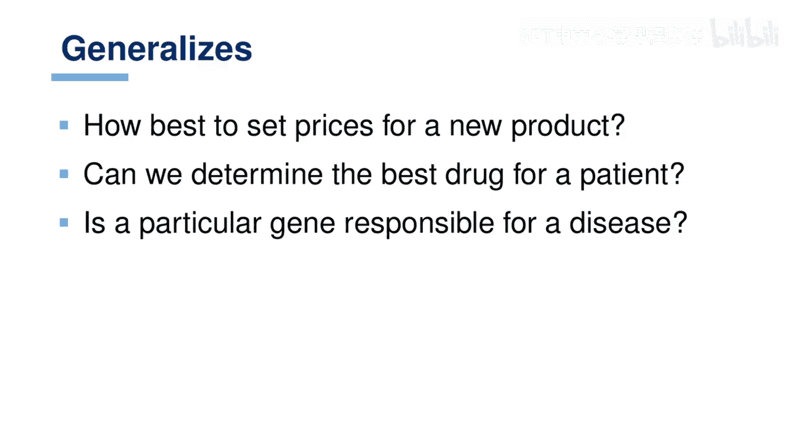

# 约翰霍普金斯大学《数据科学：时间中的决策｜Data Science Decisions in Time》中英字幕 p19 3_大规模图像库中的稀有图像检索技术.zh_en -BV1NCuzzfEJa_p19-

Well， I now think again about image search and the consequences of trying to find a rare image or a rare event。

One way of thinking about this and maybe an entry into our second week in our second Coursera course here is imagine you've got a denial service attack。

 So're your internet provider and you're trying to find where it's coming from How best would you scan to find that。

 How would you go about searching within say tens of thousands of potential computers that are doing denial service which one is the culprit。

 maybe youd look sequentially by Internet I， maybe look randomly over the full set。

 these would be potentially very， very time consuming So is there a faster way to search and this is the whole idea that we're exploring within turnoff starting point。

 the 1959 paper how do we look over a set of hypotheses and how do ultimately do we search over a say of images or a set of different IP addresses in order to find where something is what's the best way to do that So this idea of a search for a very image's again a very general problem。

You seem to put up this particular slide before， but essentially we're doing the same thing many。

 many different ways。 we've got incoming data。 we're comparing to a set of hypotheses and we want to imagine that we've got an answer。

 So maybe in this case we've got a particular set of images and one is odd odd in some particular way that we want to explore maybe it's even like a military type setting maybe you're trying to identify where a tank is or something like that。

 how do you find that odd image， how do you discover which one it is So think about as like a set H of x where Hs our hypothesis set and think again about this as being sequential not necessarily time ordered again。

 and I want to continue to underline that that what we're thinking about is draws from a set of I addresss from a generating function and there's a linkage set of information from one presentation of image to another or one IP address to another you're simply exploring this large space and again this is a very general problem There are many。

 many settings that。

Have similar sorts of questions that we're trying to ask。

 and we imagine when we do these that in any of these settings that there is some correct hypothesis and given enough time and enough data we'll eventually find it。

 But if we've got noise if we've got a fixed time budget or fixed budget for the cost of our experiments。

 How do we optimize this。 how do we find this most readily is there a better way to go about doing this。

 So another might of any example then is visual search。

 So last week we talked about relatively simple experiments visually。

 we have different patterns we controlled the patterns。

 we were looking in terms of say visual cortex and monkey versus human behavior time。

 Now imagine you're a wildlife biologist and you're trying to count all the different kinds of animals that you see exploring a particular region。

 So your trap camera will say has some noise in terms of how quickly it can trigger or not the light levels may be different in the background。

 the whether it's not always easy to identify exactly what's in that image that But the other thing that happens。

 and this is from USgs is that you may have some animals you're especially curious about， say dear。

In this case and youve got many， many other examples of other animals， say aposta rabbit， coyote。

 cat， squirrel， raccoon， etc cetera。 and deer is relatively small from where I've explored these sorts of things deers are much more common than other animals。

 So you know this may vary obviously depending upon where you're looking how your cameras are set out。

 but imagine you've got a rare animal it may or may not be deer it maybe some other one how would you go about exploring for that odd one out for that rare animal。

 And this generalizes very quickly。 So the main thing I wanted to explore with you in this week is this idea of looking at this over a very much larger data set So this is one with a set of people from Stanford。

 Facebook， Wisconsin。

working together to look to see whether they could search for rare concepts across a very。

 very large library and I'll be putting this algorithm up a couple times but they're comparing something like a baseline approach to what they're calling their seals approach which is basically this sequential optimization type algorithm looking for rare events。

 So essentially in each case we've got unlabelled data we've got some seedat that's labeled。

 we've got some sort of feature extractor on that and we've got a selection strategy which I'll go over in a moment we've got a batch size and sort of budget for labeling and then in each case we're defining an L and a P functions note that they're essentially the same in each case and they're repeating over our training but in our seals approach。

 we're really trying to find something that does this more quickly that's looking for rare events。

 and this general approach is something that we want you to be learning from this week and potentially maybe even coding yourself and plain with。

 So they looked in terms of imagenet open images and then 10 billion proprietary。

Images， they looked with an embedding model， which is resnet 50 in each case。

 They looked with different numbers of concepts， but the number of examples gets really quite quite big。

 especially this 10 billion one here and looking for rare events again。

 you're looking for something that's relatively small number of images within this image set the function that they use they looked at three but I'm just going to focus now on this max entropy1 because this is the sort of thing we've been talking about it。

 So P log P so y hat conditional on z and a sub R and minus again on that and then the sum over all the y hats this max entropy method is the sort of thing that we could then use in our selection strategy and this is really what ultimately will help to make this efficient is this argm on that done in a particular way in order to optimize our rare search and there'll be more on this as we got further in how to do this but this is really a motivating example for you at this point So again in a setting where dear is the rare one。

We're trying to optimize our search。 We're trying to find as quickly as possible those rare animals in that set。

 So obviously this will depend on the feature set。 how we cope about doing this。

 You need a certain number of seed labels， and then you can either look locally。

 which is what this paper was doing or you can think in terms of tree structure。

 which is we're going to be covering next or you can think in terms of a cart classification or regression tree type algorithm where you're trying to do the search。

 ideally we want this to be sublinear， we want it to be fast enough that it really does speed things up。

 it does depend obviously on the scale。 So in this motivating example where they're looking say 10 billion images。

 if you look try to look over all them， say linearly I mean you would just really get destroyed。

 so to speak it would just take way too long。 So this general is very much how to set prices for a new product can we determine best drug for a patient iss a particular gene responsible for disease。

 These are all generalizations of the same sort of problem that we're thinking about here。

 So I hope I've helped you to see into our second week in terms of class of problems that we're going to be dealing with。

Thank you。