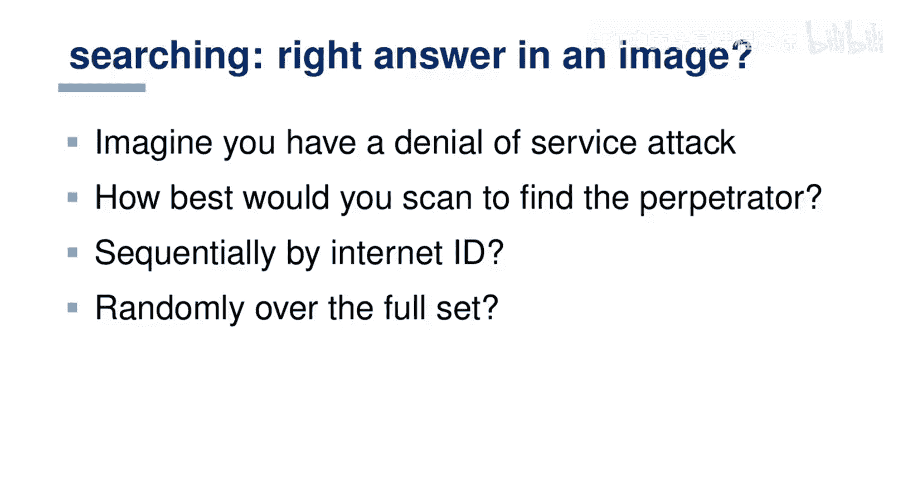
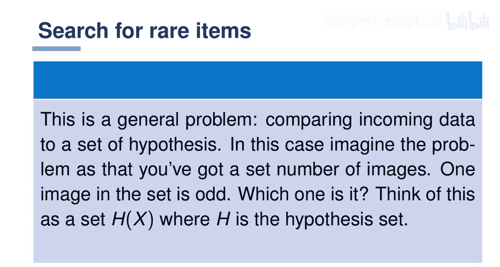
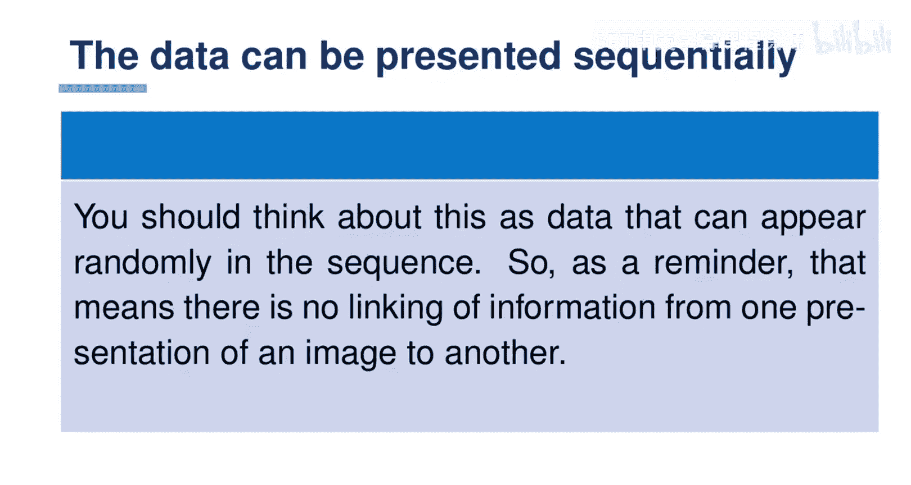
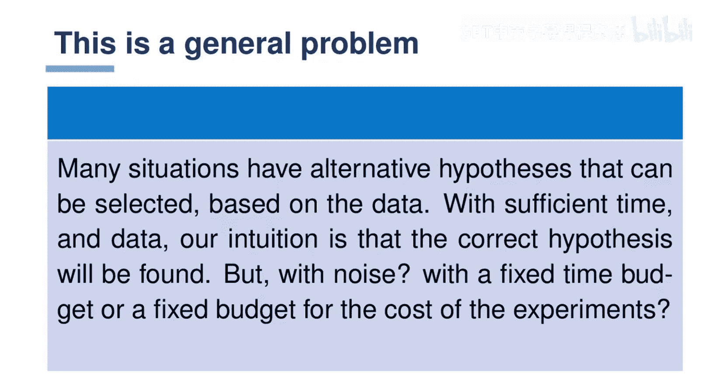
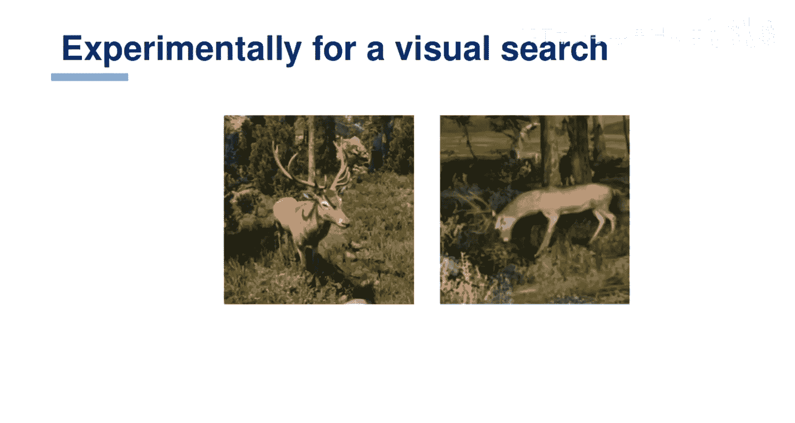
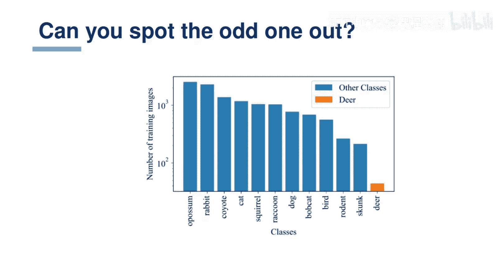
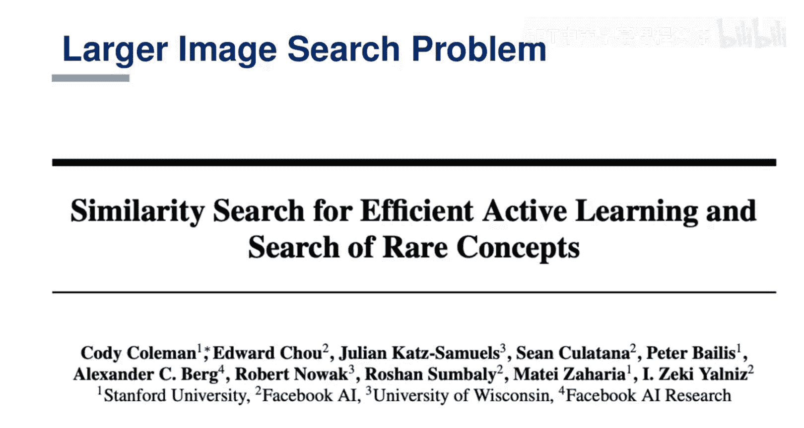
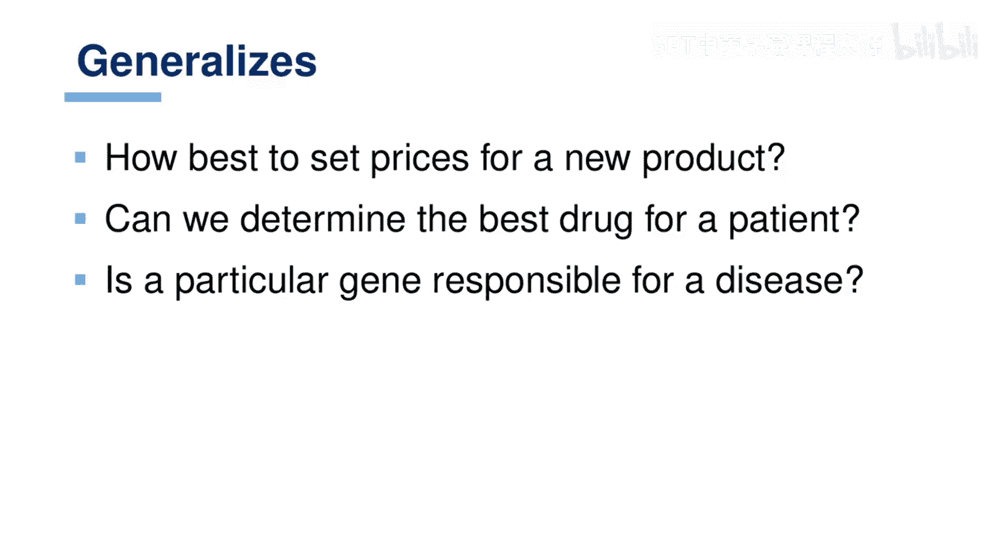

# 数据科学：时间中的决策｜2：大规模图像库中的稀有图像检索技术 🖼️

在本节课中，我们将要学习如何在大规模数据集中高效地搜索稀有图像或罕见事件。这是一个普遍存在的问题，例如在网络安全中定位攻击源，或在生态学中识别稀有动物。我们将探讨一种名为“顺序优化”的算法思想，它能显著提升搜索效率，避免线性扫描带来的巨大时间成本。

---

上一节我们介绍了稀有图像检索问题的普遍性。本节中，我们来看看如何将这个问题形式化。

我们可以将搜索过程视为在一组假设 `H` 中进行。`H` 代表我们的假设集合，例如所有可能的图像或IP地址。我们的目标是找到其中那个“正确”的假设（例如，包含坦克的图片或发起攻击的IP）。

这个过程本质上是顺序的。数据从一个生成函数中产生，并且不同数据点（如图像或IP地址）之间可能存在信息关联。我们正是在这个庞大的空间中探索。

---

理解了问题形式化后，我们来看一些具体的应用场景。以下是几个需要高效搜索稀有事件的例子：

*   **网络安全**：互联网服务提供商试图从上万个潜在计算机中找出发起拒绝服务攻击的源头。
*   **生态学研究**：野生动物学家通过陷阱相机拍摄的海量图像，试图找出其中罕见的动物（如鹿）。
*   **医学研究**：确定对患者最有效的药物，或寻找导致疾病的特定基因。
*   **商业决策**：为新商品设定最佳价格。

所有这些场景都共享同一个核心挑战：如何在有限的时间或实验成本预算内，从海量可能性中最优地找到目标。

---

看过了应用场景，我们进入核心部分：一种针对稀有概念搜索的优化算法。

一项由斯坦福大学、Facebook和威斯康星大学的研究者进行的工作，旨在从超大规模图像库中搜索稀有概念。他们比较了基线方法和一种名为SEALS（顺序优化）的算法。

该算法的基本流程如下：
1.  我们拥有**未标记的数据**和少量已标记的**种子数据**。
2.  使用一个**特征提取器**（如ResNet-50模型）处理数据。
3.  采用一种**选择策略**来挑选接下来需要标记的数据批次。
4.  在给定的**标记预算**内重复此过程。

SEALS算法的关键在于其**选择策略**，它旨在加速对稀有事件的发现。研究者使用了基于**最大熵**的方法来指导搜索。其核心公式如下：

**选择策略 = argmax [ - Σ ( P(y_hat | z) * log P(y_hat | z) ) ]**

其中，`P(y_hat | z)` 是模型对数据点 `z` 的预测概率分布。这个公式促使算法去选择那些模型最“不确定”或预测熵最高的数据点进行标记，这在寻找罕见样本时通常更有效。

---

最后，我们来总结一下实现高效搜索的关键。算法的性能取决于多个因素：

*   **特征集的质量**：特征提取器能否有效区分不同类别。
*   **种子标签的数量**：初始已标记数据的多少。
*   **搜索策略**：除了上述基于熵的方法，还可以考虑局部搜索、树形结构（如分类回归树CART）等策略。

理想情况下，我们希望搜索复杂度是**亚线性**的，即远快于检查每一个数据点的线性扫描。在处理像**100亿张图像**这样的规模时，线性方法是不可行的。顺序优化算法为此类“大海捞针”的问题提供了可行的解决方案。

---

本节课中我们一起学习了大规模数据集中稀有图像检索的挑战与解决方案。我们首先将问题形式化为在假设集合中的顺序搜索，然后列举了其在网络安全、生态学等领域的广泛应用。核心部分介绍了一种基于顺序优化和最大熵选择策略的SEALS算法，它能高效地指导搜索过程，以亚线性的速度定位稀有目标。理解这一框架，是处理海量数据中罕见事件检测问题的重要基础。