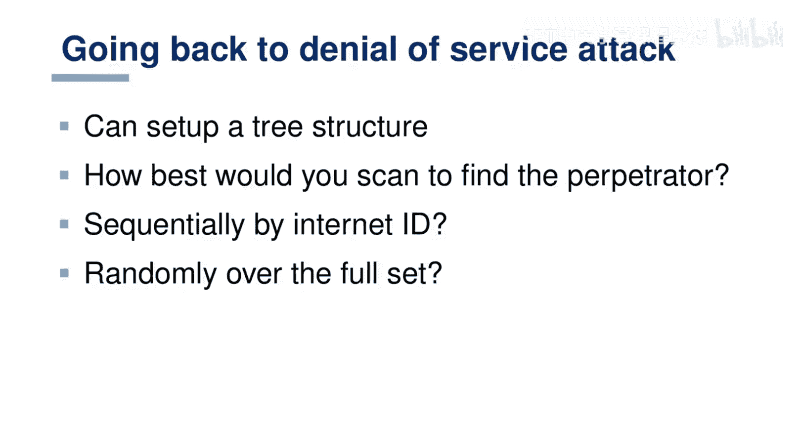
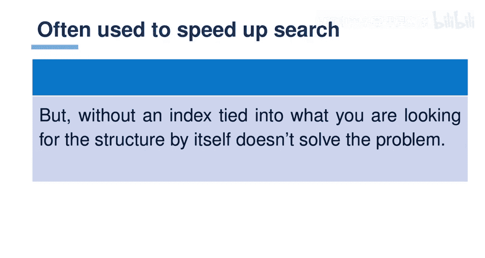
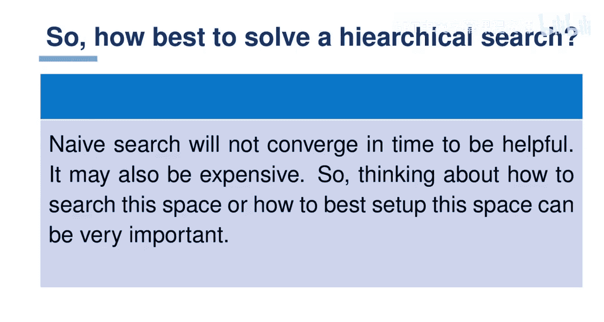
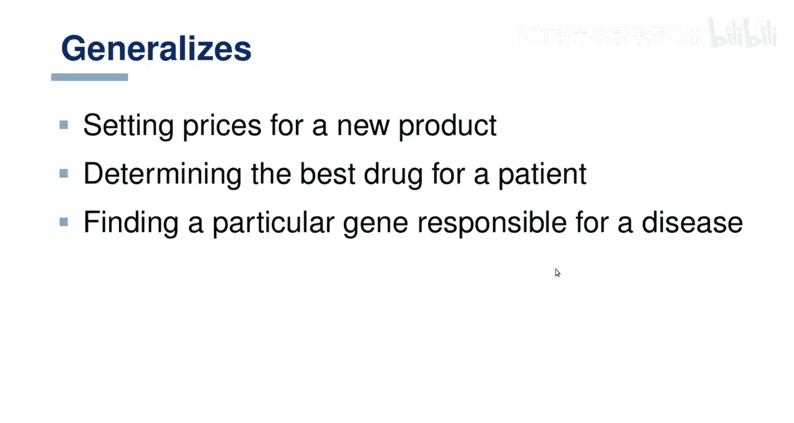

# 约翰霍普金斯大学《数据科学：时间中的决策｜Data Science Decisions in Time》中英字幕 p20 4_构建二叉树的随机游走高效探索算法.zh_en -BV1NCuzzfEJa_p20-

We'll not talk about how to search a hierarchical structure for a rare hypotheses again。

 the same concept turn off 1959 paper， but now we're talking about information directed random walks。

 So imagine I've got a tree structure fairly easy to set up when we get to our next paper next idea this week we'll be talking about how you can even optimize sending up a tree structure。

 but imagine you've just simply set up a binary tree structure and now you've got a dial service attack How could you imagine finding the note in that。

 this is exactly the sort of problem that we've been talking about but now and the context of。

A really important problem in security to out service attack。How would you scan this。

 How would you find that perpetrator You could obviously do it sequentially by internet ID。

 you could do it by randomly over the full set These are not necessarily going to very quick in terms of finding it so if you've got a rarevan even if you've got a tree structure if you'd have the index necessarily set up on exactly what you want it's not so quick or easy to figure out how to go about doing that So the tree structure again itself is fairly easy to set up。

 you can always put the data into a binary tree， in other words。

 all you need to do is define the criteria for the split points and you could set up this kind of a tree structure so you could do it just numerically for example by IP address and you would have a very quick binary tree set up but then unless you were searching on that IP number that data structure by itself doesn't necessarily solve the problem it does make it much easier to search in many wayss and that's obviously why we would often set up a tree structure but again you need an index into the thing you're looking for for that to be a help and this index itself obviously。

could be time dependent so for example， to have service。

 you may have something that's creating a real problem at one point in time。

 but it's not necessarily by itself always a problem so you wouldn't necessarily be able to index it out so you've got to search using the tree structure and the question is how do I go about doing that na youiveve search again we're going to assume that it would eventually converge but it could be very expensive so we want to think about a way to do this that's effective and what's nice about thinking how to solve this is that we many may many have many problems that are hierarchical when we've got to think about how to solve them within some sort of a hierarchical type setting so this sets up this paper which I think does a really interesting idea exploration on how to do a random walk with information so effectively what you can imagine doing it is that each node as you're going down a tree structure。

Youll ask a ternary search type question and I'll show this in a moment from one of their figures。

 But essentially what you do is at each point in the binary tree you're asking。

 do I keep going down go back up。 and this is very similar again to while。

 very similar to turn off in the sense that we're asking questions on a tree structure Now we're assuming we've got information again similar to turn off 1959 paper where're assuming of information available at all node。

 So at each point， imagine where I've got daughter notes coming down。

 I still have information present。 And that's seen in this figure here。

 which which is again from their paper， that's what we're talking about。

 imagine I've got one node down here， these are the leaf node at the very bottom。

 This is the zeroth level。 I've got one node here。 that's my danger note。

 that's my one that's maybe generating the denial service type of text。

 I want to find this as quickly as possible because I want to eventually stopped them or isolate them All of these other ones don't have that information So we can think of these f zeros as being in a distribution that is reflecting normal traffic whereas this distribution。

G0 reflects a very highserv type processing going on so if we start up here at our root in our node。

 then we are imagining that we see all the information on our do node so at this point at this L equal 3 we've not necessarily seen anything that tells us that there is a problem but we get down to either this side or this side we've got a difference on this side versus this side because on this side these poor daughter nodes all have f0 meaning they're kind of normal terms of the distribution of traffic that we see on this side we have one that is much higher so even at this point in our hierarchy we're imagining that we can see so if we do a query type really a hypothesis type test and a turnoff type sense on this node we ask do we go back up do we go to this side or do we to this side if we've set up our query in the right way we would clearly want to go this way so we would randomly without you know information we start here we're randomly walk a biased wall。

We're more likely to go to this side to this side even at this point， because we're seeing this。

 we get down here， we're more likely to go this side than to this side because we say evidence of this we get down here。

 we're more likely to go here because we save into this so at each node we're asking a ternary branching question and that turn branching question it's enabling us to very rapidly traverse down this binary structured tree and again it's splitting the data at each point but the splits here are not based on these functions they're based on something like the internet addresses so we can think in terms of more mathematical formulation we can think in terms of our probability and our quality on that has been based on a prior on our am hypotheses and effectively then a probability and expectation and these are conditioning on each of the hyposes that we're testing so effectively what we're doing is then we're doing a sum of the probability this is our gamma which I'll put up in a moment but we're doing a probability test over our effective policy that is being。

Into how we select where we're going to walk。 So effectively。

 what we're doing then is we're going to similar to tru。

 we're going to try and optimize our cost this， you can think of this cost or risk。

 our probability plus C times Q。 You can think of this as our estimated probability and our。

Cost estimator on in turn off， we converged on this， our long termm error。

 but in this particular kind of random walk， we can think about it。

 this is being related to our cost for our search and our probability， the error at each point。

 we can think of this almost like a type1 type2 error。

 our probability that we can correctly identify the right way to walk。

 So obviously we're trying to optimize on this we' R star inum again。

 think of the best in versus arenum the lowest is the in on that set。 So our in gamma or on gamma。

 So we're trying to optimize our walk in our information in random walk and clear that our star this one right here。

 the best one we can think for any particular one， we're always going be less than that。 So goes to0。

 we can think that there's a limit there that goes to1 So if we're thinking it began about our tree and the way that we're stepping on it As I said a minute ago。

 but now' now we've got the arrows on it。 This is effectively just simply attorney like decision question。

At each point in this binary structured tree， do I go back up do I go to the left or do I go to the right and again we're imagining that this node is seen information down in these dos so this side should be biased because of the fact that we've got G0 in it this one would be less strong because we don't have a G0 in it so effectively this kind of a tree search is based on the same idea that we've been dealing with with Walt and with turnoff which are these likelihood ratio tests so we're looking at G0 during F0 we can imagine doing a series of these tests over time but this likelihood ratio test relative to these distribution functions we're collected in this maybe if is c into it。

 this idea of maybe counts at these nodes like a denial N service type count G0 would be much higher than F0 and so we're counting again our comparisons and we're doing this over time so this likelihood ratio test we can then think of as being throughout the tree so we're going from one to K of L we're thinking about integrating that information。

the tree and what that means then is that we've got the ability to split this tree at each point in our testing so we might bias our walks into this side relative to this side then we've gone here。

 we're going to bias to this side relative to this side so at each point we're splitting the tree so it's again an information generated random walk where in each case we're moving down the tree and what's nice is this going be generalized to more than one situation。

 I mean maybe I've got a g zero type node denial service type node spread out in in the leaves we can still do the same thing。

 we can show that that will converge so these are then using ideas from Charles 1959 paper that uses aggregate information from all these sub nodes and it can handle all these single or multiple rare events and this generalizes very quickly this is being related to setting prices for new products or the best drug for a patient or we're finding a particular gene responsible for disease All of these are essentially walking down a hierarchy so we we could think about some。

sortrt of a product hierarchy or a drug hierarchy or gene hierarchy and we could walk down that So this idea again of moving down a structure where I might have multiple rare events even is something that's very powerful it generalizes very quickly and again it's all defined from the 1959 paper it all grows from the 1959 paper so I hope I've helped you see a little bit into this idea of an information directed randomham Walk and how to explore a hierarchy Thank you。

