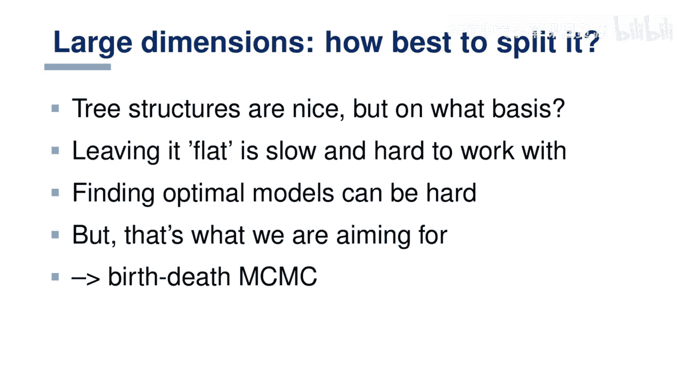
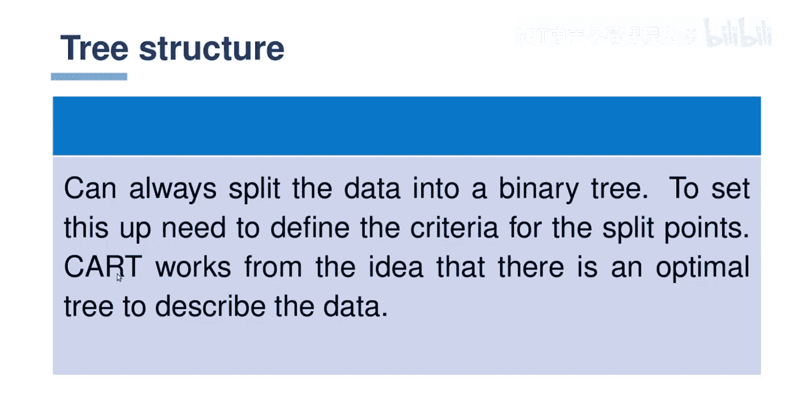
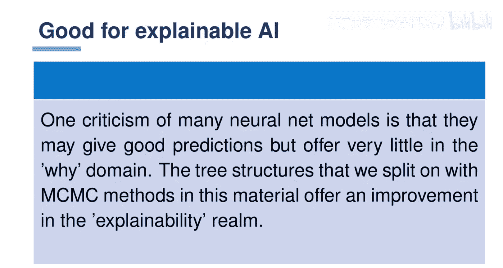
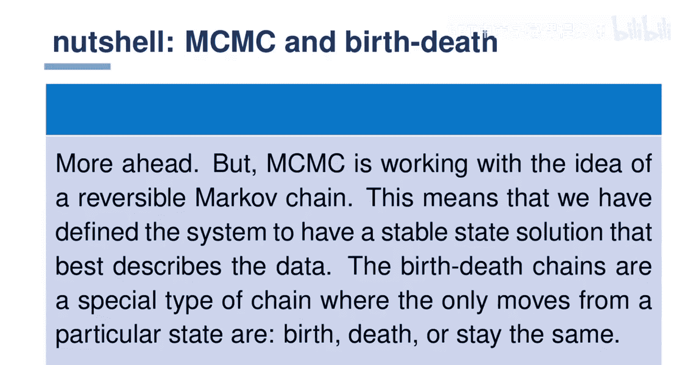
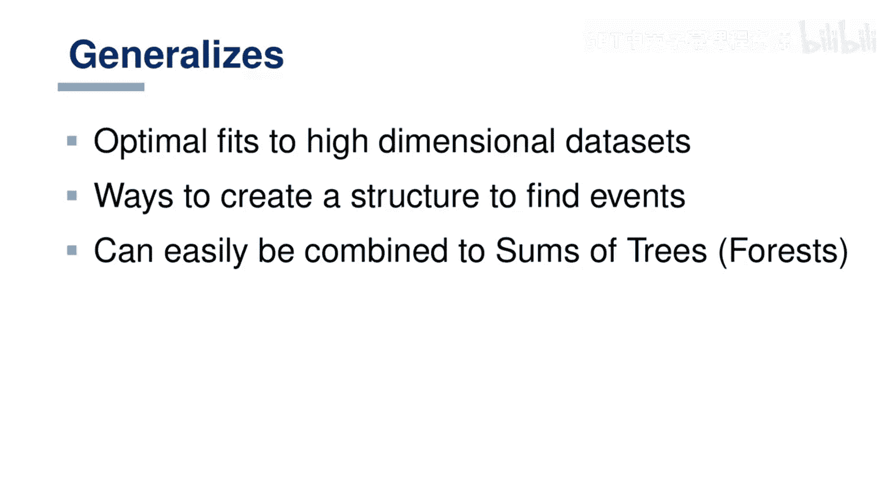

# 约翰霍普金斯大学《数据科学：时间中的决策｜Data Science Decisions in Time》中英字幕 p21 5_基于MCMC的优化可解释树搜索.zh_en -BV1NCuzzfEJa_p21-

We'll now talk about what I think is a very nice ad into what we've been talking on this week。

 And that is， how do we find the best Cartesian regression tree or cart Ct for a large dimensional data set。

 You can think of this is how to walk along birth death chain。 and this is a MCMC procedure。

 I think you'll enjoy this。 I hope so anyway。 So large dimensions。

 not so easy in terms of many aspects of data， but very real world。 Many， many systems are， in fact。

 large dimensions， often， in fact， many mediumsized data sets are set up with large dimensions。

 And this is then a real problem。 In other words， how do we best interpret it。

 One way of approaching it are these cart Cartesian regression trees。

 and the problem with this is how do you split it， how do you define where to make the tree structure。

 Now you saw tree structure in terms of our binary structure tree。

 but those splits were somewhat arbitrary。 those were just split。

 say for convenience in terms of the data structure， you can always make them they're always nice。

 They're was bound。But the real power in some ways is this splitting on some aspect of the data。

 some feature set of the data that tells you something about the data。 that makes it explainable。

 but doing that is not always at all straightforward。 So if you leave it flat。

 which is always an option， meaning you don't try and set up some sographical model。

 things can be slower。 they can be much harder to work with。

 So there's many advantages of finding these structures。 But finding these structures is just heart。

 there's no easy route that people defined for doing it。

 So these MCMC chains that we're going to be talking about in this one。

 otherwise known as birth death， Markov Chamon Carlow。

 I think are really nice way to address this kind of a question。

 So within that idea of a tree structure， again， you can always split the data in some sort of a binary tree。

 All you do is to simply come up with some rule that splits the data in half at each point and just keep that going until you hit some idea of a leaf node。

 maybe some population level。 So in principle， in terms of making a data structure thats split into a binary tree。

 that is relatively easy。

But hard part is figuring out how to split it in such a way that it is really meaningful that you really understood something about the data。

 meaning that there is some sort of an arbitrary but still reasonable way of parsing the data and that phrase arbitrary really comes back again into this idea that there are multiple hypotheses on the data you're trying to find the best hypothesis that fits the data。

 The argument that's being made here is ultimately that these splits into the binary tree are really a way of checking for which hypothesis best fits the data。

 So the point again is that we have to define a criteria for splitting and that our quoettianary regression tree works from this idea that there's an optimal tree if you want an optimal hypothesis that describes the data。

 and I would argue this is really good for explainable AI。 because one thing that comes up many。

 many times for neural type models is that they make very good predictions。

 sometimes even almost scarily good predictions to many people and yet there's very little in terms of why they're just basically a black box。

 people use them and they're getting easier and easier to。

into， but their ability to explain why they come out with something is not at all good。

 And that also leads people to be concerned about whether they're brittle or whether they can really generalize correctly。

 Now that's a huge amount of progress on that。 So I'm not being overly critical with this。

 I'm just arguing that one advantage of the Cartesian regression trees or cart is that we really have a way to explain why things were split。

 So if we come up with an optimal tree structure， then we really may have something that we can explain。

 And these trees are often an easy root for many many people to look into the data。

 So to have a way to optimally split it again going back again to turn off in 1959。

 really with hypothesis testing。

On data gives you a really nice way to think about what's going on。 So here's a quick nutshell。

 just to kind of remind some of you MCMC and birth death。

 So MCMC is just really essentially a reversible Markov chain。 Markov in this context， again。

 means that for one particular state， the state I'm in。

Totally ignoring and I don't have to be at all concerned about all the previous history。

 It's only depending on the current state where it's going to go next we're phrased another way。

 n plus1 is dependent on n， but not all the previous states and minus1 down to the start and reversible again means that we can make it have both the forward and a backward and not tell the difference。

 in other words， it might sound a little bit confusing。

 but what it really ultimately comes down to because it's reversible。

 we can set a bunch of walkers out in our MCmC environment if we want and they should all stationary converge to a clear and consistent picture of that posterior surface and so the reversible nature of the markco chain is central in these kind of sampling environments because it lets us set up a good defined system for evaluating our posterior distribution So basically again what means is we've got a stable state solution it best describes the data and our birth death chains。

 which is the other reason I wanted to do this small nutshell for you is basically a special type of these MCMC chains where。

Only moves from a particular state or either a birth event a death event or stay the same。

 So you can think there's a self-trans。 these are going to be continuous markco chains。

 so these will be exponential in time distributions and we can think about the state then is being queried all the way along this continuous time in terms of whether it's a transition down。

 which would be Earth or up which would be a death or stay the same。

 So okay this paper is from these two from Amsterdam well Netherlands and Matthew from Ohio State and the argument that's being made here is an extension of work that the first author did with another author earlier for graphical models and essentially what they're doing again is a continuous time birth death。

 MCMC for Bayesian type， meaning it's in the context of a posterior walk on this MCMC surface for regression tree model and here's a cartoon to try and start giving you a sense on it。

 So first think of this as a type of tree and it's exactly what is being described here capital T here's the tree。

Tab was the topology and we've got a series of pairs that are you think of this as almost like a long termm vector if you want。

 describing the splitting rule。 So the news here are the dimension of the data。

 I think what is like de dimensionmenional data and then within that dimensional data we define where we're going to split So this would be saying I'm going to split on the first or the second I'm going to split at C1。

 I'm going to split this one at C2。 Each time I split I either I'm making new do nodes。

 or I'm actually making leaf nodes。 I continue to split until I've got a population。

 that's at the bottom of the tree。 that is the leaf node。 the of t here is these muse。

 and again that's then the set of the leaf node for that system。

 So essentially what we're doing is we've got a data set coming in as x we're splitting it in terms of a regression type fit for y some function G splitting on the data which is ddimensal we've got a tree we can think of our terminal node。

 this theus sub T here We can think of that as being the functional split it。

And we've got noise that's always present in any real data system。

 And so it's really nice to see it immediately as part of our data description。

 Epsilon is a zerocented Gaussian with the variant sigma squared so zero mean and sigma squared then we've got our priors so again our tree topology。

 our leaf nodes and our variance we can think of that as priors of independence between our variance our tree structure and then given our tree structure and our variance we can define our leaf node our theta of t So then we can define a waiting time distribution and you can think of this as a balancing between our births and our deaths and our births and our deaths are dependent on our tree structure and our leaf node and essentially what we're doing is we're defining the probability of birth or the probability of death I'll describe these in a little bit more detail。

 but you can see that we've got a waiting type process we can define these distributions essentially what we're doing is making a structure that's just like this figure here So from a particular starting point in this case we've got two nodes。

Theyre than split into daughter nodes。 If we make a birth event。

 then you can see that we're going to add a new a to 1 onto this。 So a to 1 a to 2。

 and we add this new one A to sub I a death event we're taking away one of these。

 So we had a to 1 and a to 2， we're just going to a to 1。

 The notation might be a little bit confusing because we're going to effectively say that when we add this one in。

 that's this I。 And then we're going to add a J here for the part of the dimension that we're going to be looking at the data in again。

 it's the d dimensional。 So this J is anywhere from 1 to D。

 And then C sub K is the value that we're going to split on。

 So you can see we've added an I J K term that completely describes this。

 So this leaf node left and right is added in this instance where we're taking something away。

 we have to describe where it was taken away。 So this is taking away。

 And so then you see that's where the I J K is coming from in terms of this notation。

 and this is where the I is coming from in terms of this notation。

 So death at this node A to sub I and then birth at this node a to sub I。

we're adding in the variable nu sub J and the cut point C sub K。 So again。

 that's where the C sub I Jk B sub Ijk is coming from is that we're adding this in。

 So this node here which was originally going to new3 has now got an a sub I So we've added in an I we've decided by the algorithm again this continuous time MCmC。

 we've added in a look at this dimension J at this particular cut point。 So again。

 this is birth at this node A to sub I variable no sub J cut point C sub K and that's the birth at Ijk。

 So that's what that notation means and death would be at D sub I So then given this kind of figure you can imagine that at each point。

 we're asking do you have a death event going off to the left。

 if you want a birth event going off to the right， or does it stay the same。

 Does it not adjust And what that would mean like what that would look like and really mean in terms of time。

 is that in comparisons to aersible jump MCmC， which happens in discrete time。

Is that we've got dwell times。 these are these W1 W2。

 you can think of these1 as renewal times or exponential time distributions。

 So the amount of time we spend in any particular state is ultimately telling us how much we believe that that particular topologies。

 the correct tree topology that fits the data。 So then we've got our tree distribution So probability our particular topology given the data we can think of that as an estimator for these tree distributions effectively again we've got is for each of these different topologies。

 these tauos we have different dwell times。 and that's then telling us something about the likelihood that those are the correct solutions for the optimal split for that tree。

 This is the algorithm a little more detail。 Ct again continuous time。 Markov Chanemanonic Carlo。

 we've got a tree capital T is our total tree the some T is again going to our terminal nodes for the data D for any durationerations。

 you can see we're going to do this for and here。 we're going to look at all the possible moves so I J and K think of those again being related to the。

Processes that we're doing potential births on right so we're looking in terms of the nodes that we can do something on then we're thinking in terms of where we can make in terms of our dimension D where we can evaluate a new cut point and then we're thinking where the cut point is you can do this in parallel。

 we can define new split rules。 That's the new subcase C sub K。

 we can define the new mucis and then we define the birth rates。

 B s Jk and the death rates from the equations that I had a minute ago and we calculate the waiting time again these are exponentially distributed we can update the new topology tau is the indicator for the topology based on these birth death probabilities。

 we update out our variance， and then we just keep going and we're looking for stability in this carbon algorithm。

 So B subjk and d s ultimately in terms of where MCmc moves。 it's a man。 this is a very common。

 you've not seen too much Monte Carlo， you can look this up on Wikipedia or check out there's many。

 many books on Monte carlo methods， but this very standard to have a man on a set。

 So you're comparing the ratios and I'll show you in a minute but these。

ultimately related to the Staple state solutions for the MCMC chain and so you can think of these as related to the ratio between the birth process and this is the death process related to the other side of the processes and that's maybe kind of an awkward way simply of saying that for these equations to be stable。

 we need the ratios of these to be similar and this is really what this theorem is saying which was another big part of their paper on this that if we've got the birth death probabilities we define them in the right way then we have stable states。

 we in once we're able to show that our birth rates and our death rates or any equilibrium and again that's in the way of saying it's reversible time independent distribution that converges on the surface so essentially then birth death MCC chain。

 it's using ideas although they're not directly cited from journal 1959 paper essentially again the idea of there are multiple candidate hypotheses。

For a given data set and we're trying to find the best way to describe it。

 So it's using a continuous process as is is birth death process。

 which is continuous and exponential time。 The lifetime of the state is basically human estimate of the best state and this alsoizes very easily generalizes the high-diional data sets very nicely。

 gives us a way to create a structure， to find events。

 you can think of it as a nice way to make it explainable and this can easily be combined to make sum of trees。

 and many of you have heard of this because these are forest。

 So essentially this is a very I think mainstream artificial intelligence。

 machine learning approach but grounded very firmly in statistics and probability。

 So okay we'll stop here。 I hope this helped you to get a sense as to how these birth death MCmC chains fit into Charoff's ideas for 1959。

Thank you。