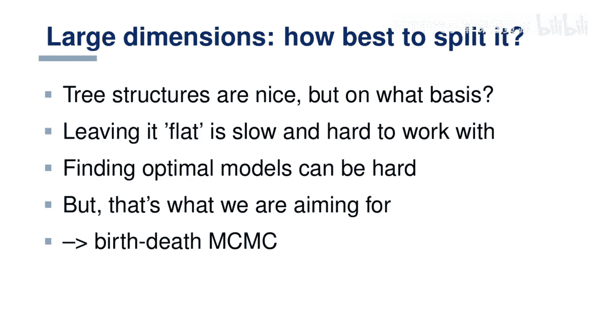
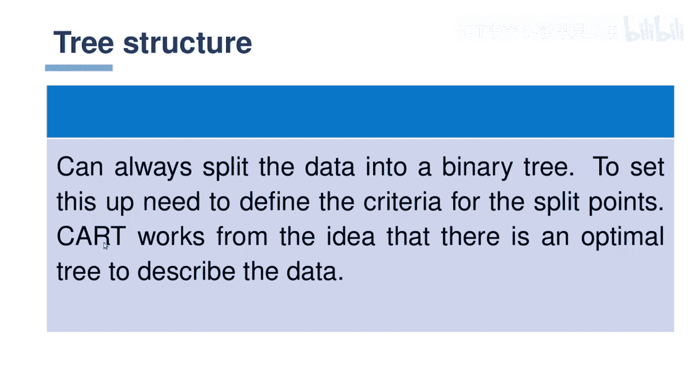
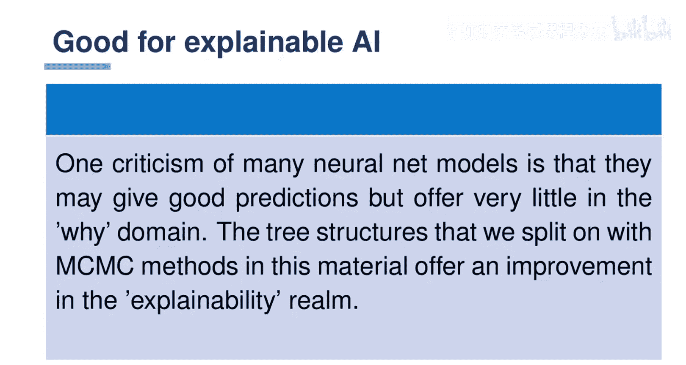
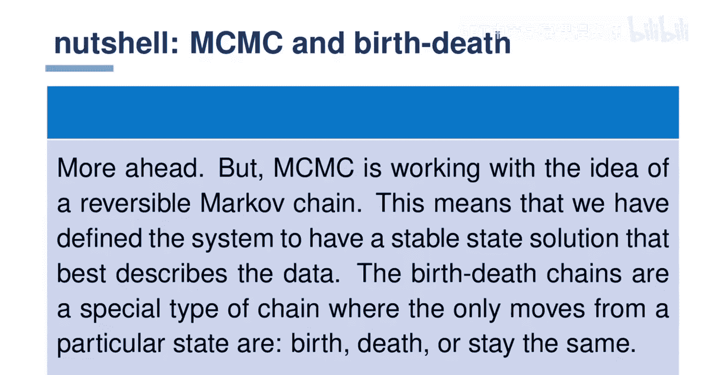
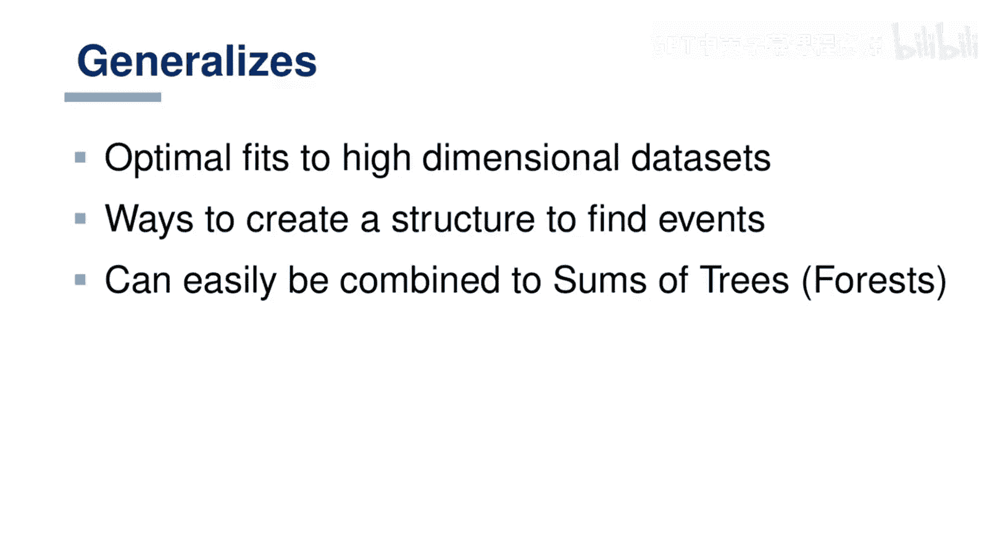

# 数据科学：时间中的决策｜5：基于MCMC的优化可解释树搜索 🌳

在本节课中，我们将要学习如何为高维数据集寻找最优的CART（分类与回归树）。我们将探讨一种基于MCMC（马尔可夫链蒙特卡洛）的“生灭链”方法，该方法能帮助我们以可解释的方式，在众多可能的树结构中搜索出最能描述数据的那一个。

---

## 从树结构到最优假设

上一节我们讨论了树结构的基本概念。本节中我们来看看如何让这种结构变得“有意义”。

在原则上，将数据分割成二叉树结构是相对容易的。你只需要一个规则，在每个节点将数据一分为二，并持续这个过程，直到达到某个叶节点（例如满足一定数据量）。



```python
# 伪代码示例：简单的二叉树分割
def split_data(data):
    if len(data) < min_samples:  # 达到叶节点条件
        return LeafNode(data)
    else:
        # 选择一个特征和切分点（此处规则简单）
        feature, split_value = choose_split(data)
        left_data = data[data[:, feature] < split_value]
        right_data = data[data[:, feature] >= split_value]
        return Node(feature, split_value, split_data(left_data), split_data(right_data))
```

但困难的部分在于，如何以**真正有意义**的方式分割数据，使我们能理解数据背后的故事。这意味着需要一种虽然带有人为选择色彩，但依然合理的解析数据方式。这里的“人为选择”再次指向一个核心理念：数据存在多种可能的假设，我们试图找到**最能拟合数据的最佳假设**。

因此，这里的观点是：将数据分割成二叉树，本质上是一种检验哪种假设最符合数据的方式。我们需要定义一个分割标准。CART回归树基于这样一个思想：如果你想得到一个描述数据的最优假设，那么就存在一棵最优的树。



我认为这对于**可解释的人工智能（XAI）** 非常有益。神经网络模型常常能做出非常好的预测，有时甚至好到令人惊讶，但它们通常是一个“黑箱”，很难解释其决策原因。这也引发了人们对其鲁棒性和泛化能力的担忧。而CART树的一个优势在于，我们能够清晰地解释数据为何被如此分割。如果我们能找到一棵最优的树结构，我们就拥有了可以解释的东西。这些树对许多人来说，是深入理解数据的一条便捷途径。

---



## MCMC与生灭链：核心概念回顾

为了寻找最优树，我们将使用MCMC方法，特别是其中一种称为“生灭链”的特殊形式。在深入树搜索之前，我们先简要回顾一下这些核心概念。

**MCMC** 本质上是一种**可逆的马尔可夫链**。“马尔可夫”意味着链的下一个状态（n+1）只依赖于当前状态（n），而与所有过去的历史状态（n-1, n-2, …）无关。“可逆”则意味着我们无法区分链是向前运行还是向后运行。这种可逆性至关重要，因为它允许我们在MCMC环境中设置多个“行走者”，它们最终都会平稳地收敛到后验分布的一个清晰且一致的画面，从而为我们评估后验分布提供了一个定义良好的系统。

**生灭链** 是MCMC的一种特殊类型。在生灭链中，系统从一个特定状态出发，只能发生三种事件：**出生**（增加一个组件）、**死亡**（减少一个组件）或**保持不变**。你可以将其视为一种带有“自转移”的连续时间马尔可夫链，其事件发生的时间间隔服从指数分布。我们沿着连续时间查询状态，看它是向下转移（出生）、向上转移（死亡）还是保持不变。

---

## 应用于回归树的连续时间生灭MCMC

现在，我们将上述概念应用于回归树模型。本部分基于一篇论文，其核心是将生灭MCMC扩展到贝叶斯回归树模型，即在MCMC构建的后验分布表面上进行“行走”。



首先，将树视为一个整体结构。我们用大写 **T** 表示树，它由拓扑结构 **τ** 和一系列描述分割规则的参数对组成。假设数据是 **D** 维的，我们需要决定在哪个维度（特征）以及该维度的哪个值（切分点）上进行分割。

以下是该模型的数学描述：

我们有一个数据集 **X**，希望通过一个函数 **g** 以回归的方式拟合目标 **Y**。模型在 **D** 维数据上进行分割，形成一棵树。终端节点（叶节点）的集合记为 **θ_T**。任何真实数据系统都存在噪声，我们将其建模为零均值、方差为 **σ²** 的高斯分布 **ε**。

公式表示如下：
\[
Y = g(X; T, \theta_T) + \epsilon, \quad \epsilon \sim \mathcal{N}(0, \sigma^2)
\]

我们为树拓扑 **τ**、叶节点参数 **θ_T** 和方差 **σ²** 设置先验分布，通常假设它们彼此独立。给定树结构和方差，我们可以定义叶节点的分布。

算法的核心是定义**出生率**和**死亡率**。这些速率依赖于当前的树结构和叶节点参数。本质上，我们定义了一个等待时间过程（指数分布），来决定下一个事件是出生、死亡还是无变化。

---

## 生灭过程在树上的直观体现

想象从一棵简单的树开始（例如只有两个节点）。生灭过程如何作用其上呢？

以下是生灭事件在树结构上的操作：

*   **出生事件**：在某个现有节点 **η_i** 上，我们添加一个新的分割规则。这涉及到选择一个维度 **j** (1 ≤ j ≤ D) 和一个切分点 **c_k**。该节点会分裂成两个新的子节点（左和右）。记作 **出生在节点 η_i，变量 ν_j，切分点 c_k**，简记为 **B_{ijk}**。
*   **死亡事件**：移除一个现有的分割节点 **η_i**，将其两个子节点合并回该节点本身。记作 **死亡在节点 η_i**，简记为 **D_i**。
*   **保持不变**：树结构暂时不发生变化。

与在离散时间发生的可逆跳转MCMC不同，连续时间生灭链具有**驻留时间**（例如 W1, W2）。我们在任一特定状态（即一种树拓扑 **τ**）下花费的时间长度，本质上反映了我们**相信该拓扑是拟合数据的正确树结构的程度**。

因此，我们可以将给定数据下特定拓扑的概率，视为对这些树分布的一个估计。不同的拓扑 **τ** 对应不同的驻留时间，这告诉了我们哪些分割方案最有可能是该树的最优解。

---

## 算法流程概述

以下是连续时间生灭MCMC（CTMCMC）算法的主要步骤：

1.  **初始化**：从一棵初始树 **T**（可能只是一个根节点）开始。
2.  **循环迭代**：对于指定的持续时间或迭代次数 `N`：
    a. **评估可能操作**：遍历所有可能的节点 **i**、维度 **j** 和切分点 **k**，评估在这些位置进行“出生”操作的潜力。
    b. **计算速率**：根据前述公式，计算每个可能操作的出生率 **B_{ijk}** 和当前树中每个可死亡节点的死亡率 **D_i**。
    c. **确定等待时间与事件**：总事件速率是出生率与死亡率之和。等待时间服从指数分布。根据各事件的相对速率，随机选择下一个发生的事件（出生、死亡或无变化）。
    d. **更新状态**：执行选中的事件，更新树拓扑 **τ**、叶节点参数 **θ_T** 和方差 **σ²**。
3.  **寻求稳定**：持续运行算法，直到树结构分布达到稳定状态。在稳定后，驻留时间最长的树拓扑可以被认为是最优结构的良好候选。

出生率 **B_{ijk}** 和死亡率 **D_i** 的计算是算法的关键，它们确保了链的可逆性和收敛到正确的后验分布。这通常涉及计算接受率，其核心是比较新状态与旧状态的后验概率比，类似于Metropolis-Hastings算法中的步骤。

---

## 总结与联系

本节课中我们一起学习了如何利用**连续时间生灭MCMC链**来优化CART树搜索。

这种方法的核心优势在于：
*   **可解释性**：最终得到的树结构清晰地展示了数据是如何被分割的，每个决策都对应一个具体的特征和阈值。
*   **处理高维数据**：该方法能自然地推广到高维数据集。
*   **坚实的统计基础**：它植根于贝叶斯统计和MCMC理论，提供了概率框架下的最优搜索。
*   **可扩展性**：可以轻松组合多棵树形成“森林”，即随机森林，这是一种强大且主流的机器学习方法。

本质上，这种方法是1959年Chernoff等人提出的多重假设检验思想在现代计算框架下的一个优雅体现。我们面对一个数据集，存在多个候选假设（即不同的树结构），而生灭MCMC提供了一种连续、动态的方式来探索这些假设的空间，并让数据本身通过“驻留时间”告诉我们哪个假设最为可信。



通过将经典的统计思想与强大的计算工具相结合，我们获得了一种既强大又可解释的数据建模方法。